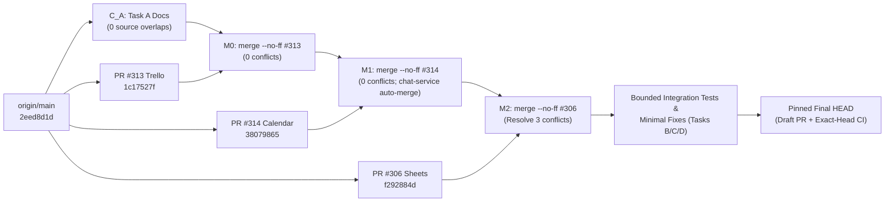
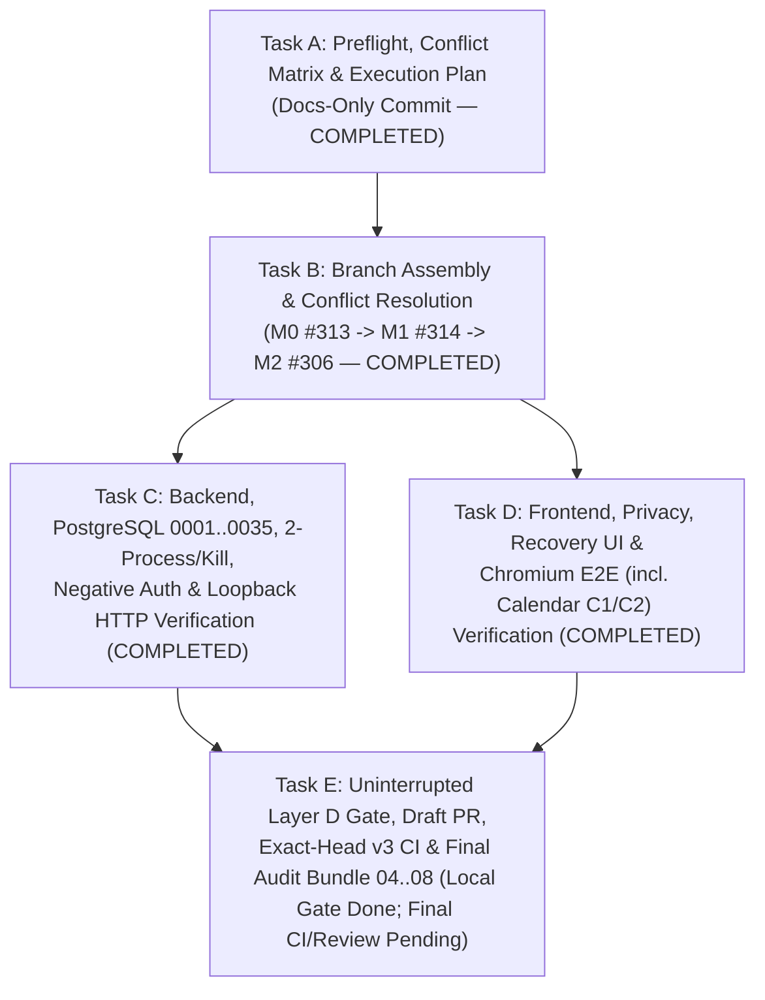

# 01 — ATI V3 Cross-Service Integration Gate V2: Preflight & Execution Plan

**Goal:** Assemble, verify, and audit a single combined Git tree integrating Google Sheets R2 (`PR #306`), Trello Combined (`PR #313`), and Google Calendar Combined (`PR #314`) onto `origin/main` (`2eed8d1d4309e833088d6f1d3fa774189049e283`) with full ancestry provenance, zero invariant regressions across scheduler/auth/receipts/leases/UI, real PostgreSQL + multi-process + Chromium E2E evidence, and exact-head CI verification — stopping at **Gate A (Technical Cross-Service Integration Gate)** in **Draft PR** state (`NO MERGE into main`, `NO DEPLOY`, `PRODUCTION ACTIVATION — HOLD`).

**Architecture:** Traceable three-merge `--no-ff` assembly (`Trello #313 -> Calendar #314 -> Sheets #306`) inside the dedicated isolated integration worktree, governed by pre-declared cross-service behavioral contracts (`03-SHARED-FILE-CONFLICT-AND-CONTRACT-MATRIX.md`) and verified across four progressive evidence layers (Layer A targeted unit/contract/static guards, Layer B disposable PostgreSQL 16 + loopback HTTP + 2-process OS scheduler/crash/fencing + negative auth, Layer C real Chromium Playwright UI/recovery/privacy/Calendar C1–C2, Layer D full `npm run check` + 25-group `npm run test:browser:v3` + exact-head GitHub Actions `v3 check` single job `v3`).

**Tech Stack:** TypeScript 5.8 (ESM NodeNext), Node.js >= 20, PostgreSQL 16 (`pg`), Express (`@wap/chat-api`), React 19 + Vite (`@wap/chat-web`), Vitest, Playwright Chromium (`scripts/test-v3-browser.mjs`), GitHub Actions (`.github/workflows/v3-check.yml`).

**Spec & Governance Authorities:**
- `AGENTS.md` (v3.1)
- `docs/superpowers/specs/2026-09-29-ai-workflow-platform-v3-design.md` (Normative v3 Design Spec, including §1.4 Multi-Service Acceptance Criteria)
- `docs/team-workflow.md` & `docs/handoff/REVIEW-CHECKLIST.md`
- Companion Matrix: `docs/audits/2026-11-10-cross-service-integration/03-SHARED-FILE-CONFLICT-AND-CONTRACT-MATRIX.md`

**Global Constraints:**
- **Execution Status (`2026-11-11`):** **Tasks A, B, C & D COMPLETED; Task E Local Verification & Draft PR `#315` Published (`WORKER REPORTED` on `4056fef20127d7da3c3139f34830035facbf5daf`); Final Docs-Head Exact-Head CI & Coordinator Acceptance `PENDING / NOT VERIFIED` at Commit Time** — Frozen tested code+test anchor `4056fef20127d7da3c3139f34830035facbf5daf` (full-tree `270b82ba509d0ef01069c6548e18eb53853fa556`); uninterrupted `npm run check` (`EXIT_CODE=0`) + all 25 browser scenario groups (`EXIT_CODE=0`) executed locally (`WORKER REPORTED`); Draft PR `#315` targeting `main` (`isDraft: true`, `NO MERGE`, Gate A & Gate B `NOT READY` at commit time pending final exact-head `v3 check` CI and Coordinator Codex acceptance; `PRODUCTION ACTIVATION — HOLD`). *(Historical Task A scope at commit `83cb3401`: docs-only preflight and execution plan.)*
- **Worktree Exclusivity:** Execute exclusively inside `C:\Users\VinhDat\orca\workspaces\ATI_Project\ati-v3-cross-service-integration-gate` (`VinhDat267/ati-v3-cross-service-integration-gate`). **Never** create nested worktrees inside this workspace; **never** touch dirty `main`, original remediation branches/worktrees, `docs/handoff/CURRENT-STATE.md`, or `docs/handoff/ROADMAP.md`.
- **No Silent Source Substitution:** Any movement of `origin/main` or source PR heads (`#306`, `#313`, `#314`) halts execution and requires explicit revalidation / coordinator confirmation. Constituent PRs (`#309`, `#310`, `#311`, `#307`, `#308`, `#312`) MUST NOT be integrated separately.
- **No Production / External Side Effects:** Loopback HTTP (`127.0.0.1`) only. Zero live Google Sheets, Google Calendar, Gmail, Trello, Slack, or Telegram writes/invitations; zero production flag or migration execution.

**Review Focus:**
1. Exactness of the 3 textual conflict resolutions (`schedule-service.ts`, `slack-adapter.ts`, `scripts/test-v3-browser.mjs`) and semantic contract alignments (`PrivacyPage.tsx`, `ScheduleRunRecovery.tsx`, `schedule-runner.ts`, `adapter-factory.ts`).
2. Preservation of `evaluations/generic-plumbing/static-guard.test.ts` service-literal invariants.
3. Sufficiency of Layer B (real PostgreSQL 16 fresh + `<=0032` upgrade, 3 simultaneously due digests, 2 OS processes, deterministic child process kill, credential revocation, negative auth `outbound === 0`, malformed receipts, append lease fencing) and Layer C (Chromium recovery, privacy, and Calendar `C1/C2` cross-midnight/DST/IANA/invitations/recurrence).

---

## 1. Preflight Verification Record (Task A — Completed `2026-11-10`)

### 1.1. Model, Effort & CodeGraph Status
| Check | Result | Evidence Source | Label |
| --- | --- | --- | --- |
| **Requested Model & Effort** | `gemini-4-carbon-high` (`Gemini 4 Carbon (High)`), effort `high`, **NO fallback** | Task A Orca dispatch specification | `INDEPENDENTLY VERIFIED` |
| **Effective Configured Model** | `Gemini 4 Carbon (High)` (`antigravity/gemini-4-carbon-high/high`, no fallback model configured) | Orca `worker-show` `launch.effective = antigravity/gemini-4-carbon-high/high` (verified by coordinator Codex); `C:\Users\VinhDat\.gemini\antigravity-cli\settings.json` line 3 (`"model": "Gemini 4 Carbon (High)"`); session transcript `step_index: 0` (`<USER_SETTINGS_CHANGE>` -> `Model Selection`: `Gemini 4 Carbon (High)`) | `INDEPENDENTLY VERIFIED` |
| **Effective Configured Effort** | `1.00` (`high` / maximum reasoning effort) | Orca `worker-show` `launch.effective = antigravity/gemini-4-carbon-high/high` + runtime system instruction header (`EFFORT LEVEL: 1.00`) | `INDEPENDENTLY VERIFIED` |
| **Served Model Wire Header** | Local transcript `PLANNER_RESPONSE` entries record `source: "MODEL"`, token usage, and `thinking` traces, but do not expose raw upstream HTTP response `modelVersion` wire headers | Local session transcript (`transcript.jsonl`); upstream wire header not exposed locally | `NOT VERIFIED` |
| **CodeGraph Availability** | `.codegraph/` absent at worktree root (`Test-Path .codegraph` -> `False`) | PowerShell preflight check (`exit 0`); bounded read-only `git diff` / `git merge-tree` / `read_file` fallback used | `INDEPENDENTLY VERIFIED` |
| **Isolated Worktree & Branch** | `C:\Users\VinhDat\orca\workspaces\ATI_Project\ati-v3-cross-service-integration-gate` on `VinhDat267/ati-v3-cross-service-integration-gate` | `git status --short --branch` & `git rev-parse HEAD` (`2eed8d1d4309e833088d6f1d3fa774189049e283`, tree `eb2ee6f1183eb0cdc51adfa238e3043a0b4ed4b4`) | `INDEPENDENTLY VERIFIED` |

### 1.2. Pinned Baseline & Candidate Source Heads (`2026-11-10` Revalidation)

| Target | Branch / PR | Status | Exact Commit SHA | Exact Tree SHA | Merge-Base vs `origin/main` | GitHub Actions `v3 check` Run |
| --- | --- | --- | --- | --- | --- | --- |
| **Baseline** | `origin/main` | Base | `2eed8d1d4309e833088d6f1d3fa774189049e283` | `eb2ee6f1183eb0cdc51adfa238e3043a0b4ed4b4` | `2eed8d1d4309e833088d6f1d3fa774189049e283` | Baseline `main` |
| **Trello Combined** | PR `#313` (`VinhDat267/trello-v3-combined-gate`) | `OPEN` (`isDraft: true`) | `1c17527f16715b2c6655c170cdb448673a84dd1b` | `f53ed6b2b7cfdeae0f27d18e1fc7831cc69f7d76` | `2eed8d1d4309e833088d6f1d3fa774189049e283` | [`42809170181`](https://github.com/VinhDat267/ATI_Project/actions/runs/42809170181) (`completed` / `success`) |
| **Calendar Combined** | PR `#314` (`VinhDat267/calendar-v3-combined-gate`) | `OPEN` (`isDraft: true`) | `3807986542dbe3470b8f3f1cd42413cb7bd460dd` | `8805043497bfffe05d9620c520d098abfb00a60c` | `2eed8d1d4309e833088d6f1d3fa774189049e283` | [`42835422010`](https://github.com/VinhDat267/ATI_Project/actions/runs/42835422010) (`completed` / `success`) |
| **Sheets R2** | PR `#306` (`VinhDat267/sheets-gas-recovery-guard-argon`) | `OPEN` (`isDraft: true`) | `f292884d0ae965ffb9841e7063b8843cd266b17e` | `a9ca98c257a99da8b8d1fde266091f2a3897719b` | `2eed8d1d4309e833088d6f1d3fa774189049e283` | [`42811254062`](https://github.com/VinhDat267/ATI_Project/actions/runs/42811254062) (`completed` / `success`) |

---

## 2. Merge Strategy, Candidate Parents & Delivery Topology Evaluation

### 2.1. Selected Assembly Order (`Trello #313 -> Calendar #314 -> Sheets #306`)
Starting from Task A's docs-only commit (`C_A` on `VinhDat267/ati-v3-cross-service-integration-gate`, which touches only the 4 Task A markdown files and has **0** overlap with the 106 changed source files):



**Why this order is optimal (`INDEPENDENTLY VERIFIED` via `git merge-tree --write-tree`):**
1. **`M0` + `M1` (`Trello #313` + `Calendar #314`) exits `0`** (`b44810211e75698da038a84acbe4ff66aca3b969` on raw source trees) with zero SQL schema changes beyond `0034` and only 1 orthogonal overlap (`apps/chat-api/src/services/chat-service.ts`), allowing an immediate `npm run typecheck:v3` sanity gate before touching any conflict.
2. **`M2` (`+ Sheets #306`)** isolates the sole new SQL migration (`db/v3/0035_sheets_gas_r2_remediation.sql`), `PostgresSheetsAppendLeaseStore`, and all **3** textual conflicts (`schedule-service.ts`, `slack-adapter.ts`, `scripts/test-v3-browser.mjs`) into one explicit merge commit.
3. Every source head remains an ancestor of `HEAD` (`git merge-base --is-ancestor <source_sha> HEAD` returns `0` for `1c17527f`, `38079865`, and `f292884d`), providing cryptographic provenance without cherry-picking or squashing away remediation history.

### 2.2. Combined Integration Draft PR vs. Sequential Merges into `main`
| Criterion | Option 1: Single Combined Draft Integration PR (Selected) | Option 2: Sequential Merges (`#313` -> `#314` -> `#306`) into `main` |
| --- | --- | --- |
| **Intermediate `main` safety** | `main` never observes an intermediate commit where `SlackAdapter.sendMessage` lacks strict receipt `channel` + `'null'`/`'undefined'` + `requestSent: true` intersection or where `schedule-service.ts` lacks `GAS-08` snapshot protection. | Merging `#313` before `#306` temporarily omits `GAS-08` snapshot protection and falls back to `args.channel` on missing/non-string `res.channel` on `main`; merging `#306` before `#313` temporarily omits `'undefined'`/`'null'` sentinel checks, `channel` validation, and `details: { requestSent: true }`. |
| **Source CI provenance** | Original Draft PRs `#306`, `#313`, `#314` remain untouched at their CI-verified SHAs (`42811254062`, `42809170181`, `42835422010`), while the new combined Draft PR gets its own exact-head `v3 check` run. | Rebasing `#314` and `#306` onto updated `main` invalidates their pinned SHAs and requires 2 additional full CI/browser cycles during merge execution. |
| **Ancestry & rollback** | Preserves all 3 source commits via `--no-ff` parents; single merge point at Gate B if Owner later approves. | Three separate `main` advancements; partial rollback if `#306` fails post-merge is higher-blast-radius. |
| **Tree-equivalence rule** | Pinned final `HEAD` and full-tree `HEAD^{tree}` SHA recorded in `02` and `06`. | Exact tree equivalence holds **only if** full-tree SHAs match identically (`git rev-parse <combined_ref>^{tree} === git rev-parse <sequential_final_ref>^{tree}`, i.e. `git diff <combined_tree_sha> <sequential_final_tree_sha>` is `0` bytes with **zero path exclusions**). If docs-only audit bundle files differ, full trees are **not** equivalent; any docs-only path exclusions must be disclosed separately and **never** reported as exact tree equivalence. |

---

## 3. Semantic Dependency Map & Must-Preserve Capabilities

All remediated capabilities from the three source gates MUST remain intact simultaneously (detailed conflict/contract rules in `03-SHARED-FILE-CONFLICT-AND-CONTRACT-MATRIX.md` §2 & §4):

1. **Google Sheets (`PR #306` — `GAS-01..12`):**
   - `GAS-01`: Reject non-string/empty Slack `ts` (`ts: {}`, `ts: 12345`), missing Telegram numeric `messageId`, and empty Gmail `messageId` as `SHEETS_DELIVERY_UNKNOWN` (`needs_attention`).
   - `GAS-02` & `GAS-06`: Explicit `includeAiSummary` opt-out (`checkbox-sheets-include-ai-summary`), deterministic metrics-only mode, personal Gmail recipient binding, and `/privacy#mysheets` `drive.file` + AI opt-out disclosure (`ENABLE_MYSHEETS_DRIVE_WRITE_TOOLS=false`).
   - `GAS-04`: Post-`claimSheetsDigestDelivery` `digest_sent` / `delivery_unknown` commits survive concurrent `pause`, `cancel`, version bump, or runner shutdown.
   - `GAS-05`, `GAS-07`, `GAS-11`: Vietnamese explicit A1 range extraction/canonicalization, fail-closed oversized/unbounded range rejection, locale-aware numeric/currency/date parsing, and deterministic row/metric accuracy.
   - `GAS-08` & `GAS-09`: `0035_sheets_gas_r2_remediation.sql` immutable `dispatched_config` / `dispatched_config_hash` on `mark_sent` (`MISSING_DISPATCH_SNAPSHOT` fail-closed) and `SCHEDULE_PAUSED` block on `retry_new_run` (backend + `ScheduleSection` UI).
   - `GAS-10`: `PostgresSheetsAppendLeaseStore` (`sheets_append_leases`) monotonic `fencing_token`, stale-owner pre-dispatch fence (`0` POSTs), background heartbeat, durable `unknown_outcome` across `release()` and expiry, provider-verified reconciliation with generation CAS, and fail-closed rejection of manual override flags.
   - `GAS-12` + CI `42801382748` fix: `sheets_digest_v2_recovery` browser scenario routing and render-phase `trackedRunIdentity` consent-reset in `ScheduleRunRecovery.tsx`.

2. **Trello & Telegram (`PR #313` — `TRELLO-AUDIT-01..19`, `TRELLO-REM-C`):**
   - `TRELLO-AUDIT-01/02/05`: `TRELLO_RESOURCE_ID_PATTERN` (`^[A-Za-z0-9_-]{1,64}$`) across `@wap/tool-schemas` and `TrelloBase` (`0` HTTP requests on path traversal); minimal `/1/cards/:id?fields=id,idBoard` and `/1/lists/:id?fields=id,idBoard` `allowedBoards` prechecks before reading checklists or list cards; board membership verification before card writes.
   - `TRELLO-AUDIT-03`: Compound write (`trello.add_checklist`) partial failure sets `partialWrite: true` -> `StepRunner` `'unknown'` -> `ExecutionService` `'reconciliation_required'` (blocks `retryStep` duplicate checklist creation).
   - `TRELLO-AUDIT-07/08/10/15`: Trusted org `workspaceId` fail-closed in `AdapterFactory` and `evaluateTrelloDigestCandidate`; pre-send live credential/member re-check (`0` sends on revocation); `SlackAdapter` malformed receipt (`'undefined'`, missing `channel`, `requestSent: true`); `startRun` `delivery_started_at` re-entry block + `reconcileScheduleRuns` per-kind `*_DELIVERY_UNKNOWN`; `mark_sent` (`buildConfirmedTrelloDigestDelivery`) and `retry_new_run` (`CONFIG_CHANGED_SINCE_RUN`, `SCHEDULE_PAUSED`, `REAUTHORIZATION_REQUIRED`) for `trello_digest` & `telegram_digest`.
   - `TRELLO-REM-C`: Duplicate board-name ambiguity block, explicit missing board rejection, horizon-only `dueSoonHours` parser, `ScheduleRunRecovery` `TRELLO_DELIVERY_UNKNOWN` UI, and `scripts/test-v3-browser.mjs` ESM `OMITTED_SCENARIO_ROUTING` (`trello_telegram_mocked_ui`, `trello_telegram_sandbox_e2e`).

3. **Google Calendar (`PR #314` — `CALENDAR-REM-A/B/C`):**
   - `CALENDAR-REM-A`: `CalendarDigestRunner` multi-calendar pagination/coverage verification, deterministic event sorting/formatting, and live credential/allowlist enforcement.
   - `CALENDAR-REM-B`: Shared `packages/tool-adapters/src/calendar/time-utils.ts` & `IANA_TIMEZONE_PATTERN`; `mycalendar.list_events` / `find_free_slots` `coverage` metadata (`complete`, `returned`, `totalAvailable`); free-slot busy-interval clamping across DST/IANA zones; `ChatService` full-day candidate-window conflict precheck across all `allowedCalendars` with `hasTrustworthyCompleteCoverage` (suppressing false `"Không phát hiện trùng lịch"` when incomplete); recurring event `timeZone` propagation (`fake-google-gmail.mjs` HTTP `400` guard).
   - `CALENDAR-REM-C` (`C1/C2`, `07`, `09`): `PlanMoment.tsx` & `PreviewContents.tsx` cross-midnight / multi-day / explicit IANA `timeZone` range rendering without dropping end date/time, explicit `sendInvites` pill/warning truthiness, `/privacy#mycalendar` honest scope & token revocation copy, and `workspace-isolation.test.ts` `drainExecutionService()` anti-`40P01` deadlock guard.

---

## 4. Task DAG, Exclusive Ownership & Step-by-Step Implementation Plan



> **Workspace & Parallelism Rule:** Do **not** create nested `git worktree` directories inside `ati-v3-cross-service-integration-gate`. Tasks C and D have disjoint file ownership (`packages/**` + `apps/chat-api/**` + `db/v3/**` vs. `apps/chat-web/**` + `scripts/test-v3-browser.mjs`), **however concurrent workers sharing a single worktree are strictly prohibited**:
> - **Parallel execution:** If Task C and Task D run concurrently via parallel workers, **each worker MUST operate in its own separate isolated `git worktree`** (branched from Task B's pinned commit, outside any existing worktree directory) and reconcile via explicit commits/merges afterward.
> - **Sequential execution:** Same-worktree execution inside `ati-v3-cross-service-integration-gate` is permitted **only** via strictly sequential ownership handoff (only one active writer at a time, clean working tree between phases, explicit `git add <files>`, never `git add .`).

---

### Task A: Preflight, Conflict Matrix & Execution Plan (Current Task — Completed)
- **Exclusive Owned Files:**
  - `docs/audits/2026-11-10-cross-service-integration/01-INTEGRATION-EXECUTION-PLAN.md`
  - `docs/audits/2026-11-10-cross-service-integration/03-SHARED-FILE-CONFLICT-AND-CONTRACT-MATRIX.md`
  - `docs/handoff/tasks/XSVC-INTEGRATION-V2.md`
  - `docs/handoff/log/2026-11-10-xsvc-integration-v2-preflight-plan.md`
- **Deliverable Gate:** Clean `git status` except the 4 new docs, single focused Conventional Commit on `VinhDat267/ati-v3-cross-service-integration-gate`, zero source edits or merges.

---

### Task B: Combined Branch Assembly, Conflict Resolution & Ancestry Proof
- **Exclusive Owned Files:**
  - Merge resolution of the 3 conflicted files:
    - `apps/chat-api/src/services/schedules/schedule-service.ts`
    - `packages/tool-adapters/src/slack/slack-adapter.ts`
    - `scripts/test-v3-browser.mjs`
  - Semantic disclosure alignment in `apps/chat-web/src/pages/Privacy/PrivacyPage.tsx` (top Google overview paragraph)
  - Audit doc: `docs/audits/2026-11-10-cross-service-integration/02-SOURCE-ANCESTRY-AND-MERGE-EVIDENCE.md`
  - Status updates in `docs/audits/2026-11-10-cross-service-integration/03-SHARED-FILE-CONFLICT-AND-CONTRACT-MATRIX.md`
- **Step-by-Step Execution:**
  - [x] **Step B.1 — Revalidate source refs before merge:**
    ```powershell
    git fetch origin --prune
    git rev-parse origin/main
    gh pr view 313 --json state,isDraft,headRefOid
    gh pr view 314 --json state,isDraft,headRefOid
    gh pr view 306 --json state,isDraft,headRefOid
    ```
    *Expected:* Exact match with Table 1.2 SHAs (`2eed8d1d...`, `1c17527f...`, `38079865...`, `f292884d...`) and `OPEN` + `isDraft: true`. Stop immediately on any mismatch.
  - [x] **Step B.2 — Merge Trello Combined (`PR #313`) via `--no-ff` (`M0`):**
    ```powershell
    git merge --no-ff -m "chore(integration): merge trello combined gate PR #313 (1c17527f)" 1c17527f16715b2c6655c170cdb448673a84dd1b
    ```
    *Expected:* Exit `0`, zero conflicts.
  - [x] **Step B.3 — Merge Calendar Combined (`PR #314`) via `--no-ff` (`M1`) & run intermediate typecheck:**
    ```powershell
    git merge --no-ff -m "chore(integration): merge calendar combined gate PR #314 (38079865)" 3807986542dbe3470b8f3f1cd42413cb7bd460dd
    npm run typecheck:v3
    ```
    *Expected:* Merge exits `0` (clean auto-merge of `apps/chat-api/src/services/chat-service.ts`); `npm run typecheck:v3` exits `0`.
  - [x] **Step B.4 — Start `--no-ff --no-commit` merge of Sheets R2 (`PR #306`) (`M2`) and resolve the 3 expected textual conflicts:**
    ```powershell
    git merge --no-ff --no-commit f292884d0ae965ffb9841e7063b8843cd266b17e
    git diff --name-only --diff-filter=U
    ```
    *Expected:* Exit `1` with exactly the 3 conflicted files (`apps/chat-api/src/services/schedules/schedule-service.ts`, `packages/tool-adapters/src/slack/slack-adapter.ts`, `scripts/test-v3-browser.mjs`). Apply the exact combined resolutions specified in `03-SHARED-FILE-CONFLICT-AND-CONTRACT-MATRIX.md` §4 Rows 1–3, stage the 3 resolved files (`git add <3 files>`), and commit `M2`:
    ```powershell
    git commit -m "chore(integration): merge sheets r2 gate PR #306 (f292884d) and resolve shared contracts"
    ```
  - [x] **Step B.5 — Align `PrivacyPage.tsx` top Google overview paragraph (if not folded into `M2`, commit atomically):**
    Ensure the introductory paragraph above `#mycalendar` and `#mysheets` accurately covers both personal Google Sheets (`drive.file`, `ENABLE_MYSHEETS_DRIVE_WRITE_TOOLS=false`) and personal Google Calendar (`calendar.readonly`, `calendar.events` per `#mycalendar` section) without contradicting either region.
  - [x] **Step B.6 — Verify ancestry, web build, typecheck, static architecture guards, and focused contract suites (Layer A Smoke):**
    ```powershell
    git merge-base --is-ancestor 1c17527f16715b2c6655c170cdb448673a84dd1b HEAD
    git merge-base --is-ancestor 3807986542dbe3470b8f3f1cd42413cb7bd460dd HEAD
    git merge-base --is-ancestor f292884d0ae965ffb9841e7063b8843cd266b17e HEAD
    npm run build:v3
    npm run typecheck:v3
    npx vitest run evaluations/generic-plumbing/static-guard.test.ts
    npx vitest run apps/chat-web/tests/browser-scenario-selection.test.ts
    ```
    *Note:* Only `@wap/chat-web` defines a workspace `"build"` script (`npm run build:v3` -> `npm run build -w @wap/chat-web`); `@wap/tool-schemas`, `@wap/tool-adapters`, `@wap/planner`, `@wap/executor`, and `@wap/chat-api` export `./src/index.ts` directly.
    *Expected:* All commands exit `0`; `scenarios.length === 25`; zero disallowed service literals in `adapter-factory.ts` or `schedule-service.ts`. Record full `git log --graph`, merge parents, and anchored pre-docs commit/tree SHAs in `02-SOURCE-ANCESTRY-AND-MERGE-EVIDENCE.md`.

---

### Task C: Backend, Disposable PostgreSQL Migrations, Concurrency, Crash/Kill & Negative Auth Verification
- **Exclusive Owned Files:**
  - New combined cross-service integration test suite: `apps/chat-api/tests/services/schedules/cross-service-combined-gate.test.ts`
  - Optional helper extension if needed for deterministic child-process crash/kill probe: `apps/chat-api/tests/helpers/cross-service-scheduler-worker.ts` (modeled on existing `apps/chat-api/tests/helpers/two-process-digest-worker.ts`)
  - Minimal backend integration bugfix **only** if a combined RED test exposes a genuine cross-PR defect (strictly TDD RED -> GREEN -> Refactor; zero new features or generic retries).
- **Required Verification & Test Matrix (Layers A & B Backend):**
  - [x] **Step C.1 — Layer A Targeted Package & Contract Suites:**
    ```powershell
    npm test --workspace=@wap/tool-schemas
    npm test --workspace=@wap/tool-adapters
    npm test --workspace=@wap/planner
    npm test --workspace=@wap/executor
    npm run test:eval:v3
    ```
    Specifically verify:
    - `packages/tool-schemas/tests/sheets-digest-v2-types.test.ts`, `trello-resource-id.test.ts`, `mycalendar-schemas.test.ts`
    - `packages/tool-adapters/tests/slack-adapter.test.ts`, `trello-audit-remediation.test.ts`, `sheets-adapter.test.ts`, `sheets/personal-sheets-adapter.test.ts`, `calendar-adapter.test.ts`, `calendar/personal-calendar-adapter.test.ts`, `calendar/calendar-rem-b.test.ts`, `calendar/calendar-rem-b-review.test.ts`
    - `packages/planner/tests/read-answers.test.ts`, `schedules.test.ts` (SHA-256 prompt baseline check)
    - `evaluations/generic-plumbing/static-guard.test.ts` and `evaluations/eval.test.ts` (via `npm run test:eval:v3` -> `vitest run evaluations`)
  - [x] **Step C.2 — Disposable PostgreSQL 16 Fresh + Prior-Schema Upgrade Migration Verification:**
    Start a clean disposable PostgreSQL 16 instance (e.g. Docker container on a dedicated owned loopback port with `ALLOW_ISOLATED_TEST_PORT=1`, never loading live `.env` or touching unrelated existing DBs) and verify:
    1. **Fresh apply (`0001_v3_core.sql` .. `0035_sheets_gas_r2_remediation.sql`):** run `node db/v3/migrate.mjs` (with explicit `DATABASE_URL`) twice consecutively to prove clean creation and idempotent re-run (`exit 0`).
    2. **Upgrade path (`0001..0032` -> `0033_sheets_digest_v2_remediation.sql` -> `0034_github_workspace_scoped_team_scope.sql` -> `0035_sheets_gas_r2_remediation.sql`):** seed pre-`0033` `users`, `workspaces`, `conversations`, `schedules` (`sheets_digest`, `trello_digest`, `calendar_digest`), and `schedule_runs`, then apply `0033`, `0034`, `0035` sequentially and re-apply `0035` to verify zero row corruption, intact `sheets_append_leases` constraints, and `trg_schedule_runs_capture_dispatched_config` trigger behavior.
  - [x] **Step C.3 — Existing Source Backend Integration Suites on Real PostgreSQL:**
    ```powershell
    npx vitest run apps/chat-api/tests/services/sheets-gas-r2-remediation.test.ts `
      apps/chat-api/tests/services/sheets-digest-concurrency.test.ts `
      apps/chat-api/tests/services/sheets-digest-candidate-v2.test.ts `
      apps/chat-api/tests/services/sheets-digest.test.ts `
      apps/chat-api/tests/services/schedules/trello-telegram-delivery-invariants.test.ts `
      apps/chat-api/tests/services/schedules/trello-digest-accuracy-coverage.test.ts `
      apps/chat-api/tests/services/schedules/telegram-digest-cancellation.test.ts `
      apps/chat-api/tests/services/trello-digest.test.ts `
      apps/chat-api/tests/services/calendar-digest-runner.test.ts `
      apps/chat-api/tests/services/calendar-rem-a-digest-accuracy.test.ts `
      apps/chat-api/tests/services/calendar-rem-b-precheck.test.ts `
      apps/chat-api/tests/services/calendar-rem-b-review-precheck.test.ts `
      apps/chat-api/tests/services/calendar-conflict-planning.test.ts `
      apps/chat-api/tests/services/adapter-factory.test.ts `
      apps/chat-api/tests/routes/workspace-isolation.test.ts
    ```
  - [x] **Step C.4 — Author & Execute Combined Cross-Service Runtime Suite (`apps/chat-api/tests/services/schedules/cross-service-combined-gate.test.ts`, Loopback `127.0.0.1` Only):**
    Must prove on real PostgreSQL + real `node:http` loopback servers:
    1. **Three simultaneously due digests (`sheets_digest` + `trello_digest` + `calendar_digest`):** all three claim, read loopback providers, deliver to loopback Slack/Telegram/Gmail, and commit `digest_sent` with valid receipts and zero cross-schedule interference.
    2. **Two independent OS scheduler processes:** spawn two child Node processes (`child_process.spawn`) running `ScheduleRunner` against the same PostgreSQL schema with all three due digests; assert total outbound deliveries per digest === `1` (single-winner claim across OS processes).
    3. **Pause / cancel near dispatch:** pause/cancel each schedule while its outbound HTTP delivery is in flight (`delivery_started_at IS NOT NULL`); assert confirmed receipts commit `'digest_sent'` and aborted deliveries commit `'needs_attention'` (`*_DELIVERY_UNKNOWN`), **never** `'discarded'`.
    4. **Deterministic OS process-kill & restart reconciliation (closing both scheduler and Sheets OS-kill gaps locally):** spawn child worker process, wait on loopback HTTP barrier until (a) a digest run has durably committed `delivery_started_at` and (b) a `PostgresSheetsAppendLeaseStore` append worker has durably entered `status = 'dispatched'`, then terminate the child process via `child.kill('SIGKILL')`, wait for `exit`, run `reconcileScheduleRuns` + `tick()` in the surviving process, and assert:
       - Killed digest run transitions to `'needs_attention'` with service-specific `*_DELIVERY_UNKNOWN`, `outbound === 1` (zero automatic replay on restart), and `replanRun` throws `RUN_NOT_REPLANNABLE`.
       - Expired `dispatched` append lease transitions to durable `'unknown_outcome'` (`SHEETS_APPEND_UNKNOWN_OUTCOME_UNRECONCILED`, `0` duplicate POSTs from second worker until provider verification succeeds; manual override options rejected fail-closed).
    5. **Credential & workspace membership revocation before dispatch / mid-read:** revoke `service_credentials.status = 'revoked'` or `workspace_members.status = 'removed'` before send across Sheets, Trello, and Calendar; assert `outbound === 0`, run `'blocked'`, schedule `'paused'`.
    6. **Cross-service fault isolation:** in a single scheduler batch, inject `AbortSignal.timeout` on Sheets loopback, malformed Slack `{ ok: true, ts: 'undefined' }` on Trello loopback, and `coverage: { complete: false }` partial read on Calendar loopback; verify each run lands in its exact expected state without poisoning healthy runs.
    7. **Combined Negative Authorization Matrix (`outbound === 0`):** exercise `ExecutionService` / `AdapterFactory` / adapters with (i) cross-workspace `X-Workspace-Id`, (ii) blank org `workspaceId`, (iii) cross-user personal credential UUID swap, (iv) Trello `../../` path traversal IDs, (v) out-of-allowlist `spreadsheetId` (`sheets`/`mysheets`), (vi) out-of-allowlist `calendarId` (`mycalendar`), and (vii) revoked OAuth/bot credentials; assert loopback provider HTTP request count === `0` on every case.
    8. **Malformed receipts & stale lease owners:** assert `{ ok: true, ts: {} }`, `{ ok: true, ts: 12345 }`, `{ ok: true, ts: 'undefined' }`, `{ ok: true, ts: 'null' }`, and missing/malformed `channel` on `SlackAdapter.sendMessage` all throw `StepError` (`category: 'UNKNOWN'`, `retryable: false`, `details: { requestSent: true }` — resulting in `StepRunner` `'unknown'` and digest runner `*_DELIVERY_UNKNOWN`), and stale pre-dispatch append lease owners emit `0` HTTP POSTs.

---

### Task D: Frontend, Privacy, Recovery UI & Real Chromium E2E Verification (Isolated from Task C)
- **Exclusive Owned Files:**
  - `apps/chat-web/tests/browser/mycalendar.spec.ts` (focused Chromium extension closing PR `#314`'s `C1/C2` browser gap)
  - Optional combined UI unit regression test if needed: `apps/chat-web/tests/cross-service-recovery-privacy.test.tsx`
  - Minimal frontend integration fix **only** if a combined RED test reproduces an issue in `apps/chat-web/src/**` or `scripts/test-v3-browser.mjs`.
- **Required Verification & Test Matrix (Layers A & C Frontend):**
  - [x] **Step D.1 — Layer A Frontend Unit & Component Suites (`@wap/chat-web`):**
    ```powershell
    npm test --workspace=@wap/chat-web
    ```
    Specifically verify:
    - `apps/chat-web/tests/browser-scenario-selection.test.ts` (`25` scenarios)
    - `apps/chat-web/tests/schedule-sheets-digest-v2.test.tsx` (including `GAS-02`, `GAS-09`, and CI `42801382748` render-phase consent-reset test)
    - `apps/chat-web/tests/schedule-trello-digest-mode.test.tsx` (`TRELLO-AUDIT-10 / AUTO-06`)
    - `apps/chat-web/tests/mysheets-ui.test.tsx` & `apps/chat-web/tests/calendar-rem-c-09-oauth-disclosure.test.tsx` (combined `PrivacyPage.tsx`)
    - `apps/chat-web/tests/calendar-rem-c-07-invitation-preview.test.tsx` & `apps/chat-web/tests/calendar-rem-c-review-regressions.test.tsx` (`C1/C2`)
    - `apps/chat-web/tests/trello-connection.test.tsx`
  - [x] **Step D.2 — Add Focused Chromium E2E Coverage for Calendar `C1/C2`, Invitations & Recurring Timezone (`apps/chat-web/tests/browser/mycalendar.spec.ts`):**
    Extend `apps/chat-web/tests/browser/mycalendar.spec.ts` (executed against real Vite + `@wap/chat-api` + `scripts/fake-google-gmail.mjs` in Chromium) to assert in a real browser DOM (not jsdom):
    1. **`C1/C2` Cross-Midnight / DST / Explicit IANA `timeZone` Approved Instant:** render and approve a `mycalendar.create_event` / `update_event` plan spanning local midnight / non-local IANA zone (e.g. `America/New_York` across DST boundary or late-night UTC crossing local midnight in `Asia/Ho_Chi_Minh`); assert both `PlanMoment` step card and `PreviewModal` display the exact start and end dates/times + IANA zone without collapsing cross-midnight end date, and assert the outbound `POST /calendars/.../events` body captured by `fake-google-gmail.mjs` matches the exact approved instant.
    2. **Invitations / `sendInvites` Truthiness:** verify an event with `attendees` + `sendInvites: true` displays the explicit external email invitation warning/pill in `PlanMoment` and `PreviewModal` and sends `sendUpdates=all` (or configured param) on approval, whereas `sendInvites: false` / omitted suppresses `"Gửi email mời họp"`.
    3. **Recurring Event `timeZone` Contract:** approve a recurring (`RRULE:...`) event in Chromium and assert `fake-google-gmail.mjs` receives matching non-empty `start.timeZone` and `end.timeZone` (`200 OK`, `stats.writes` incremented by `1`, zero `400` errors).
  - [x] **Step D.3 — Layer C Targeted Real Chromium Scenarios (`scripts/test-v3-browser.mjs`):**
    ```powershell
    $env:SCENARIO="sheets_digest_v2_recovery"; node scripts/test-v3-browser.mjs
    $env:SCENARIO="mysheets"; node scripts/test-v3-browser.mjs
    $env:SCENARIO="trello_telegram_mocked_ui"; node scripts/test-v3-browser.mjs
    $env:SCENARIO="trello_telegram_sandbox_e2e"; node scripts/test-v3-browser.mjs
    $env:SCENARIO="mycalendar"; node scripts/test-v3-browser.mjs
    $env:SCENARIO="calendar_slack"; node scripts/test-v3-browser.mjs
    $env:SCENARIO="sheets_slack"; node scripts/test-v3-browser.mjs
    $env:SCENARIO="three_service"; node scripts/test-v3-browser.mjs
    $env:SCENARIO="nine_service"; node scripts/test-v3-browser.mjs
    $env:SCENARIO="schedule"; node scripts/test-v3-browser.mjs
    $env:SCENARIO="default"; node scripts/test-v3-browser.mjs
    ```
    *Note:* `scripts/test-v3-browser.mjs` filters scenario groups via `process.env.SCENARIO` (not `BROWSER_SCENARIO`), and `FE-10` runs inside the `default` scenario group (`FE-02..FE-12`). Execute against an isolated disposable `DATABASE_URL` and provisioned `CHAT_ADMIN_*` without loading live `.env`.
    *Expected:* Every targeted Chromium scenario exits `0` with zero uncaught page errors or horizontal viewport overflow (`1440px` & `375px`).

---

### Task E: Full Layer D Gate, Draft PR, Exact-Head CI/Provenance & Final Audit Bundle (`04..08`)
- **Exclusive Owned Files:**
  - `docs/audits/2026-11-10-cross-service-integration/04-CROSS-SERVICE-INVARIANT-ACCEPTANCE.md`
  - `docs/audits/2026-11-10-cross-service-integration/05-REGRESSION-TEST-EVIDENCE.md`
  - `docs/audits/2026-11-10-cross-service-integration/06-CI-AND-PROVENANCE-VERIFICATION.md`
  - `docs/audits/2026-11-10-cross-service-integration/07-INHERITED-RISKS-AND-STAGING-GAPS.md`
  - `docs/audits/2026-11-10-cross-service-integration/08-FINAL-ATI-INTEGRATION-VERDICT.md`
  - Task card "Kết quả" completion in `docs/handoff/tasks/XSVC-INTEGRATION-V2.md` and final handoff log entry in `docs/handoff/log/`
- **Step-by-Step Execution:**
  - [x] **Step E.1 — Uninterrupted Local Layer D Gate (Against Isolated Disposable PostgreSQL, Without Loading Live `.env`):**
    ```powershell
    Remove-Item Env:SCENARIO -ErrorAction SilentlyContinue
    node db/v3/migrate.mjs
    npm run check
    node scripts/test-v3-browser.mjs
    ```
    *Exact Verified Script Definitions (`package.json`, workspace `package.json` files, and `.github/workflows/v3-check.yml`):*
    - Root `npm run check` executes verbatim:
      `npm run typecheck:v3 && npm run test:v3 && npm run test:eval:v3 && npm run build:v3 && node scripts/test-v3-web-build-security.mjs && npm run test:launcher:v3 && node --test scripts/v3-local-env.test.mjs scripts/fake-oidc.test.mjs scripts/google-oidc-fixture.test.mjs scripts/slack/inventory.test.mjs scripts/fake-slack-personal.test.mjs scripts/slack/contract-probe.test.mjs`
      (There are **no** `eval:security` or `check:plumbing` scripts in `package.json`.)
    - `npm run typecheck:v3` executes `tsc -p apps/chat-api/tsconfig.json --noEmit && tsc -p apps/chat-web/tsconfig.json --noEmit`.
    - `npm run test:v3` executes `node --env-file-if-exists=.env scripts/test-v3.mjs`, which spawns `npm test` across `@wap/tool-schemas` (`tsc --noEmit -p tsconfig.contracts.json && vitest run`), `@wap/tool-adapters` (`vitest run && npm run test:probe`), `@wap/planner` (`vitest run`), `@wap/executor` (`vitest run`), `@wap/chat-api` (`vitest run`), and `@wap/chat-web` (`vitest run`).
    - `npm run test:eval:v3` executes `vitest run evaluations` (including `evaluations/generic-plumbing/static-guard.test.ts` and `evaluations/eval.test.ts`).
    - `npm run build:v3` executes `npm run build -w @wap/chat-web` (`tsc -p tsconfig.json && vite build`).
    - `npm run test:launcher:v3` executes `node --test scripts/start-v3.test.mjs`.
    - `npm run test:browser:v3` executes `node --env-file-if-exists=.env scripts/test-v3-browser.mjs` across all **25** browser scenario groups sequentially (when a local `.env` exists in another environment, invoke `node scripts/test-v3-browser.mjs` directly with explicit isolated env vars so live `.env` credentials are never loaded).
  - [ ] **Step E.2 — Publish Draft Integration PR & Verify Exact-Head GitHub Actions `v3 check` (`Draft PR #315` opened; final docs-head CI verification `PENDING / NOT VERIFIED` at commit time, recorded externally in PR `#315` body and `worker_done` upon completion):**
    - Inspect `git status` and `git log --oneline origin/main..HEAD` (verify zero AI co-author / "Generated with" lines, zero unintended files).
    - Push `VinhDat267/ati-v3-cross-service-integration-gate` to `origin` and open a **Draft PR** (`gh pr create --draft --base main ...` — **NEVER** mark Ready for Review, **NEVER** merge into `main`).
    - Wait for `.github/workflows/v3-check.yml` (`name: v3 check`, which defines **one** job `v3` running `npm ci`, `npm run db:migrate:v3`, `npm run check`, `npm run admin:provision:v3`, `npx playwright install --with-deps chromium`, and `npm run test:browser:v3`) to complete on the exact final `HEAD` SHA (`gh run view <run_id> --json headSha,status,conclusion,jobs`). If docs-only audit evidence (`06`, `08`) is committed after code CI, re-run and pass `v3 check` on the **exact final commit SHA** so code + audit bundle share a single CI-verified `HEAD`.
  - [x] **Step E.3 — Independent Provenance & Evidence Bundle Finalization (`04..08`):**
    - Complete all 8 audit documents using strict evidence labels (`CI VERIFIED`, `INDEPENDENTLY VERIFIED`, `WORKER REPORTED`, `NOT VERIFIED`, `NOT RUN`).
    - Never claim universal "exactly-once" external delivery (provider HTTP lacks distributed 2PC across Slack/Telegram/Gmail/Sheets; claim bounded single-claim / pre-dispatch fencing / fail-closed unknown recovery only where proven).
    - Never accept CI green alone without Layer B + Layer C runtime proofs.

---

## 5. Planned 8-File Audit Evidence Bundle & Allowed Evidence Labels

Directory: `docs/audits/2026-11-10-cross-service-integration/`

| File | Owner Task | Required Contents |
| --- | :---: | --- |
| `01-INTEGRATION-EXECUTION-PLAN.md` | Task A | This preflight & execution plan, model/CodeGraph evidence, pinned SHAs, Task DAG, 4-layer test plan, risk register, gate rules. |
| `02-SOURCE-ANCESTRY-AND-MERGE-EVIDENCE.md` | Task B | Revalidated source SHAs, `git log --graph` parent proofs, `git merge-base --is-ancestor` exits, exact diffs of `M0`, `M1`, `M2`. |
| `03-SHARED-FILE-CONFLICT-AND-CONTRACT-MATRIX.md` | Task A -> B/E | Pre-resolution behavioral contracts, 106-file inventory, 10-file overlap matrix, `merge-tree` outputs, post-resolution verification status. |
| `04-CROSS-SERVICE-INVARIANT-ACCEPTANCE.md` | Task E | Invariant-by-invariant proof table across Scheduler, Auth/Scope, Receipts, Immutable Snapshots, Append Leases, `AdapterFactory` Guard, Privacy, Recovery UI, Calendar `C1/C2`. |
| `05-REGRESSION-TEST-EVIDENCE.md` | Task C/D/E | Exact commands, durations, exit codes, test counts, PostgreSQL `0001..0035` fresh/upgrade logs, 2-process + `SIGKILL` logs, negative-auth `outbound=0` logs, Chromium Playwright traces. |
| `06-CI-AND-PROVENANCE-VERIFICATION.md` | Task E | Final Draft PR link, pinned `HEAD` SHA & `HEAD^{tree}` SHA, GitHub Actions `v3 check` run ID/URL/job logs matching exact `HEAD`, tree-equivalence check. |
| `07-INHERITED-RISKS-AND-STAGING-GAPS.md` | Task E | Updated risk register carrying forward all unclosed live-provider, staging, distributed-refresh, operator-tooling, and product-adoption gaps. |
| `08-FINAL-ATI-INTEGRATION-VERDICT.md` | Task E | Gate A exact allowed verdict (`PASS — VERIFIED WITHIN TESTED SCOPE` / `CONDITIONAL — NON-BLOCKING GAPS` / `NOT READY — BLOCKING DEFECT OR MISSING CRITICAL EVIDENCE` / `FAIL — CONFIRMED REGRESSION`), Gate B (`MERGE READY FOR OWNER REVIEW` / `NOT READY`), Gate C (`PRODUCTION ACTIVATION — HOLD`). |

**Mandatory Evidence Label Vocabulary:**
- `INDEPENDENTLY VERIFIED` — Directly executed and verified from primary command/DB/browser output by the auditing/verifying agent.
- `CI VERIFIED` — Verified via GitHub Actions `v3 check` logs on an exact pinned commit SHA.
- `WORKER REPORTED` — Reported in a constituent PR log/card not yet independently re-executed on the combined tree.
- `NOT VERIFIED` — Code exists or static check ran, but runtime/wire behavior has not been proven.
- `NOT RUN` — Explicitly out of scope or requires live external credentials/staging infrastructure not executed in this gate.

---

## 6. Inherited Limitations & Cross-Service Risk Register (Preflight Baseline)

> **Severity Discipline:** Pre-assembly merge overlaps (`RISK-01`..`RISK-03`) are **`SHARED CONTRACT RISK`** — hypothetical regressions that *would* arise only if an unassembled merge conflict were resolved unsafely, **not** confirmed `P0` defects in any constituent PR and **not** reproduced regressions prior to assembly.

| ID | Origin | Severity / Classification | Evidence Label | Impact | Service | Owner | Planned Action | Code Gate (Gate A) | Owner Merge Review (Gate B) | Production Gate |
| --- | --- | :---: | --- | --- | --- | --- | --- | --- | --- | --- |
| **RISK-01** | Combined `#313` ∩ `#306` (`slack-adapter.ts`) | **High — Shared Contract Risk** (unassembled hypothetical; P1-impact receipt invariant) | `INDEPENDENTLY VERIFIED` (static diff); `NOT RUN` (combined runtime in Task A) | Unsafely taking `#313` alone falls back to `args.channel` on missing/non-string `res.channel` and omits `'null'` sentinel check; taking `#306` alone accepts `ts: 'undefined'`/`'null'`, skips `res.channel` validation, and omits `details: { requestSent: true }`. | Shared (`slack`, `sheets`, `trello`, `calendar`) | Task B / C | Enforce strict string + non-`'undefined'`/`'null'` `ts` & `channel` + `details: { requestSent: true }` in `M2`; prove via real loopback tests in Tasks B & C. | **MUST CLOSE** (`PASS — VERIFIED WITHIN TESTED SCOPE` requires proof) | Verify in `04`/`05` | Blocks if open |
| **RISK-02** | Combined `#313` ∩ `#306` (`schedule-service.ts`) | **High — Shared Contract Risk** (unassembled hypothetical; P1-impact recovery/snapshot invariant) | `INDEPENDENTLY VERIFIED` (static diff); `NOT RUN` (combined runtime in Task A) | Unsafely resolving `resolveRunDelivery` could drop `GAS-08`/`GAS-09` immutable `dispatched_config` & paused guard, drop `TRELLO-AUDIT-10` Trello/Telegram manual recovery, or trip `static-guard.test.ts` `'slack'` ban. | Shared (`schedules`, `sheets`, `trello`, `telegram`) | Task B / C | Apply exact per-kind `dispatched_config` + version-guarded fallback + active-status check with `'channelId' in dest`; verify on isolated PostgreSQL in Tasks B & C. | **MUST CLOSE** (`PASS — VERIFIED WITHIN TESTED SCOPE` requires proof) | Verify in `04`/`05` | Blocks if open |
| **RISK-03** | Combined `#313` ∩ `#306` (`test-v3-browser.mjs`) | **Medium-High — Shared Contract Risk** (unassembled hypothetical; P2-impact CI E2E coverage) | `INDEPENDENTLY VERIFIED` (static diff); `NOT RUN` (combined runtime in Task A) | Unsafely resolving `scripts/test-v3-browser.mjs` would omit `sheets_digest_v2_recovery` or `#313`'s ESM exports (`trello_telegram_mocked_ui`, `trello_telegram_sandbox_e2e`) in `npm run test:browser:v3` and CI job `v3`. | Shared (`chat-web` E2E) | Task B / D | Merge all **25** scenario groups into `OMITTED_SCENARIO_ROUTING` + `resolveActiveScenarios`; verify selector in Task B and full `test:browser:v3` in Task E. | **MUST CLOSE** (`PASS — VERIFIED WITHIN TESTED SCOPE` requires proof) | Verify in `05`/`06` | Blocks if open |
| **RISK-04** | PR `#314` (`CALENDAR-COMBINED` Risk #2: `C1/C2` browser gap) | **Medium (P2 — Inherited Test-Layer Gap)** | `WORKER REPORTED` (jsdom + loopback); `NOT RUN` (Chromium) | Cross-midnight/DST/IANA approved-instant rendering, `sendInvites` pill truthiness, and recurring `timeZone` write were verified in React component + loopback adapter tests in `#314`, not real Chromium. | Calendar (`mycalendar`, `chat-web`) | Task D | Add focused real Chromium assertions in `apps/chat-web/tests/browser/mycalendar.spec.ts` against `fake-google-gmail.mjs` and pass in Layers C & D. | **MUST CLOSE** for `PASS — VERIFIED WITHIN TESTED SCOPE` (else `CONDITIONAL — NON-BLOCKING GAPS`) | Verify in `04`/`05` | Blocks if open |
| **RISK-05** | PR `#306` (`REPORT.md` Residual #2: OS process-kill gap) | **Medium (P2 — Inherited Test-Layer Gap)** | `NOT RUN` (in `#306` via `SIGKILL`; simulated via SQL TTL expiry) | `#306` simulated worker crash via SQL `expires_at` backdating rather than killing a live child OS process holding a `dispatched` lease / `delivery_started_at` run. | Sheets & Scheduler | Task C | Execute deterministic child-process `SIGKILL` (`TerminateProcess` on Windows) mid-loopback-HTTP in `cross-service-combined-gate.test.ts` and verify `reconcileScheduleRuns` + `unknown_outcome` lease survival. | **TARGET CLOSE** in Task C (document if OS limits arise) | Review runtime proof | Required before prod |
| **RISK-06** | PR `#306` (`GAS-03` Live Staging Audit) | **P2** | `NOT RUN` | Pre-`0035` staging/prod `sheets_digest` row inventory (`SHEETS-DIGEST-V2-STAGING-RUNBOOK.md` §1) requires live staging DB credentials not available in local/CI sandbox. | Sheets (`db/v3/0035`) | Ops / Owner | Keep documented in `07`; execute `SHEETS-DIGEST-V2-STAGING-RUNBOOK.md` against staging DB prior to production cutover. | Documented non-blocker (`NOT RUN`) | Inform Owner | **BLOCKS PROD** (`PRODUCTION ACTIVATION — HOLD`) |
| **RISK-07** | PR `#306` (`GAS-10` Manual Append Lease Override Disabled) | **P2** | `CI VERIFIED` (`#306`) | Manual override of `sheets_append_leases.status = 'unknown_outcome'` is intentionally disabled fail-closed until an authenticated, authorized, durably audited operator recovery service exists (`>500`-row out-of-window unverified states require DB/spreadsheet inspection). | Sheets (`sheets`, `mysheets`) | Platform Eng / Ops | Preserve fail-closed rejection in Gate A (`0` unsafe overrides); track operator recovery tooling in `07`. | Fail-closed behavior **REQUIRED** | Owner acknowledges operational constraint | Operational runbook required before prod |
| **RISK-08** | PR `#313` (`R1`: Single-Process Trello OAuth Refresh Map) | **P2** | `WORKER REPORTED` (`#313`) | `TrelloTokenManager` (`apps/chat-api/src/services/trello/token-manager.ts`) deduplicates concurrent refreshes in-memory per process (`inFlightRefreshes` Map), without a cross-replica PostgreSQL advisory lock when Trello rotates single-use refresh tokens in multi-replica deployments. | Trello (`trello` OAuth) | Backend Eng | Document single-replica constraint / advisory-lock follow-up in `07`; do not invent new distributed token architecture inside this bounded integration gate. | Documented inherited limitation | Owner reviews deployment topology | Single-replica or DB lock required before multi-replica prod |
| **RISK-09** | PR `#313` (`TRELLO-AUDIT-19`) & PR `#314` (`CALENDAR-AUDIT-12`) & PR `#306` | **P2** | `NOT RUN` | Real external OAuth consent, live Google Sheets/Drive, live Google Calendar events/attendee invitations/revocation propagation, live Trello API, and live Slack/Telegram workspace delivery are prohibited in local/CI gates. | All (`sheets`, `trello`, `calendar`, `slack`, `telegram`, `gmail`) | QA / Owner Staging | Enforce loopback-only (`127.0.0.1`) in Gate A; carry controlled staging checklist forward in `07`. | Documented (`NOT RUN` by safety rule) | Inform Owner | **BLOCKS PROD** (`PRODUCTION ACTIVATION — HOLD`) |
| **RISK-10** | PR `#314` (`CALENDAR-AUDIT-10`, `11`, `FLOW-07`) | **P2** | `WORKER REPORTED` (`#314`) | Calendar digest Slack workspace credential pinning policy (`10`), non-Slack Calendar delivery receipt schema parity (`11`), and broader cross-service `FLOW-07` backlog remain open design/product items outside `#314`. | Calendar (`calendar_digest`) | Product / Arch | Preserve `#314`'s verified scope without out-of-scope redesign; record in `07` for post-Gate-B backlog. | Non-blocker if documented honestly | Owner policy review | Evaluate before enabling org Calendar digests in prod |
| **RISK-11** | Product Value, User Adoption & ROI | **Info / Gov** | `NOT VERIFIED` | Technical invariant verification does not prove end-user workflow comprehension, retention, or business ROI (§1.4 product scope vs. technical gate). | Platform-wide | Product / Owner | Keep explicitly separated in `08-FINAL-ATI-INTEGRATION-VERDICT.md`. | Out of technical Gate A scope | Separate product review | Separate rollout decision |

---

## 7. Stop Conditions, Escalation Rules & Three-Gate Governance

### 7.1. Immediate Stop / Escalation Conditions (`NEEDS OWNER DECISION`)
Halt affected work and escalate via `orca orchestration` (`NEEDS OWNER DECISION`) while continuing only safe, independent verification if:
1. `origin/main` (`2eed8d1d...`) or any pinned source PR head (`#306` `f292884d...`, `#313` `1c17527f...`, `#314` `38079865...`) moves, closes, or loses Draft/CI status.
2. Resolving a combined regression would require relaxing `evaluations/generic-plumbing/static-guard.test.ts`, weakening workspace/credential/allowlist isolation, adding automatic retry on `unknown` write/delivery outcomes, or introducing new database architecture beyond `0035_sheets_gas_r2_remediation.sql`.
3. Any test or script attempts non-loopback network egress to live Google, Trello, Slack, or Telegram endpoints, or touches another agent's worktree/branch.
4. Any blocking defect or confirmed cross-service invariant regression remains unfixed at Task E.

### 7.2. Three-Gate Separation & Owner Exact Allowed Verdicts
1. **Gate A — Technical Cross-Service Integration Gate (Target of Task E — Exact Four Allowed Verdicts):**
   - `PASS — VERIFIED WITHIN TESTED SCOPE`: All three pinned SHAs are verified ancestors of final `HEAD`; Layers A, B, C, and D pass on the combined tree with real disposable PostgreSQL `0001..0035` (fresh + upgrade), 2-process + crash/kill scheduler proof, `outbound === 0` negative auth proof, and real Chromium UI/recovery/privacy/Calendar `C1–C2` proof; zero blocking defects or confirmed regressions remain; GitHub Actions `v3 check` (single job `v3`) succeeds on the **exact final `HEAD` SHA** of the **Draft** integration PR; and all 8 audit documents (`01..08`) are complete and internally consistent.
   - `CONDITIONAL — NON-BLOCKING GAPS`: Core cross-service invariants, safety guards, and exact-head CI pass with zero confirmed regressions, while bounded non-blocking test-layer or operational gaps remain explicitly documented.
   - `NOT READY — BLOCKING DEFECT OR MISSING CRITICAL EVIDENCE`: Required runtime/DB/browser/CI evidence is incomplete or a blocking integration defect remains open.
   - `FAIL — CONFIRMED REGRESSION`: A reproduced cross-service safety, auth, receipt, recovery, lease, or data-integrity regression is confirmed on the combined tree.
2. **Gate B — Owner Merge Review (Exact Two Allowed Verdicts: `MERGE READY FOR OWNER REVIEW` / `NOT READY`):**
   - `MERGE READY FOR OWNER REVIEW`: Gate A satisfies Owner criteria, Draft PR + exact-head CI + 8-file bundle `01..08` are complete for Owner inspection (PR still remains **Draft** and **unmerged** until Owner explicitly acts).
   - `NOT READY`: Gate A or required provenance/CI/evidence bundle is incomplete (`NOT READY` throughout Tasks A–D and until Task E settles).
3. **Gate C — Production Activation (Exact Verdict: `PRODUCTION ACTIVATION — HOLD`):**
   - Always `PRODUCTION ACTIVATION — HOLD` in this gate: production deployment, production DB migration `0035`, live OAuth/provider rollout, and feature-flag activation remain on hold pending live staging execution (`GAS-03` runbook, live provider smoke tests, multi-replica refresh/operator recovery readiness).
