# Google Sheets Digest Gate A — Stacked PR Integration Matrix & Merge Readiness (`STACKED-PR-INTEGRATION-MATRIX.md`)

- **Phiên bản báo cáo:** `FEAC v1.2 (Cross-Track Hunk Analysis including PR #300/#301, Corrected Merge-Commit Ancestry Runbook & Release Safety)`
- **Ngày kiểm toán:** `2026-11-09`
- **Repository:** [`VinhDat267/ATI_Project`](https://github.com/VinhDat267/ATI_Project)
- **Baseline `origin/main`:** `08c8d8c5e7bf12625857ac3496fb96ec3914e34f`
- **Cumulative Stack Tip (`PR #299`):** `b80c238941c4927cbd6c9b435816a4fdc6522f4e`

---

## 1. Cấu trúc Phân tầng 9 Stacked Draft PRs (`#289 → #299`)

```mermaid
flowchart LR
  MAIN["main<br/>08c8d8c5e7bf"] --> PR289["PR #289 (Task 0)<br/>test/tenant-digest-baseline<br/>dd7fd0b7b73a"]
  PR289 --> PR290["PR #290 (Task 1)<br/>feat/sheets-digest-v2-schemas<br/>365b674bfa52"]
  PR290 --> PR291["PR #291 (Task 2)<br/>feat/sheets-digest-bounded-reader<br/>6b307bdc81a2"]
  PR291 --> PR292["PR #292 (Task 3)<br/>feat/sheets-digest-atomic-runner<br/>e3e1e2b86e7f"]
  PR292 --> PR293["PR #293 (Task 4)<br/>feat/sheets-digest-v2-candidate<br/>e8e7ce31d950"]
  PR293 --> PR294["PR #294 (Task 5A)<br/>feat/sheets-digest-reauthorize-api<br/>d97574f81a50"]
  PR294 --> PR295["PR #295 (Task 5B)<br/>feat/sheets-digest-delivery-recovery-api<br/>84057251564b"]
  PR295 --> PR297["PR #297 (Task 6)<br/>feat/sheets-digest-v2-migration-tool<br/>c7ef31cb761f"]
  PR297 --> PR299["PR #299 (Task 7)<br/>feat/sheets-digest-web-recovery<br/>b80c238941c4"]
```

Đã kiểm chứng bằng `git merge-base --is-ancestor <parent> <child>` (`exit code = 0` cho cả 9 cặp):



---

## 2. Ma trận Per-PR Delta (`git diff --name-status <base>..<head>`) & Ranh giới Module

| Thứ tự | PR | Base ← Head | 40-char HEAD SHA | Danh sách File Thay đổi (`<base>..<head>`) | Phụ thuộc Ngữ nghĩa (Semantic Dependencies) |
|---:|---|---|---|---|---|
| **1** | **[#289](https://github.com/VinhDat267/ATI_Project/pull/289)** | `main` ← `test/tenant-digest-baseline` | `dd7fd0b7b73a5e3f7d1ce26a4965694ca512780f` | `A apps/chat-api/tests/helpers/sheets-digest-tenant-fixtures.ts`<br>`A apps/chat-api/tests/services/sheets-digest-baseline-inventory.test.ts`<br>`A docs/handoff/log/2026-11-08-RMD-00-sheets-digest-baseline.md`<br>`A docs/handoff/tasks/RMD-00-sheets-digest-baseline.md`<br>`A docs/superpowers/plans/2026-11-08-sheets-digest-gate-a-remediation.md`<br>`A docs/superpowers/specs/2026-11-08-sheets-digest-gate-a-remediation-design.md` | Nền tảng test fixtures multi-tenant và đặc tả v2.4 cho toàn bộ chuỗi `#290..#299`. |
| **2** | **[#290](https://github.com/VinhDat267/ATI_Project/pull/290)** | `test/tenant-digest-baseline` ← `feat/sheets-digest-v2-schemas` | `365b674bfa52f6d15b4c7b4034f9f63ef01c9ce7` | `M packages/tool-schemas/src/types.ts`<br>`A packages/tool-schemas/tests/sheets-digest-v2-types.test.ts` | Cung cấp `SheetsDigestConfigV2`, `SheetsDigestPreviewInfo`, `SheetsDigestDataScope`, `SheetsDigestDeliveryResolutionStatus` cho `#291..#299`. |
| **3** | **[#291](https://github.com/VinhDat267/ATI_Project/pull/291)** | `feat/sheets-digest-v2-schemas` ← `feat/sheets-digest-bounded-reader` | `6b307bdc81a22fa3ae95df5a1b39a1a3ee103b52` | `M packages/tool-adapters/src/index.ts`<br>`M packages/tool-adapters/src/sheets/personal-sheets-adapter.ts`<br>`M packages/tool-adapters/src/sheets/sheets-adapter.ts`<br>`M packages/tool-adapters/src/sheets/sheets-shared.ts`<br>`A packages/tool-adapters/tests/sheets/sheets-digest-window.test.ts` | Phụ thuộc `#290` (`SheetsDigestDataScope`). Cung cấp `readDigestWindow` (500-row scan cap + 3-tier `dataScope`) cho runner `#292`. |
| **4** | **[#292](https://github.com/VinhDat267/ATI_Project/pull/292)** | `feat/sheets-digest-bounded-reader` ← `feat/sheets-digest-atomic-runner` | `e3e1e2b86e7f2619844d9030f07c96f978051214` | `A db/v3/0033_sheets_digest_v2_remediation.sql`<br>`M apps/chat-api/src/config/schedules-runtime.ts`<br>`M apps/chat-api/src/server.ts`<br>`M apps/chat-api/src/services/schedules/schedule-runner.ts`<br>`M apps/chat-api/src/services/schedules/sheets-digest-candidate.ts`<br>`M apps/chat-api/src/services/schedules/sheets-digest-runner.ts`<br>`M apps/chat-api/tests/config/schedules-runtime.test.ts`<br>`A apps/chat-api/tests/services/sheets-digest-concurrency.test.ts`<br>`M apps/chat-api/tests/services/sheets-digest.test.ts` | Phụ thuộc `#290` + `#291`. Thêm migration `0033`, `claimSheetsDigestDelivery` CAS, `SHEETS_DELIVERY_UNKNOWN`, và `strict_pause_all` default policy. |
| **5** | **[#293](https://github.com/VinhDat267/ATI_Project/pull/293)** | `feat/sheets-digest-atomic-runner` ← `feat/sheets-digest-v2-candidate` | `e8e7ce31d950acd7dcdc915c65f175893d2770cf` | `M apps/chat-api/src/config/gmail-tools-runtime.ts`<br>`M apps/chat-api/src/config/schedules-runtime.ts`<br>`M apps/chat-api/src/server.ts`<br>`M apps/chat-api/src/services/chat-service.ts`<br>`M apps/chat-api/src/services/schedules/schedule-service.ts`<br>`M apps/chat-api/src/services/schedules/sheets-digest-candidate.ts`<br>`A apps/chat-api/tests/services/sheets-digest-candidate-v2.test.ts`<br>`A apps/chat-api/tests/services/sheets-digest-e2e-pipeline.test.ts`<br>`M apps/chat-api/tests/services/sheets-digest.test.ts` | Phụ thuộc `#292`. Thêm `verifySheetsDigestCandidateInTx` (zero-network Phase B), 5-hop trusted context, `SHEETS_DIGEST_EMIT_V2` guard, và sửa `stripSharedSheets` trong Org mode. |
| **6** | **[#294](https://github.com/VinhDat267/ATI_Project/pull/294)** | `feat/sheets-digest-v2-candidate` ← `feat/sheets-digest-reauthorize-api` | `d97574f81a509c471ca81d21631e2ca757adfe60` | `M apps/chat-api/src/routes/schedule-routes.ts`<br>`M apps/chat-api/src/services/schedules/schedule-service.ts`<br>`A apps/chat-api/tests/services/sheets-digest-reauthorize.test.ts` | Phụ thuộc `#293` (`verifySheetsDigestCandidateInTx`). Tách `resume` khỏi `POST /api/schedules/:id/reauthorize-preview` + `confirmProposal(reauthorize)` với `kind === 'sheets_digest'` guard. |
| **7** | **[#295](https://github.com/VinhDat267/ATI_Project/pull/295)** | `feat/sheets-digest-reauthorize-api` ← `feat/sheets-digest-delivery-recovery-api` | `84057251564b9d88cc0da642ba4cf171c9701074` | `M apps/chat-api/src/db/repositories/schedule-repo.ts`<br>`M apps/chat-api/src/routes/schedule-routes.ts`<br>`M apps/chat-api/src/services/schedules/run-state.ts`<br>`M apps/chat-api/src/services/schedules/schedule-service.ts`<br>`A apps/chat-api/tests/services/sheets-digest-delivery-recovery.test.ts`<br>`M packages/tool-schemas/src/types.ts`<br>`M packages/tool-schemas/tests/sheets-digest-v2-types.test.ts` | Phụ thuộc `#292` (`0033` columns) và `#294` (`schedule-service.ts` / `schedule-routes.ts`). Thêm `POST /api/schedule-runs/:runId/resolve-delivery` (`mark_sent` & `retry_new_run`). |
| **8** | **[#297](https://github.com/VinhDat267/ATI_Project/pull/297)** | `feat/sheets-digest-delivery-recovery-api` ← `feat/sheets-digest-v2-migration-tool` | `c7ef31cb761f74a5ce3a1afef525f30d60b742c1` | `A apps/chat-api/src/scripts/sheets-digest-v2-migrate.ts`<br>`A apps/chat-api/src/services/schedules/sheets-digest-v2-migration.ts`<br>`A apps/chat-api/tests/services/sheets-digest-v2-migration.test.ts` | Phụ thuộc `#292` (`sheets_digest_v2_migration_audit` table) và `#293` (`computeSheetsDigestHash`). Cung cấp CLI `inventory` / `dry-run` / `apply` / `rollback`. |
| **9** | **[#299](https://github.com/VinhDat267/ATI_Project/pull/299)** | `feat/sheets-digest-v2-migration-tool` ← `feat/sheets-digest-web-recovery` | `b80c238941c4927cbd6c9b435816a4fdc6522f4e` | `M apps/chat-web/src/pages/Cockpit/ScheduleActions.tsx`<br>`M apps/chat-web/src/pages/Cockpit/ScheduleMoment.tsx`<br>`M apps/chat-web/src/pages/Cockpit/ScheduleRunRecovery.tsx`<br>`M apps/chat-web/src/pages/History/ScheduleSection.tsx`<br>`M apps/chat-web/src/services/api-client.ts`<br>`A apps/chat-web/tests/browser/sheets-digest-v2-recovery.spec.ts`<br>`A apps/chat-web/tests/chat-api-test-shim.d.ts`<br>`M apps/chat-web/tests/mysheets-ui.test.tsx`<br>`A apps/chat-web/tests/schedule-sheets-digest-v2-real-backend.test.tsx`<br>`A apps/chat-web/tests/schedule-sheets-digest-v2.test.tsx`<br>`M apps/chat-web/vite.config.ts` | Phụ thuộc `#294` (`reauthorize-preview`) và `#295` (`resolve-delivery`). Hoàn thiện giao diện V2 Preview, Reauthorize CTA, Delivery Recovery UI và Real-Backend Postgres Smoke Test. |

---

## 3. Phân tích Va chạm (Cross-Track Comparison) với Các PR Đồng Thời (`#182`, `#189`, `#296`, `#298`, `#300`, `#301`)

### 3.1. Tổng quan Trạng thái Các PR Đồng Thời trên GitHub (`G9-01`)

| Concurrent PR | Nhánh & HEAD SHA | Trạng thái trên GitHub | File Trùng Lặp với Chuỗi Gate A (`#289..#299`) | Đánh giá Xung đột & Quy tắc Khóa Tích hợp (`G9-02`) |
|---|---|---|---|---|
| **[PR #182](https://github.com/VinhDat267/ATI_Project/pull/182)** (Calendar/Gmail Rollout) | `codex/gmail-04-enable-flags` (`ada674f12c679016c6d1ef981b3e03b3ba511480`) | `Draft / OPEN` (`CONFLICTING` với `main`) | **1 file:** [`apps/chat-api/src/services/chat-service.ts`](https://github.com/VinhDat267/ATI_Project/blob/e8e7ce31d950acd7dcdc915c65f175893d2770cf/apps/chat-api/src/services/chat-service.ts) | **Không xung đột ngữ nghĩa:** `PR #182` chỉ chạm dòng `520-548` (thông báo kết nối Google/Gmail), hoàn toàn tách biệt với vùng `createScheduleProposal` của `PR #293` (`lines 1378-1402, 1493-1531, 1815-1837`). Vì `#182` đang `CONFLICTING` với `main`, **Gate A phải được merge trước**, sau đó `#182` rebase lên `main` mới. |
| **[PR #189](https://github.com/VinhDat267/ATI_Project/pull/189)** (Notion OAuth) | `codex/notion-oauth` (`45827254f86ace8bc15a647397a0a792fd70b180`) | `Draft / OPEN` (`CONFLICTING` với `main`) | **1 file:** [`apps/chat-api/src/server.ts`](https://github.com/VinhDat267/ATI_Project/blob/e8e7ce31d950acd7dcdc915c65f175893d2770cf/apps/chat-api/src/server.ts) | **Nhánh cũ đã lỗi thời (`CONFLICTING`):** Nội dung Notion OAuth đã được tích hợp vào `main` ở các PR sau đó (`0015_notion_oauth_connections.sql`). Tuyệt đối **không merge `#189`** trước Gate A. |
| **[PR #296](https://github.com/VinhDat267/ATI_Project/pull/296)** (Trello Gate 0 Evidence) | `test/trello-gate0-evidence` (`c1212b34196b6e31db042af44c60e03e02dd1717`) | `Draft / OPEN` (`MERGEABLE`, CI `FAILURE` do RED tests) | **`0` files** (`A trello-gate0-digest.red.test.ts`, `A trello-gate0-scope.red.test.ts`, `A docs/...`) | **Hoàn toàn độc lập:** Không chạm bất kỳ file nào của Gate A. Vì `#296` chứa RED tests cố ý fail CI, không merge `#296` vào `main` cho tới khi Trello Gate A xanh. |
| **[PR #298](https://github.com/VinhDat267/ATI_Project/pull/298)** (Independent Deep Service Audit) | `independent_service_audit` (`a1c01e1a01d3142e9251c1b12c7df938159727cf`) | `Draft / OPEN` (`MERGEABLE`, CI `SUCCESS`) | **`0` files** (7 file tài liệu trong `docs/audits/service-deep-review/*.md`) | **Hoàn toàn độc lập ở mức Git diff (`G9-07`):** `#298` chỉ chứa tài liệu kiểm toán. Tuy nhiên, backlog Wave R1/R2 trong `#298` có kế hoạch sửa các file dùng chung (`gmail-tools-runtime.ts`, `personal-sheets-adapter.ts`, `chat-service.ts`, `schedule-runner.ts`, `server.ts`) — các file này đã được **KHÓA (`LOCKED`) cho Gate A** cho tới khi `#289..#299` hoàn tất merge. |
| **[PR #300](https://github.com/VinhDat267/ATI_Project/pull/300)** (`PR-R1-A2a` MySheets Drive Write Kill-Switch) | `fix/r1-a2a-mysheets-drive-killswitch` (`982539ecf69c63a3794b85078bd8a259542ec3ee`) | `Draft / OPEN` (`MERGEABLE`, CI `SUCCESS` — [Run 42589873061](https://github.com/VinhDat267/ATI_Project/actions/runs/42589873061/job/129068623590)) | **1 file:** [`packages/tool-adapters/src/sheets/personal-sheets-adapter.ts`](https://github.com/VinhDat267/ATI_Project/blob/6b307bdc81a22fa3ae95df5a1b39a1a3ee103b52/packages/tool-adapters/src/sheets/personal-sheets-adapter.ts) (trùng với Gate A **[PR #291](https://github.com/VinhDat267/ATI_Project/pull/291)**) | **Khóa tích hợp nghiêm ngặt (`LOCKED BEHIND GATE A`):** `PR #300` sửa `personal-sheets-adapter.ts` tại dòng `34-57, 87-103, 379-392, 1037` (ngay vị trí kết thúc class nơi `PR #291` thêm `readDigestWindow` tại dòng `1003-1015`). **Tuyệt đối không thêm `#300` vào chuỗi merge 9 PR Gate A và không merge `#300` trước khi Gate A (`#289..#299`) đã vào `main`.** Sau khi Gate A merge xong, `#300` phải rebase lên `main` đã tích hợp Gate A, bảo toàn cả `readDigestWindow` lẫn dual-layer catalog + adapter Drive write kill-switch, và chạy lại toàn bộ kiểm thử trước khi xét duyệt merge. |
| **[PR #301](https://github.com/VinhDat267/ATI_Project/pull/301)** (`PR-R1-B1` Planner & Report Evidence Grounding) | `fix/r1-b1-report-evidence-grounding` (HEAD mới `dc8f8f3d5f8fd86915f5f49ac14f0f3cd0e668fe`, trước đó `81fa178aab73adfb6b8edbf5b5eb7b0bd573f82f`) | `Draft / OPEN` (`MERGEABLE`, CI `SUCCESS` — [Run 42596963808](https://github.com/VinhDat267/ATI_Project/actions/runs/42596963808/job/129091859267)) — **Trạng thái nghiệm thu phải được review riêng; CI xanh không đồng nghĩa đã nghiệm thu merge** | **`0` direct files** (HEAD `dc8f8f3d` chạm 6 files: `apps/chat-api/src/services/report-evidence-guard.ts`, `packages/planner/src/planner.ts`, `packages/planner/src/reports/renderers.ts`, `packages/planner/src/validator.ts`, `packages/planner/tests/report-evidence-sheets-mixed.test.ts`, `packages/tool-schemas/src/report-evidence.ts`; giao với 46 files của chuỗi Gate A = `0`), nhưng chạm **Planner / Report Evidence** dùng chung cho workflow Sheets | **Không được coi là đã nghiệm thu merge (`SEPARATE ACCEPTANCE REVIEW REQUIRED`):** **Tuyệt đối không tự thêm `#301` vào chuỗi merge 9 PR Gate A.** Trước khi `#301` có thể được xét merge (sau Gate A), bắt buộc phải: (1) có kết luận review độc lập riêng cho HEAD `dc8f8f3d5f8fd86915f5f49ac14f0f3cd0e668fe` (đóng hay chưa đóng các yêu cầu `Changes Requested` trước đó), (2) rebase lên `main` sau khi chuỗi `#289..#299` đã tích hợp, và (3) kiểm chứng không gây suy giảm hành vi (behavioral regression) đối với luồng tạo đề xuất, xem trước và thực thi định kỳ Google Sheets Digest. |
| **[PR #303](https://github.com/VinhDat267/ATI_Project/pull/303)** (`PR-R1-C1` Digest Live Scope & Telegram Binding Guard) | `fix/r1-c1-digest-live-scope-guard` (`4abc785f2c7d88e84b930ffdea3a895e2f8c2245`) | `Draft / OPEN` (`MERGEABLE`) | **2 files:** [`apps/chat-api/src/services/schedules/schedule-runner.ts`](https://github.com/VinhDat267/ATI_Project/blob/e3e1e2b86e7f2619844d9030f07c96f978051214/apps/chat-api/src/services/schedules/schedule-runner.ts) (trùng với `#292`), [`evaluations/generic-plumbing/static-guard.test.ts`](https://github.com/VinhDat267/ATI_Project/blob/b80c238941c4927cbd6c9b435816a4fdc6522f4e/evaluations/generic-plumbing/static-guard.test.ts) | **Khóa tích hợp nghiêm ngặt (`LOCKED BEHIND GATE A`):** `PR #303` sửa `schedule-runner.ts` — module đã được khóa cho `PR #292`. **Tuyệt đối không thêm `#303` vào chuỗi merge 9 PR Gate A và không merge `#303` trước Gate A.** Sau khi `#289..#299` đã vào `main`, `#303` phải rebase lên `main` mới và giữ nguyên toàn bộ logic `executeSheetsDigestRun` / `delivery_started_at` của `#292`. |
| **[PR #304](https://github.com/VinhDat267/ATI_Project/pull/304)** (`PR-R1-A3c` Atomic Approval & Recovery CAS) | `fix/r1-a3c-atomic-approval-recovery-cas` (`67a2c34cf41212a5f44a01b43314bcf6eb84fa03`) | `Draft / OPEN` (`MERGEABLE`, CI `SUCCESS` — [Run 42604245550](https://github.com/VinhDat267/ATI_Project/actions/runs/42604245550/job/129115993346)) | **`0` files** (`plan-repo.ts`, `execution-service.ts`, tests) | **Độc lập ở mức file nhưng thuộc Wave R1 (`LOCKED BEHIND GATE A`):** Không thêm vào chuỗi merge 9 PR Gate A; chỉ xét duyệt riêng sau khi Gate A đã hoàn tất. |
| **[PR #305](https://github.com/VinhDat267/ATI_Project/pull/305)** (`PR-R1-A1` GitHub Workspace Scope `0034` RED Suite) | `fix/r1-a1-github-workspace-scope-red` (`7439a073ac86214e2ebef27909a4c00310fc88ec`) | `Draft / OPEN` (`MERGEABLE`, CI `FAILURE` do RED evidence — [Run 42606431317](https://github.com/VinhDat267/ATI_Project/actions/runs/42606431317/job/129123508456)) | **`0` files** (`db/v3/0034_github_workspace_scoped_team_scope.sql`, RED tests) | **Bằng chứng RED (`DO NOT MERGE`):** Tuyệt đối không merge `#305` khi còn ở trạng thái RED; số thứ tự migration `0033` đã thuộc về `PR #292` của Gate A. |
| **[PR #47](https://github.com/VinhDat267/ATI_Project/pull/47)** (`DEPLOY-02` Planora Cloud Workspace Backend) | `codex/chore/backend-deploy` (`b2330d7846de19566392c2d563856b07b4141419`, base `Frontend_UXUI`) | `Draft / OPEN` | **1 file:** `apps/chat-api/src/app.ts` (nhánh tách từ `Frontend_UXUI` cũ) | **Nhánh triển khai Render `planora-api` (`srv-db0kf2e0tbcc73885glg`):** Không thuộc chuỗi Gate A; chứa `apps/chat-api/deploy/render.yaml` và tài liệu kết nối Render/Vercel/Neon (xem phân tích chi tiết tại Mục 6). |

### 3.2. Bảng Phân tích Tác động Chi Tiết ở Mức Hunk / Dòng Code trên 5 Module Dùng Chung Trọng Yếu (`Task D`)

Đã chạy `git diff -U0` đối chiếu trực tiếp giữa chuỗi Gate A (`origin/main..origin/feat/sheets-digest-web-recovery`) và 6 PR đồng thời (`#182`, `#189`, `#296`, `#298`, `#300`, `#301`) trên 5 module dùng chung trọng yếu:

| Module Dùng Chung Trọng Yếu | PR Thay Đổi trong Gate A & Tọa Độ Hunk (`origin/main..#299`) | Hunk trong `PR #182` & `PR #189` | Hunk trong `PR #296` & `PR #298` | Hunk trong `PR #300` & `PR #301` | Quy Tắc Phối Hợp & Trạng Thái Khóa (`Integration Lock`) |
|---|---|---|---|---|---|
| **1. [`apps/chat-api/src/services/chat-service.ts`](https://github.com/VinhDat267/ATI_Project/blob/e8e7ce31d950acd7dcdc915c65f175893d2770cf/apps/chat-api/src/services/chat-service.ts)** | **`PR #293` (`e8e7ce31d950`):**<br>- `@@ -21,2 +21,7 @@` (imports)<br>- `@@ -184,0 +190,3 @@` (`sheetsDigestEmitV2` config)<br>- `@@ -1370 +1378,25 @@` (truyền 5-hop context vào `prepareSheetsDigestCandidate`)<br>- `@@ -1469,14 +1493,39 @@` (`createScheduleProposal` lưu `digestConfig` v2 & `previewInfo`)<br>- `@@ -1765,0 +1815,23 @@` (helper `resolveSheetsDigestContext`) | `#182`: `@@ -520,6 +520,29 @@` (cách vùng sửa của `#293` hơn **800 dòng**)<br>`#189`: `0` hunks | `0` hunks | `0` hunks | **LOCKED TO GATE A (`PR #293`)**: Không xung đột dòng với `#182`. Sau khi toàn bộ Gate A (`#289..#299`) merge vào `main`, các nhánh khác mới được rebase. |
| **2. [`apps/chat-api/src/server.ts`](https://github.com/VinhDat267/ATI_Project/blob/e8e7ce31d950acd7dcdc915c65f175893d2770cf/apps/chat-api/src/server.ts)** | **`PR #292` (`e3e1e2b86e7f`) & `PR #293` (`e8e7ce31d950`):**<br>- `@@ -279,23 +279,101 @@` (khởi tạo `createSheetsDigestAdapter` hỗ trợ cả `sheets` & `mysheets`, pin `credentialId`)<br>- `@@ -612 +691 @@` & `@@ -677,2 +756,5 @@` (truyền `pool`, `encryptionKey`, `v2Mode`, `v1CompatPolicy`, `sheetsDigestEmitV2` vào `ScheduleRunner` / `ChatService`) | `#182`: `0` hunks<br>`#189`: `@@ -23,0 +24 @@` & `@@ -352,0 +354 @@` (nhánh cũ đã `CONFLICTING`) | `0` hunks | `0` hunks | **LOCKED TO GATE A (`PR #292`, `#293`)**: Không merge `#189` lỗi thời; mọi thay đổi composition root phải đợi sau khi `#299` merge vào `main`. |
| **3. [`apps/chat-api/src/config/gmail-tools-runtime.ts`](https://github.com/VinhDat267/ATI_Project/blob/e8e7ce31d950acd7dcdc915c65f175893d2770cf/apps/chat-api/src/config/gmail-tools-runtime.ts)** | **`PR #293` (`e8e7ce31d950`):**<br>- `@@ -78,24 +78,30 @@` (sửa `const stripSharedSheets = hasMySheetsSpreadsheets && !isOrgMode` để giữ cả `sheets.*` của Tổ chức và `mysheets.*` cá nhân khi `workspaceMode === 'organization'`) | `0` hunks | `0` hunks | `0` hunks (`PR #300` sửa `registered-services.ts` & `env.ts`, không sửa `gmail-tools-runtime.ts`) | **LOCKED TO GATE A (`PR #293`)**: Đảm bảo `PR #293` merge trước; bảo toàn logic `stripSharedSheets` tại dòng `78-107`. |
| **4. [`apps/chat-api/src/services/schedules/schedule-runner.ts`](https://github.com/VinhDat267/ATI_Project/blob/e3e1e2b86e7f2619844d9030f07c96f978051214/apps/chat-api/src/services/schedules/schedule-runner.ts)** | **`PR #292` (`e3e1e2b86e7f`):**<br>- `@@ -11 +11,3 @@` (import `SheetsDigestV1CompatPolicy`, `SheetsDigestV2Mode`)<br>- `@@ -91,0 +94,13 @@` (options `pool`, `encryptionKey`, `sheetsDigestV2Mode`, `sheetsDigestV1CompatPolicy`)<br>- `@@ -520,25 +533,69 @@` (truyền context vào `executeSheetsDigestRun`, xử lý `paused_reauth_required` và chặn tự động retry khi `delivery_started_at IS NOT NULL`) | `0` hunks | `0` hunks | `0` hunks | **LOCKED TO GATE A (`PR #292`)**: Mọi cải tiến scheduler của các dịch vụ khác chỉ được bắt đầu sau khi `#292..#299` đã vào `main`. |
| **5. [`packages/tool-adapters/src/sheets/personal-sheets-adapter.ts`](https://github.com/VinhDat267/ATI_Project/blob/6b307bdc81a22fa3ae95df5a1b39a1a3ee103b52/packages/tool-adapters/src/sheets/personal-sheets-adapter.ts)** | **`PR #291` (`6b307bdc81a2`):**<br>- `@@ -11,0 +12 @@` & `@@ -26,0 +28,2 @@` (imports cho `readDigestWindow`)<br>- `@@ -999,0 +1003,13 @@` (thêm phương thức `readDigestWindow` kiểm tra `allowedSpreadsheets` fail-closed trước khi đọc cửa sổ 500 dòng) | `0` hunks | `0` hunks | **`PR #300` (`982539ec`):**<br>- `@@ -33,0 +34,10 @@`<br>- `@@ -35,0 +46,12 @@`<br>- `@@ -64,0 +87 @@`<br>- `@@ -75,0 +99,5 @@`<br>- `@@ -350,0 +379,14 @@`<br>- `@@ -995 +1037 @@` (sửa sát dòng cuối class nơi `#291` thêm `readDigestWindow`)<br>`PR #301`: `0` hunks | **LOCKED TO GATE A (`PR #291`)**: Không merge `#300` trước Gate A. Sau khi `#289..#299` đã vào `main`, rebase `#300` lên `main`, giữ nguyên cả `readDigestWindow` (`#291`) và dual-layer Drive write kill-switch (`#300`), rồi chạy lại toàn bộ kiểm thử. |

---

## 4. Chủ Sở Hữu Tích Hợp cho Toàn Bộ Các File Dùng Chung (`G9-02`)

| Shared File Path | PR Thay đổi trong Chuỗi Gate A | Vai trò Sở hữu (`docs/team-workflow.md`) | Trạng thái Khóa (`Integration Lock`) |
|---|---|---|---|
| [`packages/tool-schemas/src/types.ts`](https://github.com/VinhDat267/ATI_Project/blob/84057251564b9d88cc0da642ba4cf171c9701074/packages/tool-schemas/src/types.ts) | `#290`, `#295` | `Architect / Schemas Owner` | Locked to Gate A (`#290`, `#295`) |
| [`packages/tool-adapters/src/sheets/personal-sheets-adapter.ts`](https://github.com/VinhDat267/ATI_Project/blob/6b307bdc81a22fa3ae95df5a1b39a1a3ee103b52/packages/tool-adapters/src/sheets/personal-sheets-adapter.ts) | `#291` | `Tool Adapters Owner` | Locked to Gate A (`#291`); Wave R2 waits for Gate A merge |
| [`apps/chat-api/src/config/gmail-tools-runtime.ts`](https://github.com/VinhDat267/ATI_Project/blob/e8e7ce31d950acd7dcdc915c65f175893d2770cf/apps/chat-api/src/config/gmail-tools-runtime.ts) | `#293` | `Backend / Runtime Config Owner` | Locked to Gate A (`#293`); `RMD-W4-01` Drive/Docs kill-switch deferred to Wave R1/R2 (`G9-04`) |
| [`apps/chat-api/src/server.ts`](https://github.com/VinhDat267/ATI_Project/blob/e8e7ce31d950acd7dcdc915c65f175893d2770cf/apps/chat-api/src/server.ts) | `#292`, `#293` | `Backend / Composition Root Owner` | Locked to Gate A (`#292`, `#293`) |
| [`apps/chat-api/src/services/chat-service.ts`](https://github.com/VinhDat267/ATI_Project/blob/e8e7ce31d950acd7dcdc915c65f175893d2770cf/apps/chat-api/src/services/chat-service.ts) | `#293` | `Backend / Chat Orchestration Owner` | Locked to Gate A (`#293`) |
| [`apps/chat-api/src/services/schedules/schedule-runner.ts`](https://github.com/VinhDat267/ATI_Project/blob/e3e1e2b86e7f2619844d9030f07c96f978051214/apps/chat-api/src/services/schedules/schedule-runner.ts) | `#292` | `Backend / Scheduler Owner` | Locked to Gate A (`#292`) |
| [`apps/chat-api/src/services/schedules/schedule-service.ts`](https://github.com/VinhDat267/ATI_Project/blob/84057251564b9d88cc0da642ba4cf171c9701074/apps/chat-api/src/services/schedules/schedule-service.ts) | `#293`, `#294`, `#295` | `Backend / Schedule Service Owner` | Locked to Gate A (`#293` → `#294` → `#295`) |
| [`apps/chat-api/src/routes/schedule-routes.ts`](https://github.com/VinhDat267/ATI_Project/blob/84057251564b9d88cc0da642ba4cf171c9701074/apps/chat-api/src/routes/schedule-routes.ts) | `#294`, `#295` | `Backend / API Routes Owner` | Locked to Gate A (`#294` → `#295`) |

---

## 5. Runbook Merge Tuần Tự 9 Bước Có Kiểm Chứng Sau Mỗi PR (`G9-06` — Chỉ Thực Hiện Sau Khi Chủ Dự Án Cấp `MERGE GO`)

> [!CAUTION]
> **Tuyệt đối KHÔNG thực hiện bất kỳ bước nào dưới đây khi chưa có lệnh `MERGE GO` tường minh từ Chủ dự án (`GATEA-EXT-A01`) và chưa đóng toàn bộ điều kiện Release Safety tại Mục 6 (Release Safety).**

### 5.1. Sửa lỗi kiểm tra ancestry trước & sau merge (`FEAC-EXT-RB-01` & `FEAC-EXT-RB-02`)

> [!WARNING]
> **Hai lỗi ancestry đã được loại bỏ hoàn toàn và chứng minh bằng rehearsal thực thi đúng lệnh §5.3:**
> 1. **`FEAC-EXT-RB-01` (sau merge):** Dùng `git merge-base --is-ancestor origin/main <next_SHA>` sau `gh pr merge --merge`. Luôn thất bại (`exit 1` ở `8/8` bước có PR kế tiếp) vì merge commit mới trên `main` không phải tổ tiên của nhánh PR kế tiếp.
> 2. **`FEAC-EXT-RB-02` (trước merge):** Dùng `git merge-base --is-ancestor "$MAIN_BEFORE" "$SHA"` trước khi merge PR hiện tại. Ở Bước 1 (`#289`), `MAIN_BEFORE` là baseline `08c8d8c5...` nên lệnh qua được; nhưng từ Bước 2 (`#290`) trở đi, `MAIN_BEFORE` là merge commit của PR trước trên `origin/main` (không phải tổ tiên của nhánh `#290..#299`), khiến lệnh này **luôn thất bại (`exit 1` ở cả `8/8` bước từ `#290` tới `#299`)**.

1. **Trước khi merge `PR` hiện tại (`SHA`, với `PREV` là `08c8d8c5e7bf12625857ac3496fb96ec3914e34f` ở Bước 1 hoặc SHA khóa của PR vừa merge ở Bước 2..9):**

```bash
# Bước 1 (#289): khóa cứng baseline main trước khi bắt đầu chuỗi
if [ "$STEP" -eq 1 ]; then
  test "$MAIN_BEFORE" = "08c8d8c5e7bf12625857ac3496fb96ec3914e34f"
fi
# Mọi bước (1..9): xác minh qua PREV (KHÔNG dùng is-ancestor "$MAIN_BEFORE" "$SHA")
git merge-base --is-ancestor "$PREV" origin/main
git merge-base --is-ancestor "$PREV" "$SHA"
test "$(git rev-parse "origin/main^{tree}")" = "$(git rev-parse "$PREV^{tree}")"
```

2. **Sau khi merge `PR` hiện tại (`SHA`) bằng `--merge --match-head-commit "$SHA"` và trước khi xét `PR` kế tiếp (`NEXT`):**

```bash
MERGE=$(gh pr view "$PR" --json mergeCommit --jq .mergeCommit.oid)
git merge-base --is-ancestor "$SHA" origin/main                             # PR vừa merge đã nằm trong main
test "$(git rev-parse "$MERGE^1")" = "$MAIN_BEFORE"                         # parent 1 = main trước khi merge
test "$(git rev-parse "$MERGE^2")" = "$SHA"                                 # parent 2 = đúng SHA đã khóa
test "$(git rev-parse "$MERGE^{tree}")" = "$(git rev-parse "$SHA^{tree}")"  # không có drift tích hợp

# Khi chuẩn bị PR kế tiếp (Bước 1..8):
git merge-base --is-ancestor "$SHA" origin/main
git merge-base --is-ancestor "$SHA" "$NEXT"
test "$(git rev-parse "origin/main^{tree}")" = "$(git rev-parse "$SHA^{tree}")"
```

Nếu bất kỳ phép so sánh `tree` nào **khác nhau**, nghĩa là `main` đã nhận commit khác ngoài chuỗi Gate A. Khi đó **DỪNG NGAY LẬP TỨC (`HARD STOP`)**: CI cũ của PR hiện tại / kế tiếp không còn hợp lệ; phải chạy CI mới trên trạng thái tích hợp mới (Mục 5.2, cổng `G4`) trước khi tiếp tục.

### 5.2. Cổng kiểm soát Fail-Closed bắt buộc ở MỖI bước (`G1`–`G7`) — Quy tắc Dừng Tức Thì (`HARD STOP ON ANY GATE FAILURE`)

> [!IMPORTANT]
> **Quy tắc bất khả xâm phạm:**
> 1. Chuỗi merge cố định là **`#289 → #290 → #291 → #292 → #293 → #294 → #295 → #297 → #299`** (tuyệt đối không thêm `#300`, `#301`, `#303`, `#304`, `#305` vào stack).
> 2. **Tuyệt đối không biến `gh pr ready` thành bước tự động trước khi qua đủ cả 7 cổng pre-merge (`G1`–`G7`):** Mọi phép kiểm tra pre-merge của `G1`–`G7` phải trả về `exit 0` **trước** khi gọi `gh pr ready "$PR"` và **trước** khi gọi `gh pr merge "$PR" --merge --match-head-commit "$SHA"`. Nếu bất kỳ cổng nào lỗi, script thoát khác `0` ngay lập tức (`HARD STOP`), giữ nguyên PR ở trạng thái `isDraft: true` và không chạm `main`.

| Cổng | Kiểm tra Fail-Closed | Thực thi & Assertions trong §5.3 | Điều kiện đạt (`exit 0`) & Mã lỗi chặn (`exit 1`) |
|---|---|---|---|
| **G1 — Locked HEAD SHA & PR State JSON Assertions** | Khớp chính xác JSON của PR trước khi `gh pr ready` và sau khi `gh pr ready` | `gh pr view "$PR" --json headRefOid,baseRefName,isDraft,mergeable,reviewDecision,reviews,author` kiểm tra bằng `node -e`: trước `gh pr ready` bắt buộc `headRefOid == "$SHA"`, `baseRefName == "main"`, `isDraft == true`, `mergeable == "MERGEABLE"`; sau `gh pr ready` bắt buộc `isDraft == false`; khi merge dùng `--match-head-commit "$SHA"` | Khớp 100% trạng thái kỳ vọng. Sai SHA → `GATE_FAILURE:G1_SHA_MISMATCH`; sai base → `GATE_FAILURE:G1_WRONG_BASE`; không `MERGEABLE` hoặc sai `isDraft` → `GATE_FAILURE:G1_PR_STATE_INVALID` |
| **G2 — Exact Changed File Path List (Không chỉ `wc -l`)** | So sánh chính xác danh sách đường dẫn file đã sắp xếp của cả 3 nguồn diff với manifest từng PR | So sánh chuỗi đường dẫn đã sort (`LC_ALL=C sort`) của: (1) `git diff --name-only origin/main..."$SHA"`, (2) `git diff --name-only "$PREV" "$SHA"`, và (3) `gh pr diff "$PR" --name-only` với hàm manifest `expected_files_for_pr "$PR"` | Cả 3 tập đường dẫn phải khớp từng ký tự với danh sách file của PR tại Mục 2 & §5.3 (`6/2/5/9/9/3/7/3/11` files). Lệch bất kỳ đường dẫn nào (kể cả khi `wc -l` bằng nhau) → `GATE_FAILURE:G2_FILE_DELTA_MISMATCH` |
| **G3 — Pre-Merge & Post-Merge Ancestry + Parents + Tree** | Các phép kiểm tra đúng ở Mục 5.1 trước và sau merge + parent 1/2 + tree của merge commit | Trước merge: Bước 1 khóa `$MAIN_BEFORE == 08c8d8c5...`; mọi bước kiểm tra `is-ancestor "$PREV" origin/main`, `is-ancestor "$PREV" "$SHA"`, `tree(origin/main) == tree($PREV)`. Sau merge: `is-ancestor "$SHA" origin/main`, `$MERGE^1 == $MAIN_BEFORE`, `$MERGE^2 == $SHA`, `tree($MERGE) == tree($SHA)` | Toàn bộ trả về `exit 0` ở cả 9 bước (`0` false failures từ `#290` trở đi) |
| **G4 — CI `completed / success` Đúng SHA & Sau Thời Điểm Retarget** | Không dùng lại CI cũ; chặn merge nếu không có run, run đang chạy hoặc run lỗi | Trước merge: `gh run list --workflow "v3 check" --event pull_request --commit "$SHA" --json databaseId,status,conclusion,headSha,event,createdAt` lọc `headSha == "$SHA"`, `event == "pull_request"`, `createdAt >= "$MIN_CI_CREATED_AT"` (ở Bước 2..9 là thời điểm sau khi retarget và reopen PR). Sau merge: `gh run list --workflow "v3 check" --branch main --event push --commit "$MERGE" --json ...` | Bắt buộc có ít nhất 1 run hợp lệ và run mới nhất có `status == "completed"` và `conclusion == "success"`. Không có run / run cũ trước retarget → `GATE_FAILURE:G4_CI_MISSING_OR_STALE`; đang chạy → `GATE_FAILURE:G4_CI_IN_PROGRESS`; đỏ/hủy → `GATE_FAILURE:G4_CI_RED` |
| **G5 — Independent Reviewer Approval hoặc Signed Manual Control (`A1–A4`)** | Kiểm tra phê duyệt `A1–A4` và chữ ký review độc lập hoặc kiểm soát thủ công có chữ ký | Kiểm tra `OWNER_A1..A4 == "APPROVED"`. Nếu `main` bật Branch Protection yêu cầu approving review (`reqApprovals >= 1`), bắt buộc `reviewDecision == "APPROVED"` và có ít nhất 1 review `state == "APPROVED"` trên đúng `commit.oid == "$SHA"` từ `author.login != pr.author.login` (**review `COMMENTED` bị từ chối**). Nếu ở chế độ Manual Control đã ký (`G6`), bắt buộc có independent `APPROVED` review hoặc `MANUAL_REVIEW_VERIFIED_PR == "$PR"` & `MANUAL_REVIEW_VERIFIED_SHA == "$SHA"` | Thiếu `A1..A4` → `GATE_FAILURE:G5_OWNER_A1_A4_MISSING`; thiếu independent `APPROVED` review (hoặc chỉ có `COMMENTED`) khi branch protection yêu cầu → `GATE_FAILURE:G5_INDEPENDENT_APPROVAL_REQUIRED`; thiếu cả review lẫn manual record → `GATE_FAILURE:G5_REVIEW_OR_MANUAL_CONTROL_MISSING` |
| **G6 — Branch Protection hoặc Signed Manual Risk Acceptance + Step-Verifier (`A6`)** | Kiểm tra bảo vệ nhánh `main` hoặc biên bản kiểm soát thủ công có chữ ký | `gh api repos/VinhDat267/ATI_Project/branches/main`: nếu `protected == true`, bắt buộc `strict == true`, check `"v3"`, `enforce_admins.enabled == true`, `allow_force_pushes.enabled == false`, `allow_deletions.enabled == false`. Nếu `protected == false`, bắt buộc `OWNER_A6_MANUAL_CONTROL_SIGN_OFF == "APPROVED"` và `NAMED_STEP_VERIFIER` khác rỗng | Nhánh `main` chưa bật bảo vệ mà thiếu chữ ký `A6` hoặc thiếu `NAMED_STEP_VERIFIER` → dừng ngay trước `gh pr ready` với `GATE_FAILURE:G6_UNPROTECTED_MAIN_NO_MANUAL_SIGNOFF` |
| **G7 — External CD & Production Flag Safety (`A5 = VERIFIED`)** | Bắt buộc đóng `A5` trước `gh pr ready` và `gh pr merge`; **không** lấy số GitHub Deployments thay cho kiểm tra Vercel/Render | Kiểm tra `OWNER_A5_CD_VERIFICATION_STATUS == "VERIFIED"`, `VERCEL_MAIN_AUTO_DEPLOY_SAFE == "VERIFIED"`, `RENDER_MAIN_AUTO_DEPLOY_SAFE == "VERIFIED"`, `PROD_RUNTIME_FLAGS_SAFE == "VERIFIED"` ở đầu mỗi bước trước `gh pr ready` | Chưa xác minh xong Vercel/Render/Production Flags (`NOT_VERIFIED` hoặc thiếu biến) → dừng ngay trước `gh pr ready` với `GATE_FAILURE:G7_A5_NOT_VERIFIED` |

### 5.3. Khối lệnh Fail-Closed cho một bước (Lặp lại cho cả 9 PR theo bảng 5.5 — Thực thi nguyên văn trong Rehearsal Phần 3 & Phần 4)

```bash
# Hàm tra cứu chính xác danh sách đường dẫn file thay đổi (đã sắp xếp theo LC_ALL=C) của từng PR (G2):
expected_files_for_pr() {
  case "$1" in
    289)
      cat <<'EOF'
apps/chat-api/tests/helpers/sheets-digest-tenant-fixtures.ts
apps/chat-api/tests/services/sheets-digest-baseline-inventory.test.ts
docs/handoff/log/2026-11-08-RMD-00-sheets-digest-baseline.md
docs/handoff/tasks/RMD-00-sheets-digest-baseline.md
docs/superpowers/plans/2026-11-08-sheets-digest-gate-a-remediation.md
docs/superpowers/specs/2026-11-08-sheets-digest-gate-a-remediation-design.md
EOF
      ;;
    290)
      cat <<'EOF'
packages/tool-schemas/src/types.ts
packages/tool-schemas/tests/sheets-digest-v2-types.test.ts
EOF
      ;;
    291)
      cat <<'EOF'
packages/tool-adapters/src/index.ts
packages/tool-adapters/src/sheets/personal-sheets-adapter.ts
packages/tool-adapters/src/sheets/sheets-adapter.ts
packages/tool-adapters/src/sheets/sheets-shared.ts
packages/tool-adapters/tests/sheets/sheets-digest-window.test.ts
EOF
      ;;
    292)
      cat <<'EOF'
apps/chat-api/src/config/schedules-runtime.ts
apps/chat-api/src/server.ts
apps/chat-api/src/services/schedules/schedule-runner.ts
apps/chat-api/src/services/schedules/sheets-digest-candidate.ts
apps/chat-api/src/services/schedules/sheets-digest-runner.ts
apps/chat-api/tests/config/schedules-runtime.test.ts
apps/chat-api/tests/services/sheets-digest-concurrency.test.ts
apps/chat-api/tests/services/sheets-digest.test.ts
db/v3/0033_sheets_digest_v2_remediation.sql
EOF
      ;;
    293)
      cat <<'EOF'
apps/chat-api/src/config/gmail-tools-runtime.ts
apps/chat-api/src/config/schedules-runtime.ts
apps/chat-api/src/server.ts
apps/chat-api/src/services/chat-service.ts
apps/chat-api/src/services/schedules/schedule-service.ts
apps/chat-api/src/services/schedules/sheets-digest-candidate.ts
apps/chat-api/tests/services/sheets-digest-candidate-v2.test.ts
apps/chat-api/tests/services/sheets-digest-e2e-pipeline.test.ts
apps/chat-api/tests/services/sheets-digest.test.ts
EOF
      ;;
    294)
      cat <<'EOF'
apps/chat-api/src/routes/schedule-routes.ts
apps/chat-api/src/services/schedules/schedule-service.ts
apps/chat-api/tests/services/sheets-digest-reauthorize.test.ts
EOF
      ;;
    295)
      cat <<'EOF'
apps/chat-api/src/db/repositories/schedule-repo.ts
apps/chat-api/src/routes/schedule-routes.ts
apps/chat-api/src/services/schedules/run-state.ts
apps/chat-api/src/services/schedules/schedule-service.ts
apps/chat-api/tests/services/sheets-digest-delivery-recovery.test.ts
packages/tool-schemas/src/types.ts
packages/tool-schemas/tests/sheets-digest-v2-types.test.ts
EOF
      ;;
    297)
      cat <<'EOF'
apps/chat-api/src/scripts/sheets-digest-v2-migrate.ts
apps/chat-api/src/services/schedules/sheets-digest-v2-migration.ts
apps/chat-api/tests/services/sheets-digest-v2-migration.test.ts
EOF
      ;;
    299)
      cat <<'EOF'
apps/chat-web/src/pages/Cockpit/ScheduleActions.tsx
apps/chat-web/src/pages/Cockpit/ScheduleMoment.tsx
apps/chat-web/src/pages/Cockpit/ScheduleRunRecovery.tsx
apps/chat-web/src/pages/History/ScheduleSection.tsx
apps/chat-web/src/services/api-client.ts
apps/chat-web/tests/browser/sheets-digest-v2-recovery.spec.ts
apps/chat-web/tests/chat-api-test-shim.d.ts
apps/chat-web/tests/mysheets-ui.test.tsx
apps/chat-web/tests/schedule-sheets-digest-v2-real-backend.test.tsx
apps/chat-web/tests/schedule-sheets-digest-v2.test.tsx
apps/chat-web/vite.config.ts
EOF
      ;;
    *) return 1 ;;
  esac
}

# Biến của bước (xem bảng 5.5):
# STEP=<1..9>, PR=<số PR>, SHA=<SHA khóa>, PREV=<08c8d8c5... ở bước 1 hoặc SHA khóa của PR trước ở bước 2..9>,
# MIN_CI_CREATED_AT=<ISO-8601 UTC timestamp; ở Bước 2..9 phải >= thời điểm retarget/reopen PR>,
# NEXT_PR=<PR kế tiếp>, NEXT=<SHA khóa kế tiếp>
set -euo pipefail
git fetch origin
MAIN_BEFORE=$(git rev-parse origin/main)

# G7 (trước gh pr ready & gh pr merge): Bắt buộc A5=VERIFIED từ bằng chứng Vercel & Render Dashboard/API + Production Flags.
# Tuyệt đối KHÔNG lấy số lượng GitHub Deployment objects thay thế kiểm tra Vercel/Render.
if [ "${OWNER_A5_CD_VERIFICATION_STATUS:-}" != "VERIFIED" ] || \
   [ "${VERCEL_MAIN_AUTO_DEPLOY_SAFE:-}" != "VERIFIED" ] || \
   [ "${RENDER_MAIN_AUTO_DEPLOY_SAFE:-}" != "VERIFIED" ] || \
   [ "${PROD_RUNTIME_FLAGS_SAFE:-}" != "VERIFIED" ]; then
  echo "GATE_FAILURE:G7_A5_NOT_VERIFIED" >&2
  exit 1
fi

# G6 (trước gh pr ready & gh pr merge): Branch Protection trên main hoặc Signed Manual Control + Named Step-Verifier
BP_JSON=$(gh api repos/VinhDat267/ATI_Project/branches/main)
BP_MODE=$(BP_JSON="$BP_JSON" \
  OWNER_A6="${OWNER_A6_MANUAL_CONTROL_SIGN_OFF:-}" \
  STEP_VERIFIER="${NAMED_STEP_VERIFIER:-}" \
  node -e '
    const bp = JSON.parse(process.env.BP_JSON);
    if (bp.protected === true) {
      const checks = (bp.protection && bp.protection.required_status_checks && bp.protection.required_status_checks.checks) || [];
      const hasV3 = checks.some(c => c.context === "v3");
      const strict = Boolean(bp.protection && bp.protection.required_status_checks && bp.protection.required_status_checks.strict);
      const enforceAdmins = Boolean(bp.enforce_admins && bp.enforce_admins.enabled);
      const noForcePush = bp.allow_force_pushes && bp.allow_force_pushes.enabled === false;
      const noDeletions = bp.allow_deletions && bp.allow_deletions.enabled === false;
      const reqApprovals = (bp.required_pull_request_reviews && bp.required_pull_request_reviews.required_approving_review_count) || 0;
      if (!strict || !hasV3 || !enforceAdmins || !noForcePush || !noDeletions) {
        console.error("GATE_FAILURE:G6_INCOMPLETE_BRANCH_PROTECTION");
        process.exit(1);
      }
      process.stdout.write("PROTECTED:" + reqApprovals);
    } else {
      if (process.env.OWNER_A6 !== "APPROVED" || !process.env.STEP_VERIFIER || !process.env.STEP_VERIFIER.trim()) {
        console.error("GATE_FAILURE:G6_UNPROTECTED_MAIN_NO_MANUAL_SIGNOFF");
        process.exit(1);
      }
      process.stdout.write("MANUAL:0");
    }
  ')

# G1 (trước gh pr ready & gh pr merge): JSON assertions bắt buộc cho headRefOid, baseRefName, isDraft, mergeable
PR_JSON=$(gh pr view "$PR" --json headRefOid,baseRefName,isDraft,mergeable,reviewDecision,reviews,author)
PR_JSON="$PR_JSON" EXPECTED_SHA="$SHA" node -e '
  const pr = JSON.parse(process.env.PR_JSON);
  if (pr.headRefOid !== process.env.EXPECTED_SHA) {
    console.error("GATE_FAILURE:G1_SHA_MISMATCH");
    process.exit(1);
  }
  if (pr.baseRefName !== "main") {
    console.error("GATE_FAILURE:G1_WRONG_BASE");
    process.exit(1);
  }
  if (pr.isDraft !== true || pr.mergeable !== "MERGEABLE") {
    console.error("GATE_FAILURE:G1_PR_STATE_INVALID");
    process.exit(1);
  }
'

# G2 (trước gh pr ready & gh pr merge): So sánh chính xác tập đường dẫn file thay đổi (không chỉ wc -l)
EXPECTED_PATHS=$(expected_files_for_pr "$PR")
ACTUAL_THREE_DOT=$(git diff --name-only origin/main..."$SHA" | LC_ALL=C sort)
ACTUAL_TWO_DOT=$(git diff --name-only "$PREV" "$SHA" | LC_ALL=C sort)
ACTUAL_PR_DIFF=$(gh pr diff "$PR" --name-only | LC_ALL=C sort)
if [ "$ACTUAL_THREE_DOT" != "$EXPECTED_PATHS" ] || \
   [ "$ACTUAL_TWO_DOT" != "$EXPECTED_PATHS" ] || \
   [ "$ACTUAL_PR_DIFF" != "$EXPECTED_PATHS" ]; then
  echo "GATE_FAILURE:G2_FILE_DELTA_MISMATCH" >&2
  exit 1
fi

# G3 (trước gh pr ready & gh pr merge): Bước 1 khóa baseline; mọi bước kiểm tra PREV là tổ tiên của origin/main & SHA, và tree(origin/main) == tree(PREV)
if [ "$STEP" -eq 1 ]; then
  test "$MAIN_BEFORE" = "08c8d8c5e7bf12625857ac3496fb96ec3914e34f"
fi
git merge-base --is-ancestor "$PREV" origin/main
git merge-base --is-ancestor "$PREV" "$SHA"
test "$(git rev-parse "origin/main^{tree}")" = "$(git rev-parse "$PREV^{tree}")"

# G4 (trước gh pr ready & gh pr merge): CI "v3 check" pull_request phải completed/success trên đúng $SHA và createdAt >= $MIN_CI_CREATED_AT
CI_PR_JSON=$(gh run list --workflow "v3 check" --event pull_request --commit "$SHA" --limit 10 \
  --json databaseId,status,conclusion,headSha,event,createdAt)
CI_PR_JSON="$CI_PR_JSON" EXPECTED_SHA="$SHA" MIN_TS="$MIN_CI_CREATED_AT" node -e '
  const runs = JSON.parse(process.env.CI_PR_JSON).filter(
    r => r.headSha === process.env.EXPECTED_SHA && r.event === "pull_request" && r.createdAt >= process.env.MIN_TS
  );
  if (runs.length === 0) {
    console.error("GATE_FAILURE:G4_CI_MISSING_OR_STALE");
    process.exit(1);
  }
  const latest = runs[0];
  if (latest.status !== "completed") {
    console.error("GATE_FAILURE:G4_CI_IN_PROGRESS");
    process.exit(1);
  }
  if (latest.conclusion !== "success") {
    console.error("GATE_FAILURE:G4_CI_RED");
    process.exit(1);
  }
'

# G5 (trước gh pr ready & gh pr merge): Quyết định A1..A4 + Independent Approving Review (hoặc Signed Manual Control khi unprotected)
if [ "${OWNER_A1_MERGE_GO:-}" != "APPROVED" ] || \
   [ "${OWNER_A2_COPY_SIGN_OFF:-}" != "APPROVED" ] || \
   [ "${OWNER_A3_DEFAULTS_SIGN_OFF:-}" != "APPROVED" ] || \
   [ "${OWNER_A4_P3_RISK_ACCEPTANCE:-}" != "APPROVED" ]; then
  echo "GATE_FAILURE:G5_OWNER_A1_A4_MISSING" >&2
  exit 1
fi
PR_JSON="$PR_JSON" BP_MODE="$BP_MODE" EXPECTED_PR="$PR" EXPECTED_SHA="$SHA" \
  OWNER_A6="${OWNER_A6_MANUAL_CONTROL_SIGN_OFF:-}" \
  MANUAL_PR="${MANUAL_REVIEW_VERIFIED_PR:-}" \
  MANUAL_SHA="${MANUAL_REVIEW_VERIFIED_SHA:-}" \
  node -e '
    const pr = JSON.parse(process.env.PR_JSON);
    const bpMode = process.env.BP_MODE || "";
    const prAuthor = pr.author && pr.author.login;
    const independentApprovals = (pr.reviews || []).filter(
      r => r.state === "APPROVED" && r.commit && r.commit.oid === process.env.EXPECTED_SHA && r.author && r.author.login !== prAuthor
    );
    const hasIndependentApproval = pr.reviewDecision === "APPROVED" && independentApprovals.length >= 1;
    if (bpMode.startsWith("PROTECTED:")) {
      const reqCount = Number(bpMode.split(":")[1] || "1");
      if (reqCount >= 1 && !hasIndependentApproval) {
        console.error("GATE_FAILURE:G5_INDEPENDENT_APPROVAL_REQUIRED");
        process.exit(1);
      }
    } else {
      const hasSignedManual =
        process.env.OWNER_A6 === "APPROVED" &&
        process.env.MANUAL_PR === process.env.EXPECTED_PR &&
        process.env.MANUAL_SHA === process.env.EXPECTED_SHA;
      if (!hasIndependentApproval && !hasSignedManual) {
        console.error("GATE_FAILURE:G5_REVIEW_OR_MANUAL_CONTROL_MISSING");
        process.exit(1);
      }
    }
  '

# Chỉ sau khi cả 7 cổng G1..G7 đều PASS mới được phép chuyển Draft -> Ready và thực thi merge
gh pr ready "$PR"
READY_JSON=$(gh pr view "$PR" --json headRefOid,baseRefName,isDraft,mergeable)
READY_JSON="$READY_JSON" EXPECTED_SHA="$SHA" node -e '
  const pr = JSON.parse(process.env.READY_JSON);
  if (pr.headRefOid !== process.env.EXPECTED_SHA || pr.baseRefName !== "main" || pr.isDraft !== false || pr.mergeable !== "MERGEABLE") {
    console.error("GATE_FAILURE:G1_POST_READY_STATE_INVALID");
    process.exit(1);
  }
'
gh pr merge "$PR" --merge --match-head-commit "$SHA"     # KHÔNG dùng --squash / --rebase / --admin

# G3 (sau merge): kiểm tra ancestry, parents 1/2 và tree của merge commit
git fetch origin
MERGE=$(gh pr view "$PR" --json mergeCommit --jq .mergeCommit.oid)
git merge-base --is-ancestor "$SHA" origin/main
test "$(git rev-parse "$MERGE^1")" = "$MAIN_BEFORE"
test "$(git rev-parse "$MERGE^2")" = "$SHA"
test "$(git rev-parse "$MERGE^{tree}")" = "$(git rev-parse "$SHA^{tree}")"

# G4 (sau merge): run push trên main phải completed/success tại đúng $MERGE
CI_MAIN_JSON=$(gh run list --workflow "v3 check" --branch main --event push --commit "$MERGE" --limit 5 \
  --json databaseId,status,conclusion,headSha,event,createdAt)
CI_MAIN_JSON="$CI_MAIN_JSON" MERGE_SHA="$MERGE" node -e '
  const runs = JSON.parse(process.env.CI_MAIN_JSON).filter(
    r => r.headSha === process.env.MERGE_SHA && r.event === "push"
  );
  if (runs.length === 0 || runs[0].status !== "completed" || runs[0].conclusion !== "success") {
    console.error("GATE_FAILURE:G4_POST_MERGE_PUSH_CI_FAILED");
    process.exit(1);
  }
'

# Chuẩn bị PR kế tiếp (bỏ qua ở bước 9)
if [ "$STEP" -lt 9 ]; then
  git merge-base --is-ancestor "$SHA" origin/main
  git merge-base --is-ancestor "$SHA" "$NEXT"
  test "$(git rev-parse "origin/main^{tree}")" = "$(git rev-parse "$SHA^{tree}")"
  NEXT_VIEW=$(gh pr view "$NEXT_PR" --json headRefOid,baseRefName,isDraft,mergeable)
  NEXT_BASE=$(NEXT_VIEW="$NEXT_VIEW" node -e 'process.stdout.write(JSON.parse(process.env.NEXT_VIEW).baseRefName)')
  if [ "$NEXT_BASE" != "main" ]; then
    gh pr edit "$NEXT_PR" --base main
    NEXT_VIEW=$(gh pr view "$NEXT_PR" --json headRefOid,baseRefName,isDraft,mergeable)
  fi
  NEXT_VIEW="$NEXT_VIEW" EXPECTED_NEXT_SHA="$NEXT" node -e '
    const pr = JSON.parse(process.env.NEXT_VIEW);
    if (pr.headRefOid !== process.env.EXPECTED_NEXT_SHA || pr.baseRefName !== "main" || pr.isDraft !== true || pr.mergeable !== "MERGEABLE") {
      console.error("GATE_FAILURE:NEXT_PR_STATE_INVALID");
      process.exit(1);
    }
  '
  NEXT_EXPECTED_PATHS=$(expected_files_for_pr "$NEXT_PR")
  NEXT_ACTUAL_THREE_DOT=$(git diff --name-only origin/main..."$NEXT" | LC_ALL=C sort)
  test "$NEXT_ACTUAL_THREE_DOT" = "$NEXT_EXPECTED_PATHS"
  RETARGET_TS=$(date -u +"%Y-%m-%dT%H:%M:%SZ")
  gh pr close "$NEXT_PR" && gh pr reopen "$NEXT_PR"     # kích hoạt CI mới sau retarget
  # Chờ run pull_request mới của NEXT_PR (createdAt >= RETARGET_TS) COMPLETED / SUCCESS rồi mới sang bước tiếp theo
fi
```

### 5.4. Bằng chứng rehearsal git DAG cô lập, thực thi nguyên văn lệnh §5.3 & 10 kịch bản Negative Fail-Closed (`PASS=113 FAIL=0`)

- **Script:** [`runbook-rehearsal/stacked-merge-rehearsal.sh`](./runbook-rehearsal/stacked-merge-rehearsal.sh) — chạy hoàn toàn trong repository tạm, không push, không gọi mạng hay GitHub.
- **Output thô:** [`runbook-rehearsal/stacked-merge-rehearsal-output.txt`](./runbook-rehearsal/stacked-merge-rehearsal-output.txt) — **`RESULT: PASS=113 FAIL=0`**, exit code `0`.
- **Phần 1 (tổng hợp):** `main → PR A → PR B`; merge PR A bằng merge commit (`--no-ff`); lệnh cũ `is-ancestor main <PR_B>` trả `exit 1` (`FEAC-EXT-RB-01`); hai lệnh mới trả `exit 0`; parent và tree của merge commit đúng; retarget PR B và diff ba chấm chỉ còn `b.txt`; kịch bản *drift* (commit lạ trên `main`) bị phát hiện qua tree khác nhau; kịch bản HEAD bị đổi sau review bị phát hiện qua SHA khác nhau.
- **Phần 2 (SHA thật — kiểm tra bất biến DAG & danh sách đường dẫn file):** phát lại 9 SHA khóa `#289 → #299` thành merge commit trên bản sao cục bộ của `origin/main` `08c8d8c5e7bf12625857ac3496fb96ec3914e34f`. Ở cả 9 bước: SHA có mặt, PR trước là tổ tiên, tập đường dẫn file khớp chính xác từng dòng với `expected_files_for_pr` (`6/2/5/9/9/3/7/3/11` files), merge không xung đột, parent đúng, `is-ancestor <PR> main` exit `0`, `tree(main) == tree(PR)`. Ở 8 bước có PR kế tiếp: `is-ancestor <PR> <next>` exit `0` và lệnh cũ exit `1`.
- **Phần 3 (Thực thi nguyên văn khối lệnh fail-closed §5.3 trên bare `origin` remote — Positive 9/9):** khởi tạo bare repository `origin.git` tại `08c8d8c5e7bf12625857ac3496fb96ec3914e34f` cùng 9 nhánh Gate A, clone bản sao operator, và thực thi **nguyên văn khối lệnh fail-closed §5.3** (`run_exact_step_5_3`) qua cả 9 bước `STEP=1..9` (`#289 → #290 → #291 → #292 → #293 → #294 → #295 → #297 → #299`):
  - Chứng minh lệnh lỗi đã xóa `FEAC-EXT-RB-02` (`git merge-base --is-ancestor "$MAIN_BEFORE" "$SHA"`) trả về **`exit 1` ở cả `8/8` bước từ Bước 2 (`#290`) đến Bước 9 (`#299`)**.
  - Chứng minh khối lệnh fail-closed §5.3 trả về **`exit 0` ở cả `9/9` bước (`#289` đến `#299`, không có bất kỳ false failure nào ở `#290+`)**, và sau Bước 9 `tree(origin/main) == tree(#299)` (`b80c238941c4927cbd6c9b435816a4fdc6522f4e`).
- **Phần 4 (10 kịch bản Negative Fail-Closed — Tất cả đều thoát `exit 1` với đúng mã lỗi cổng TRƯỚC `gh pr ready` và TRƯỚC `gh pr merge`):**
  1. **Negative 4.1 (`G4` — CI đỏ `conclusion=failure`):** thoát `exit 1` (`GATE_FAILURE:G4_CI_RED`), `isDraft=true`, `main` không đổi.
  2. **Negative 4.2a (`G4` — CI đang chạy `status=in_progress`):** thoát `exit 1` (`GATE_FAILURE:G4_CI_IN_PROGRESS`), `isDraft=true`, `main` không đổi.
  3. **Negative 4.2b (`G4` — CI cũ trước thời điểm retarget `createdAt < MIN_CI_CREATED_AT` hoặc thiếu run):** thoát `exit 1` (`GATE_FAILURE:G4_CI_MISSING_OR_STALE`), `isDraft=true`, `main` không đổi.
  4. **Negative 4.3 (`G1` — SHA lệch `headRefOid != locked SHA`):** thoát `exit 1` (`GATE_FAILURE:G1_SHA_MISMATCH`), `isDraft=true`, `main` không đổi.
  5. **Negative 4.4 (`G1/G2` — Base sai `baseRefName != main`):** thoát `exit 1` (`GATE_FAILURE:G1_WRONG_BASE`), `isDraft=true`, `main` không đổi.
  6. **Negative 4.5 (`G2` — Sai đường dẫn file trong diff dù tổng số file `wc -l` vẫn bằng `6`):** thoát `exit 1` (`GATE_FAILURE:G2_FILE_DELTA_MISMATCH`), `isDraft=true`, `main` không đổi.
  7. **Negative 4.6a (`G5` — Review dạng `COMMENTED` khi Branch Protection yêu cầu approving review):** thoát `exit 1` (`GATE_FAILURE:G5_INDEPENDENT_APPROVAL_REQUIRED`), `isDraft=true`, `main` không đổi.
  8. **Negative 4.6b (`G5` — Thiếu independent reviewer và thiếu biên bản manual review khớp PR/SHA):** thoát `exit 1` (`GATE_FAILURE:G5_REVIEW_OR_MANUAL_CONTROL_MISSING`), `isDraft=true`, `main` không đổi.
  9. **Negative 4.7 (`G7` — Thiếu `A5` / `OWNER_A5_CD_VERIFICATION_STATUS=NOT_VERIFIED`):** thoát `exit 1` (`GATE_FAILURE:G7_A5_NOT_VERIFIED`), `isDraft=true`, `main` không đổi.
  10. **Negative 4.8 (`G6` — `main` chưa bật Branch Protection và thiếu chữ ký manual risk acceptance `A6` / `NAMED_STEP_VERIFIER`):** thoát `exit 1` (`GATE_FAILURE:G6_UNPROTECTED_MAIN_NO_MANUAL_SIGNOFF`), `isDraft=true`, `main` không đổi.
- **Giới hạn:** rehearsal chứng minh toàn bộ lệnh git, JSON assertions và 10 kịch bản chặn fail-closed của §5.3 trên bare `origin` cục bộ, không thay thế CI GitHub của trạng thái tích hợp thật (cổng `G4`) và không thao tác trên GitHub.

### 5.5. Bảng tham số 9 bước

| Bước (`STEP`) | PR | SHA khóa (`SHA`) | `PREV` | `EXPECTED_DELTA` | PR kế tiếp (`NEXT_PR` @ `NEXT`) |
|---|---|---|---|---|---|
| `1` | `#289` | `dd7fd0b7b73a5e3f7d1ce26a4965694ca512780f` | `08c8d8c5e7bf12625857ac3496fb96ec3914e34f` (main) | `6` | `#290` @ `365b674bfa52f6d15b4c7b4034f9f63ef01c9ce7` |
| `2` | `#290` | `365b674bfa52f6d15b4c7b4034f9f63ef01c9ce7` | `dd7fd0b7b73a5e3f7d1ce26a4965694ca512780f` | `2` | `#291` @ `6b307bdc81a22fa3ae95df5a1b39a1a3ee103b52` |
| `3` | `#291` | `6b307bdc81a22fa3ae95df5a1b39a1a3ee103b52` | `365b674bfa52f6d15b4c7b4034f9f63ef01c9ce7` | `5` | `#292` @ `e3e1e2b86e7f2619844d9030f07c96f978051214` |
| `4` | `#292` | `e3e1e2b86e7f2619844d9030f07c96f978051214` | `6b307bdc81a22fa3ae95df5a1b39a1a3ee103b52` | `9` | `#293` @ `e8e7ce31d950acd7dcdc915c65f175893d2770cf` |
| `5` | `#293` | `e8e7ce31d950acd7dcdc915c65f175893d2770cf` | `e3e1e2b86e7f2619844d9030f07c96f978051214` | `9` | `#294` @ `d97574f81a509c471ca81d21631e2ca757adfe60` |
| `6` | `#294` | `d97574f81a509c471ca81d21631e2ca757adfe60` | `e8e7ce31d950acd7dcdc915c65f175893d2770cf` | `3` | `#295` @ `84057251564b9d88cc0da642ba4cf171c9701074` |
| `7` | `#295` | `84057251564b9d88cc0da642ba4cf171c9701074` | `d97574f81a509c471ca81d21631e2ca757adfe60` | `7` | `#297` @ `c7ef31cb761f74a5ce3a1afef525f30d60b742c1` |
| `8` | `#297` | `c7ef31cb761f74a5ce3a1afef525f30d60b742c1` | `84057251564b9d88cc0da642ba4cf171c9701074` | `3` | `#299` @ `b80c238941c4927cbd6c9b435816a4fdc6522f4e` |
| `9` | `#299` | `b80c238941c4927cbd6c9b435816a4fdc6522f4e` | `c7ef31cb761f74a5ce3a1afef525f30d60b742c1` | `11` | — (hậu kiểm `main`) |

**Hậu kiểm sau bước 9:** `test "$(git rev-parse origin/main^{tree})" = "$(git rev-parse b80c238941c4927cbd6c9b435816a4fdc6522f4e^{tree})"`; run `push` của `v3 check` trên merge commit cuối `COMPLETED / SUCCESS`; merge PR kiểm toán `#302` chỉ khi Chủ dự án yêu cầu; cập nhật `docs/handoff/` theo `AGENTS.md` §4.5; giữ Gate 10 ở `NO-GO / HOLD`. `PR #300` và `PR #301` **không** thuộc runbook này.

---

## 6. Release Safety Closure (`FEAC v1.2`) — Kiểm Chứng External CD (`A5`), Cờ Production Thực Tế và Branch Protection (`A6`)

Snapshot kiểm tra read-only lúc `2026-11-09T12:07:00Z` (`19:07:00+07:00`) trên `origin/main` `08c8d8c5e7bf12625857ac3496fb96ec3914e34f`, Gate A tip `b80c238941c4927cbd6c9b435816a4fdc6522f4e`, nhánh triển khai `codex/chore/backend-deploy` ([`PR #47`](https://github.com/VinhDat267/ATI_Project/pull/47), SHA `b2330d7846de19566392c2d563856b07b4141419`), repository công khai `longnguyen005/planora` và các endpoint `/api/health` công khai:

### 6.1. `A5` — Xác minh External CD / Vercel & Render (`BLOCKING — VERDICT: NOT_VERIFIED / MERGE GO HOLD`)

> [!CAUTION]
> **Quy tắc kiểm toán nghiêm ngặt:**
> 1. **Tuyệt đối không đánh dấu `VERIFIED` chỉ vì GitHub trả về `0` Deployment objects hoặc vì `GET /api/health` trả về `HTTP 200`.**
> 2. **`SHEETS_DIGEST_EMIT_V2=false` trong mã nguồn không thay thế việc chặn một đợt production deployment hoặc `db/v3/migrate.mjs` ngoài ý muốn.**
> 3. Vì môi trường kiểm toán không có quyền truy cập dashboard/API của Vercel (`VERCEL_TOKEN` vắng) hay Render (`RENDER_API_KEY` vắng), **cổng `A5` được giữ ở trạng thái `BLOCKED (`NOT_VERIFIED`)` và khuyến nghị cuối cùng đối với Merge GO là `HOLD` cho tới khi Chủ dự án cung cấp bằng chứng trực tiếp từ dashboard/API của CD provider.**

#### A. Bằng chứng Read-Only thu thập được (`2026-11-09T12:07:00Z`)

1. **Trong phạm vi GitHub Repository (`VinhDat267/ATI_Project`) & Toàn bộ 13 Public Repositories của `VinhDat267`:**
   - `gh api /repos/VinhDat267/ATI_Project/actions/workflows` → Chỉ có duy nhất 1 workflow [`.github/workflows/v3-check.yml`](https://github.com/VinhDat267/ATI_Project/blob/08c8d8c5e7bf12625857ac3496fb96ec3914e34f/.github/workflows/v3-check.yml) (`push: [main]` + `pull_request`; chỉ chạy `npm ci`, `db:migrate:v3` vào container `postgres:16` cục bộ, `check`, `admin:provision:v3`, `test:browser:v3`; `0` bước deploy, `0` secrets, `0` `environment:`).
   - `gh api /users/VinhDat267/repos` + kiểm tra `/deployments` trên toàn bộ 13 public repos của `VinhDat267` (`ATI_Project`, `Air_Quality_App`, v.v.) → Tất cả 13 repo đều có `deployments: 0` (`[]`).
   - `gh api /repos/VinhDat267/ATI_Project/environments` → `{"total_count":0,"environments":[]}` (`0` environments).
   - `gh api /repos/VinhDat267/ATI_Project/hooks` → `[]` (`0` repository webhooks).
   - `gh api /repos/VinhDat267/ATI_Project/commits/08c8d8c5e7bf12625857ac3496fb96ec3914e34f/check-suites` → Ghi nhận 4 GitHub Apps gắn ở cấp tài khoản `VinhDat267`: `Vercel` (`app_id: 8329`, `status: "queued"`, `conclusion: null`, `latest_check_runs_count: 0`), `Cursor` (`app_id: 1210556`, `queued`, `0` runs), `Claude` (`app_id: 1236702`, `queued`, `0` runs), và `GitHub Actions` (`app_id: 15368`, `completed/success`, `1` run). Không có check-suite của `Render` trên `VinhDat267/ATI_Project`.
2. **Bằng chứng Read-Only trực tiếp từ GitHub API trên Repository `longnguyen005/planora` (Vercel Project `planora`):**
   - `gh api /repos/longnguyen005/planora/deployments?per_page=5` & `gh api /repos/longnguyen005/planora/commits/b00f5f21a2536caf830d110694ac0419660b74c8/statuses` → Xác nhận project Vercel **`longnguyen005s-projects/planora`** được gắn trực tiếp với repository **`longnguyen005/planora`** (`default_branch: "main"`):
     - Deployment mới nhất do `vercel[bot]` tạo: `id: 6831501872`, `environment: "Production"`, `sha: "b00f5f21a2536caf830d110694ac0419660b74c8"`, `created_at: "2026-10-16T18:52:47Z"`, `target_url: "https://vercel.com/longnguyen005s-projects/planora/B5VEE6c39CBswM4nJa744j6qTA2D"`, `environment_url: "https://planora-in6mmko3l-longnguyen005s-projects.vercel.app"`.
     - File `vercel.json` trên `longnguyen005/planora:main` cấu hình rewrite: `{"source": "/api/:path*", "destination": "https://planora-api-m1ks.onrender.com/api/:path*"}`.
   - Tuy nhiên, không có quyền truy cập Vercel Dashboard/API của tài khoản `VinhDat267` để chứng minh liệu có bất kỳ project Vercel nào khác đang theo dõi `VinhDat267/ATI_Project` hay không (`NOT_VERIFIED`).
3. **Bằng chứng về Render Service `planora-api` (`srv-db0kf2e0tbcc73885glg`) và `deckai-backend`:**
   - Theo log bàn giao [`b2330d78:docs/handoff/tasks/DEPLOY-02-planora-backend.md`](https://github.com/VinhDat267/ATI_Project/blob/b2330d7846de19566392c2d563856b07b4141419/docs/handoff/tasks/DEPLOY-02-planora-backend.md) (trên nhánh `codex/chore/backend-deploy`, `PR #47`), service Render `planora-api` (`srv-db0kf2e0tbcc73885glg`, URL `https://planora-api-m1ks.onrender.com`) được tạo bằng phương thức **Public Git Repository** trỏ tới `https://github.com/VinhDat267/ATI_Project` ở nhánh `codex/chore/backend-deploy` (commit `669a4131`, vì GitHub App của Render trên tài khoản `longnguyen005` không có quyền nhìn thấy repo của `VinhDat267`).
   - Cấu hình blueprint [`669a4131:apps/chat-api/deploy/render.yaml`](https://github.com/VinhDat267/ATI_Project/blob/669a4131bd6425dc196a1c80f9bf2609dc2e6ba3/apps/chat-api/deploy/render.yaml) quy định:
     - `buildCommand: npm ci --include=dev && node apps/chat-api/deploy/build.mjs`
     - `startCommand: node db/v3/migrate.mjs && node apps/chat-api/deploy/dist/server.mjs`
   - Kiểm tra read-only `GET https://planora-api-m1ks.onrender.com/api/health` trả về `HTTP 200` `{"status":"ok","version":"v3","deployment":"accounts-workspace","capabilities":{"accounts":true,"conversations":true,"planning":false,"execution":false,"signup":false}}`. Phản hồi `/api/health = 200` chỉ cho biết tiến trình hiện đang chạy bản build `accounts-workspace`, **tuyệt đối không phải là bằng chứng về cài đặt `Branch` hay `Auto-Deploy` hiện hành trên Render Dashboard (`NOT_VERIFIED`)**. Nếu bất kỳ service Render nào được cấu hình theo dõi `VinhDat267/ATI_Project:main` với `Auto-Deploy` bật và dùng `startCommand` trên, việc merge vào `main` có thể kích hoạt cả deploy lẫn `node db/v3/migrate.mjs`.

#### B. Bảng Kiểm Chứng 6 Hạng Mục External CD (`A5` — `BLOCKING`)

| # | Hạng mục cần xác minh trước khi cấp Merge GO | Bằng chứng Read-Only từ Repo / GitHub API (`2026-11-09T12:07:00Z`) | Trạng thái Xác Minh | Bằng chứng Chủ Dự Án Cần Cung Cấp Để Đóng Cổng `A5` |
|---|---|---|---|---|
| **A5-1** | **Vercel — Connected Projects & Repository:** Dự án Vercel `planora` nối với repo nào, và có project Vercel nào nối với `VinhDat267/ATI_Project` không? | Đã xác minh qua GitHub API rằng project Vercel `longnguyen005s-projects/planora` nối với repo **`longnguyen005/planora`** (`deployment id: 6831501872`). Cả 13 public repos của `VinhDat267/*` đều có `0` GitHub Deployments, nhưng GitHub App `Vercel` (`app_id: 8329`) có mặt trên tài khoản `VinhDat267` (`queued`, `0` check-runs). Không có quyền truy cập Vercel Dashboard/API của `VinhDat267`. | **`NOT_VERIFIED`** *(đối với tài khoản Vercel của `VinhDat267`)* | Ảnh chụp hoặc output API từ Vercel Dashboard xác nhận không có project Vercel nào gắn với `VinhDat267/ATI_Project` (hoặc liệt kê chi tiết nếu có). |
| **A5-2** | **Vercel & Render — Configured Repository & Production Branch:** Nhánh được theo dõi của `planora-api` (`srv-db0kf2e0tbcc73885glg`), `deckai-backend` và bất kỳ project Vercel nào là gì? | Tài liệu `b2330d78` ghi `planora-api` được tạo từ `VinhDat267/ATI_Project` nhánh `codex/chore/backend-deploy`. Tuy nhiên không có quyền đọc Render Dashboard/API để xác nhận trường `Branch` hiện tại của `srv-db0kf2e0tbcc73885glg` và `deckai-backend`. | **`NOT_VERIFIED`** | Ảnh chụp hoặc output `GET https://api.render.com/v1/services/srv-db0kf2e0tbcc73885glg` xác nhận `repo` và `branch` hiện tại **không phải là `VinhDat267/ATI_Project:main`**. |
| **A5-3** | **Vercel & Render — Auto-Deploy Status:** Trạng thái `Auto-Deploy` trên Vercel và Render hiện là gì? | Phản hồi `GET /api/health = 200` không chứng minh trạng thái `Auto-Deploy`. Không có quyền đọc cài đặt `autoDeploy` trên Render/Vercel. | **`NOT_VERIFIED`** | Xác nhận từ Render Dashboard (`Settings → Build & Deploy → Auto-Deploy`) và Vercel Dashboard rằng `Auto-Deploy` không bật trên `VinhDat267/ATI_Project:main` (hoặc đã tạm tắt `Auto-Deploy: No` trước khi chạy Runbook). |
| **A5-4** | **Other CD Hooks / Polling Services:** Có deployment hooks hoặc dịch vụ CD nào khác theo dõi `VinhDat267/ATI_Project` không? | `gh api /repos/VinhDat267/ATI_Project/hooks` → `[]` (`0` repo webhooks — `VERIFIED`). Tuy nhiên dịch vụ nối qua Public Git URL (như Render `srv-db0kf2e0tbcc73885glg`) hoặc GitHub App cấp tài khoản không xuất hiện trong `/hooks`. | **`NOT_VERIFIED`** | Xác nhận danh sách đầy đủ các dịch vụ ngoài đang theo dõi `VinhDat267/ATI_Project`. |
| **A5-5** | **Executing Build / Start Command & Migration Impact:** Lệnh `Build Command` và `Start Command` đang thực thi trên Render là gì, và merge vào `VinhDat267/ATI_Project:main` có thể kích hoạt deploy hoặc `node db/v3/migrate.mjs` không? | Trong blueprint `669a4131:apps/chat-api/deploy/render.yaml` (`PR #47`), `startCommand` là `node db/v3/migrate.mjs && node apps/chat-api/deploy/dist/server.mjs`. Không đọc được cấu hình thực tế đang lưu trên Render Dashboard (`srv-db0kf2e0tbcc73885glg`). | **`NOT_VERIFIED`** | Cung cấp `buildCommand`, `startCommand`, `branch` và `autoDeploy` thực tế từ Render Dashboard cho `srv-db0kf2e0tbcc73885glg` (và `deckai-backend`), xác nhận merge `VinhDat267/ATI_Project:main` không tự động chạy `db/v3/migrate.mjs` trên DB production. |
| **A5-6** | **Production Auto-Deploy Block or Separate Approval:** Nếu có bất kỳ cơ chế auto-deploy nào trên `main`, đã được chặn an toàn hoặc có Production Deployment Approval riêng chưa? | Chưa có bằng chứng dashboard/API xác nhận auto-deploy đã tắt trên `main`, và chưa có Production Deployment Approval riêng. | **`BLOCKED`** | Hoặc cung cấp bằng chứng đóng `A5-1..A5-5` xác nhận merge `main` không kích hoạt deploy/migrate, hoặc ký **Production Deployment Approval** riêng trước khi merge. |

---

### 6.2. Ma Trận Xác Minh Các Cờ Runtime (`Source Code Defaults = VERIFIED` vs `Production Environment Values = NOT_VERIFIED`)

| Biến Môi Trường / Ranh Giới Bảo Vệ | Giá Trị Mặc Định Trong Mã Nguồn (`08c8d8c5` & Gate A `b80c2389`) | Trạng Thái Ở Mức Source Code | Giá Trị Thực Tế Đang Cấu Hình Trên Production (Render / Vercel) | Trạng Thái Trên Production Thực Tế |
|---|---|---|---|---|
| **`SHEETS_DIGEST_EMIT_V2`** | [`apps/chat-api/src/config/schedules-runtime.ts#L17-L23`](https://github.com/VinhDat267/ATI_Project/blob/b80c238941c4927cbd6c9b435816a4fdc6522f4e/apps/chat-api/src/config/schedules-runtime.ts#L17-L23): `false` khi biến môi trường vắng hoặc khác `true`/`1`/`on`. | **`VERIFIED IN CODE` (`false`)** | Không có quyền đọc bảng Environment Variables của Render (`srv-db0kf2e0tbcc73885glg`) hay Vercel. | **`NOT_VERIFIED` (`A5 BLOCKED`)** |
| **`SHEETS_DIGEST_V2_MODE`** | [`apps/chat-api/src/services/schedules/sheets-digest-runner.ts#L321-L323`](https://github.com/VinhDat267/ATI_Project/blob/e3e1e2b86e7f2619844d9030f07c96f978051214/apps/chat-api/src/services/schedules/sheets-digest-runner.ts#L321-L323): `'compat'` trừ khi đặt `'enforce'`. | **`VERIFIED IN CODE` (`compat`)** | Không có quyền đọc bảng Environment Variables của Render hay Vercel. | **`NOT_VERIFIED` (`A5 BLOCKED`)** |
| **`SHEETS_DIGEST_V1_COMPAT_POLICY`** | [`sheets-digest-runner.ts#L325-L329`](https://github.com/VinhDat267/ATI_Project/blob/e3e1e2b86e7f2619844d9030f07c96f978051214/apps/chat-api/src/services/schedules/sheets-digest-runner.ts#L325-L329) & [`sheets-digest-v2-migration.ts#L650-L655`](https://github.com/VinhDat267/ATI_Project/blob/c7ef31cb761f74a5ce3a1afef525f30d60b742c1/apps/chat-api/src/services/schedules/sheets-digest-v2-migration.ts#L650-L655): chỉ chấp nhận `strict_pause_all` hoặc `allow_consistency_candidate`; mặc định `'strict_pause_all'`. | **`VERIFIED IN CODE` (`strict_pause_all`)** | Không có quyền đọc bảng Environment Variables của Render hay Vercel. | **`NOT_VERIFIED` (`A5 BLOCKED`)** |
| **`MYSHEETS_ENABLED`** | [`apps/chat-api/src/config/env.ts#L274-L275`](https://github.com/VinhDat267/ATI_Project/blob/08c8d8c5e7bf12625857ac3496fb96ec3914e34f/apps/chat-api/src/config/env.ts#L274-L275): `env.MYSHEETS_ENABLED === 'on'`, mặc định `false` (`off`). Các công cụ ghi Drive/Docs (`create_drive_folder`, `create_doc`, `append_doc_text`, `move_drive_file`) đã tồn tại trên `main` trước Gate A tại [`registered-services.ts#L14-L21`](https://github.com/VinhDat267/ATI_Project/blob/08c8d8c5e7bf12625857ac3496fb96ec3914e34f/apps/chat-api/src/services/registered-services.ts#L14-L21) khi `MYSHEETS_ENABLED=on`. | **`VERIFIED IN CODE` (mặc định `off`)** | Không suy luận từ mặc định trong code rằng production đang đặt `off`; không đọc được Environment Variables trên Render hay Vercel. | **`NOT_VERIFIED` (`A5 BLOCKED`)** |
| **Dual-Layer Drive Write Kill-Switch (`PR #300`)** | [`PR #300`](https://github.com/VinhDat267/ATI_Project/pull/300) (`fix/r1-a2a-mysheets-drive-killswitch`, SHA `982539ecf69c63a3794b85078bd8a259542ec3ee`) đang ở trạng thái `Draft / OPEN`, **chưa merge vào `main`** và bị khóa đứng sau Gate A do chạm `personal-sheets-adapter.ts`. | **`VERIFIED` (chưa merge vào `main`)** | Nếu `main` được deploy lên môi trường có `MYSHEETS_ENABLED=on` trước khi `#300` được tích hợp, kill-switch hai lớp của `#300` sẽ chưa có mặt. | **`NOT_MERGED` (Phụ thuộc `A5` & `MYSHEETS_ENABLED`)** |

---

### 6.3. Đề Xuất Cấu Hình Branch Protection Cụ Thể Cho Nhánh `main` (`Task 3` / `A6` / `RS-6`)

- **Trạng thái hiện tại trên GitHub (`2026-11-09`):**
  - `gh api /repos/VinhDat267/ATI_Project/branches/main --jq '{protected, protection}'` → `{"protected":false,"protection":{"enabled":false,"required_status_checks":{"checks":[],"contexts":[],"enforcement_level":"off"}}}`
  - `gh api /repos/VinhDat267/ATI_Project/rulesets` → `[]` (`0` rulesets).
  - **Cam kết:** AI Auditor **tuyệt đối không tự ý thay đổi cài đặt repository**.

#### A. Đề xuất cấu hình chuẩn để Chủ dự án (`VinhDat267`) áp dụng trên nhánh `main`

| Thiết lập Bảo vệ Nhánh `main` | Giá trị Đề xuất | Ý nghĩa Kỹ thuật & Quản trị |
|---|---|---|
| **Required status checks** | `strict: true`, `checks: [{"context": "v3"}]` | Bắt buộc job `v3` (thuộc workflow `v3 check`) phải `SUCCESS` trên trạng thái mới nhất trước khi cho phép merge |
| **Pull request reviews** | `required_approving_review_count: 1`, `dismiss_stale_reviews: true` | Yêu cầu ít nhất `1` independent reviewer phê duyệt PR; tự động hủy review cũ nếu nhánh PR bị push thêm commit mới |
| **Do not allow bypassing settings** | `enforce_admins: true` | Áp dụng đầy đủ required status checks và review cho cả quản trị viên, không cho phép `--admin` bypass |
| **Force pushes & Deletions** | `allow_force_pushes: false`, `allow_deletions: false` | Chặn tuyệt đối `git push --force` và xóa nhánh `main` |
| **Conversation resolution** | `required_conversation_resolution: true` | Bắt buộc đóng toàn bộ review thread trước khi merge |

**Lệnh `gh api` mẫu để Chủ dự án tự thực thi (khi quyết định bật Branch Protection trên `main`):**

```bash
gh api -X PUT repos/VinhDat267/ATI_Project/branches/main/protection \
  --input - <<'EOF'
{
  "required_status_checks": {
    "strict": true,
    "checks": [
      { "context": "v3" }
    ]
  },
  "enforce_admins": true,
  "required_pull_request_reviews": {
    "dismiss_stale_reviews": true,
    "require_code_owner_reviews": false,
    "required_approving_review_count": 1,
    "require_last_push_approval": false
  },
  "restrictions": null,
  "required_linear_history": false,
  "allow_force_pushes": false,
  "allow_deletions": false,
  "block_creations": false,
  "required_conversation_resolution": true,
  "lock_branch": false,
  "allow_fork_syncing": false
}
EOF
```

#### B. Phương án dự phòng nếu Chủ dự án chọn Kiểm Soát Thủ Công (`Manual Controls Risk Acceptance`)

Nếu Chủ dự án chưa thêm tài khoản reviewer độc lập thứ hai vào repo (do GitHub không cho phép cùng một tài khoản tác giả `VinhDat267` tự bấm `Approve` trên PR của chính mình) và chọn giữ `protected: false` (hoặc đặt `required_approving_review_count: 0` nhưng giữ `strict: true, checks: ["v3"], enforce_admins: true, allow_force_pushes: false, allow_deletions: false`), Chủ dự án phải ký xác nhận **Chấp nhận rủi ro kiểm soát thủ công (`A6`)** và chỉ định rõ **Người chịu trách nhiệm kiểm tra từng bước (`Named Step-Verifier`)** cho cả 7 cổng `G1–G7`:

| Bước | PR & Locked HEAD SHA | Người Chịu Trách Nhiệm Kiểm Tra `G1–G7` Trước & Sau Merge (`Named Step-Verifier`) | Phương Thức Kiểm Soát (`GitHub Branch Protection` hoặc `Signed Manual Controls`) | Trạng Thái Ký Xác Nhận (`A6`) |
|---|---|---|---|---|
| **1–9** | `#289 → #290 → #291 → #292 → #293 → #294 → #295 → #297 → #299` | **Project Owner (`VinhDat267`)** *(hoặc kỹ sư độc lập được Chủ dự án chỉ định)* | Chờ Chủ dự án chọn: **(Option 1 — Khuyến nghị)** Bật Branch Protection trên `main` theo mẫu trên, hoặc **(Option 2)** Ký chấp nhận rủi ro kiểm soát thủ công `G1–G7` từng bước | **`PENDING OWNER SIGN-OFF`** |
