# Google Sheets Digest Gate A — Stacked PR Integration Matrix & Merge Readiness (`STACKED-PR-INTEGRATION-MATRIX.md`)

- **Phiên bản báo cáo:** `FEAC v1.2 (Cross-Track Hunk Analysis including PR #300/#301, Corrected Merge-Commit Ancestry Runbook & Release Safety)`
- **Ngày kiểm toán:** `2026-11-09`
- **Repository:** [`VinhDat267/ATI_Project`](https://github.com/VinhDat267/ATI_Project)
- **Baseline `origin/main`:** `08c8d8c5e7bf12625857ac3496fb96ec3914e34f`
- **Cumulative Stack Tip (`PR #299`):** `b80c238941c4927cbd6c9b435816a4fdc6522f4e`

---

## 1. Cấu trúc Phân tầng 9 Stacked Draft PRs (`#289 → #299`)

```mermaid
flowchart LR
  MAIN["main<br/>08c8d8c5e7bf"] --> PR289["PR #289 (Task 0)<br/>test/tenant-digest-baseline<br/>dd7fd0b7b73a"]
  PR289 --> PR290["PR #290 (Task 1)<br/>feat/sheets-digest-v2-schemas<br/>365b674bfa52"]
  PR290 --> PR291["PR #291 (Task 2)<br/>feat/sheets-digest-bounded-reader<br/>6b307bdc81a2"]
  PR291 --> PR292["PR #292 (Task 3)<br/>feat/sheets-digest-atomic-runner<br/>e3e1e2b86e7f"]
  PR292 --> PR293["PR #293 (Task 4)<br/>feat/sheets-digest-v2-candidate<br/>e8e7ce31d950"]
  PR293 --> PR294["PR #294 (Task 5A)<br/>feat/sheets-digest-reauthorize-api<br/>d97574f81a50"]
  PR294 --> PR295["PR #295 (Task 5B)<br/>feat/sheets-digest-delivery-recovery-api<br/>84057251564b"]
  PR295 --> PR297["PR #297 (Task 6)<br/>feat/sheets-digest-v2-migration-tool<br/>c7ef31cb761f"]
  PR297 --> PR299["PR #299 (Task 7)<br/>feat/sheets-digest-web-recovery<br/>b80c238941c4"]
```

Đã kiểm chứng bằng `git merge-base --is-ancestor <parent> <child>` (`exit code = 0` cho cả 9 cặp):



---

## 2. Ma trận Per-PR Delta (`git diff --name-status <base>..<head>`) & Ranh giới Module

| Thứ tự | PR | Base ← Head | 40-char HEAD SHA | Danh sách File Thay đổi (`<base>..<head>`) | Phụ thuộc Ngữ nghĩa (Semantic Dependencies) |
|---:|---|---|---|---|---|
| **1** | **[#289](https://github.com/VinhDat267/ATI_Project/pull/289)** | `main` ← `test/tenant-digest-baseline` | `dd7fd0b7b73a5e3f7d1ce26a4965694ca512780f` | `A apps/chat-api/tests/helpers/sheets-digest-tenant-fixtures.ts`<br>`A apps/chat-api/tests/services/sheets-digest-baseline-inventory.test.ts`<br>`A docs/handoff/log/2026-11-08-RMD-00-sheets-digest-baseline.md`<br>`A docs/handoff/tasks/RMD-00-sheets-digest-baseline.md`<br>`A docs/superpowers/plans/2026-11-08-sheets-digest-gate-a-remediation.md`<br>`A docs/superpowers/specs/2026-11-08-sheets-digest-gate-a-remediation-design.md` | Nền tảng test fixtures multi-tenant và đặc tả v2.4 cho toàn bộ chuỗi `#290..#299`. |
| **2** | **[#290](https://github.com/VinhDat267/ATI_Project/pull/290)** | `test/tenant-digest-baseline` ← `feat/sheets-digest-v2-schemas` | `365b674bfa52f6d15b4c7b4034f9f63ef01c9ce7` | `M packages/tool-schemas/src/types.ts`<br>`A packages/tool-schemas/tests/sheets-digest-v2-types.test.ts` | Cung cấp `SheetsDigestConfigV2`, `SheetsDigestPreviewInfo`, `SheetsDigestDataScope`, `SheetsDigestDeliveryResolutionStatus` cho `#291..#299`. |
| **3** | **[#291](https://github.com/VinhDat267/ATI_Project/pull/291)** | `feat/sheets-digest-v2-schemas` ← `feat/sheets-digest-bounded-reader` | `6b307bdc81a22fa3ae95df5a1b39a1a3ee103b52` | `M packages/tool-adapters/src/index.ts`<br>`M packages/tool-adapters/src/sheets/personal-sheets-adapter.ts`<br>`M packages/tool-adapters/src/sheets/sheets-adapter.ts`<br>`M packages/tool-adapters/src/sheets/sheets-shared.ts`<br>`A packages/tool-adapters/tests/sheets/sheets-digest-window.test.ts` | Phụ thuộc `#290` (`SheetsDigestDataScope`). Cung cấp `readDigestWindow` (500-row scan cap + 3-tier `dataScope`) cho runner `#292`. |
| **4** | **[#292](https://github.com/VinhDat267/ATI_Project/pull/292)** | `feat/sheets-digest-bounded-reader` ← `feat/sheets-digest-atomic-runner` | `e3e1e2b86e7f2619844d9030f07c96f978051214` | `A db/v3/0033_sheets_digest_v2_remediation.sql`<br>`M apps/chat-api/src/config/schedules-runtime.ts`<br>`M apps/chat-api/src/server.ts`<br>`M apps/chat-api/src/services/schedules/schedule-runner.ts`<br>`M apps/chat-api/src/services/schedules/sheets-digest-candidate.ts`<br>`M apps/chat-api/src/services/schedules/sheets-digest-runner.ts`<br>`M apps/chat-api/tests/config/schedules-runtime.test.ts`<br>`A apps/chat-api/tests/services/sheets-digest-concurrency.test.ts`<br>`M apps/chat-api/tests/services/sheets-digest.test.ts` | Phụ thuộc `#290` + `#291`. Thêm migration `0033`, `claimSheetsDigestDelivery` CAS, `SHEETS_DELIVERY_UNKNOWN`, và `strict_pause_all` default policy. |
| **5** | **[#293](https://github.com/VinhDat267/ATI_Project/pull/293)** | `feat/sheets-digest-atomic-runner` ← `feat/sheets-digest-v2-candidate` | `e8e7ce31d950acd7dcdc915c65f175893d2770cf` | `M apps/chat-api/src/config/gmail-tools-runtime.ts`<br>`M apps/chat-api/src/config/schedules-runtime.ts`<br>`M apps/chat-api/src/server.ts`<br>`M apps/chat-api/src/services/chat-service.ts`<br>`M apps/chat-api/src/services/schedules/schedule-service.ts`<br>`M apps/chat-api/src/services/schedules/sheets-digest-candidate.ts`<br>`A apps/chat-api/tests/services/sheets-digest-candidate-v2.test.ts`<br>`A apps/chat-api/tests/services/sheets-digest-e2e-pipeline.test.ts`<br>`M apps/chat-api/tests/services/sheets-digest.test.ts` | Phụ thuộc `#292`. Thêm `verifySheetsDigestCandidateInTx` (zero-network Phase B), 5-hop trusted context, `SHEETS_DIGEST_EMIT_V2` guard, và sửa `stripSharedSheets` trong Org mode. |
| **6** | **[#294](https://github.com/VinhDat267/ATI_Project/pull/294)** | `feat/sheets-digest-v2-candidate` ← `feat/sheets-digest-reauthorize-api` | `d97574f81a509c471ca81d21631e2ca757adfe60` | `M apps/chat-api/src/routes/schedule-routes.ts`<br>`M apps/chat-api/src/services/schedules/schedule-service.ts`<br>`A apps/chat-api/tests/services/sheets-digest-reauthorize.test.ts` | Phụ thuộc `#293` (`verifySheetsDigestCandidateInTx`). Tách `resume` khỏi `POST /api/schedules/:id/reauthorize-preview` + `confirmProposal(reauthorize)` với `kind === 'sheets_digest'` guard. |
| **7** | **[#295](https://github.com/VinhDat267/ATI_Project/pull/295)** | `feat/sheets-digest-reauthorize-api` ← `feat/sheets-digest-delivery-recovery-api` | `84057251564b9d88cc0da642ba4cf171c9701074` | `M apps/chat-api/src/db/repositories/schedule-repo.ts`<br>`M apps/chat-api/src/routes/schedule-routes.ts`<br>`M apps/chat-api/src/services/schedules/run-state.ts`<br>`M apps/chat-api/src/services/schedules/schedule-service.ts`<br>`A apps/chat-api/tests/services/sheets-digest-delivery-recovery.test.ts`<br>`M packages/tool-schemas/src/types.ts`<br>`M packages/tool-schemas/tests/sheets-digest-v2-types.test.ts` | Phụ thuộc `#292` (`0033` columns) và `#294` (`schedule-service.ts` / `schedule-routes.ts`). Thêm `POST /api/schedule-runs/:runId/resolve-delivery` (`mark_sent` & `retry_new_run`). |
| **8** | **[#297](https://github.com/VinhDat267/ATI_Project/pull/297)** | `feat/sheets-digest-delivery-recovery-api` ← `feat/sheets-digest-v2-migration-tool` | `c7ef31cb761f74a5ce3a1afef525f30d60b742c1` | `A apps/chat-api/src/scripts/sheets-digest-v2-migrate.ts`<br>`A apps/chat-api/src/services/schedules/sheets-digest-v2-migration.ts`<br>`A apps/chat-api/tests/services/sheets-digest-v2-migration.test.ts` | Phụ thuộc `#292` (`sheets_digest_v2_migration_audit` table) và `#293` (`computeSheetsDigestHash`). Cung cấp CLI `inventory` / `dry-run` / `apply` / `rollback`. |
| **9** | **[#299](https://github.com/VinhDat267/ATI_Project/pull/299)** | `feat/sheets-digest-v2-migration-tool` ← `feat/sheets-digest-web-recovery` | `b80c238941c4927cbd6c9b435816a4fdc6522f4e` | `M apps/chat-web/src/pages/Cockpit/ScheduleActions.tsx`<br>`M apps/chat-web/src/pages/Cockpit/ScheduleMoment.tsx`<br>`M apps/chat-web/src/pages/Cockpit/ScheduleRunRecovery.tsx`<br>`M apps/chat-web/src/pages/History/ScheduleSection.tsx`<br>`M apps/chat-web/src/services/api-client.ts`<br>`A apps/chat-web/tests/browser/sheets-digest-v2-recovery.spec.ts`<br>`A apps/chat-web/tests/chat-api-test-shim.d.ts`<br>`M apps/chat-web/tests/mysheets-ui.test.tsx`<br>`A apps/chat-web/tests/schedule-sheets-digest-v2-real-backend.test.tsx`<br>`A apps/chat-web/tests/schedule-sheets-digest-v2.test.tsx`<br>`M apps/chat-web/vite.config.ts` | Phụ thuộc `#294` (`reauthorize-preview`) và `#295` (`resolve-delivery`). Hoàn thiện giao diện V2 Preview, Reauthorize CTA, Delivery Recovery UI và Real-Backend Postgres Smoke Test. |

---

## 3. Phân tích Va chạm (Cross-Track Comparison) với Các PR Đồng Thời (`#182`, `#189`, `#296`, `#298`, `#300`, `#301`)

### 3.1. Tổng quan Trạng thái Các PR Đồng Thời trên GitHub (`G9-01`)

| Concurrent PR | Nhánh & HEAD SHA | Trạng thái trên GitHub | File Trùng Lặp với Chuỗi Gate A (`#289..#299`) | Đánh giá Xung đột & Quy tắc Khóa Tích hợp (`G9-02`) |
|---|---|---|---|---|
| **[PR #182](https://github.com/VinhDat267/ATI_Project/pull/182)** (Calendar/Gmail Rollout) | `codex/gmail-04-enable-flags` (`ada674f12c679016c6d1ef981b3e03b3ba511480`) | `Draft / OPEN` (`CONFLICTING` với `main`) | **1 file:** [`apps/chat-api/src/services/chat-service.ts`](https://github.com/VinhDat267/ATI_Project/blob/e8e7ce31d950acd7dcdc915c65f175893d2770cf/apps/chat-api/src/services/chat-service.ts) | **Không xung đột ngữ nghĩa:** `PR #182` chỉ chạm dòng `520-548` (thông báo kết nối Google/Gmail), hoàn toàn tách biệt với vùng `createScheduleProposal` của `PR #293` (`lines 1378-1402, 1493-1531, 1815-1837`). Vì `#182` đang `CONFLICTING` với `main`, **Gate A phải được merge trước**, sau đó `#182` rebase lên `main` mới. |
| **[PR #189](https://github.com/VinhDat267/ATI_Project/pull/189)** (Notion OAuth) | `codex/notion-oauth` (`45827254f86ace8bc15a647397a0a792fd70b180`) | `Draft / OPEN` (`CONFLICTING` với `main`) | **1 file:** [`apps/chat-api/src/server.ts`](https://github.com/VinhDat267/ATI_Project/blob/e8e7ce31d950acd7dcdc915c65f175893d2770cf/apps/chat-api/src/server.ts) | **Nhánh cũ đã lỗi thời (`CONFLICTING`):** Nội dung Notion OAuth đã được tích hợp vào `main` ở các PR sau đó (`0015_notion_oauth_connections.sql`). Tuyệt đối **không merge `#189`** trước Gate A. |
| **[PR #296](https://github.com/VinhDat267/ATI_Project/pull/296)** (Trello Gate 0 Evidence) | `test/trello-gate0-evidence` (`c1212b34196b6e31db042af44c60e03e02dd1717`) | `Draft / OPEN` (`MERGEABLE`, CI `FAILURE` do RED tests) | **`0` files** (`A trello-gate0-digest.red.test.ts`, `A trello-gate0-scope.red.test.ts`, `A docs/...`) | **Hoàn toàn độc lập:** Không chạm bất kỳ file nào của Gate A. Vì `#296` chứa RED tests cố ý fail CI, không merge `#296` vào `main` cho tới khi Trello Gate A xanh. |
| **[PR #298](https://github.com/VinhDat267/ATI_Project/pull/298)** (Independent Deep Service Audit) | `independent_service_audit` (`a1c01e1a01d3142e9251c1b12c7df938159727cf`) | `Draft / OPEN` (`MERGEABLE`, CI `SUCCESS`) | **`0` files** (7 file tài liệu trong `docs/audits/service-deep-review/*.md`) | **Hoàn toàn độc lập ở mức Git diff (`G9-07`):** `#298` chỉ chứa tài liệu kiểm toán. Tuy nhiên, backlog Wave R1/R2 trong `#298` có kế hoạch sửa các file dùng chung (`gmail-tools-runtime.ts`, `personal-sheets-adapter.ts`, `chat-service.ts`, `schedule-runner.ts`, `server.ts`) — các file này đã được **KHÓA (`LOCKED`) cho Gate A** cho tới khi `#289..#299` hoàn tất merge. |
| **[PR #300](https://github.com/VinhDat267/ATI_Project/pull/300)** (`PR-R1-A2a` MySheets Drive Write Kill-Switch) | `fix/r1-a2a-mysheets-drive-killswitch` (`982539ecf69c63a3794b85078bd8a259542ec3ee`) | `Draft / OPEN` (`MERGEABLE`, CI `SUCCESS` — [Run 42589873061](https://github.com/VinhDat267/ATI_Project/actions/runs/42589873061/job/129068623590)) | **1 file:** [`packages/tool-adapters/src/sheets/personal-sheets-adapter.ts`](https://github.com/VinhDat267/ATI_Project/blob/6b307bdc81a22fa3ae95df5a1b39a1a3ee103b52/packages/tool-adapters/src/sheets/personal-sheets-adapter.ts) (trùng với Gate A **[PR #291](https://github.com/VinhDat267/ATI_Project/pull/291)**) | **Khóa tích hợp nghiêm ngặt (`LOCKED BEHIND GATE A`):** `PR #300` sửa `personal-sheets-adapter.ts` tại dòng `34-57, 87-103, 379-392, 1037` (ngay vị trí kết thúc class nơi `PR #291` thêm `readDigestWindow` tại dòng `1003-1015`). **Tuyệt đối không thêm `#300` vào chuỗi merge 9 PR Gate A và không merge `#300` trước khi Gate A (`#289..#299`) đã vào `main`.** Sau khi Gate A merge xong, `#300` phải rebase lên `main` đã tích hợp Gate A, bảo toàn cả `readDigestWindow` lẫn dual-layer catalog + adapter Drive write kill-switch, và chạy lại toàn bộ kiểm thử trước khi xét duyệt merge. |
| **[PR #301](https://github.com/VinhDat267/ATI_Project/pull/301)** (`PR-R1-B1` Planner & Report Evidence Grounding) | `fix/r1-b1-report-evidence-grounding` (HEAD mới `dc8f8f3d5f8fd86915f5f49ac14f0f3cd0e668fe`, trước đó `81fa178aab73adfb6b8edbf5b5eb7b0bd573f82f`) | `Draft / OPEN` (`MERGEABLE`, CI `SUCCESS` — [Run 42596963808](https://github.com/VinhDat267/ATI_Project/actions/runs/42596963808/job/129091859267)) — **Trạng thái nghiệm thu phải được review riêng; CI xanh không đồng nghĩa đã nghiệm thu merge** | **`0` direct files** (HEAD `dc8f8f3d` chạm 6 files: `apps/chat-api/src/services/report-evidence-guard.ts`, `packages/planner/src/planner.ts`, `packages/planner/src/reports/renderers.ts`, `packages/planner/src/validator.ts`, `packages/planner/tests/report-evidence-sheets-mixed.test.ts`, `packages/tool-schemas/src/report-evidence.ts`; giao với 46 files của chuỗi Gate A = `0`), nhưng chạm **Planner / Report Evidence** dùng chung cho workflow Sheets | **Không được coi là đã nghiệm thu merge (`SEPARATE ACCEPTANCE REVIEW REQUIRED`):** **Tuyệt đối không tự thêm `#301` vào chuỗi merge 9 PR Gate A.** Trước khi `#301` có thể được xét merge (sau Gate A), bắt buộc phải: (1) có kết luận review độc lập riêng cho HEAD `dc8f8f3d5f8fd86915f5f49ac14f0f3cd0e668fe` (đóng hay chưa đóng các yêu cầu `Changes Requested` trước đó), (2) rebase lên `main` sau khi chuỗi `#289..#299` đã tích hợp, và (3) kiểm chứng không gây suy giảm hành vi (behavioral regression) đối với luồng tạo đề xuất, xem trước và thực thi định kỳ Google Sheets Digest. |
| **[PR #303](https://github.com/VinhDat267/ATI_Project/pull/303)** (`PR-R1-C1` Digest Live Scope & Telegram Binding Guard) | `fix/r1-c1-digest-live-scope-guard` (`4abc785f2c7d88e84b930ffdea3a895e2f8c2245`) | `Draft / OPEN` (`MERGEABLE`) | **2 files:** [`apps/chat-api/src/services/schedules/schedule-runner.ts`](https://github.com/VinhDat267/ATI_Project/blob/e3e1e2b86e7f2619844d9030f07c96f978051214/apps/chat-api/src/services/schedules/schedule-runner.ts) (trùng với `#292`), [`evaluations/generic-plumbing/static-guard.test.ts`](https://github.com/VinhDat267/ATI_Project/blob/b80c238941c4927cbd6c9b435816a4fdc6522f4e/evaluations/generic-plumbing/static-guard.test.ts) | **Khóa tích hợp nghiêm ngặt (`LOCKED BEHIND GATE A`):** `PR #303` sửa `schedule-runner.ts` — module đã được khóa cho `PR #292`. **Tuyệt đối không thêm `#303` vào chuỗi merge 9 PR Gate A và không merge `#303` trước Gate A.** Sau khi `#289..#299` đã vào `main`, `#303` phải rebase lên `main` mới và giữ nguyên toàn bộ logic `executeSheetsDigestRun` / `delivery_started_at` của `#292`. |
| **[PR #304](https://github.com/VinhDat267/ATI_Project/pull/304)** (`PR-R1-A3c` Atomic Approval & Recovery CAS) | `fix/r1-a3c-atomic-approval-recovery-cas` (`67a2c34cf41212a5f44a01b43314bcf6eb84fa03`) | `Draft / OPEN` (`MERGEABLE`, CI `SUCCESS` — [Run 42604245550](https://github.com/VinhDat267/ATI_Project/actions/runs/42604245550/job/129115993346)) | **`0` files** (`plan-repo.ts`, `execution-service.ts`, tests) | **Độc lập ở mức file nhưng thuộc Wave R1 (`LOCKED BEHIND GATE A`):** Không thêm vào chuỗi merge 9 PR Gate A; chỉ xét duyệt riêng sau khi Gate A đã hoàn tất. |
| **[PR #305](https://github.com/VinhDat267/ATI_Project/pull/305)** (`PR-R1-A1` GitHub Workspace Scope `0034` RED Suite) | `fix/r1-a1-github-workspace-scope-red` (`7439a073ac86214e2ebef27909a4c00310fc88ec`) | `Draft / OPEN` (`MERGEABLE`, CI `FAILURE` do RED evidence — [Run 42606431317](https://github.com/VinhDat267/ATI_Project/actions/runs/42606431317/job/129123508456)) | **`0` files** (`db/v3/0034_github_workspace_scoped_team_scope.sql`, RED tests) | **Bằng chứng RED (`DO NOT MERGE`):** Tuyệt đối không merge `#305` khi còn ở trạng thái RED; số thứ tự migration `0033` đã thuộc về `PR #292` của Gate A. |
| **[PR #47](https://github.com/VinhDat267/ATI_Project/pull/47)** (`DEPLOY-02` Planora Cloud Workspace Backend) | `codex/chore/backend-deploy` (`b2330d7846de19566392c2d563856b07b4141419`, base `Frontend_UXUI`) | `Draft / OPEN` | **1 file:** `apps/chat-api/src/app.ts` (nhánh tách từ `Frontend_UXUI` cũ) | **Nhánh triển khai Render `planora-api` (`srv-db0kf2e0tbcc73885glg`):** Không thuộc chuỗi Gate A; chứa `apps/chat-api/deploy/render.yaml` và tài liệu kết nối Render/Vercel/Neon (xem phân tích chi tiết tại Mục 6). |

### 3.2. Bảng Phân tích Tác động Chi Tiết ở Mức Hunk / Dòng Code trên 5 Module Dùng Chung Trọng Yếu (`Task D`)

Đã chạy `git diff -U0` đối chiếu trực tiếp giữa chuỗi Gate A (`origin/main..origin/feat/sheets-digest-web-recovery`) và 6 PR đồng thời (`#182`, `#189`, `#296`, `#298`, `#300`, `#301`) trên 5 module dùng chung trọng yếu:

| Module Dùng Chung Trọng Yếu | PR Thay Đổi trong Gate A & Tọa Độ Hunk (`origin/main..#299`) | Hunk trong `PR #182` & `PR #189` | Hunk trong `PR #296` & `PR #298` | Hunk trong `PR #300` & `PR #301` | Quy Tắc Phối Hợp & Trạng Thái Khóa (`Integration Lock`) |
|---|---|---|---|---|---|
| **1. [`apps/chat-api/src/services/chat-service.ts`](https://github.com/VinhDat267/ATI_Project/blob/e8e7ce31d950acd7dcdc915c65f175893d2770cf/apps/chat-api/src/services/chat-service.ts)** | **`PR #293` (`e8e7ce31d950`):**<br>- `@@ -21,2 +21,7 @@` (imports)<br>- `@@ -184,0 +190,3 @@` (`sheetsDigestEmitV2` config)<br>- `@@ -1370 +1378,25 @@` (truyền 5-hop context vào `prepareSheetsDigestCandidate`)<br>- `@@ -1469,14 +1493,39 @@` (`createScheduleProposal` lưu `digestConfig` v2 & `previewInfo`)<br>- `@@ -1765,0 +1815,23 @@` (helper `resolveSheetsDigestContext`) | `#182`: `@@ -520,6 +520,29 @@` (cách vùng sửa của `#293` hơn **800 dòng**)<br>`#189`: `0` hunks | `0` hunks | `0` hunks | **LOCKED TO GATE A (`PR #293`)**: Không xung đột dòng với `#182`. Sau khi toàn bộ Gate A (`#289..#299`) merge vào `main`, các nhánh khác mới được rebase. |
| **2. [`apps/chat-api/src/server.ts`](https://github.com/VinhDat267/ATI_Project/blob/e8e7ce31d950acd7dcdc915c65f175893d2770cf/apps/chat-api/src/server.ts)** | **`PR #292` (`e3e1e2b86e7f`) & `PR #293` (`e8e7ce31d950`):**<br>- `@@ -279,23 +279,101 @@` (khởi tạo `createSheetsDigestAdapter` hỗ trợ cả `sheets` & `mysheets`, pin `credentialId`)<br>- `@@ -612 +691 @@` & `@@ -677,2 +756,5 @@` (truyền `pool`, `encryptionKey`, `v2Mode`, `v1CompatPolicy`, `sheetsDigestEmitV2` vào `ScheduleRunner` / `ChatService`) | `#182`: `0` hunks<br>`#189`: `@@ -23,0 +24 @@` & `@@ -352,0 +354 @@` (nhánh cũ đã `CONFLICTING`) | `0` hunks | `0` hunks | **LOCKED TO GATE A (`PR #292`, `#293`)**: Không merge `#189` lỗi thời; mọi thay đổi composition root phải đợi sau khi `#299` merge vào `main`. |
| **3. [`apps/chat-api/src/config/gmail-tools-runtime.ts`](https://github.com/VinhDat267/ATI_Project/blob/e8e7ce31d950acd7dcdc915c65f175893d2770cf/apps/chat-api/src/config/gmail-tools-runtime.ts)** | **`PR #293` (`e8e7ce31d950`):**<br>- `@@ -78,24 +78,30 @@` (sửa `const stripSharedSheets = hasMySheetsSpreadsheets && !isOrgMode` để giữ cả `sheets.*` của Tổ chức và `mysheets.*` cá nhân khi `workspaceMode === 'organization'`) | `0` hunks | `0` hunks | `0` hunks (`PR #300` sửa `registered-services.ts` & `env.ts`, không sửa `gmail-tools-runtime.ts`) | **LOCKED TO GATE A (`PR #293`)**: Đảm bảo `PR #293` merge trước; bảo toàn logic `stripSharedSheets` tại dòng `78-107`. |
| **4. [`apps/chat-api/src/services/schedules/schedule-runner.ts`](https://github.com/VinhDat267/ATI_Project/blob/e3e1e2b86e7f2619844d9030f07c96f978051214/apps/chat-api/src/services/schedules/schedule-runner.ts)** | **`PR #292` (`e3e1e2b86e7f`):**<br>- `@@ -11 +11,3 @@` (import `SheetsDigestV1CompatPolicy`, `SheetsDigestV2Mode`)<br>- `@@ -91,0 +94,13 @@` (options `pool`, `encryptionKey`, `sheetsDigestV2Mode`, `sheetsDigestV1CompatPolicy`)<br>- `@@ -520,25 +533,69 @@` (truyền context vào `executeSheetsDigestRun`, xử lý `paused_reauth_required` và chặn tự động retry khi `delivery_started_at IS NOT NULL`) | `0` hunks | `0` hunks | `0` hunks | **LOCKED TO GATE A (`PR #292`)**: Mọi cải tiến scheduler của các dịch vụ khác chỉ được bắt đầu sau khi `#292..#299` đã vào `main`. |
| **5. [`packages/tool-adapters/src/sheets/personal-sheets-adapter.ts`](https://github.com/VinhDat267/ATI_Project/blob/6b307bdc81a22fa3ae95df5a1b39a1a3ee103b52/packages/tool-adapters/src/sheets/personal-sheets-adapter.ts)** | **`PR #291` (`6b307bdc81a2`):**<br>- `@@ -11,0 +12 @@` & `@@ -26,0 +28,2 @@` (imports cho `readDigestWindow`)<br>- `@@ -999,0 +1003,13 @@` (thêm phương thức `readDigestWindow` kiểm tra `allowedSpreadsheets` fail-closed trước khi đọc cửa sổ 500 dòng) | `0` hunks | `0` hunks | **`PR #300` (`982539ec`):**<br>- `@@ -33,0 +34,10 @@`<br>- `@@ -35,0 +46,12 @@`<br>- `@@ -64,0 +87 @@`<br>- `@@ -75,0 +99,5 @@`<br>- `@@ -350,0 +379,14 @@`<br>- `@@ -995 +1037 @@` (sửa sát dòng cuối class nơi `#291` thêm `readDigestWindow`)<br>`PR #301`: `0` hunks | **LOCKED TO GATE A (`PR #291`)**: Không merge `#300` trước Gate A. Sau khi `#289..#299` đã vào `main`, rebase `#300` lên `main`, giữ nguyên cả `readDigestWindow` (`#291`) và dual-layer Drive write kill-switch (`#300`), rồi chạy lại toàn bộ kiểm thử. |

---

## 4. Chủ Sở Hữu Tích Hợp cho Toàn Bộ Các File Dùng Chung (`G9-02`)

| Shared File Path | PR Thay đổi trong Chuỗi Gate A | Vai trò Sở hữu (`docs/team-workflow.md`) | Trạng thái Khóa (`Integration Lock`) |
|---|---|---|---|
| [`packages/tool-schemas/src/types.ts`](https://github.com/VinhDat267/ATI_Project/blob/84057251564b9d88cc0da642ba4cf171c9701074/packages/tool-schemas/src/types.ts) | `#290`, `#295` | `Architect / Schemas Owner` | Locked to Gate A (`#290`, `#295`) |
| [`packages/tool-adapters/src/sheets/personal-sheets-adapter.ts`](https://github.com/VinhDat267/ATI_Project/blob/6b307bdc81a22fa3ae95df5a1b39a1a3ee103b52/packages/tool-adapters/src/sheets/personal-sheets-adapter.ts) | `#291` | `Tool Adapters Owner` | Locked to Gate A (`#291`); Wave R2 waits for Gate A merge |
| [`apps/chat-api/src/config/gmail-tools-runtime.ts`](https://github.com/VinhDat267/ATI_Project/blob/e8e7ce31d950acd7dcdc915c65f175893d2770cf/apps/chat-api/src/config/gmail-tools-runtime.ts) | `#293` | `Backend / Runtime Config Owner` | Locked to Gate A (`#293`); `RMD-W4-01` Drive/Docs kill-switch deferred to Wave R1/R2 (`G9-04`) |
| [`apps/chat-api/src/server.ts`](https://github.com/VinhDat267/ATI_Project/blob/e8e7ce31d950acd7dcdc915c65f175893d2770cf/apps/chat-api/src/server.ts) | `#292`, `#293` | `Backend / Composition Root Owner` | Locked to Gate A (`#292`, `#293`) |
| [`apps/chat-api/src/services/chat-service.ts`](https://github.com/VinhDat267/ATI_Project/blob/e8e7ce31d950acd7dcdc915c65f175893d2770cf/apps/chat-api/src/services/chat-service.ts) | `#293` | `Backend / Chat Orchestration Owner` | Locked to Gate A (`#293`) |
| [`apps/chat-api/src/services/schedules/schedule-runner.ts`](https://github.com/VinhDat267/ATI_Project/blob/e3e1e2b86e7f2619844d9030f07c96f978051214/apps/chat-api/src/services/schedules/schedule-runner.ts) | `#292` | `Backend / Scheduler Owner` | Locked to Gate A (`#292`) |
| [`apps/chat-api/src/services/schedules/schedule-service.ts`](https://github.com/VinhDat267/ATI_Project/blob/84057251564b9d88cc0da642ba4cf171c9701074/apps/chat-api/src/services/schedules/schedule-service.ts) | `#293`, `#294`, `#295` | `Backend / Schedule Service Owner` | Locked to Gate A (`#293` → `#294` → `#295`) |
| [`apps/chat-api/src/routes/schedule-routes.ts`](https://github.com/VinhDat267/ATI_Project/blob/84057251564b9d88cc0da642ba4cf171c9701074/apps/chat-api/src/routes/schedule-routes.ts) | `#294`, `#295` | `Backend / API Routes Owner` | Locked to Gate A (`#294` → `#295`) |

---

## 5. Runbook Merge Tuần Tự 9 Bước Có Kiểm Chứng Sau Mỗi PR (`G9-06` — Chỉ Thực Hiện Sau Khi Chủ Dự Án Cấp `MERGE GO`)

> [!CAUTION]
> **Tuyệt đối KHÔNG thực hiện bất kỳ bước nào dưới đây khi chưa có lệnh `MERGE GO` tường minh từ Chủ dự án (`GATEA-EXT-A01`) và chưa đóng toàn bộ điều kiện Release Safety tại Mục 6 (Release Safety).**

### 5.1. Sửa lỗi kiểm tra ancestry (`FEAC v1.2 Runbook Correction`)

> [!WARNING]
> **Lỗi đã được sửa:** Bản runbook trước dùng `git merge-base --is-ancestor origin/main <next_SHA>` sau `gh pr merge --merge`. Phép kiểm tra này **luôn thất bại (exit 1)** vì merge commit mới trên `main` không phải tổ tiên của nhánh PR kế tiếp. Rehearsal cô lập ở Mục 5.4 đã chứng minh lệnh cũ trả về `exit 1` ở cả `8/8` bước có PR kế tiếp.

Sau mỗi lần merge `PR <prev>` (SHA `PREV`) và trước khi xét `PR <next>` (SHA `NEXT`), dùng hai phép kiểm tra đúng:

```bash
git merge-base --is-ancestor "$PREV" origin/main   # PR vừa merge đã nằm trong main
git merge-base --is-ancestor "$PREV" "$NEXT"       # PR kế tiếp được xây trên đúng PR vừa merge
```

Kèm ba phép kiểm tra cấu trúc merge commit và trạng thái tích hợp:

```bash
MERGE=$(gh pr view <prev> --json mergeCommit --jq .mergeCommit.oid)
test "$(git rev-parse "$MERGE^1")" = "$MAIN_BEFORE"                       # parent 1 = main trước khi merge
test "$(git rev-parse "$MERGE^2")" = "$PREV"                              # parent 2 = đúng SHA đã khóa
test "$(git rev-parse "$MERGE^{tree}")" = "$(git rev-parse "$PREV^{tree}")" # không có drift tích hợp
```

Nếu phép so sánh tree cuối cùng **khác nhau**, nghĩa là `main` đã nhận commit khác ngoài chuỗi Gate A. Khi đó **DỪNG**: CI cũ của PR kế tiếp không còn hợp lệ; phải chạy CI mới trên trạng thái tích hợp mới (Mục 5.2, cổng G5) trước khi tiếp tục.

### 5.2. Cổng kiểm soát bắt buộc ở MỖI bước (`G1`–`G7`) — Quy tắc Dừng Tức Thì (`HARD STOP ON ANY GATE FAILURE`)

> [!IMPORTANT]
> **Quy tắc bất khả xâm phạm:** Chuỗi merge cố định là **`#289 → #290 → #291 → #292 → #293 → #294 → #295 → #297 → #299`** (tuyệt đối không thêm `#300`, `#301`, `#303`, `#304`, `#305` vào stack). Tại **mỗi một PR**, cả **7 cổng (`G1`–`G7`)** dưới đây phải đạt `PASS` trước và sau thao tác merge; **nếu bất kỳ một cổng nào không đạt, phải DỪNG NGAY LẬP TỨC (`HARD STOP`) và không được chuyển sang PR kế tiếp.**

| Cổng | Kiểm tra | Lệnh / Bằng chứng | Điều kiện đạt |
|---|---|---|---|
| **G1 — Locked HEAD SHA** | HEAD của PR đúng SHA 40 ký tự đã khóa | `gh pr view <pr> --json headRefOid`; merge bằng `gh pr merge <pr> --merge --match-head-commit <SHA>` | `headRefOid` khớp đúng SHA khóa tại bảng 5.5; `--match-head-commit` từ chối merge nếu HEAD đã đổi |
| **G2 — Exact Base & Expected Delta** | Base của PR là `main` và diff chỉ chứa đúng tập file của Task tương ứng | `gh pr view <pr> --json baseRefName`, `git diff --name-only origin/main...<SHA>` và `gh pr diff <pr> --name-only` | `baseRefName == main` (repo đang bật `delete_branch_on_merge: true`, GitHub tự retarget PR con về `main` khi nhánh base bị xoá sau merge; nếu chưa retarget thì chạy `gh pr edit <pr> --base main`); đúng số file và danh sách ở Mục 2: `#289`=6, `#290`=2, `#291`=5, `#292`=9, `#293`=9, `#294`=3, `#295`=7, `#297`=3, `#299`=11 |
| **G3 — Correct Merge-Commit Ancestry** | Hai phép kiểm tra đúng ở Mục 5.1 + parent/tree của merge commit | `git merge-base --is-ancestor "$PREV" origin/main`, `git merge-base --is-ancestor "$PREV" "$NEXT"` và kiểm tra `$MERGE^1`, `$MERGE^2`, `$MERGE^{tree}` | Cả hai `is-ancestor` exit `0`; parent 1 = `main` trước merge, parent 2 = SHA vừa merge, `tree(main) == tree(PR)` |
| **G4 — CI của trạng thái tích hợp mới** | Không dùng lại CI cũ khi base hoặc trạng thái tích hợp đã đổi | (a) Run `push` của `v3 check` trên merge commit mới của `main`: `gh run list --branch main --event push --commit "$MERGE"`. (b) Run `pull_request` mới của PR kế tiếp được tạo **sau** khi retarget. | Cả (a) và (b) `COMPLETED / SUCCESS` trên đúng SHA. **Lưu ý:** workflow `v3-check.yml` dùng `pull_request:` với activity type mặc định (`opened`, `synchronize`, `reopened`), nên việc đổi base (`edited`) **không tự chạy CI mới**. Để có run mới trên merge ref mới mà không sửa nhánh Gate A, dùng `gh pr close <next>` rồi `gh pr reopen <next>` (sinh sự kiện `reopened`), sau đó chờ run mới xanh. |
| **G5 — Human Review Disposition** | Quyết định review của Chủ dự án (`A1`) | `gh pr view <pr> --json reviewDecision,reviews` | Đã có quyết định `A1` được ghi nhận. **Lưu ý:** cả 9 PR do chính tài khoản `VinhDat267` (chủ repo) mở, GitHub không cho tác giả tự *approve* PR của mình; Chủ dự án chọn một reviewer độc lập có quyền approve, hoặc ghi nhận review dạng *comment* nêu rõ `MERGE GO` (`A1`). |
| **G6 — Branch Protection / Signed Manual Control** | Kiểm tra quy tắc bảo vệ nhánh `main` hoặc biên bản kiểm soát thủ công (`A6`) | `gh api repos/VinhDat267/ATI_Project/branches/main --jq .protected`; `gh api repos/VinhDat267/ATI_Project/rulesets` | Hoặc Chủ dự án đã bật Branch Protection trên `main` (yêu cầu check `v3`, không force-push, không bypass), hoặc Chủ dự án đã ký biên bản chấp nhận rủi ro kiểm soát thủ công kèm tên người chịu trách nhiệm kiểm từng bước tại Mục 6.3 (`A6`). |
| **G7 — Production / CD Safety** | Không có auto-deploy / auto-migrate ngoài ý muốn lên production khi merge vào `main` | Đóng cổng `A5` tại Mục 6.1 trước Bước 1; sau mỗi bước kiểm tra `gh api repos/VinhDat267/ATI_Project/deployments?per_page=5` và trạng thái CD provider | Đã có bằng chứng đóng `A5` từ Chủ dự án trước khi bắt đầu Bước 1, và không phát sinh production deployment ngoài ý muốn sau mỗi lần merge. |

### 5.3. Lệnh mẫu cho một bước (lặp lại cho cả 9 PR theo bảng 5.5)

```bash
# Biến của bước: PR=<số PR>, SHA=<SHA khóa>, PREV=<SHA PR trước hoặc baseline main 08c8d8c5...>, NEXT_PR / NEXT=<PR và SHA kế tiếp>
git fetch origin
MAIN_BEFORE=$(git rev-parse origin/main)

# G7: branch protection
gh api repos/VinhDat267/ATI_Project/branches/main --jq .protected
# G1, G2: SHA và base
gh pr view "$PR" --json headRefOid,baseRefName,isDraft,mergeable,reviewDecision,statusCheckRollup
# G3: expected delta (phải khớp số file ở bảng 5.5)
git diff --name-only origin/main..."$SHA"
gh pr diff "$PR" --name-only
# G4 (trước merge): PR được xây trên main hiện tại
git merge-base --is-ancestor "$MAIN_BEFORE" "$SHA"
# G5 (trước merge): run pull_request mới nhất của PR phải xanh trên đúng SHA và được tạo sau lần đổi main gần nhất
gh run list --workflow "v3 check" --event pull_request --commit "$SHA" --limit 5
# G6: đã có quyết định A1 của Chủ dự án

gh pr ready "$PR"
gh pr merge "$PR" --merge --match-head-commit "$SHA"     # KHÔNG dùng --squash / --rebase / --admin

# G4 (sau merge): kiểm tra ancestry đúng
git fetch origin
MERGE=$(gh pr view "$PR" --json mergeCommit --jq .mergeCommit.oid)
git merge-base --is-ancestor "$SHA" origin/main
test "$(git rev-parse "$MERGE^1")" = "$MAIN_BEFORE"
test "$(git rev-parse "$MERGE^2")" = "$SHA"
test "$(git rev-parse "$MERGE^{tree}")" = "$(git rev-parse "$SHA^{tree}")"
# G5 (sau merge): run push trên main phải xanh
gh run list --workflow "v3 check" --branch main --event push --commit "$MERGE"

# Chuẩn bị PR kế tiếp (bỏ qua ở bước 9)
git merge-base --is-ancestor "$SHA" "$NEXT"
gh pr view "$NEXT_PR" --json baseRefName,headRefOid   # baseRefName phải là main (GitHub auto-retarget), nếu không:
# gh pr edit "$NEXT_PR" --base main
git diff --name-only origin/main..."$NEXT"            # phải đúng expected delta của PR kế tiếp
gh pr close "$NEXT_PR" && gh pr reopen "$NEXT_PR"     # kích hoạt CI mới trên trạng thái tích hợp mới
# Chờ run pull_request mới của NEXT_PR COMPLETED / SUCCESS rồi mới sang bước tiếp theo
```

### 5.4. Bằng chứng rehearsal git DAG cô lập

- **Script:** [`runbook-rehearsal/stacked-merge-rehearsal.sh`](./runbook-rehearsal/stacked-merge-rehearsal.sh) — chạy hoàn toàn trong repository tạm, không push, không gọi GitHub.
- **Output thô:** [`runbook-rehearsal/stacked-merge-rehearsal-output.txt`](./runbook-rehearsal/stacked-merge-rehearsal-output.txt) — `RESULT: PASS=85 FAIL=0`, exit code `0`.
- **Phần 1 (tổng hợp):** `main → PR A → PR B`; merge PR A bằng merge commit (`--no-ff`); lệnh cũ `is-ancestor main <PR_B>` trả `exit 1` (xác nhận lỗi); hai lệnh mới trả `exit 0`; parent và tree của merge commit đúng; retarget PR B và diff ba chấm chỉ còn `b.txt`; kịch bản *drift* (commit lạ trên `main`) bị phát hiện qua tree khác nhau; kịch bản HEAD bị đổi sau review bị phát hiện qua SHA khác nhau.
- **Phần 2 (SHA thật):** phát lại 9 SHA khóa `#289 → #299` thành merge commit trên bản sao cục bộ của `origin/main` `08c8d8c5e7bf12625857ac3496fb96ec3914e34f`. Ở cả 9 bước: SHA có mặt, PR trước là tổ tiên, expected delta đúng (`6/2/5/9/9/3/7/3/11`), merge không xung đột, parent đúng, `is-ancestor <PR> main` exit `0`, tree(main) = tree(PR). Ở 8 bước có PR kế tiếp: `is-ancestor <PR> <next>` exit `0` và lệnh cũ exit `1`. Tree cuối của `main` tích hợp bằng tree của `#299` (`b80c238941c4927cbd6c9b435816a4fdc6522f4e`).
- **Giới hạn:** rehearsal chứng minh DAG và delta, không thay thế CI GitHub của trạng thái tích hợp thật (cổng G5) và không thao tác trên GitHub.

### 5.5. Bảng tham số 9 bước

| Bước | PR | SHA khóa (`SHA`) | `PREV` | Expected delta | PR kế tiếp (`NEXT_PR` @ `NEXT`) |
|---|---|---|---|---|---|
| 1/9 | `#289` | `dd7fd0b7b73a5e3f7d1ce26a4965694ca512780f` | `08c8d8c5e7bf12625857ac3496fb96ec3914e34f` (main) | 6 files | `#290` @ `365b674bfa52f6d15b4c7b4034f9f63ef01c9ce7` |
| 2/9 | `#290` | `365b674bfa52f6d15b4c7b4034f9f63ef01c9ce7` | `dd7fd0b7b73a5e3f7d1ce26a4965694ca512780f` | 2 files | `#291` @ `6b307bdc81a22fa3ae95df5a1b39a1a3ee103b52` |
| 3/9 | `#291` | `6b307bdc81a22fa3ae95df5a1b39a1a3ee103b52` | `365b674bfa52f6d15b4c7b4034f9f63ef01c9ce7` | 5 files | `#292` @ `e3e1e2b86e7f2619844d9030f07c96f978051214` |
| 4/9 | `#292` | `e3e1e2b86e7f2619844d9030f07c96f978051214` | `6b307bdc81a22fa3ae95df5a1b39a1a3ee103b52` | 9 files | `#293` @ `e8e7ce31d950acd7dcdc915c65f175893d2770cf` |
| 5/9 | `#293` | `e8e7ce31d950acd7dcdc915c65f175893d2770cf` | `e3e1e2b86e7f2619844d9030f07c96f978051214` | 9 files | `#294` @ `d97574f81a509c471ca81d21631e2ca757adfe60` |
| 6/9 | `#294` | `d97574f81a509c471ca81d21631e2ca757adfe60` | `e8e7ce31d950acd7dcdc915c65f175893d2770cf` | 3 files | `#295` @ `84057251564b9d88cc0da642ba4cf171c9701074` |
| 7/9 | `#295` | `84057251564b9d88cc0da642ba4cf171c9701074` | `d97574f81a509c471ca81d21631e2ca757adfe60` | 7 files | `#297` @ `c7ef31cb761f74a5ce3a1afef525f30d60b742c1` |
| 8/9 | `#297` | `c7ef31cb761f74a5ce3a1afef525f30d60b742c1` | `84057251564b9d88cc0da642ba4cf171c9701074` | 3 files | `#299` @ `b80c238941c4927cbd6c9b435816a4fdc6522f4e` |
| 9/9 | `#299` | `b80c238941c4927cbd6c9b435816a4fdc6522f4e` | `c7ef31cb761f74a5ce3a1afef525f30d60b742c1` | 11 files | — (hậu kiểm `main`) |

**Hậu kiểm sau bước 9:** `test "$(git rev-parse origin/main^{tree})" = "$(git rev-parse b80c238941c4927cbd6c9b435816a4fdc6522f4e^{tree})"`; run `push` của `v3 check` trên merge commit cuối `COMPLETED / SUCCESS`; merge PR kiểm toán `#302` chỉ khi Chủ dự án yêu cầu; cập nhật `docs/handoff/` theo `AGENTS.md` §4.5; giữ Gate 10 ở `NO-GO / HOLD`. `PR #300` và `PR #301` **không** thuộc runbook này.

---

## 6. Release Safety Closure (`FEAC v1.2`) — Kiểm Chứng External CD (`A5`), Cờ Production Thực Tế và Branch Protection (`A6`)

Snapshot kiểm tra read-only lúc `2026-11-09T11:16:28Z` (`18:16:28+07:00`) trên `origin/main` `08c8d8c5e7bf12625857ac3496fb96ec3914e34f`, Gate A tip `b80c238941c4927cbd6c9b435816a4fdc6522f4e`, nhánh triển khai `codex/chore/backend-deploy` ([`PR #47`](https://github.com/VinhDat267/ATI_Project/pull/47), SHA `b2330d7846de19566392c2d563856b07b4141419`) và các endpoint `/api/health` công khai:

### 6.1. `A5` — Xác minh External CD / Vercel & Render (`BLOCKING — VERDICT: NOT_VERIFIED / MERGE GO HOLD`)

> [!CAUTION]
> **Quy tắc kiểm toán nghiêm ngặt:**
> 1. **Tuyệt đối không đánh dấu `VERIFIED` chỉ vì GitHub trả về `0` Deployment objects.**
> 2. **`SHEETS_DIGEST_EMIT_V2=false` trong mã nguồn không thay thế việc chặn một đợt production deployment ngoài ý muốn.**
> 3. Vì môi trường kiểm toán không có quyền truy cập dashboard/API của Vercel (`VERCEL_TOKEN` vắng) hay Render (`RENDER_API_KEY` vắng) và token GitHub CLI không phải user-to-server token của GitHub App (`gh api /user/installations` → `HTTP 403`), **cổng `A5` được giữ ở trạng thái `BLOCKED (`NOT_VERIFIED`)` và khuyến nghị cuối cùng đối với Merge GO là `HOLD` cho tới khi Chủ dự án cung cấp bằng chứng trực tiếp từ dashboard/API của CD provider.**

#### A. Bằng chứng Read-Only thu thập được (`2026-11-09T11:16:28Z`)

1. **Trong phạm vi GitHub Repository (`VinhDat267/ATI_Project`):**
   - `gh api /repos/VinhDat267/ATI_Project/actions/workflows` → Chỉ có duy nhất 1 workflow [`.github/workflows/v3-check.yml`](https://github.com/VinhDat267/ATI_Project/blob/08c8d8c5e7bf12625857ac3496fb96ec3914e34f/.github/workflows/v3-check.yml) (`push: [main]` + `pull_request`; chỉ chạy `npm ci`, `db:migrate:v3` vào container `postgres:16` cục bộ, `check`, `admin:provision:v3`, `test:browser:v3`; `0` bước deploy, `0` secrets, `0` `environment:`).
   - `gh api /repos/VinhDat267/ATI_Project/deployments?per_page=10` → `[]` (`0` GitHub Deployment objects).
   - `gh api /repos/VinhDat267/ATI_Project/environments` → `{"total_count":0,"environments":[]}` (`0` environments).
   - `gh api /repos/VinhDat267/ATI_Project/hooks` → `[]` (`0` repository webhooks).
   - `gh api /repos/VinhDat267/ATI_Project/commits/08c8d8c5e7bf12625857ac3496fb96ec3914e34f/check-suites` → Ghi nhận 4 GitHub Apps gắn ở cấp tài khoản:
     - `Vercel` (`app_id: 8329`, `id: 115116990254`, `status: "queued"`, `conclusion: null`, `latest_check_runs_count: 0`, `created_at == updated_at == "2026-11-08T15:53:41Z"`)
     - `Cursor` (`app_id: 1210556`, `status: "queued"`, `latest_check_runs_count: 0`)
     - `Claude` (`app_id: 1236702`, `status: "queued"`, `latest_check_runs_count: 0`)
     - `GitHub Actions` (`app_id: 15368`, `status: "completed"`, `conclusion: "success"`, `latest_check_runs_count: 1`)
2. **Dấu vết hạ tầng Cloud trong lịch sử Handoff (`PR #47` — `b2330d78` / `669a4131` trên nhánh `codex/chore/backend-deploy`) & Kiểm tra Read-Only `GET /api/health`:**
   - **Frontend Vercel (`https://planora-ivory-tau.vercel.app`, project `planora`):** Tài liệu bàn giao `b2330d78:docs/handoff/tasks/DEPLOY-02-planora-backend.md` ghi nhận project Vercel `planora` được nối với **một repository frontend riêng biệt là `longnguyen005/planora` (commit `2f02695`, deployment `dpl_3uMpsSkNX4YHVq5mu5epDcVYWZHE`)** và dùng rewrite `/api/:path*` sang Render.
   - **Backend Render (`https://planora-api-m1ks.onrender.com`, service `planora-api` `srv-db0kf2e0tbcc73885glg`, cùng service cũ `deckai-backend`):** Tài liệu `b2330d78` ghi nhận service Render `planora-api` được deploy từ nhánh `codex/chore/backend-deploy` (commit `669a413`, Draft `PR #47`, base `Frontend_UXUI`) với cấu hình `apps/chat-api/deploy/render.yaml` (`startCommand: node db/v3/migrate.mjs && node apps/chat-api/deploy/dist/server.mjs`) kết nối tới Neon PostgreSQL (`planora-db`, `store_9Oc8rAsguemPOe74`).
   - **Kết quả gọi Read-Only `GET /api/health` lúc `2026-11-09T11:16:28Z`:**
     - `GET https://planora-api-m1ks.onrender.com/api/health` → `HTTP 200`: `{"status":"ok","version":"v3","deployment":"accounts-workspace","capabilities":{"accounts":true,"conversations":true,"planning":false,"execution":false,"signup":false}}`
     - `GET https://planora-ivory-tau.vercel.app/api/health` → `HTTP 200` (cùng payload trên qua rewrite `/api/*`, header `Server: Vercel`, `X-Vercel-Id: hkg1::...`).
     - Điều này xác nhận tại thời điểm kiểm tra, backend Render đang chạy bản build `accounts-workspace` của nhánh `codex/chore/backend-deploy` (`PR #47`, với `planning: false`, `execution: false`), **chưa chạy `apps/chat-api/src/server.ts` của `main`**.

#### B. Bảng Kiểm Chứng 6 Hạng Mục External CD (`A5` — `BLOCKING`)

| # | Hạng mục cần xác minh trước khi cấp Merge GO | Bằng chứng quan sát được từ Repo / GitHub API / Public Health (`2026-11-09T11:16:28Z`) | Trạng thái Xác Minh | Yêu cầu Đóng Cổng `A5` (Chủ Dự Án Cung Cấp Từ Dashboard/API Của CD Provider) |
|---|---|---|---|---|
| **A5-1** | Có hay không Vercel project kết nối trực tiếp với repository `VinhDat267/ATI_Project`? | GitHub check-suite có `Vercel` (`app_id: 8329`, `queued`, `latest_check_runs_count: 0`). Log `DEPLOY-02` ghi project Vercel `planora` nối với repo `longnguyen005/planora`, không phải `VinhDat267/ATI_Project`. Tuy nhiên không có `VERCEL_TOKEN` để truy vấn danh sách project trên Vercel API. | **`NOT_VERIFIED`** | Ảnh chụp hoặc JSON từ Vercel Dashboard / `GET /v9/projects` xác nhận `VinhDat267/ATI_Project` không gắn với project Vercel nào (hoặc liệt kê tên project nếu có). |
| **A5-2** | Production Branch của project trên Vercel và của các service trên Render (`planora-api` `srv-db0kf2e0tbcc73885glg`, `deckai-backend`) là gì? | Trên Render, `planora-api` đang phản hồi `"deployment":"accounts-workspace"` (code chỉ tồn tại trên nhánh `codex/chore/backend-deploy` của `PR #47`), nhưng không đọc được trường `branch` trên Render Dashboard/API. | **`NOT_VERIFIED`** | Xác nhận từ Render Dashboard (`Settings → Build & Deploy → Branch`) và Vercel Dashboard (`Settings → Git → Production Branch`) rằng nhánh được theo dõi **không phải là `VinhDat267/ATI_Project:main`** (hoặc đã khóa auto-deploy). |
| **A5-3** | Push hoặc merge vào `VinhDat267/ATI_Project:main` có tự động tạo Production Deployment (hoặc chạy `node db/v3/migrate.mjs` trên Render) không? | GitHub Actions `v3-check.yml` không deploy (`VERIFIED`). Nhưng nếu một Render service đang theo dõi `VinhDat267/ATI_Project:main` với `Auto-Deploy: Yes`, merge vào `main` sẽ kích hoạt build/deploy (và lưu ý `render.yaml` trên `PR #47` có `node db/v3/migrate.mjs` trong `startCommand`). | **`NOT_VERIFIED`** | Xác nhận `Auto-Deploy` của mọi service Render/Vercel trỏ tới `VinhDat267/ATI_Project` đang là `No` / `Paused` (hoặc không trỏ tới `main`). |
| **A5-4** | Có deployment hooks hoặc CD services nào khác theo dõi repository `VinhDat267/ATI_Project` không? | `gh api /repos/VinhDat267/ATI_Project/hooks` → `[]` (`0` repo-level webhooks — `VERIFIED`). Tuy nhiên các tích hợp cấp tài khoản GitHub App / public-repo polling (Vercel, Render) không liệt kê trong `/hooks`. | **`NOT_VERIFIED`** | Xác nhận từ `GitHub Settings → Applications → Installed GitHub Apps` và Render Dashboard về toàn bộ dịch vụ CD có quyền đọc `VinhDat267/ATI_Project`. |
| **A5-5** | Cấu hình deployment đang được thực thi thực tế trên CD provider (không chỉ là file blueprint/env đề xuất)? | Chỉ quan sát được phản hồi công khai `/api/health` (`deployment: "accounts-workspace"`). Không có quyền read-only vào cấu hình service thực tế trên Render/Vercel. | **`NOT_VERIFIED`** | Cung cấp thông tin cấu hình thực tế đang chạy của project/service (`serviceId`, `branch`, `autoDeploy`, `buildCommand`, `startCommand`). |
| **A5-6** | Nếu có production auto-deployment trên `main`, đã được chặn an toàn hoặc có Production Deployment Approval riêng chưa? | Chưa có bằng chứng chặn auto-deploy từ dashboard CD provider và chưa có Production Deployment Approval riêng. | **`BLOCKED`** | Hoặc chứng minh auto-deploy trên `main` không tồn tại / đã tắt, hoặc ký **Production Deployment Approval** riêng trước khi merge. |

---

### 6.2. Kiểm Chứng Các Cờ Runtime Hiện Hữu (`Source Defaults VERIFIED` vs `Production Runtime = NOT_VERIFIED`)

| Cờ / Ranh giới Bảo vệ | Bằng chứng trong Mã Nguồn (`08c8d8c5` & Gate A `b80c2389`) | Trạng thái ở Mức Source Code | Bằng chứng Read-Only trên Môi Trường Production Thực Tế (`2026-11-09T11:16:28Z`) | Trạng thái trên Production Thực Tế |
|---|---|---|---|---|
| **`SHEETS_DIGEST_EMIT_V2`** | [`apps/chat-api/src/config/schedules-runtime.ts#L17-L23`](https://github.com/VinhDat267/ATI_Project/blob/b80c238941c4927cbd6c9b435816a4fdc6522f4e/apps/chat-api/src/config/schedules-runtime.ts#L17-L23): trả về `false` khi biến môi trường vắng hoặc khác `true`/`1`/`on`. | **`VERIFIED` (`false`)** | Endpoint công khai `GET /api/health` trên `planora-api-m1ks.onrender.com` chỉ trả về `capabilities: {accounts:true, conversations:true, planning:false, execution:false, signup:false}`, không công bố bảng biến môi trường. Không có quyền read-only vào Render/Vercel Environment Variables. | **`NOT_VERIFIED` (`A5 BLOCKED`)** |
| **`SHEETS_DIGEST_V2_MODE`** | [`apps/chat-api/src/services/schedules/sheets-digest-runner.ts#L321-L323`](https://github.com/VinhDat267/ATI_Project/blob/e3e1e2b86e7f2619844d9030f07c96f978051214/apps/chat-api/src/services/schedules/sheets-digest-runner.ts#L321-L323): mặc định `'compat'` trừ khi đặt `'enforce'`. | **`VERIFIED` (`compat`)** | Không đọc được biến môi trường thực tế trên Render/Vercel. | **`NOT_VERIFIED` (`A5 BLOCKED`)** |
| **`SHEETS_DIGEST_V1_COMPAT_POLICY`** | [`sheets-digest-runner.ts#L325-L329`](https://github.com/VinhDat267/ATI_Project/blob/e3e1e2b86e7f2619844d9030f07c96f978051214/apps/chat-api/src/services/schedules/sheets-digest-runner.ts#L325-L329) & [`sheets-digest-v2-migration.ts#L650-L655`](https://github.com/VinhDat267/ATI_Project/blob/c7ef31cb761f74a5ce3a1afef525f30d60b742c1/apps/chat-api/src/services/schedules/sheets-digest-v2-migration.ts#L650-L655): chỉ có 2 giá trị hợp lệ (`strict_pause_all` và `allow_consistency_candidate`), mặc định `strict_pause_all`. | **`VERIFIED` (`strict_pause_all`)** | Không đọc được biến môi trường thực tế trên Render/Vercel. | **`NOT_VERIFIED` (`A5 BLOCKED`)** |
| **`MYSHEETS_ENABLED`** | [`apps/chat-api/src/config/env.ts#L274-L275`](https://github.com/VinhDat267/ATI_Project/blob/08c8d8c5e7bf12625857ac3496fb96ec3914e34f/apps/chat-api/src/config/env.ts#L274-L275): `env.MYSHEETS_ENABLED === 'on'`, mặc định `false` (`off`). Các công cụ ghi Drive/Docs (`create_drive_folder`, `create_doc`, `append_doc_text`, `move_drive_file`) đã tồn tại trên `main` trước Gate A tại [`registered-services.ts#L14-L21`](https://github.com/VinhDat267/ATI_Project/blob/08c8d8c5e7bf12625857ac3496fb96ec3914e34f/apps/chat-api/src/services/registered-services.ts#L14-L21) khi `MYSHEETS_ENABLED=on`. | **`VERIFIED` (mặc định `off` trong code)** | Không suy luận từ mặc định trong code rằng production đang đặt `off`; không có quyền đọc biến môi trường của Render/Vercel. | **`NOT_VERIFIED` (`A5 BLOCKED`)** |
| **Dual-Layer Drive Write Kill-Switch (`PR #300`)** | [`PR #300`](https://github.com/VinhDat267/ATI_Project/pull/300) (`fix/r1-a2a-mysheets-drive-killswitch`, SHA `982539ecf69c63a3794b85078bd8a259542ec3ee`) hiện đang ở trạng thái `Draft / OPEN`, **chưa merge vào `main`** và bị khóa đứng sau Gate A do chạm `personal-sheets-adapter.ts`. | **`VERIFIED` (chưa merge vào `main`)** | Vì `#300` chưa merge vào `main`, nếu `main` được deploy lên một môi trường có `MYSHEETS_ENABLED=on` trước khi `#300` được tích hợp, kill-switch hai lớp của `#300` sẽ chưa có mặt. | **`NOT_MERGED` (Phụ thuộc `A5` & `MYSHEETS_ENABLED`)** |

---

### 6.3. Quyết Định Branch Protection Cho Nhánh `main` (`A6` / `RS-6`)

- **Trạng thái hiện tại trên GitHub (`2026-11-09`):**
  - `gh api /repos/VinhDat267/ATI_Project/branches/main --jq '{protected, protection}'` → `{"protected":false,"protection":{"enabled":false,"required_status_checks":{"checks":[],"contexts":[],"enforcement_level":"off"}}}`
  - `gh api /repos/VinhDat267/ATI_Project/rulesets` → `[]` (`0` rulesets).
  - **Không tự ý thay đổi cài đặt repository khi chưa được Chủ dự án phê duyệt.**
- **Khuyến nghị cấu hình Branch Protection cho `main` (Đề xuất Chủ dự án bật trước Bước 1 của Runbook):**
  1. **Require status checks to pass before merging:** Bắt buộc check `v3` (GitHub Actions `v3 check`), kèm `Require branches to be up to date before merging` (`strict: true`).
  2. **Require a pull request before merging:** Yêu cầu ít nhất `1` independent approving review khi khả thi.
  3. **Do not allow bypassing the above settings (`enforce_admins: true`):** Không cho phép vượt qua required status checks.
  4. **Block force-pushes (`allow_force_pushes: false`) & deletions (`allow_deletions: false`).**
- **Phương án thay thế nếu Chủ dự án chọn Kiểm Soát Thủ Công (`Manual Controls Risk Acceptance`):**
  - Nếu Chủ dự án quyết định giữ `main` ở trạng thái `protected: false` trong lúc chạy Runbook 9 bước (ví dụ do giới hạn tự approve PR của cùng một tài khoản chủ repo `VinhDat267`), Chủ dự án phải ký xác nhận **Chấp nhận rủi ro kiểm soát thủ công (`A6`)** và chỉ định rõ **Người chịu trách nhiệm kiểm tra từng bước (`Named Step-Verifier`)** cho cả 7 cổng `G1–G7` tại bảng dưới đây:

| Bước | PR & Locked HEAD SHA | Người Chịu Trách Nhiệm Kiểm Tra `G1–G7` Trước & Sau Merge (`Named Step-Verifier`) | Phương Thức Kiểm Soát (`GitHub Branch Protection` hoặc `Signed Manual Controls`) | Trạng Thái Ký Xác Nhận (`A6`) |
|---|---|---|---|---|
| **1–9** | `#289 → #290 → #291 → #292 → #293 → #294 → #295 → #297 → #299` | **Project Owner (`VinhDat267`)** *(hoặc kỹ sư độc lập được Chủ dự án chỉ định)* | Chờ Chủ dự án chọn: **(Option 1 — Khuyến nghị)** Bật Branch Protection trên `main`, hoặc **(Option 2)** Ký chấp nhận rủi ro kiểm soát thủ công `G1–G7` từng bước | **`PENDING OWNER SIGN-OFF`** |
