# Google Sheets Digest Gate A — Stacked PR Integration Matrix & Merge Readiness (`STACKED-PR-INTEGRATION-MATRIX.md`)

- **Phiên bản báo cáo:** `FEAC v1.2 (Cross-Track Hunk Analysis including PR #300/#301, Corrected Merge-Commit Ancestry Runbook & Release Safety)`
- **Ngày kiểm toán:** `2026-11-09`
- **Repository:** [`VinhDat267/ATI_Project`](https://github.com/VinhDat267/ATI_Project)
- **Baseline `origin/main`:** `08c8d8c5e7bf12625857ac3496fb96ec3914e34f`
- **Cumulative Stack Tip (`PR #299`):** `b80c238941c4927cbd6c9b435816a4fdc6522f4e`

---

## 1. Cấu trúc Phân tầng 9 Stacked Draft PRs (`#289 → #299`)

```mermaid
flowchart LR
  MAIN["main<br/>08c8d8c5e7bf"] --> PR289["PR #289 (Task 0)<br/>test/tenant-digest-baseline<br/>dd7fd0b7b73a"]
  PR289 --> PR290["PR #290 (Task 1)<br/>feat/sheets-digest-v2-schemas<br/>365b674bfa52"]
  PR290 --> PR291["PR #291 (Task 2)<br/>feat/sheets-digest-bounded-reader<br/>6b307bdc81a2"]
  PR291 --> PR292["PR #292 (Task 3)<br/>feat/sheets-digest-atomic-runner<br/>e3e1e2b86e7f"]
  PR292 --> PR293["PR #293 (Task 4)<br/>feat/sheets-digest-v2-candidate<br/>e8e7ce31d950"]
  PR293 --> PR294["PR #294 (Task 5A)<br/>feat/sheets-digest-reauthorize-api<br/>d97574f81a50"]
  PR294 --> PR295["PR #295 (Task 5B)<br/>feat/sheets-digest-delivery-recovery-api<br/>84057251564b"]
  PR295 --> PR297["PR #297 (Task 6)<br/>feat/sheets-digest-v2-migration-tool<br/>c7ef31cb761f"]
  PR297 --> PR299["PR #299 (Task 7)<br/>feat/sheets-digest-web-recovery<br/>b80c238941c4"]
```

Đã kiểm chứng bằng `git merge-base --is-ancestor <parent> <child>` (`exit code = 0` cho cả 9 cặp):



---

## 2. Ma trận Per-PR Delta (`git diff --name-status <base>..<head>`) & Ranh giới Module

| Thứ tự | PR | Base ← Head | 40-char HEAD SHA | Danh sách File Thay đổi (`<base>..<head>`) | Phụ thuộc Ngữ nghĩa (Semantic Dependencies) |
|---:|---|---|---|---|---|
| **1** | **[#289](https://github.com/VinhDat267/ATI_Project/pull/289)** | `main` ← `test/tenant-digest-baseline` | `dd7fd0b7b73a5e3f7d1ce26a4965694ca512780f` | `A apps/chat-api/tests/helpers/sheets-digest-tenant-fixtures.ts`<br>`A apps/chat-api/tests/services/sheets-digest-baseline-inventory.test.ts`<br>`A docs/handoff/log/2026-11-08-RMD-00-sheets-digest-baseline.md`<br>`A docs/handoff/tasks/RMD-00-sheets-digest-baseline.md`<br>`A docs/superpowers/plans/2026-11-08-sheets-digest-gate-a-remediation.md`<br>`A docs/superpowers/specs/2026-11-08-sheets-digest-gate-a-remediation-design.md` | Nền tảng test fixtures multi-tenant và đặc tả v2.4 cho toàn bộ chuỗi `#290..#299`. |
| **2** | **[#290](https://github.com/VinhDat267/ATI_Project/pull/290)** | `test/tenant-digest-baseline` ← `feat/sheets-digest-v2-schemas` | `365b674bfa52f6d15b4c7b4034f9f63ef01c9ce7` | `M packages/tool-schemas/src/types.ts`<br>`A packages/tool-schemas/tests/sheets-digest-v2-types.test.ts` | Cung cấp `SheetsDigestConfigV2`, `SheetsDigestPreviewInfo`, `SheetsDigestDataScope`, `SheetsDigestDeliveryResolutionStatus` cho `#291..#299`. |
| **3** | **[#291](https://github.com/VinhDat267/ATI_Project/pull/291)** | `feat/sheets-digest-v2-schemas` ← `feat/sheets-digest-bounded-reader` | `6b307bdc81a22fa3ae95df5a1b39a1a3ee103b52` | `M packages/tool-adapters/src/index.ts`<br>`M packages/tool-adapters/src/sheets/personal-sheets-adapter.ts`<br>`M packages/tool-adapters/src/sheets/sheets-adapter.ts`<br>`M packages/tool-adapters/src/sheets/sheets-shared.ts`<br>`A packages/tool-adapters/tests/sheets/sheets-digest-window.test.ts` | Phụ thuộc `#290` (`SheetsDigestDataScope`). Cung cấp `readDigestWindow` (500-row scan cap + 3-tier `dataScope`) cho runner `#292`. |
| **4** | **[#292](https://github.com/VinhDat267/ATI_Project/pull/292)** | `feat/sheets-digest-bounded-reader` ← `feat/sheets-digest-atomic-runner` | `e3e1e2b86e7f2619844d9030f07c96f978051214` | `A db/v3/0033_sheets_digest_v2_remediation.sql`<br>`M apps/chat-api/src/config/schedules-runtime.ts`<br>`M apps/chat-api/src/server.ts`<br>`M apps/chat-api/src/services/schedules/schedule-runner.ts`<br>`M apps/chat-api/src/services/schedules/sheets-digest-candidate.ts`<br>`M apps/chat-api/src/services/schedules/sheets-digest-runner.ts`<br>`M apps/chat-api/tests/config/schedules-runtime.test.ts`<br>`A apps/chat-api/tests/services/sheets-digest-concurrency.test.ts`<br>`M apps/chat-api/tests/services/sheets-digest.test.ts` | Phụ thuộc `#290` + `#291`. Thêm migration `0033`, `claimSheetsDigestDelivery` CAS, `SHEETS_DELIVERY_UNKNOWN`, và `strict_pause_all` default policy. |
| **5** | **[#293](https://github.com/VinhDat267/ATI_Project/pull/293)** | `feat/sheets-digest-atomic-runner` ← `feat/sheets-digest-v2-candidate` | `e8e7ce31d950acd7dcdc915c65f175893d2770cf` | `M apps/chat-api/src/config/gmail-tools-runtime.ts`<br>`M apps/chat-api/src/config/schedules-runtime.ts`<br>`M apps/chat-api/src/server.ts`<br>`M apps/chat-api/src/services/chat-service.ts`<br>`M apps/chat-api/src/services/schedules/schedule-service.ts`<br>`M apps/chat-api/src/services/schedules/sheets-digest-candidate.ts`<br>`A apps/chat-api/tests/services/sheets-digest-candidate-v2.test.ts`<br>`A apps/chat-api/tests/services/sheets-digest-e2e-pipeline.test.ts`<br>`M apps/chat-api/tests/services/sheets-digest.test.ts` | Phụ thuộc `#292`. Thêm `verifySheetsDigestCandidateInTx` (zero-network Phase B), 5-hop trusted context, `SHEETS_DIGEST_EMIT_V2` guard, và sửa `stripSharedSheets` trong Org mode. |
| **6** | **[#294](https://github.com/VinhDat267/ATI_Project/pull/294)** | `feat/sheets-digest-v2-candidate` ← `feat/sheets-digest-reauthorize-api` | `d97574f81a509c471ca81d21631e2ca757adfe60` | `M apps/chat-api/src/routes/schedule-routes.ts`<br>`M apps/chat-api/src/services/schedules/schedule-service.ts`<br>`A apps/chat-api/tests/services/sheets-digest-reauthorize.test.ts` | Phụ thuộc `#293` (`verifySheetsDigestCandidateInTx`). Tách `resume` khỏi `POST /api/schedules/:id/reauthorize-preview` + `confirmProposal(reauthorize)` với `kind === 'sheets_digest'` guard. |
| **7** | **[#295](https://github.com/VinhDat267/ATI_Project/pull/295)** | `feat/sheets-digest-reauthorize-api` ← `feat/sheets-digest-delivery-recovery-api` | `84057251564b9d88cc0da642ba4cf171c9701074` | `M apps/chat-api/src/db/repositories/schedule-repo.ts`<br>`M apps/chat-api/src/routes/schedule-routes.ts`<br>`M apps/chat-api/src/services/schedules/run-state.ts`<br>`M apps/chat-api/src/services/schedules/schedule-service.ts`<br>`A apps/chat-api/tests/services/sheets-digest-delivery-recovery.test.ts`<br>`M packages/tool-schemas/src/types.ts`<br>`M packages/tool-schemas/tests/sheets-digest-v2-types.test.ts` | Phụ thuộc `#292` (`0033` columns) và `#294` (`schedule-service.ts` / `schedule-routes.ts`). Thêm `POST /api/schedule-runs/:runId/resolve-delivery` (`mark_sent` & `retry_new_run`). |
| **8** | **[#297](https://github.com/VinhDat267/ATI_Project/pull/297)** | `feat/sheets-digest-delivery-recovery-api` ← `feat/sheets-digest-v2-migration-tool` | `c7ef31cb761f74a5ce3a1afef525f30d60b742c1` | `A apps/chat-api/src/scripts/sheets-digest-v2-migrate.ts`<br>`A apps/chat-api/src/services/schedules/sheets-digest-v2-migration.ts`<br>`A apps/chat-api/tests/services/sheets-digest-v2-migration.test.ts` | Phụ thuộc `#292` (`sheets_digest_v2_migration_audit` table) và `#293` (`computeSheetsDigestHash`). Cung cấp CLI `inventory` / `dry-run` / `apply` / `rollback`. |
| **9** | **[#299](https://github.com/VinhDat267/ATI_Project/pull/299)** | `feat/sheets-digest-v2-migration-tool` ← `feat/sheets-digest-web-recovery` | `b80c238941c4927cbd6c9b435816a4fdc6522f4e` | `M apps/chat-web/src/pages/Cockpit/ScheduleActions.tsx`<br>`M apps/chat-web/src/pages/Cockpit/ScheduleMoment.tsx`<br>`M apps/chat-web/src/pages/Cockpit/ScheduleRunRecovery.tsx`<br>`M apps/chat-web/src/pages/History/ScheduleSection.tsx`<br>`M apps/chat-web/src/services/api-client.ts`<br>`A apps/chat-web/tests/browser/sheets-digest-v2-recovery.spec.ts`<br>`A apps/chat-web/tests/chat-api-test-shim.d.ts`<br>`M apps/chat-web/tests/mysheets-ui.test.tsx`<br>`A apps/chat-web/tests/schedule-sheets-digest-v2-real-backend.test.tsx`<br>`A apps/chat-web/tests/schedule-sheets-digest-v2.test.tsx`<br>`M apps/chat-web/vite.config.ts` | Phụ thuộc `#294` (`reauthorize-preview`) và `#295` (`resolve-delivery`). Hoàn thiện giao diện V2 Preview, Reauthorize CTA, Delivery Recovery UI và Real-Backend Postgres Smoke Test. |

---

## 3. Phân tích Va chạm (Cross-Track Comparison) với Các PR Đồng Thời (`#182`, `#189`, `#296`, `#298`, `#300`, `#301`)

### 3.1. Tổng quan Trạng thái Các PR Đồng Thời trên GitHub (`G9-01`)

| Concurrent PR | Nhánh & HEAD SHA | Trạng thái trên GitHub | File Trùng Lặp với Chuỗi Gate A (`#289..#299`) | Đánh giá Xung đột & Quy tắc Khóa Tích hợp (`G9-02`) |
|---|---|---|---|---|
| **[PR #182](https://github.com/VinhDat267/ATI_Project/pull/182)** (Calendar/Gmail Rollout) | `codex/gmail-04-enable-flags` (`ada674f12c679016c6d1ef981b3e03b3ba511480`) | `Draft / OPEN` (`CONFLICTING` với `main`) | **1 file:** [`apps/chat-api/src/services/chat-service.ts`](https://github.com/VinhDat267/ATI_Project/blob/e8e7ce31d950acd7dcdc915c65f175893d2770cf/apps/chat-api/src/services/chat-service.ts) | **Không xung đột ngữ nghĩa:** `PR #182` chỉ chạm dòng `520-548` (thông báo kết nối Google/Gmail), hoàn toàn tách biệt với vùng `createScheduleProposal` của `PR #293` (`lines 1378-1402, 1493-1531, 1815-1837`). Vì `#182` đang `CONFLICTING` với `main`, **Gate A phải được merge trước**, sau đó `#182` rebase lên `main` mới. |
| **[PR #189](https://github.com/VinhDat267/ATI_Project/pull/189)** (Notion OAuth) | `codex/notion-oauth` (`45827254f86ace8bc15a647397a0a792fd70b180`) | `Draft / OPEN` (`CONFLICTING` với `main`) | **1 file:** [`apps/chat-api/src/server.ts`](https://github.com/VinhDat267/ATI_Project/blob/e8e7ce31d950acd7dcdc915c65f175893d2770cf/apps/chat-api/src/server.ts) | **Nhánh cũ đã lỗi thời (`CONFLICTING`):** Nội dung Notion OAuth đã được tích hợp vào `main` ở các PR sau đó (`0015_notion_oauth_connections.sql`). Tuyệt đối **không merge `#189`** trước Gate A. |
| **[PR #296](https://github.com/VinhDat267/ATI_Project/pull/296)** (Trello Gate 0 Evidence) | `test/trello-gate0-evidence` (`c1212b34196b6e31db042af44c60e03e02dd1717`) | `Draft / OPEN` (`MERGEABLE`, CI `FAILURE` do RED tests) | **`0` files** (`A trello-gate0-digest.red.test.ts`, `A trello-gate0-scope.red.test.ts`, `A docs/...`) | **Hoàn toàn độc lập:** Không chạm bất kỳ file nào của Gate A. Vì `#296` chứa RED tests cố ý fail CI, không merge `#296` vào `main` cho tới khi Trello Gate A xanh. |
| **[PR #298](https://github.com/VinhDat267/ATI_Project/pull/298)** (Independent Deep Service Audit) | `independent_service_audit` (`a1c01e1a01d3142e9251c1b12c7df938159727cf`) | `Draft / OPEN` (`MERGEABLE`, CI `SUCCESS`) | **`0` files** (7 file tài liệu trong `docs/audits/service-deep-review/*.md`) | **Hoàn toàn độc lập ở mức Git diff (`G9-07`):** `#298` chỉ chứa tài liệu kiểm toán. Tuy nhiên, backlog Wave R1/R2 trong `#298` có kế hoạch sửa các file dùng chung (`gmail-tools-runtime.ts`, `personal-sheets-adapter.ts`, `chat-service.ts`, `schedule-runner.ts`, `server.ts`) — các file này đã được **KHÓA (`LOCKED`) cho Gate A** cho tới khi `#289..#299` hoàn tất merge. |
| **[PR #300](https://github.com/VinhDat267/ATI_Project/pull/300)** (`PR-R1-A2a` MySheets Drive Write Kill-Switch) | `fix/r1-a2a-mysheets-drive-killswitch` (`982539ecf69c63a3794b85078bd8a259542ec3ee`) | `Draft / OPEN` (`MERGEABLE`, CI `SUCCESS` — [Run 42589873061](https://github.com/VinhDat267/ATI_Project/actions/runs/42589873061/job/129068623590)) | **1 file:** [`packages/tool-adapters/src/sheets/personal-sheets-adapter.ts`](https://github.com/VinhDat267/ATI_Project/blob/6b307bdc81a22fa3ae95df5a1b39a1a3ee103b52/packages/tool-adapters/src/sheets/personal-sheets-adapter.ts) (trùng với Gate A **[PR #291](https://github.com/VinhDat267/ATI_Project/pull/291)**) | **Khóa tích hợp nghiêm ngặt (`LOCKED BEHIND GATE A`):** `PR #300` sửa `personal-sheets-adapter.ts` tại dòng `34-57, 87-103, 379-392, 1037` (ngay vị trí kết thúc class nơi `PR #291` thêm `readDigestWindow` tại dòng `1003-1015`). **Tuyệt đối không thêm `#300` vào chuỗi merge 9 PR Gate A và không merge `#300` trước khi Gate A (`#289..#299`) đã vào `main`.** Sau khi Gate A merge xong, `#300` phải rebase lên `main` đã tích hợp Gate A, bảo toàn cả `readDigestWindow` lẫn dual-layer catalog + adapter Drive write kill-switch, và chạy lại toàn bộ kiểm thử trước khi xét duyệt merge. |
| **[PR #301](https://github.com/VinhDat267/ATI_Project/pull/301)** (`PR-R1-B1` Planner & Report Evidence Grounding) | `fix/r1-b1-report-evidence-grounding` (HEAD mới `dc8f8f3d5f8fd86915f5f49ac14f0f3cd0e668fe`, trước đó `81fa178aab73adfb6b8edbf5b5eb7b0bd573f82f`) | `Draft / OPEN` (`MERGEABLE`, CI `SUCCESS` — [Run 42596963808](https://github.com/VinhDat267/ATI_Project/actions/runs/42596963808/job/129091859267)) — **Trạng thái nghiệm thu phải được review riêng; CI xanh không đồng nghĩa đã nghiệm thu merge** | **`0` direct files** (HEAD `dc8f8f3d` chạm 6 files: `apps/chat-api/src/services/report-evidence-guard.ts`, `packages/planner/src/planner.ts`, `packages/planner/src/reports/renderers.ts`, `packages/planner/src/validator.ts`, `packages/planner/tests/report-evidence-sheets-mixed.test.ts`, `packages/tool-schemas/src/report-evidence.ts`; giao với 46 files của chuỗi Gate A = `0`), nhưng chạm **Planner / Report Evidence** dùng chung cho workflow Sheets | **Không được coi là đã nghiệm thu merge (`SEPARATE ACCEPTANCE REVIEW REQUIRED`):** **Tuyệt đối không tự thêm `#301` vào chuỗi merge 9 PR Gate A.** Trước khi `#301` có thể được xét merge (sau Gate A), bắt buộc phải: (1) có kết luận review độc lập riêng cho HEAD `dc8f8f3d5f8fd86915f5f49ac14f0f3cd0e668fe` (đóng hay chưa đóng các yêu cầu `Changes Requested` trước đó), (2) rebase lên `main` sau khi chuỗi `#289..#299` đã tích hợp, và (3) kiểm chứng không gây suy giảm hành vi (behavioral regression) đối với luồng tạo đề xuất, xem trước và thực thi định kỳ Google Sheets Digest. |

### 3.2. Bảng Phân tích Tác động Chi Tiết ở Mức Hunk / Dòng Code trên 5 Module Dùng Chung Trọng Yếu (`Task D`)

Đã chạy `git diff -U0` đối chiếu trực tiếp giữa chuỗi Gate A (`origin/main..origin/feat/sheets-digest-web-recovery`) và 6 PR đồng thời (`#182`, `#189`, `#296`, `#298`, `#300`, `#301`) trên 5 module dùng chung trọng yếu:

| Module Dùng Chung Trọng Yếu | PR Thay Đổi trong Gate A & Tọa Độ Hunk (`origin/main..#299`) | Hunk trong `PR #182` & `PR #189` | Hunk trong `PR #296` & `PR #298` | Hunk trong `PR #300` & `PR #301` | Quy Tắc Phối Hợp & Trạng Thái Khóa (`Integration Lock`) |
|---|---|---|---|---|---|
| **1. [`apps/chat-api/src/services/chat-service.ts`](https://github.com/VinhDat267/ATI_Project/blob/e8e7ce31d950acd7dcdc915c65f175893d2770cf/apps/chat-api/src/services/chat-service.ts)** | **`PR #293` (`e8e7ce31d950`):**<br>- `@@ -21,2 +21,7 @@` (imports)<br>- `@@ -184,0 +190,3 @@` (`sheetsDigestEmitV2` config)<br>- `@@ -1370 +1378,25 @@` (truyền 5-hop context vào `prepareSheetsDigestCandidate`)<br>- `@@ -1469,14 +1493,39 @@` (`createScheduleProposal` lưu `digestConfig` v2 & `previewInfo`)<br>- `@@ -1765,0 +1815,23 @@` (helper `resolveSheetsDigestContext`) | `#182`: `@@ -520,6 +520,29 @@` (cách vùng sửa của `#293` hơn **800 dòng**)<br>`#189`: `0` hunks | `0` hunks | `0` hunks | **LOCKED TO GATE A (`PR #293`)**: Không xung đột dòng với `#182`. Sau khi toàn bộ Gate A (`#289..#299`) merge vào `main`, các nhánh khác mới được rebase. |
| **2. [`apps/chat-api/src/server.ts`](https://github.com/VinhDat267/ATI_Project/blob/e8e7ce31d950acd7dcdc915c65f175893d2770cf/apps/chat-api/src/server.ts)** | **`PR #292` (`e3e1e2b86e7f`) & `PR #293` (`e8e7ce31d950`):**<br>- `@@ -279,23 +279,101 @@` (khởi tạo `createSheetsDigestAdapter` hỗ trợ cả `sheets` & `mysheets`, pin `credentialId`)<br>- `@@ -612 +691 @@` & `@@ -677,2 +756,5 @@` (truyền `pool`, `encryptionKey`, `v2Mode`, `v1CompatPolicy`, `sheetsDigestEmitV2` vào `ScheduleRunner` / `ChatService`) | `#182`: `0` hunks<br>`#189`: `@@ -23,0 +24 @@` & `@@ -352,0 +354 @@` (nhánh cũ đã `CONFLICTING`) | `0` hunks | `0` hunks | **LOCKED TO GATE A (`PR #292`, `#293`)**: Không merge `#189` lỗi thời; mọi thay đổi composition root phải đợi sau khi `#299` merge vào `main`. |
| **3. [`apps/chat-api/src/config/gmail-tools-runtime.ts`](https://github.com/VinhDat267/ATI_Project/blob/e8e7ce31d950acd7dcdc915c65f175893d2770cf/apps/chat-api/src/config/gmail-tools-runtime.ts)** | **`PR #293` (`e8e7ce31d950`):**<br>- `@@ -78,24 +78,30 @@` (sửa `const stripSharedSheets = hasMySheetsSpreadsheets && !isOrgMode` để giữ cả `sheets.*` của Tổ chức và `mysheets.*` cá nhân khi `workspaceMode === 'organization'`) | `0` hunks | `0` hunks | `0` hunks (`PR #300` sửa `registered-services.ts` & `env.ts`, không sửa `gmail-tools-runtime.ts`) | **LOCKED TO GATE A (`PR #293`)**: Đảm bảo `PR #293` merge trước; bảo toàn logic `stripSharedSheets` tại dòng `78-107`. |
| **4. [`apps/chat-api/src/services/schedules/schedule-runner.ts`](https://github.com/VinhDat267/ATI_Project/blob/e3e1e2b86e7f2619844d9030f07c96f978051214/apps/chat-api/src/services/schedules/schedule-runner.ts)** | **`PR #292` (`e3e1e2b86e7f`):**<br>- `@@ -11 +11,3 @@` (import `SheetsDigestV1CompatPolicy`, `SheetsDigestV2Mode`)<br>- `@@ -91,0 +94,13 @@` (options `pool`, `encryptionKey`, `sheetsDigestV2Mode`, `sheetsDigestV1CompatPolicy`)<br>- `@@ -520,25 +533,69 @@` (truyền context vào `executeSheetsDigestRun`, xử lý `paused_reauth_required` và chặn tự động retry khi `delivery_started_at IS NOT NULL`) | `0` hunks | `0` hunks | `0` hunks | **LOCKED TO GATE A (`PR #292`)**: Mọi cải tiến scheduler của các dịch vụ khác chỉ được bắt đầu sau khi `#292..#299` đã vào `main`. |
| **5. [`packages/tool-adapters/src/sheets/personal-sheets-adapter.ts`](https://github.com/VinhDat267/ATI_Project/blob/6b307bdc81a22fa3ae95df5a1b39a1a3ee103b52/packages/tool-adapters/src/sheets/personal-sheets-adapter.ts)** | **`PR #291` (`6b307bdc81a2`):**<br>- `@@ -11,0 +12 @@` & `@@ -26,0 +28,2 @@` (imports cho `readDigestWindow`)<br>- `@@ -999,0 +1003,13 @@` (thêm phương thức `readDigestWindow` kiểm tra `allowedSpreadsheets` fail-closed trước khi đọc cửa sổ 500 dòng) | `0` hunks | `0` hunks | **`PR #300` (`982539ec`):**<br>- `@@ -33,0 +34,10 @@`<br>- `@@ -35,0 +46,12 @@`<br>- `@@ -64,0 +87 @@`<br>- `@@ -75,0 +99,5 @@`<br>- `@@ -350,0 +379,14 @@`<br>- `@@ -995 +1037 @@` (sửa sát dòng cuối class nơi `#291` thêm `readDigestWindow`)<br>`PR #301`: `0` hunks | **LOCKED TO GATE A (`PR #291`)**: Không merge `#300` trước Gate A. Sau khi `#289..#299` đã vào `main`, rebase `#300` lên `main`, giữ nguyên cả `readDigestWindow` (`#291`) và dual-layer Drive write kill-switch (`#300`), rồi chạy lại toàn bộ kiểm thử. |

---

## 4. Chủ Sở Hữu Tích Hợp cho Toàn Bộ Các File Dùng Chung (`G9-02`)

| Shared File Path | PR Thay đổi trong Chuỗi Gate A | Vai trò Sở hữu (`docs/team-workflow.md`) | Trạng thái Khóa (`Integration Lock`) |
|---|---|---|---|
| [`packages/tool-schemas/src/types.ts`](https://github.com/VinhDat267/ATI_Project/blob/84057251564b9d88cc0da642ba4cf171c9701074/packages/tool-schemas/src/types.ts) | `#290`, `#295` | `Architect / Schemas Owner` | Locked to Gate A (`#290`, `#295`) |
| [`packages/tool-adapters/src/sheets/personal-sheets-adapter.ts`](https://github.com/VinhDat267/ATI_Project/blob/6b307bdc81a22fa3ae95df5a1b39a1a3ee103b52/packages/tool-adapters/src/sheets/personal-sheets-adapter.ts) | `#291` | `Tool Adapters Owner` | Locked to Gate A (`#291`); Wave R2 waits for Gate A merge |
| [`apps/chat-api/src/config/gmail-tools-runtime.ts`](https://github.com/VinhDat267/ATI_Project/blob/e8e7ce31d950acd7dcdc915c65f175893d2770cf/apps/chat-api/src/config/gmail-tools-runtime.ts) | `#293` | `Backend / Runtime Config Owner` | Locked to Gate A (`#293`); `RMD-W4-01` Drive/Docs kill-switch deferred to Wave R1/R2 (`G9-04`) |
| [`apps/chat-api/src/server.ts`](https://github.com/VinhDat267/ATI_Project/blob/e8e7ce31d950acd7dcdc915c65f175893d2770cf/apps/chat-api/src/server.ts) | `#292`, `#293` | `Backend / Composition Root Owner` | Locked to Gate A (`#292`, `#293`) |
| [`apps/chat-api/src/services/chat-service.ts`](https://github.com/VinhDat267/ATI_Project/blob/e8e7ce31d950acd7dcdc915c65f175893d2770cf/apps/chat-api/src/services/chat-service.ts) | `#293` | `Backend / Chat Orchestration Owner` | Locked to Gate A (`#293`) |
| [`apps/chat-api/src/services/schedules/schedule-runner.ts`](https://github.com/VinhDat267/ATI_Project/blob/e3e1e2b86e7f2619844d9030f07c96f978051214/apps/chat-api/src/services/schedules/schedule-runner.ts) | `#292` | `Backend / Scheduler Owner` | Locked to Gate A (`#292`) |
| [`apps/chat-api/src/services/schedules/schedule-service.ts`](https://github.com/VinhDat267/ATI_Project/blob/84057251564b9d88cc0da642ba4cf171c9701074/apps/chat-api/src/services/schedules/schedule-service.ts) | `#293`, `#294`, `#295` | `Backend / Schedule Service Owner` | Locked to Gate A (`#293` → `#294` → `#295`) |
| [`apps/chat-api/src/routes/schedule-routes.ts`](https://github.com/VinhDat267/ATI_Project/blob/84057251564b9d88cc0da642ba4cf171c9701074/apps/chat-api/src/routes/schedule-routes.ts) | `#294`, `#295` | `Backend / API Routes Owner` | Locked to Gate A (`#294` → `#295`) |

---

## 5. Runbook Merge Tuần Tự 9 Bước Có Kiểm Chứng Sau Mỗi PR (`G9-06` — Chỉ Thực Hiện Sau Khi Chủ Dự Án Cấp `MERGE GO`)

> [!CAUTION]
> **Tuyệt đối KHÔNG thực hiện bất kỳ bước nào dưới đây khi chưa có lệnh `MERGE GO` tường minh từ Chủ dự án (`GATEA-EXT-A01`) và chưa đóng toàn bộ điều kiện Release Safety tại Mục 6 (Release Safety).**

### 5.1. Sửa lỗi kiểm tra ancestry (`FEAC v1.2 Runbook Correction`)

> [!WARNING]
> **Lỗi đã được sửa:** Bản runbook trước dùng `git merge-base --is-ancestor origin/main <next_SHA>` sau `gh pr merge --merge`. Phép kiểm tra này **luôn thất bại (exit 1)** vì merge commit mới trên `main` không phải tổ tiên của nhánh PR kế tiếp. Rehearsal cô lập ở Mục 5.4 đã chứng minh lệnh cũ trả về `exit 1` ở cả `8/8` bước có PR kế tiếp.

Sau mỗi lần merge `PR <prev>` (SHA `PREV`) và trước khi xét `PR <next>` (SHA `NEXT`), dùng hai phép kiểm tra đúng:

```bash
git merge-base --is-ancestor "$PREV" origin/main   # PR vừa merge đã nằm trong main
git merge-base --is-ancestor "$PREV" "$NEXT"       # PR kế tiếp được xây trên đúng PR vừa merge
```

Kèm ba phép kiểm tra cấu trúc merge commit và trạng thái tích hợp:

```bash
MERGE=$(gh pr view <prev> --json mergeCommit --jq .mergeCommit.oid)
test "$(git rev-parse "$MERGE^1")" = "$MAIN_BEFORE"                       # parent 1 = main trước khi merge
test "$(git rev-parse "$MERGE^2")" = "$PREV"                              # parent 2 = đúng SHA đã khóa
test "$(git rev-parse "$MERGE^{tree}")" = "$(git rev-parse "$PREV^{tree}")" # không có drift tích hợp
```

Nếu phép so sánh tree cuối cùng **khác nhau**, nghĩa là `main` đã nhận commit khác ngoài chuỗi Gate A. Khi đó **DỪNG**: CI cũ của PR kế tiếp không còn hợp lệ; phải chạy CI mới trên trạng thái tích hợp mới (Mục 5.2, cổng G5) trước khi tiếp tục.

### 5.2. Cổng kiểm soát bắt buộc ở MỖI bước (`G1`–`G7`)

| Cổng | Kiểm tra | Lệnh / Bằng chứng | Điều kiện đạt |
|---|---|---|---|
| **G1 — SHA** | HEAD của PR đúng SHA đã khóa | `gh pr view <pr> --json headRefOid`; merge bằng `gh pr merge <pr> --merge --match-head-commit <SHA>` | `headRefOid` = SHA khóa; `--match-head-commit` từ chối merge nếu HEAD đã đổi |
| **G2 — Base** | Base của PR là `main` | `gh pr view <pr> --json baseRefName` | `baseRefName == main` (repo đang bật `delete_branch_on_merge: true`, GitHub tự retarget PR con về `main` khi nhánh base bị xoá sau merge; nếu chưa retarget thì chạy `gh pr edit <pr> --base main`) |
| **G3 — Expected delta** | Diff chỉ chứa file của Task tương ứng | `git diff --name-only origin/main...<SHA>` và `gh pr diff <pr> --name-only` | Đúng số file và danh sách ở Mục 2: `#289`=6, `#290`=2, `#291`=5, `#292`=9, `#293`=9, `#294`=3, `#295`=7, `#297`=3, `#299`=11 |
| **G4 — Ancestry** | Hai phép kiểm tra đúng ở Mục 5.1 + parent/tree của merge commit | Như Mục 5.1 | Cả hai `is-ancestor` exit `0`; parent 1/2 và tree khớp |
| **G5 — CI của trạng thái tích hợp mới** | Không dùng lại CI cũ khi base hoặc trạng thái tích hợp đã đổi | (a) Run `push` của `v3 check` trên merge commit mới của `main`: `gh run list --branch main --event push --commit "$MERGE"`. (b) Run `pull_request` mới của PR kế tiếp được tạo **sau** khi retarget. | Cả (a) và (b) `COMPLETED / SUCCESS` trên đúng SHA. **Lưu ý:** workflow `v3-check.yml` dùng `pull_request:` với activity type mặc định (`opened`, `synchronize`, `reopened`), nên việc đổi base (`edited`) **không tự chạy CI mới**. Để có run mới trên merge ref mới mà không sửa nhánh Gate A, dùng `gh pr close <next>` rồi `gh pr reopen <next>` (sinh sự kiện `reopened`), sau đó chờ run mới xanh. |
| **G6 — Review requirements** | Quyết định review của Chủ dự án | `gh pr view <pr> --json reviewDecision,reviews` | Có quyết định A1 đã ghi nhận. **Lưu ý:** cả 9 PR do chính tài khoản `VinhDat267` (chủ repo) mở, GitHub không cho tác giả tự *approve* PR của mình; Chủ dự án phải chọn cách ghi nhận: một reviewer độc lập có quyền approve, hoặc review dạng *comment* ghi rõ `MERGE GO` (A1). |
| **G7 — Branch protection** | Kiểm tra lại quy tắc bảo vệ trước mỗi lần merge | `gh api repos/VinhDat267/ATI_Project/branches/main --jq .protected`; `gh api repos/VinhDat267/ATI_Project/rulesets` | Snapshot ngày `2026-11-09`: `main` **không được bảo vệ** (`protected: false`, `0` rulesets, `0` required checks, `0` required reviews). GitHub sẽ **không chặn** merge khi CI đỏ hay thiếu review; các cổng G1–G6 phải được người thực hiện kiểm thủ công. Nếu Chủ dự án bật branch protection trước khi merge, ghi lại cấu hình mới và tuân thủ. |

### 5.3. Lệnh mẫu cho một bước (lặp lại cho cả 9 PR theo bảng 5.5)

```bash
# Biến của bước: PR=<số PR>, SHA=<SHA khóa>, PREV=<SHA PR trước hoặc baseline main 08c8d8c5...>, NEXT_PR / NEXT=<PR và SHA kế tiếp>
git fetch origin
MAIN_BEFORE=$(git rev-parse origin/main)

# G7: branch protection
gh api repos/VinhDat267/ATI_Project/branches/main --jq .protected
# G1, G2: SHA và base
gh pr view "$PR" --json headRefOid,baseRefName,isDraft,mergeable,reviewDecision,statusCheckRollup
# G3: expected delta (phải khớp số file ở bảng 5.5)
git diff --name-only origin/main..."$SHA"
gh pr diff "$PR" --name-only
# G4 (trước merge): PR được xây trên main hiện tại
git merge-base --is-ancestor "$MAIN_BEFORE" "$SHA"
# G5 (trước merge): run pull_request mới nhất của PR phải xanh trên đúng SHA và được tạo sau lần đổi main gần nhất
gh run list --workflow "v3 check" --event pull_request --commit "$SHA" --limit 5
# G6: đã có quyết định A1 của Chủ dự án

gh pr ready "$PR"
gh pr merge "$PR" --merge --match-head-commit "$SHA"     # KHÔNG dùng --squash / --rebase / --admin

# G4 (sau merge): kiểm tra ancestry đúng
git fetch origin
MERGE=$(gh pr view "$PR" --json mergeCommit --jq .mergeCommit.oid)
git merge-base --is-ancestor "$SHA" origin/main
test "$(git rev-parse "$MERGE^1")" = "$MAIN_BEFORE"
test "$(git rev-parse "$MERGE^2")" = "$SHA"
test "$(git rev-parse "$MERGE^{tree}")" = "$(git rev-parse "$SHA^{tree}")"
# G5 (sau merge): run push trên main phải xanh
gh run list --workflow "v3 check" --branch main --event push --commit "$MERGE"

# Chuẩn bị PR kế tiếp (bỏ qua ở bước 9)
git merge-base --is-ancestor "$SHA" "$NEXT"
gh pr view "$NEXT_PR" --json baseRefName,headRefOid   # baseRefName phải là main (GitHub auto-retarget), nếu không:
# gh pr edit "$NEXT_PR" --base main
git diff --name-only origin/main..."$NEXT"            # phải đúng expected delta của PR kế tiếp
gh pr close "$NEXT_PR" && gh pr reopen "$NEXT_PR"     # kích hoạt CI mới trên trạng thái tích hợp mới
# Chờ run pull_request mới của NEXT_PR COMPLETED / SUCCESS rồi mới sang bước tiếp theo
```

### 5.4. Bằng chứng rehearsal git DAG cô lập

- **Script:** [`runbook-rehearsal/stacked-merge-rehearsal.sh`](./runbook-rehearsal/stacked-merge-rehearsal.sh) — chạy hoàn toàn trong repository tạm, không push, không gọi GitHub.
- **Output thô:** [`runbook-rehearsal/stacked-merge-rehearsal-output.txt`](./runbook-rehearsal/stacked-merge-rehearsal-output.txt) — `RESULT: PASS=85 FAIL=0`, exit code `0`.
- **Phần 1 (tổng hợp):** `main → PR A → PR B`; merge PR A bằng merge commit (`--no-ff`); lệnh cũ `is-ancestor main <PR_B>` trả `exit 1` (xác nhận lỗi); hai lệnh mới trả `exit 0`; parent và tree của merge commit đúng; retarget PR B và diff ba chấm chỉ còn `b.txt`; kịch bản *drift* (commit lạ trên `main`) bị phát hiện qua tree khác nhau; kịch bản HEAD bị đổi sau review bị phát hiện qua SHA khác nhau.
- **Phần 2 (SHA thật):** phát lại 9 SHA khóa `#289 → #299` thành merge commit trên bản sao cục bộ của `origin/main` `08c8d8c5e7bf12625857ac3496fb96ec3914e34f`. Ở cả 9 bước: SHA có mặt, PR trước là tổ tiên, expected delta đúng (`6/2/5/9/9/3/7/3/11`), merge không xung đột, parent đúng, `is-ancestor <PR> main` exit `0`, tree(main) = tree(PR). Ở 8 bước có PR kế tiếp: `is-ancestor <PR> <next>` exit `0` và lệnh cũ exit `1`. Tree cuối của `main` tích hợp bằng tree của `#299` (`b80c238941c4927cbd6c9b435816a4fdc6522f4e`).
- **Giới hạn:** rehearsal chứng minh DAG và delta, không thay thế CI GitHub của trạng thái tích hợp thật (cổng G5) và không thao tác trên GitHub.

### 5.5. Bảng tham số 9 bước

| Bước | PR | SHA khóa (`SHA`) | `PREV` | Expected delta | PR kế tiếp (`NEXT_PR` @ `NEXT`) |
|---|---|---|---|---|---|
| 1/9 | `#289` | `dd7fd0b7b73a5e3f7d1ce26a4965694ca512780f` | `08c8d8c5e7bf12625857ac3496fb96ec3914e34f` (main) | 6 files | `#290` @ `365b674bfa52f6d15b4c7b4034f9f63ef01c9ce7` |
| 2/9 | `#290` | `365b674bfa52f6d15b4c7b4034f9f63ef01c9ce7` | `dd7fd0b7b73a5e3f7d1ce26a4965694ca512780f` | 2 files | `#291` @ `6b307bdc81a22fa3ae95df5a1b39a1a3ee103b52` |
| 3/9 | `#291` | `6b307bdc81a22fa3ae95df5a1b39a1a3ee103b52` | `365b674bfa52f6d15b4c7b4034f9f63ef01c9ce7` | 5 files | `#292` @ `e3e1e2b86e7f2619844d9030f07c96f978051214` |
| 4/9 | `#292` | `e3e1e2b86e7f2619844d9030f07c96f978051214` | `6b307bdc81a22fa3ae95df5a1b39a1a3ee103b52` | 9 files | `#293` @ `e8e7ce31d950acd7dcdc915c65f175893d2770cf` |
| 5/9 | `#293` | `e8e7ce31d950acd7dcdc915c65f175893d2770cf` | `e3e1e2b86e7f2619844d9030f07c96f978051214` | 9 files | `#294` @ `d97574f81a509c471ca81d21631e2ca757adfe60` |
| 6/9 | `#294` | `d97574f81a509c471ca81d21631e2ca757adfe60` | `e8e7ce31d950acd7dcdc915c65f175893d2770cf` | 3 files | `#295` @ `84057251564b9d88cc0da642ba4cf171c9701074` |
| 7/9 | `#295` | `84057251564b9d88cc0da642ba4cf171c9701074` | `d97574f81a509c471ca81d21631e2ca757adfe60` | 7 files | `#297` @ `c7ef31cb761f74a5ce3a1afef525f30d60b742c1` |
| 8/9 | `#297` | `c7ef31cb761f74a5ce3a1afef525f30d60b742c1` | `84057251564b9d88cc0da642ba4cf171c9701074` | 3 files | `#299` @ `b80c238941c4927cbd6c9b435816a4fdc6522f4e` |
| 9/9 | `#299` | `b80c238941c4927cbd6c9b435816a4fdc6522f4e` | `c7ef31cb761f74a5ce3a1afef525f30d60b742c1` | 11 files | — (hậu kiểm `main`) |

**Hậu kiểm sau bước 9:** `test "$(git rev-parse origin/main^{tree})" = "$(git rev-parse b80c238941c4927cbd6c9b435816a4fdc6522f4e^{tree})"`; run `push` của `v3 check` trên merge commit cuối `COMPLETED / SUCCESS`; merge PR kiểm toán `#302` chỉ khi Chủ dự án yêu cầu; cập nhật `docs/handoff/` theo `AGENTS.md` §4.5; giữ Gate 10 ở `NO-GO / HOLD`. `PR #300` và `PR #301` **không** thuộc runbook này.

---

## 6. Release Safety — Bằng Chứng Merge `main` Không Tự Động Deploy / Migrate / Kích Hoạt (`FEAC v1.2`)

Snapshot kiểm tra ngày `2026-11-09` trên `origin/main` `08c8d8c5e7bf12625857ac3496fb96ec3914e34f` và Gate A tip `b80c238941c4927cbd6c9b435816a4fdc6522f4e`:

| # | Rủi ro | Bằng chứng | Kết luận |
|---|---|---|---|
| RS-1 | GitHub Actions deploy production khi merge `main` | Repo chỉ có một workflow: [`.github/workflows/v3-check.yml`](https://github.com/VinhDat267/ATI_Project/blob/08c8d8c5e7bf12625857ac3496fb96ec3914e34f/.github/workflows/v3-check.yml) (`gh api .../actions/workflows` → `1` workflow `v3 check`). Trigger `push: [main]` + `pull_request`; các bước chỉ là `npm ci`, `db:migrate:v3`, `check`, `admin:provision:v3`, `playwright install`, `test:browser:v3`. Không có bước deploy, không dùng secrets, không có `environment:`. Chuỗi Gate A không sửa `.github/` (`git diff --stat 08c8d8c5..b80c2389 -- .github` rỗng). | **VERIFIED — không deploy qua GitHub Actions** |
| RS-2 | Chạy migration production | `db:migrate:v3` trong CI chạy với `DATABASE_URL=postgresql://ati_v3:…@127.0.0.1:5432/ati_v3` của service container `postgres:16` tạm thời trong runner. `apps/chat-api/src` tại Gate A tip không tự chạy migration khi khởi động (`git grep runAllMigrations\|migrate.mjs\|runMigrations` → `0` kết quả). DDL `0033` và CLI `sheets-digest-v2-migrate` chỉ chạy khi operator gọi thủ công (Gate 10, `B1`). | **VERIFIED — không có đường tự động chạm DB production** |
| RS-3 | Bật Sheets Digest V2 | [`isSheetsDigestEmitV2Enabled`](https://github.com/VinhDat267/ATI_Project/blob/b80c238941c4927cbd6c9b435816a4fdc6522f4e/apps/chat-api/src/config/schedules-runtime.ts#L17-L23) trả `false` khi biến môi trường vắng hoặc không hợp lệ; `SHEETS_DIGEST_V2_MODE` mặc định `compat`, `SHEETS_DIGEST_V1_COMPAT_POLICY` mặc định `strict_pause_all` (chỉ `allow_consistency_candidate` mới nới lỏng). Merge code không đặt biến môi trường nào. | **VERIFIED — mặc định fail-closed** (giá trị env thực tế của môi trường production không quan sát được từ repo; xem RS-5) |
| RS-4 | Kích hoạt công cụ ghi MySheets Drive/Docs chưa qua Integration Gate | Các công cụ `mysheets.create_drive_folder`, `create_doc`, `append_doc_text`, `move_drive_file` **đã có sẵn trên `main` trước Gate A** ([`registered-services.ts#L14-L21`](https://github.com/VinhDat267/ATI_Project/blob/08c8d8c5e7bf12625857ac3496fb96ec3914e34f/apps/chat-api/src/services/registered-services.ts#L14-L21)), chỉ xuất hiện khi `MYSHEETS_ENABLED=on` (mặc định `off`) và người dùng có kết nối MySheets `active`. Gate A không sửa `registered-services.ts` hay `env.ts` (diff rỗng). Thay đổi duy nhất liên quan của `#293` ở `gmail-tools-runtime.ts` chỉ quyết định có lọc công cụ **`sheets.*` dùng chung** hay không; không thêm công cụ `mysheets.*` nào. Kill-switch Drive/Docs nằm ở `PR #300` (ngoài Gate A, chưa merge). | **VERIFIED — Gate A không kích hoạt thêm**; rủi ro hiện trạng trên `main` (đã tồn tại trước Gate A) vẫn mở cho tới `PR #300` |
| RS-5 | CD bên ngoài GitHub Actions | `0` GitHub Deployments trong toàn bộ lịch sử repo, `0` environments, `0` webhooks, `0` commit statuses trên `main`. Tuy nhiên GitHub App **`vercel`** đã được cài cho tài khoản: check suite `vercel` xuất hiện ở trạng thái `queued` (không có check run nào) trên `08c8d8c5` và `b80c2389`. Repo không có `vercel.json`. Cấu hình project Vercel (nếu có) nằm ngoài repo và **không thể kiểm chứng** từ GitHub API. | **NOT VERIFIABLE FROM REPO — giữ Merge GO ở HOLD** cho tới khi Chủ dự án xác nhận (`A5`) |
| RS-6 | Không có cơ chế cưỡng chế CI/review khi merge | `main` không được bảo vệ, `0` rulesets (xem cổng G7). | Cổng G1–G6 thực hiện thủ công; Chủ dự án có thể bật branch protection trước khi merge (khuyến nghị, không bắt buộc với audit này) |

> [!IMPORTANT]
> **Kết luận Release Safety:** GitHub Actions/CD trong repo đã được kiểm chứng không deploy, không migrate production và không bật cờ. Riêng tích hợp Vercel GitHub App không thể kiểm chứng từ repo. **Merge GO giữ ở `HOLD`** cho tới khi Chủ dự án xác nhận `A5`: không có project Vercel (hoặc dịch vụ CD nào khác) tự deploy production từ nhánh `main` của repo này, hoặc nếu có thì production đặt `SHEETS_DIGEST_EMIT_V2` khác `true` và `MYSHEETS_ENABLED` theo đúng quyết định Integration Gate.
