# Google Sheets Digest Gate A — Stacked PR Integration Matrix & Merge Readiness (`STACKED-PR-INTEGRATION-MATRIX.md`)

- **Phiên bản báo cáo:** `FEAC v1.1 (Cross-Track Hunk Analysis & Step-by-Step Merge Runbook)`
- **Ngày kiểm toán:** `2026-11-09`
- **Repository:** [`VinhDat267/ATI_Project`](https://github.com/VinhDat267/ATI_Project)
- **Baseline `origin/main`:** `08c8d8c5e7bf12625857ac3496fb96ec3914e34f`
- **Cumulative Stack Tip (`PR #299`):** `b80c238941c4927cbd6c9b435816a4fdc6522f4e`

---

## 1. Cấu trúc Phân tầng 9 Stacked Draft PRs (`#289 → #299`)

```mermaid
flowchart LR
  MAIN["main<br/>08c8d8c5e7bf"] --> PR289["PR #289 (Task 0)<br/>test/tenant-digest-baseline<br/>dd7fd0b7b73a"]
  PR289 --> PR290["PR #290 (Task 1)<br/>feat/sheets-digest-v2-schemas<br/>365b674bfa52"]
  PR290 --> PR291["PR #291 (Task 2)<br/>feat/sheets-digest-bounded-reader<br/>6b307bdc81a2"]
  PR291 --> PR292["PR #292 (Task 3)<br/>feat/sheets-digest-atomic-runner<br/>e3e1e2b86e7f"]
  PR292 --> PR293["PR #293 (Task 4)<br/>feat/sheets-digest-v2-candidate<br/>e8e7ce31d950"]
  PR293 --> PR294["PR #294 (Task 5A)<br/>feat/sheets-digest-reauthorize-api<br/>d97574f81a50"]
  PR294 --> PR295["PR #295 (Task 5B)<br/>feat/sheets-digest-delivery-recovery-api<br/>84057251564b"]
  PR295 --> PR297["PR #297 (Task 6)<br/>feat/sheets-digest-v2-migration-tool<br/>c7ef31cb761f"]
  PR297 --> PR299["PR #299 (Task 7)<br/>feat/sheets-digest-web-recovery<br/>b80c238941c4"]
```

Đã kiểm chứng bằng `git merge-base --is-ancestor <parent> <child>` (`exit code = 0` cho cả 9 cặp):



---

## 2. Ma trận Per-PR Delta (`git diff --name-status <base>..<head>`) & Ranh giới Module

| Thứ tự | PR | Base ← Head | 40-char HEAD SHA | Danh sách File Thay đổi (`<base>..<head>`) | Phụ thuộc Ngữ nghĩa (Semantic Dependencies) |
|---:|---|---|---|---|---|
| **1** | **[#289](https://github.com/VinhDat267/ATI_Project/pull/289)** | `main` ← `test/tenant-digest-baseline` | `dd7fd0b7b73a5e3f7d1ce26a4965694ca512780f` | `A apps/chat-api/tests/helpers/sheets-digest-tenant-fixtures.ts`<br>`A apps/chat-api/tests/services/sheets-digest-baseline-inventory.test.ts`<br>`A docs/handoff/log/2026-11-08-RMD-00-sheets-digest-baseline.md`<br>`A docs/handoff/tasks/RMD-00-sheets-digest-baseline.md`<br>`A docs/superpowers/plans/2026-11-08-sheets-digest-gate-a-remediation.md`<br>`A docs/superpowers/specs/2026-11-08-sheets-digest-gate-a-remediation-design.md` | Nền tảng test fixtures multi-tenant và đặc tả v2.4 cho toàn bộ chuỗi `#290..#299`. |
| **2** | **[#290](https://github.com/VinhDat267/ATI_Project/pull/290)** | `test/tenant-digest-baseline` ← `feat/sheets-digest-v2-schemas` | `365b674bfa52f6d15b4c7b4034f9f63ef01c9ce7` | `M packages/tool-schemas/src/types.ts`<br>`A packages/tool-schemas/tests/sheets-digest-v2-types.test.ts` | Cung cấp `SheetsDigestConfigV2`, `SheetsDigestPreviewInfo`, `SheetsDigestDataScope`, `SheetsDigestDeliveryResolutionStatus` cho `#291..#299`. |
| **3** | **[#291](https://github.com/VinhDat267/ATI_Project/pull/291)** | `feat/sheets-digest-v2-schemas` ← `feat/sheets-digest-bounded-reader` | `6b307bdc81a22fa3ae95df5a1b39a1a3ee103b52` | `M packages/tool-adapters/src/index.ts`<br>`M packages/tool-adapters/src/sheets/personal-sheets-adapter.ts`<br>`M packages/tool-adapters/src/sheets/sheets-adapter.ts`<br>`M packages/tool-adapters/src/sheets/sheets-shared.ts`<br>`A packages/tool-adapters/tests/sheets/sheets-digest-window.test.ts` | Phụ thuộc `#290` (`SheetsDigestDataScope`). Cung cấp `readDigestWindow` (500-row scan cap + 3-tier `dataScope`) cho runner `#292`. |
| **4** | **[#292](https://github.com/VinhDat267/ATI_Project/pull/292)** | `feat/sheets-digest-bounded-reader` ← `feat/sheets-digest-atomic-runner` | `e3e1e2b86e7f2619844d9030f07c96f978051214` | `A db/v3/0033_sheets_digest_v2_remediation.sql`<br>`M apps/chat-api/src/config/schedules-runtime.ts`<br>`M apps/chat-api/src/server.ts`<br>`M apps/chat-api/src/services/schedules/schedule-runner.ts`<br>`M apps/chat-api/src/services/schedules/sheets-digest-candidate.ts`<br>`M apps/chat-api/src/services/schedules/sheets-digest-runner.ts`<br>`M apps/chat-api/tests/config/schedules-runtime.test.ts`<br>`A apps/chat-api/tests/services/sheets-digest-concurrency.test.ts`<br>`M apps/chat-api/tests/services/sheets-digest.test.ts` | Phụ thuộc `#290` + `#291`. Thêm migration `0033`, `claimSheetsDigestDelivery` CAS, `SHEETS_DELIVERY_UNKNOWN`, và `strict_pause_all` default policy. |
| **5** | **[#293](https://github.com/VinhDat267/ATI_Project/pull/293)** | `feat/sheets-digest-atomic-runner` ← `feat/sheets-digest-v2-candidate` | `e8e7ce31d950acd7dcdc915c65f175893d2770cf` | `M apps/chat-api/src/config/gmail-tools-runtime.ts`<br>`M apps/chat-api/src/config/schedules-runtime.ts`<br>`M apps/chat-api/src/server.ts`<br>`M apps/chat-api/src/services/chat-service.ts`<br>`M apps/chat-api/src/services/schedules/schedule-service.ts`<br>`M apps/chat-api/src/services/schedules/sheets-digest-candidate.ts`<br>`A apps/chat-api/tests/services/sheets-digest-candidate-v2.test.ts`<br>`A apps/chat-api/tests/services/sheets-digest-e2e-pipeline.test.ts`<br>`M apps/chat-api/tests/services/sheets-digest.test.ts` | Phụ thuộc `#292`. Thêm `verifySheetsDigestCandidateInTx` (zero-network Phase B), 5-hop trusted context, `SHEETS_DIGEST_EMIT_V2` guard, và sửa `stripSharedSheets` trong Org mode. |
| **6** | **[#294](https://github.com/VinhDat267/ATI_Project/pull/294)** | `feat/sheets-digest-v2-candidate` ← `feat/sheets-digest-reauthorize-api` | `d97574f81a509c471ca81d21631e2ca757adfe60` | `M apps/chat-api/src/routes/schedule-routes.ts`<br>`M apps/chat-api/src/services/schedules/schedule-service.ts`<br>`A apps/chat-api/tests/services/sheets-digest-reauthorize.test.ts` | Phụ thuộc `#293` (`verifySheetsDigestCandidateInTx`). Tách `resume` khỏi `POST /api/schedules/:id/reauthorize-preview` + `confirmProposal(reauthorize)` với `kind === 'sheets_digest'` guard. |
| **7** | **[#295](https://github.com/VinhDat267/ATI_Project/pull/295)** | `feat/sheets-digest-reauthorize-api` ← `feat/sheets-digest-delivery-recovery-api` | `84057251564b9d88cc0da642ba4cf171c9701074` | `M apps/chat-api/src/db/repositories/schedule-repo.ts`<br>`M apps/chat-api/src/routes/schedule-routes.ts`<br>`M apps/chat-api/src/services/schedules/run-state.ts`<br>`M apps/chat-api/src/services/schedules/schedule-service.ts`<br>`A apps/chat-api/tests/services/sheets-digest-delivery-recovery.test.ts`<br>`M packages/tool-schemas/src/types.ts`<br>`M packages/tool-schemas/tests/sheets-digest-v2-types.test.ts` | Phụ thuộc `#292` (`0033` columns) và `#294` (`schedule-service.ts` / `schedule-routes.ts`). Thêm `POST /api/schedule-runs/:runId/resolve-delivery` (`mark_sent` & `retry_new_run`). |
| **8** | **[#297](https://github.com/VinhDat267/ATI_Project/pull/297)** | `feat/sheets-digest-delivery-recovery-api` ← `feat/sheets-digest-v2-migration-tool` | `c7ef31cb761f74a5ce3a1afef525f30d60b742c1` | `A apps/chat-api/src/scripts/sheets-digest-v2-migrate.ts`<br>`A apps/chat-api/src/services/schedules/sheets-digest-v2-migration.ts`<br>`A apps/chat-api/tests/services/sheets-digest-v2-migration.test.ts` | Phụ thuộc `#292` (`sheets_digest_v2_migration_audit` table) và `#293` (`computeSheetsDigestHash`). Cung cấp CLI `inventory` / `dry-run` / `apply` / `rollback`. |
| **9** | **[#299](https://github.com/VinhDat267/ATI_Project/pull/299)** | `feat/sheets-digest-v2-migration-tool` ← `feat/sheets-digest-web-recovery` | `b80c238941c4927cbd6c9b435816a4fdc6522f4e` | `M apps/chat-web/src/pages/Cockpit/ScheduleActions.tsx`<br>`M apps/chat-web/src/pages/Cockpit/ScheduleMoment.tsx`<br>`M apps/chat-web/src/pages/Cockpit/ScheduleRunRecovery.tsx`<br>`M apps/chat-web/src/pages/History/ScheduleSection.tsx`<br>`M apps/chat-web/src/services/api-client.ts`<br>`A apps/chat-web/tests/browser/sheets-digest-v2-recovery.spec.ts`<br>`A apps/chat-web/tests/chat-api-test-shim.d.ts`<br>`M apps/chat-web/tests/mysheets-ui.test.tsx`<br>`A apps/chat-web/tests/schedule-sheets-digest-v2-real-backend.test.tsx`<br>`A apps/chat-web/tests/schedule-sheets-digest-v2.test.tsx`<br>`M apps/chat-web/vite.config.ts` | Phụ thuộc `#294` (`reauthorize-preview`) và `#295` (`resolve-delivery`). Hoàn thiện giao diện V2 Preview, Reauthorize CTA, Delivery Recovery UI và Real-Backend Postgres Smoke Test. |

---

## 3. Phân tích Va chạm (Cross-Track Comparison) với Các PR Đồng Thời (`#182`, `#189`, `#296`, `#298`)

### 3.1. Tổng quan Trạng thái Các PR Đồng Thời trên GitHub (`G9-01`)

| Concurrent PR | Nhánh & HEAD SHA | Trạng thái trên GitHub | File Trùng Lặp với Chuỗi Gate A (`#289..#299`) | Đánh giá Xung đột & Quy tắc Khóa Tích hợp (`G9-02`) |
|---|---|---|---|---|
| **[PR #182](https://github.com/VinhDat267/ATI_Project/pull/182)** (Calendar/Gmail Rollout) | `codex/gmail-04-enable-flags` (`ada674f12c679016c6d1ef981b3e03e02dd1717` / `ada674f12c679016c6d1ef981b3e03b3ba511480`) | `Draft / OPEN` (`CONFLICTING` với `main`) | **1 file:** [`apps/chat-api/src/services/chat-service.ts`](file:///C:/Users/VinhDat/.gemini/antigravity/worktrees/ATI_Project/system/apps/chat-api/src/services/chat-service.ts) | **Không xung đột ngữ nghĩa:** `PR #182` chỉ chạm dòng `520-548` (thông báo kết nối Google/Gmail), hoàn toàn tách biệt với vùng `createScheduleProposal` của `PR #293` (`lines 1376-1402, 1493-1531, 1814-1837`). Vì `#182` đang `CONFLICTING` với `main`, **Gate A phải được merge trước**, sau đó `#182` rebase lên `main` mới. |
| **[PR #189](https://github.com/VinhDat267/ATI_Project/pull/189)** (Notion OAuth) | `codex/notion-oauth` (`45827254f86ace8bc15a647397a0a792fd70b180`) | `Draft / OPEN` (`CONFLICTING` với `main`) | **1 file:** [`apps/chat-api/src/server.ts`](file:///C:/Users/VinhDat/.gemini/antigravity/worktrees/ATI_Project/system/apps/chat-api/src/server.ts) | **Nhánh cũ đã lỗi thời (`CONFLICTING`):** Nội dung Notion OAuth đã được tích hợp vào `main` ở các PR sau đó (`0015_notion_oauth_connections.sql`). Tuyệt đối **không merge `#189`** trước Gate A. |
| **[PR #296](https://github.com/VinhDat267/ATI_Project/pull/296)** (Trello Gate 0 Evidence) | `test/trello-gate0-evidence` (`c1212b34196b6e31db042af44c60e03e02dd1717`) | `Draft / OPEN` (`MERGEABLE`, CI `FAILURE` do RED tests) | **`0` files** (`A trello-gate0-digest.red.test.ts`, `A trello-gate0-scope.red.test.ts`, `A docs/...`) | **Hoàn toàn độc lập:** Không chạm bất kỳ file nào của Gate A. Vì `#296` chứa RED tests cố ý fail CI, không merge `#296` vào `main` cho tới khi Trello Gate A xanh. |
| **[PR #298](https://github.com/VinhDat267/ATI_Project/pull/298)** (Independent Deep Service Audit) | `independent_service_audit` (`a1c01e1a01d3142e9251c1b12c7df938159727cf`) | `Draft / OPEN` (`MERGEABLE`, CI `SUCCESS`) | **`0` files** (7 file tài liệu trong `docs/audits/service-deep-review/*.md`) | **Hoàn toàn độc lập ở mức Git diff (`G9-07`):** `#298` chỉ chứa tài liệu kiểm toán. Tuy nhiên, backlog Wave R1/R2 trong `#298` có kế hoạch sửa các file dùng chung (`gmail-tools-runtime.ts`, `personal-sheets-adapter.ts`, `chat-service.ts`, `schedule-runner.ts`, `server.ts`) — các file này đã được **KHÓA (`LOCKED`) cho Gate A** cho tới khi `#289..#299` hoàn tất merge. |

### 3.2. Bảng Phân tích Tác động Chi Tiết ở Mức Hunk / Dòng Code trên 5 Module Dùng Chung Trọng Yếu (`Task D`)

Đã chạy `git diff -U0` đối chiếu trực tiếp giữa chuỗi Gate A (`origin/main..origin/feat/sheets-digest-web-recovery`) và 4 PR đồng thời (`#182`, `#189`, `#296`, `#298`) trên 5 module dùng chung trọng yếu:

| Module Dùng Chung Trọng Yếu | PR Thay Đổi trong Gate A & Tọa Độ Hunk (`origin/main..#299`) | Hunk trong `PR #182` | Hunk trong `PR #189` | Hunk trong `PR #296` & `PR #298` | Quy Tắc Phối Hợp & Trạng Thái Khóa (`Integration Lock`) |
|---|---|---|---|---|---|
| **1. [`apps/chat-api/src/services/chat-service.ts`](file:///C:/Users/VinhDat/.gemini/antigravity/worktrees/ATI_Project/system/apps/chat-api/src/services/chat-service.ts)** | **`PR #293` (`e8e7ce31d950`):**<br>- `@@ -21,2 +21,7 @@` (imports)<br>- `@@ -184,0 +190,3 @@` (`sheetsDigestEmitV2` config)<br>- `@@ -1370 +1378,25 @@` (truyền 5-hop context vào `prepareSheetsDigestCandidate`)<br>- `@@ -1469,14 +1493,39 @@` (`createScheduleProposal` lưu `digestConfig` v2 & `previewInfo`)<br>- `@@ -1765,0 +1815,23 @@` (helper `resolveSheetsDigestContext`) | `@@ -520,6 +520,29 @@` (chỉ sửa chuỗi gợi ý kết nối Google/Gmail, cách vùng sửa của `#293` hơn **800 dòng**) | `0` hunks | `0` hunks (Backlog Wave R1/R2 trong `#298` đang chờ) | **LOCKED TO GATE A (`PR #293`)**: Không xung đột dòng với `#182`. Sau khi `#293` (và toàn bộ Gate A) merge vào `main`, các nhánh khác mới được rebase. |
| **2. [`apps/chat-api/src/server.ts`](file:///C:/Users/VinhDat/.gemini/antigravity/worktrees/ATI_Project/system/apps/chat-api/src/server.ts)** | **`PR #292` (`e3e1e2b86e7f`) & `PR #293` (`e8e7ce31d950`):**<br>- `@@ -279,23 +279,101 @@` (khởi tạo `createSheetsDigestAdapter` hỗ trợ cả `sheets` & `mysheets`, pin `credentialId`)<br>- `@@ -612 +691 @@` & `@@ -677,2 +756,5 @@` (truyền `pool`, `encryptionKey`, `v2Mode`, `v1CompatPolicy`, `sheetsDigestEmitV2` vào `ScheduleRunner` / `ChatService`) | `0` hunks | `@@ -23,0 +24 @@` & `@@ -352,0 +354 @@` (nhánh Notion OAuth cũ đã `CONFLICTING` với `main`) | `0` hunks | **LOCKED TO GATE A (`PR #292`, `#293`)**: Không merge `#189` lỗi thời; mọi thay đổi composition root của Wave R1/R2 phải đợi sau khi `#299` merge vào `main`. |
| **3. [`apps/chat-api/src/config/gmail-tools-runtime.ts`](file:///C:/Users/VinhDat/.gemini/antigravity/worktrees/ATI_Project/system/apps/chat-api/src/config/gmail-tools-runtime.ts)** | **`PR #293` (`e8e7ce31d950`):**<br>- `@@ -78,24 +78,30 @@` (sửa `const stripSharedSheets = hasMySheetsSpreadsheets && !isOrgMode` để giữ cả `sheets.*` của Tổ chức và `mysheets.*` cá nhân khi `workspaceMode === 'organization'`) | `0` hunks | `0` hunks | `0` hunks (Lưu ý `G9-04`: mục `RMD-W4-01` Drive/Docs kill-switch trong `#298` được tách sang Wave R1/R2) | **LOCKED TO GATE A (`PR #293`)**: Đảm bảo `PR #293` merge trước; khi triển khai `RMD-W4-01` ở Wave R1/R2 phải bảo toàn logic `stripSharedSheets` tại dòng `78-107`. |
| **4. [`apps/chat-api/src/services/schedules/schedule-runner.ts`](file:///C:/Users/VinhDat/.gemini/antigravity/worktrees/ATI_Project/system/apps/chat-api/src/services/schedules/schedule-runner.ts)** | **`PR #292` (`e3e1e2b86e7f`):**<br>- `@@ -11 +11,3 @@` (import `SheetsDigestV1CompatPolicy`, `SheetsDigestV2Mode`)<br>- `@@ -91,0 +94,13 @@` (options `pool`, `encryptionKey`, `sheetsDigestV2Mode`, `sheetsDigestV1CompatPolicy`)<br>- `@@ -520,25 +533,69 @@` (truyền context vào `executeSheetsDigestRun`, xử lý `paused_reauth_required` và chặn tự động retry khi `delivery_started_at IS NOT NULL`) | `0` hunks | `0` hunks | `0` hunks | **LOCKED TO GATE A (`PR #292`)**: Mọi cải tiến scheduler của các dịch vụ khác (`Trello Gate A`, `Wave R1/R2`) chỉ được bắt đầu sau khi `#292..#299` đã vào `main`. |
| **5. [`packages/tool-adapters/src/sheets/personal-sheets-adapter.ts`](file:///C:/Users/VinhDat/.gemini/antigravity/worktrees/ATI_Project/system/packages/tool-adapters/src/sheets/personal-sheets-adapter.ts)** | **`PR #291` (`6b307bdc81a2`):**<br>- `@@ -11,0 +12 @@` & `@@ -19,0 +21,2 @@` & `@@ -25,0 +29 @@` (imports cho `readDigestWindow`)<br>- `@@ -995,0 +1000,16 @@` (thêm phương thức `readDigestWindow` kiểm tra `allowedSpreadsheets` fail-closed trước khi đọc cửa sổ 500 dòng) | `0` hunks | `0` hunks | `0` hunks | **LOCKED TO GATE A (`PR #291`)**: Hoàn toàn tách biệt, chỉ bổ sung phương thức mới ở cuối class `PersonalSheetsAdapter`. |

---

## 4. Chủ Sở Hữu Tích Hợp cho Toàn Bộ Các File Dùng Chung (`G9-02`)

| Shared File Path | PR Thay đổi trong Chuỗi Gate A | Vai trò Sở hữu (`docs/team-workflow.md`) | Trạng thái Khóa (`Integration Lock`) |
|---|---|---|---|
| [`packages/tool-schemas/src/types.ts`](file:///C:/Users/VinhDat/.gemini/antigravity/worktrees/ATI_Project/system/packages/tool-schemas/src/types.ts) | `#290`, `#295` | `Architect / Schemas Owner` | Locked to Gate A (`#290`, `#295`) |
| [`packages/tool-adapters/src/sheets/personal-sheets-adapter.ts`](file:///C:/Users/VinhDat/.gemini/antigravity/worktrees/ATI_Project/system/packages/tool-adapters/src/sheets/personal-sheets-adapter.ts) | `#291` | `Tool Adapters Owner` | Locked to Gate A (`#291`); Wave R2 waits for Gate A merge |
| [`apps/chat-api/src/config/gmail-tools-runtime.ts`](file:///C:/Users/VinhDat/.gemini/antigravity/worktrees/ATI_Project/system/apps/chat-api/src/config/gmail-tools-runtime.ts) | `#293` | `Backend / Runtime Config Owner` | Locked to Gate A (`#293`); `RMD-W4-01` Drive/Docs kill-switch deferred to Wave R1/R2 (`G9-04`) |
| [`apps/chat-api/src/server.ts`](file:///C:/Users/VinhDat/.gemini/antigravity/worktrees/ATI_Project/system/apps/chat-api/src/server.ts) | `#292`, `#293` | `Backend / Composition Root Owner` | Locked to Gate A (`#292`, `#293`) |
| [`apps/chat-api/src/services/chat-service.ts`](file:///C:/Users/VinhDat/.gemini/antigravity/worktrees/ATI_Project/system/apps/chat-api/src/services/chat-service.ts) | `#293` | `Backend / Chat Orchestration Owner` | Locked to Gate A (`#293`) |
| [`apps/chat-api/src/services/schedules/schedule-runner.ts`](file:///C:/Users/VinhDat/.gemini/antigravity/worktrees/ATI_Project/system/apps/chat-api/src/services/schedules/schedule-runner.ts) | `#292` | `Backend / Scheduler Owner` | Locked to Gate A (`#292`) |
| [`apps/chat-api/src/services/schedules/schedule-service.ts`](file:///C:/Users/VinhDat/.gemini/antigravity/worktrees/ATI_Project/system/apps/chat-api/src/services/schedules/schedule-service.ts) | `#293`, `#294`, `#295` | `Backend / Schedule Service Owner` | Locked to Gate A (`#293` → `#294` → `#295`) |
| [`apps/chat-api/src/routes/schedule-routes.ts`](file:///C:/Users/VinhDat/.gemini/antigravity/worktrees/ATI_Project/system/apps/chat-api/src/routes/schedule-routes.ts) | `#294`, `#295` | `Backend / API Routes Owner` | Locked to Gate A (`#294` → `#295`) |

---

## 5. Runbook Merge Tuần Tự 9 Bước Có Kiểm Chứng Sau Mỗi PR (`G9-06` — Chỉ Thực Hiện Sau Khi Chủ Dự Án Cấp `MERGE GO`)

> [!CAUTION]
> **Tuyệt đối KHÔNG thực hiện bất kỳ bước nào dưới đây khi chưa có lệnh `MERGE GO` tường minh từ Chủ dự án (`GATEA-EXT-A01`).**
> Khi được cấp phép:
> 1. Phải merge bằng **Merge Commit thông thường (`gh pr merge <PR> --merge`, TUYỆT ĐỐI KHÔNG dùng `--squash` hay `--rebase`)** để bảo toàn 40-char commit SHA trong chuỗi ancestry của các nhánh con phía trên.
> 2. Sau **mỗi một PR** được merge vào `main`, bắt buộc phải: (a) đổi `base` của PR kế tiếp sang `main`, (b) kiểm tra lại `git merge-base --is-ancestor`, (c) kiểm tra `gh pr diff <next_PR> --name-only` khớp đúng danh sách file tại Mục 2, và (d) đợi GitHub Actions `v3 check` trên PR kế tiếp (hoặc `main`) xanh hoàn toàn trước khi chuyển sang bước tiếp theo.

### Bước 1 / 9 — Merge `PR #289` (`test/tenant-digest-baseline`, SHA `dd7fd0b7b73a5e3f7d1ce26a4965694ca512780f`) → `main`
```powershell
git fetch origin
# 1. Xác nhận base branch, HEAD SHA và diff của PR #289 (6 files)
gh pr view 289 --json baseRefName,headRefName,headRefOid,mergeable,statusCheckRollup
gh pr diff 289 --name-only
# 2. Chuyển Draft -> Ready và Merge bằng Merge Commit
gh pr ready 289
gh pr merge 289 --merge
# 3. Retarget PR #290 về main và kiểm chứng hậu merge
git fetch origin
git merge-base --is-ancestor origin/main 365b674bfa52f6d15b4c7b4034f9f63ef01c9ce7
gh pr edit 290 --base main
gh pr view 290 --json baseRefName,headRefOid,mergeable,statusCheckRollup
gh pr diff 290 --name-only # Phải chỉ có đúng 2 files của Task 1
```

### Bước 2 / 9 — Merge `PR #290` (`feat/sheets-digest-v2-schemas`, SHA `365b674bfa52f6d15b4c7b4034f9f63ef01c9ce7`) → `main`
```powershell
# Đợi CI của PR #290 (base main) COMPLETED / SUCCESS rồi thực thi:
gh pr ready 290
gh pr merge 290 --merge
git fetch origin
git merge-base --is-ancestor origin/main 6b307bdc81a22fa3ae95df5a1b39a1a3ee103b52
gh pr edit 291 --base main
gh pr view 291 --json baseRefName,headRefOid,mergeable,statusCheckRollup
gh pr diff 291 --name-only # Phải chỉ có đúng 5 files của Task 2
```

### Bước 3 / 9 — Merge `PR #291` (`feat/sheets-digest-bounded-reader`, SHA `6b307bdc81a22fa3ae95df5a1b39a1a3ee103b52`) → `main`
```powershell
gh pr ready 291
gh pr merge 291 --merge
git fetch origin
git merge-base --is-ancestor origin/main e3e1e2b86e7f2619844d9030f07c96f978051214
gh pr edit 292 --base main
gh pr view 292 --json baseRefName,headRefOid,mergeable,statusCheckRollup
gh pr diff 292 --name-only # Phải chỉ có đúng 9 files của Task 3
```

### Bước 4 / 9 — Merge `PR #292` (`feat/sheets-digest-atomic-runner`, SHA `e3e1e2b86e7f2619844d9030f07c96f978051214`) → `main`
```powershell
gh pr ready 292
gh pr merge 292 --merge
git fetch origin
git merge-base --is-ancestor origin/main e8e7ce31d950acd7dcdc915c65f175893d2770cf
gh pr edit 293 --base main
gh pr view 293 --json baseRefName,headRefOid,mergeable,statusCheckRollup
gh pr diff 293 --name-only # Phải chỉ có đúng 9 files của Task 4
```

### Bước 5 / 9 — Merge `PR #293` (`feat/sheets-digest-v2-candidate`, SHA `e8e7ce31d950acd7dcdc915c65f175893d2770cf`) → `main`
```powershell
gh pr ready 293
gh pr merge 293 --merge
git fetch origin
git merge-base --is-ancestor origin/main d97574f81a509c471ca81d21631e2ca757adfe60
gh pr edit 294 --base main
gh pr view 294 --json baseRefName,headRefOid,mergeable,statusCheckRollup
gh pr diff 294 --name-only # Phải chỉ có đúng 3 files của Task 5A
```

### Bước 6 / 9 — Merge `PR #294` (`feat/sheets-digest-reauthorize-api`, SHA `d97574f81a509c471ca81d21631e2ca757adfe60`) → `main`
```powershell
gh pr ready 294
gh pr merge 294 --merge
git fetch origin
git merge-base --is-ancestor origin/main 84057251564b9d88cc0da642ba4cf171c9701074
gh pr edit 295 --base main
gh pr view 295 --json baseRefName,headRefOid,mergeable,statusCheckRollup
gh pr diff 295 --name-only # Phải chỉ có đúng 7 files của Task 5B
```

### Bước 7 / 9 — Merge `PR #295` (`feat/sheets-digest-delivery-recovery-api`, SHA `84057251564b9d88cc0da642ba4cf171c9701074`) → `main`
```powershell
gh pr ready 295
gh pr merge 295 --merge
git fetch origin
git merge-base --is-ancestor origin/main c7ef31cb761f74a5ce3a1afef525f30d60b742c1
gh pr edit 297 --base main
gh pr view 297 --json baseRefName,headRefOid,mergeable,statusCheckRollup
gh pr diff 297 --name-only # Phải chỉ có đúng 3 files của Task 6
```

### Bước 8 / 9 — Merge `PR #297` (`feat/sheets-digest-v2-migration-tool`, SHA `c7ef31cb761f74a5ce3a1afef525f30d60b742c1`) → `main`
```powershell
gh pr ready 297
gh pr merge 297 --merge
git fetch origin
git merge-base --is-ancestor origin/main b80c238941c4927cbd6c9b435816a4fdc6522f4e
gh pr edit 299 --base main
gh pr view 299 --json baseRefName,headRefOid,mergeable,statusCheckRollup
gh pr diff 299 --name-only # Phải chỉ có đúng 11 files của Task 7
```

### Bước 9 / 9 — Merge `PR #299` (`feat/sheets-digest-web-recovery`, SHA `b80c238941c4927cbd6c9b435816a4fdc6522f4e`) → `main` & Hậu Kiểm `main`
```powershell
gh pr ready 299
gh pr merge 299 --merge
git fetch origin
# Kiểm tra workflow v3 check trên nhánh main hoàn tất COMPLETED / SUCCESS
gh run list --branch main --limit 3
# Sau khi main xanh:
# 1. Merge PR tài liệu kiểm toán (docs/sheets-gate-a-feac-audit) nếu Chủ dự án yêu cầu.
# 2. Cập nhật docs/handoff/CURRENT-STATE.md, docs/handoff/ROADMAP.md và thêm bản ghi vào docs/handoff/log/ theo AGENTS.md §4.5.
# 3. Giữ nguyên cổng Gate 10 ở trạng thái NO-GO / HOLD (không tự ý bật cờ production hay chạy migration production).
```
