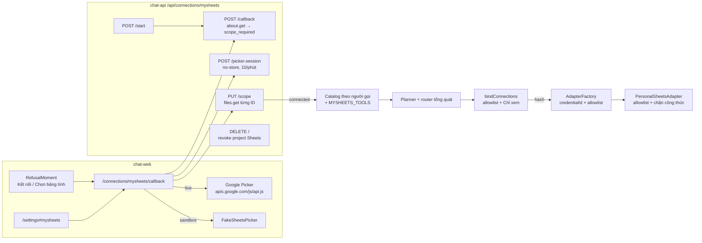

# OAUTH-03 · Kế hoạch triển khai: Google Sheets của riêng bạn (Google Picker)

**Task card:** [OAUTH-03-personal-sheets.md](../../handoff/tasks/OAUTH-03-personal-sheets.md) · **Đặc tả chuẩn tắc:** [2026-10-28-oauth-03-personal-sheets-design.md](../specs/2026-10-28-oauth-03-personal-sheets-design.md) · **Khuôn mẫu:** OAUTH-02 (#176, `f616d01`, 76 file)

## Mục tiêu

Làm **bước 1 của task card (PR mã, cờ `MYSHEETS_ENABLED` tắt)**: dịch vụ riêng `mysheets` với quyền `drive.file`, chọn bảng tính bằng Google Picker (Picker giả ở sandbox/CI), 4 tool `mysheets.*`, chạy được bốn tình huống ở đặc tả mục 1.2 trong sandbox. Cờ tắt thì hệ thống không đổi từng byte.

**Nằm ngoài PR này:**
- Bước 0 (tạo Google Cloud project) và bước 4 (P-LIVE): việc của nhóm trưởng.
- Bước 2 (bộ đo ×3): nhánh `eval/oauth-03-measure` sau khi merge, vì label phải commit trước mọi lời gọi model.

---

## Kiến trúc

Bốn lớp chặn allowlist (đặc tả 2.3.3, đột biến 3a–3d): `PUT /scope` → `bindConnections` → `AdapterFactory` → `PersonalSheetsAdapter`.

---

## Các thay đổi theo Task

Mỗi task theo TDD: viết test đỏ → chạy và ghi output RED → code → GREEN → commit kiểu Conventional Commits.

### Task 1 · Schema, executor, migration 0013
- `packages/tool-schemas/src/mysheets.ts`: `MYSHEETS_TOOLS`, `MYSHEETS_SCOPE = 'https://www.googleapis.com/auth/drive.file'`
- `packages/tool-schemas/src/registry/mysheets.ts`: `MYSHEETS_SERVICE`
- `packages/tool-schemas/src/types.ts` (`PlanConnections.mysheets`, `PersonalSpreadsheetItem`), `src/index.ts`
- `packages/executor/src/runner.ts`: thêm `MYSHEETS_TOOLS` vào bảng tra lệnh ghi
- `db/v3/0013_mysheets_personal_connections.sql`
- Tests: `packages/tool-schemas/tests/mysheets-schemas.test.ts`, `apps/chat-api/tests/db/mysheets-migration.test.ts`

### Task 2 · Cấu hình và biến môi trường
- `apps/chat-api/src/config/env.ts`: `MYSHEETS_ENABLED`, `MYSHEETS_OAUTH`, `MYSHEETS_PICKER`, `MYSHEETS_ENDPOINTS`
- `.env.example`, `.gitignore` (`docs/ai-evidence/MYSHEETS-LIVE/`)
- Tổng quát hoá `validatePersonalGoogleProjects` cho cả ba dịch vụ Google riêng (Gmail, MyCalendar, MySheets)
- Test: `apps/chat-api/tests/config/mysheets-config.test.ts`

### Task 3 · `PersonalSheetsAdapter` và tách phần dùng chung
- `packages/tool-adapters/src/sheets/sheets-shared.ts`: `a1`, `titleText`, `safeRows`, `bounded`, `queryText`, `spreadsheetPattern`, chuẩn hoá `read_range`/`append_rows`/`tabs`
- `packages/tool-adapters/src/sheets/sheets-adapter.ts`: import từ shared; giữ nguyên hành vi
- `packages/tool-adapters/src/sheets/personal-sheets-adapter.ts`, export ở `src/index.ts`
- Test: `packages/tool-adapters/tests/sheets/personal-sheets-adapter.test.ts`

### Task 4 · Kho kết nối, token manager, Google giả
- `apps/chat-api/src/db/repositories/gmail-connection-repo.ts`: nhận `'mysheets'`/`'connect_mysheets'`
- `services/gmail/token-manager.ts`, `services/gmail/connection-reference.ts`: `createMySheetsConnectionLookup`
- `scripts/fake-google-gmail.mjs`: Drive `about`, `files.get`; Sheets API cho file đã cấp; `/fake-picker/files`, `/fake-picker/grant`

### Task 5 · Route `/api/connections/mysheets`
- `apps/chat-api/src/routes/connections/mysheets.ts`: `POST /start`, `POST /callback`, `POST /picker-session`, `GET /spreadsheets`, `PUT /scope`, `DELETE /`
- `apps/chat-api/src/app.ts`: gắn route mysheets khi cờ bật, origin check, `mysheetsEnabled` ở `/api/health`
- Test: `apps/chat-api/tests/routes/mysheets-connections.test.ts`

### Task 6 · Nối vào planner, chat, executor, sandbox
- `packages/planner/src/router.ts`: tổng quát hoá luật ưu tiên personal connection
- `apps/chat-api/src/config/gmail-tools-runtime.ts`: `mysheetsEnabled`, `runtimeMySheetsAdapter`, `mayFallbackToShared`
- `services/registered-services.ts`: đưa `MYSHEETS_TOOLS` vào catalog khi `active` và có bảng
- `services/adapter-factory.ts`: khởi tạo `PersonalSheetsAdapter`, kiểm tra `credentialId` và allowlist
- `services/chat-service.ts`: `bindConnections` kiểm allowlist và từ chối ghi vào bảng chỉ xem
- `routes/services-routes.ts`: trạng thái cá nhân `not_connected | scope_required | connected | reconnect_required`
- `sandbox/scenarios.ts`: kịch bản sandbox `mysheets`

### Task 7 · Web: hạ tầng, callback và Picker
- `apps/chat-web/src/types.ts`, `services/api-client.ts`, `routes.ts`, `App.tsx`
- `services/google-picker.ts`: nạp SDK Picker của Google
- `components/FakeSheetsPicker.tsx`: modal chọn bảng tính giả lập cho môi trường sandbox
- `views/MySheetsCallbackView.tsx`: màn đón callback và quản lý chọn bảng tính

### Task 8 · Web: settings, cockpit, privacy
- `pages/Settings/PersonalMySheets.tsx`, `SettingsPage.tsx`, `useSettings.ts`
- `pages/Responses/ResponseMoment.tsx`: nút Kết nối / Chọn bảng tính / Kết nối lại
- `pages/Cockpit/PlanMoment.tsx`, `ReceiptMoment.tsx`, `RecoveryMoment.tsx`, `pages/Privacy/PrivacyPage.tsx`

### Task 9 · `/guide` và Landing
- `pages/Guide/mysheets-data.tsx`, `GuidePage.tsx`: mẫu câu và hướng dẫn dịch vụ
- `pages/Landing/LandingPage.tsx`: thẻ dịch vụ Google Sheets cá nhân khi cờ bật

### Task 10 · Browser E2E
- `scripts/test-v3-browser.mjs`: kịch bản `mysheets`
- `apps/chat-web/tests/browser/mysheets.spec.ts`: 9 test flows (Flow 1 đến Flow 6, dark/light, mobile/desktop)

### Task 11 · Đột biến, bàn giao, PR
- Thực thi 13 đột biến bắt buộc theo mục 8.2 của đặc tả chuẩn tắc
- Tạo test tự động và runner `scripts/test-mysheets-mutations.mjs`
- Bàn giao handoff log và task card
