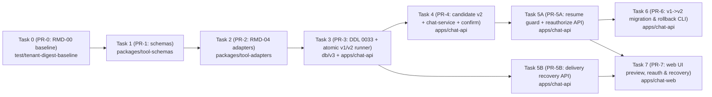

# Google Sheets Digest Gate A (`RMD-00 → RMD-04`) Implementation Plan

> **For agentic workers:** REQUIRED SUB-SKILL: Use superpowers:subagent-driven-development (recommended) or superpowers:executing-plans to implement this plan task-by-task. Steps use checkbox (`- [ ]`) syntax for tracking.

- **Document Version:** `2.4 (Pre-Task-3 Conditions Resolved — Approved for Tasks 0–2)`
- **Baseline Commit:** `main@05bb05fe24dd47b5802cc53ddb67747794c9a214` (post-PR #287; Task 0 baseline verified at `b05d49a20b68361f3f63b222f9332d744de5b7c6` and rebased onto `05bb05fe`)
- **Spec:** [`docs/superpowers/specs/2026-11-08-sheets-digest-gate-a-remediation-design.md`](../specs/2026-11-08-sheets-digest-gate-a-remediation-design.md) (`v2.4`)
- **In Scope:** Gate A (`RMD-00`, `RMD-01`, `RMD-02`, `RMD-03`, `RMD-04`)
- **Out of Scope (Official Roadmap IDs Preserved per `PLANORA_TECHNICAL_REMEDIATION_PLAN_REVIEWED.md`):**
  - `RMD-05`: ADR — Workflow Ownership Model for Personal & Organization (design-only).
  - `RMD-06A` (`06A.1`, `06A.2`, `06A.3`) & `RMD-06B`: Persisted Workflow Definition, ACL & Organization Workflow UI.
  - `RMD-07` (`07A`, `07B`): Trigger Google Sheets v1 (`row_added`/`row_updated` detector + durable checkpoint + action dispatch/dedup/recovery).
  - `RMD-08` (`08A`, `08B`): Early user discovery (`08A`) & Final business + live provider acceptance (`08B`).

---

## Global Constraints & Staged Rollout Governance

1. **Honest Historical Evidence Boundary, Pre-Rollout Inventory & Controlled V1 Policy (`SHEETS_DIGEST_V1_COMPAT_POLICY` — Blocker 2 & Pre-Task-3 Condition #1):**
   - **Explicit Evidence Boundary (No Over-Claiming):** In `db/v3/0001_v3_core.sql` and `0009_gmail_personal_connections.sql`, `service_credentials` has columns `(id, service, user_id, workspace_id, config, created_at, status, status_changed_at)` — it has **no `updated_at` column** and **no config-mutation audit log** prior to `0033`. While `GmailConnectionRepo.saveConnection` (`DELETE + INSERT`) rotates `id`, `created_at`, and `config.connectedAt`, `GmailConnectionRepo.updateConfigIfActive` (`PUT /api/connections/mysheets/scope` and `POST /api/connections/mysheets/quick-create-spreadsheet`) and `CredentialRepo.updateCredentials` execute `UPDATE service_credentials SET config = $1 WHERE id = $2` in place without changing `id`, `created_at`, or `status_changed_at`. Therefore, matching `created_at <= digest_approved_at`, `status_changed_at <= digest_approved_at`, `dec.connectedAt <= digest_approved_at`, and `digest_config_hash` establishes **Consistency Eligibility (`v1_pinned_consistency_candidate`, `evidenceBoundary: 'consistency_only_not_config_immutability_proof'`)** and **NEVER** proves that `service_credentials.config` was never mutated in place.
   - **Pre-Rollout Gate (`inspectV1SheetsDigestSchedules` / `--mode=inventory`):** Classifies all `version: 1` schedules into two explicit buckets with explicit `evidenceBoundary`:
     - **`Class A (`v1_pinned_consistency_candidate`, `evidenceBoundary: 'consistency_only_not_config_immutability_proof'`)`:** Personal/Legacy `mysheets → gmail` v1 rows with pinned `source.credentialId`, `source.email`, `destination.credentialId`, `destination.recipientEmail`, valid scope, matching v1 hash, `created_at <= digest_approved_at`, `status_changed_at <= digest_approved_at`, and `dec.connectedAt <= digest_approved_at` (when `connectedAt` is present).
     - **`Class B (`v1_unpinned_fail_closed`, `evidenceBoundary: 'unpinned_or_inconsistent'`)`:** Any v1 row lacking pinned `source.credentialId` or `destination.credentialId` (including 100% of Organization v1 schedules and all `sheets`/`slack`/`telegram` v1 rows) or failing any consistency check. Always fails closed.
   - **Controlled Policy (`SHEETS_DIGEST_V1_COMPAT_POLICY` & `--v1-compat-policy`):**
     - `'strict_pause_all'` (**Fail-Closed Default**): Because `Class A` cannot cryptographically prove `service_credentials.config` was never mutated in place (`evidenceBoundary: 'consistency_only_not_config_immutability_proof'`), the default policy pauses 100% of `version: 1` schedules (`Class A` and `Class B`) for explicit reauthorization via `POST /api/schedules/:id/reauthorize-preview`.
     - `'allow_consistency_candidate'` (**Explicit Operator Opt-In After Inventory Review**): Only when the operator has run `--mode=inventory` and obtained explicit owner sign-off to accept `Class A` consistency candidates does the runner allow `Class A` in `compat` mode (and Stage 2 `--mode=apply` auto-upgrade `Class A`). `Class B` (`v1_unpinned_fail_closed`) still fails closed under all policies.
2. **Cross-PR Ordering, Feature Flag Precedence & Zero Silent V1 Downgrade (`isSheetsDigestEmitV2Enabled` — Blocker 3 & Pre-Task-3 Condition #2):**
   - **Never allow creating a `version: 2` schedule before `PR-3` (runner v2 support) is deployed, and NEVER allow creating a new unpinned `version: 1` `sheets_digest` schedule under any flag state.**
   - **`isSheetsDigestEmitV2Enabled(options)` Precedence:** **(1) Explicit `options?.emitV2` (`boolean`)** → **(2) `process.env.SHEETS_DIGEST_EMIT_V2` (`'true'|'1'|'on'` vs `'false'|'0'|'off'`)** → **(3) Safe default `false`**.
   - **When `isSheetsDigestEmitV2Enabled` is `false`:** `analyzeSheetsDigestCandidate` returns **fail-closed `canAutoDigest: false`** (degrading the proposal to `notify_only` with an explicit reason) and **never** silently downgrades to emitting an unpinned `version: 1` `sheets_digest` config.
   - **Preview-to-Confirm Flag Drift & Stale V1 Proposal Guards:** If `SHEETS_DIGEST_EMIT_V2` flips from `true` (at Preview) to `false` (at Confirm), `ScheduleService.confirmProposal` rejects with `ScheduleConflict('DIGEST_V2_DISABLED_SINCE_PREVIEW')` (`HTTP 409`). If a stale pre-`PR-4` `version: 1` proposal is confirmed, `confirmProposal` rejects with `ScheduleConflict('LEGACY_V1_PROPOSAL_STALE')` (`HTTP 409`).
3. **End-to-End Explicit Trusted Scope (`resolveTrustedScheduleScope` — Blocker 3):**
   - Both `ChatService.prepareProposal` (`apps/chat-api/src/services/chat-service.ts`) and `ScheduleService.confirmProposal` (`apps/chat-api/src/services/schedules/schedule-service.ts`) extract `(workspaceMode, workspaceId)` directly from the `conversations` / `schedules` row via `resolveTrustedScheduleScope(row)`.
   - Never rely on `ChatService.actorForConversation`'s `fallbackMode`, which coerces `workspace_mode = 'legacy'` (`workspace_id = null`) into `'personal'` or `'organization'` when `workspaceRepo` is active.
4. **Hybrid Policy & Gmail Sender vs. Recipient:**
   - In `workspaceMode === 'organization'`:
     - `Org Sheets (sheets) → Org Slack (slack)`: Allowed.
     - `Personal Sheets (mysheets) → Org Slack (slack)`: Allowed via Hybrid Opt-in with `preview.crossBoundaryWarning`.
     - `Personal Sheets (mysheets) → Personal Gmail/Telegram`: Allowed (both source and destination belong to `schedule.user_id`; zero Organization data leaves the tenant).
     - `Org Sheets (sheets) → Personal Gmail/Telegram`: Rejected fail-closed (`ORG_DATA_EGRESS_FORBIDDEN`).
   - For Gmail digests, `destination.credentialId` + `destination.senderEmail` (`dec.email`) identify the sender OAuth account, while `destination.recipientEmail` is any single valid email approved by the user in the preview (not forced to equal `senderEmail`).
5. **Migration Audit & Optimistic-Concurrency Rollback:**
   - Never backfill missing `credentialId` or missing identity fields; Stage 2 `--mode=apply` pauses all `version: 1` schedules by default (`--v1-compat-policy=strict_pause_all`) and upgrades `Class A` (`v1_pinned_consistency_candidate`) only when the operator explicitly passes `--v1-compat-policy=allow_consistency_candidate` after inventory review.
   - `--mode=rollback` must check `WHERE id = $1 AND version = $2` (`audit.migrated_schedule_ver`) so user-modified schedules are never overwritten, and must verify live user/membership/credential status so revoked permissions are never reactivated.
6. **Zero Network I/O Inside DB Transactions (Blocker 1) & Mandatory Pre-Send Admission (Blocker 4):**
   - **Two-Phase Confirmation & Reauthorization Preview (Blocker 1):** `ChatService.prepareProposal` and Phase A of `ScheduleService.createReauthorizePreview` call `analyzeSheetsDigestCandidate` (including any bounded `fetchOrgSheetsMetadata` Google API lookup) **outside** any DB transaction. Inside the DB transaction (`ScheduleService.confirmProposal` and Phase B of `createReauthorizePreview`), call pure-DB **`verifySheetsDigestCandidateInTx(client, ...)`** (`FOR SHARE` on `users`, `workspace_members`, and `service_credentials` + in-memory AES-GCM decryption + scope + `computeSheetsDigestHash` verification) with **zero external network calls**.
   - **Mandatory Pre-Send Admission (`runId: string` — Blocker 4):** `SheetsDigestRunner.executeDigest(schedule, runVersion, runId, outerSignal)` requires a non-optional UUID `runId: string` and unconditionally executes `claimSheetsDigestDelivery` (`UPDATE schedule_runs SET delivery_started_at = now() WHERE id = $1 AND schedule_id = $2 AND status = 'planning' AND delivery_started_at IS NULL`) before constructing `destAdapter` or making any outbound HTTP call. Missing/invalid `runId` or unclaimed `schedule_runs` row aborts immediately with 0 HTTP calls.

---

## Mapping Table: `RMD-00 → RMD-04` to Tasks & PRs

| Roadmap ID | Remediation Requirement | Mapped Tasks / PRs | Verification Test IDs |
| :--- | :--- | :--- | :--- |
| **`RMD-00`** | Baseline verification at `main@b05d49a2` (rebased onto `05bb05fe`), multi-tenant fixtures (Personal A, Org A, Org B, Legacy), Class A/B v1 schedule inventory query with explicit `evidenceBoundary`, RED reproduction evidence | **`Task 0` (`PR-0`)** | `TC-01`..`TC-04`, `TC-10`, `TC-11`, `TC-13`, `TC-23` (inventory/baseline) |
| **`RMD-01`** | Tenant-scoped Sheets auto-digest (`chat-service.ts`, `sheets-digest-candidate.ts`, `schedule-service.ts`, `sheets-digest-runner.ts`, `server.ts`), `F-08` Telegram shared fallback removal, Class A/B v1 compat (`SHEETS_DIGEST_V1_COMPAT_POLICY`) & staged v1→v2 migration & rollback, strict `Resume` vs. two-phase `Reauthorize`, two-phase `confirmProposal` (`verifySheetsDigestCandidateInTx`), `isSheetsDigestEmitV2Enabled` (zero v1 creation / drift guard), explicit `'legacy'` scope | **`Task 1` (`PR-1`), `Task 3` (`PR-3`), `Task 4` (`PR-4`), `Task 5A` (`PR-5A`), `Task 6` (`PR-6`), `Task 7` (`PR-7`)** | `TC-01`, `TC-02`, `TC-03`, `TC-04`, `TC-13`, `TC-14`, `TC-19`, `TC-20`, `TC-21`, `TC-22`, `TC-23`, `TC-25` |
| **`RMD-02`** | Mandatory `runId` & atomic pre-send admission (`claimSheetsDigestDelivery`), verified lock graph (zero DB tx across HTTP), write-once `delivery_started_at`, `SHEETS_DELIVERY_UNKNOWN` recovery (`resolve-delivery` with `confirmDuplicateRisk`) | **`Task 1` (`PR-1`), `Task 3` (`PR-3`), `Task 5B` (`PR-5B`), `Task 7` (`PR-7`)** | `TC-05`, `TC-06`, `TC-07`, `TC-08`, `TC-09`, `TC-17`, `TC-18`, `TC-24` |
| **`RMD-03`** | Runtime tool catalog coexistence (`gmail-tools-runtime.ts` post-PR #286 Drive-only guard), Hybrid source resolution (`fetchOrgSheetsMetadata` outside DB tx, fail-closed on error/collision), friendly `SheetsDigestPreviewInfo` | **`Task 1` (`PR-1`), `Task 4` (`PR-4`), `Task 7` (`PR-7`)** | `TC-04`, `TC-10`, `TC-15`, `TC-19`, `TC-20` |
| **`RMD-04`** | Internal bounded 500-row digest reader (`readDigestWindow`), public tool caps untouched (`limit <= 50`, `tail:20`), deterministic 3-tier `dataScope` (`full_tab_verified`, `full_requested_range`, `partial`) | **`Task 1` (`PR-1`), `Task 2` (`PR-2`), `Task 3` (`PR-3`)** | `TC-11`, `TC-12`, `TC-16` |

---

## Deployment Compatibility Matrix Across All PRs

| Task / PR | Branch & Scope | Emits `v2` Configs? | Understands `v1` & `v2` in Runner? | Feature Flags & Defaults at Merge | Safe to Deploy Independently? |
| :--- | :--- | :--- | :--- | :--- | :--- |
| **`Task 0` (`PR-0`)** | `test/tenant-digest-baseline` (`docs`, `tests`, read-only inventory) | No (`v1` only) | Unchanged (`v1`) | None | **Yes:** Test fixtures, baseline handoff task card, and read-only Class A/B inventory helper (`evidenceBoundary`) only. Zero runtime code modified. |
| **`Task 1` (`PR-1`)** | `feat/sheets-digest-v2-schemas` (`packages/tool-schemas`) | No (`v1` only) | Unchanged (`v1`) | None | **Yes:** Additive TypeScript interfaces and `isSheetsDigestConfigV2` guard; `SheetsDigestConfig` is a union `V1 \| V2`. |
| **`Task 2` (`PR-2`)** | `feat/sheets-digest-bounded-reader` (`packages/tool-adapters`) | No (`v1` only) | Unchanged (`v1`) | None | **Yes:** Adds internal `readDigestWindow` method to `sheets`/`mysheets` adapters; existing `execute('sheets.read_range')` unchanged. |
| **`Task 3` (`PR-3`)** | `feat/sheets-digest-atomic-runner` (`db/v3` + `apps/chat-api` runner) | No (`v1` only) | **Yes (`v2` + controlled `Class A` `v1` when `SHEETS_DIGEST_V1_COMPAT_POLICY='allow_consistency_candidate'`; `Class B` & default `'strict_pause_all'` fail closed)** | `SHEETS_DIGEST_V2_MODE='compat'`, `SHEETS_DIGEST_V1_COMPAT_POLICY='strict_pause_all'` | **Yes (after pre-rollout inventory):** `0033` DDL is additive; runner executes `v2` (and `Class A` `v1` if operator opts in to `allow_consistency_candidate` after inventory), fails closed on unpinned `Class B` `v1`, uses `readDigestWindow`, and requires mandatory `runId` + `claimSheetsDigestDelivery`. **Must deploy before `Task 4`.** |
| **`Task 4` (`PR-4`)** | `feat/sheets-digest-v2-candidate` (`apps/chat-api` candidate, `chat-service`, `schedule-service`) | **Emits `v2` when `SHEETS_DIGEST_EMIT_V2=true`; fails closed to `notify_only` when `false` (never emits new `v1`)** | **Yes (`Class A` `v1` + `v2` from `PR-3`)** | `SHEETS_DIGEST_EMIT_V2='false'` (code default; enabled to `'true'` via env after `PR-3` verification); `SHEETS_DIGEST_V2_MODE='compat'` | **Yes (requires `PR-3` merged):** Never creates new unpinned `v1` schedules; enforces `DIGEST_V2_DISABLED_SINCE_PREVIEW` and `LEGACY_V1_PROPOSAL_STALE` on `confirmProposal`; runs pure-DB `verifySheetsDigestCandidateInTx(client, ...)` with 0 network calls inside the transaction. |
| **`Task 5A` (`PR-5A`)** | `feat/sheets-digest-reauthorize-api` (`apps/chat-api` service/routes) | Yes (`v2` on reauthorize confirm) | Yes (`Class A` `v1` + `v2`) | `SHEETS_DIGEST_V2_MODE='compat'` | **Yes (requires `PR-4` merged):** Adds two-phase `POST /api/schedules/:id/reauthorize-preview` (0 network calls inside DB tx) and strict `resume` verification. |
| **`Task 5B` (`PR-5B`)** | `feat/sheets-digest-delivery-recovery-api` (`apps/chat-api` service/routes) | Unchanged | Yes (`Class A` `v1` + `v2`) | `SHEETS_DIGEST_V2_MODE='compat'` | **Yes (requires `PR-3` merged):** Adds `POST /api/schedule-runs/:id/resolve-delivery` and `runView` recovery fields. |
| **`Task 6` (`PR-6`)** | `feat/sheets-digest-v2-migration-tool` (`apps/chat-api` CLI/service) | Unchanged | Yes (`Class A` `v1` + `v2`) | `SHEETS_DIGEST_V2_MODE='compat'` until Stage 2 `apply` completes, then `'enforce'` | **Yes (requires `PR-4` & `PR-5A` merged):** Adds `sheets-digest-v2-migrate` (`inventory`, `dry-run`, `apply` with `--v1-compat-policy`, `rollback`). Does NOT run `apply` automatically on deploy. |
| **`Task 7` (`PR-7`)** | `feat/sheets-digest-web-recovery` (`apps/chat-web`) | N/A (Frontend) | N/A (Frontend) | None | **Yes (requires `PR-5A` & `PR-5B` merged):** Renders v2 `preview` (falling back gracefully for v1), Reauthorization CTA, and Delivery Recovery modal. |

---

## Task & PR Dependency Graph



---

### Task 0: Baseline Verification, Multi-Tenant Fixtures & V1 Inventory (`PR-0`, `RMD-00`, Scope: `api` tests & `docs`)

**Branch:** `test/tenant-digest-baseline`
**Module Owner:** Backend / QA Engineer (`apps/chat-api/tests/`, `docs/handoff/tasks/`)
**Depends on:** None (Baseline `main@b05d49a20b68361f3f63b222f9332d744de5b7c6`, rebased onto `main@05bb05fe24dd47b5802cc53ddb67747794c9a214`)

**Files:**
- Create: `docs/handoff/tasks/RMD-00-sheets-digest-baseline.md`
- Create: `apps/chat-api/tests/helpers/sheets-digest-tenant-fixtures.ts`
- Create: `apps/chat-api/tests/services/sheets-digest-baseline-inventory.test.ts`

**Steps:**
- [x] **Step 1: Verify clean baseline at `main@b05d49a20b68361f3f63b222f9332d744de5b7c6` (and `main@05bb05fe`) and run existing suites**
  Run: `git rev-parse HEAD && npx vitest run apps/chat-api/tests/services/sheets-digest.test.ts apps/chat-api/tests/services/schedules/sheets-digest.test.ts apps/chat-api/tests/routes/workspace-isolation.test.ts`
- [x] **Step 2: Create reusable multi-tenant PostgreSQL & provider spy fixture helper in `apps/chat-api/tests/helpers/sheets-digest-tenant-fixtures.ts`**
  Provides deterministic fixtures for:
  - `Personal User A` (`mysheets`, `gmail`, `telegram`), `Personal User B` (`mysheets`, `gmail`, `telegram`),
  - `Org A` (`workspace_id = wsA`, shared `sheets` + `slack`), `Org B` (`workspace_id = wsB`, shared `sheets` + `slack`),
  - `Legacy` (`workspace_id = null`, shared `sheets` + `slack`),
  - Outbound provider spy recording `{ service, credentialId, workspaceMode, workspaceId, spreadsheetId, targetId, callCount }`,
  - Read-only SQL inventory helper `inspectV1SheetsDigestSchedules(pool)` returning counts and per-schedule classifications by `(workspace_mode, status, config_version, has_source_cred_id, has_dest_cred_id, compat_class: 'v1_pinned_consistency_candidate' | 'v1_unpinned_fail_closed' | 'v2_ready', evidence_boundary: 'consistency_only_not_config_immutability_proof' | 'unpinned_or_inconsistent' | 'v2_pinned')` per Blocker 2 & Pre-Task-3 Condition #1 (explicitly stating that `created_at + status_changed_at + connectedAt + hash` proves consistency eligibility only and never proves config immutability because `service_credentials` has no `updated_at` column or config-mutation audit log prior to `0033`).
- [x] **Step 3: Document RED reproduction evidence in `docs/handoff/tasks/RMD-00-sheets-digest-baseline.md` and keep merged test suite GREEN (`RMD-00` Rule #8)**
  - Record exact reproduction commands, base SHA (`b05d49a20b68361f3f63b222f9332d744de5b7c6` / `05bb05fe24dd47b5802cc53ddb67747794c9a214`), RED outputs for `F-01`, `F-02`, `F-03`, `F-04`, and `F-08`, and Class A (`v1_pinned_consistency_candidate` with explicit `evidenceBoundary`) / Class B (`v1_unpinned_fail_closed`) v1 inventory analysis in `docs/handoff/tasks/RMD-00-sheets-digest-baseline.md`.
  - Per `PLANORA_TECHNICAL_REMEDIATION_PLAN_REVIEWED.md` §0.8 ("RMD-00 không được merge test RED... PR RMD-00 chỉ chứa tài liệu/fixture/helper đang PASS và ghi reproduction evidence"), verify the multi-tenant fixture builder and read-only Class A/B inventory query in `sheets-digest-baseline-inventory.test.ts` pass GREEN, while the failing regression assertions for `F-01..F-04, F-08` are paired into `Task 2`, `Task 3`, and `Task 4` where they turn `RED → GREEN`.
- [x] **Step 4: Commit**
  ```bash
  git add docs/handoff/tasks/RMD-00-sheets-digest-baseline.md apps/chat-api/tests/helpers/sheets-digest-tenant-fixtures.ts apps/chat-api/tests/services/sheets-digest-baseline-inventory.test.ts
  git commit -m "test(api): add RMD-00 multi-tenant digest fixtures and v1 inventory baseline"
  ```

- **Acceptance Criteria:**
  1. `docs/handoff/tasks/RMD-00-sheets-digest-baseline.md` records `HEAD` SHA `b05d49a20b68361f3f63b222f9332d744de5b7c6` / `05bb05fe24dd47b5802cc53ddb67747794c9a214`, reproduction commands, expected vs. actual behavior for `F-01`, `F-02`, `F-03`, `F-04`, `F-08`, and the read-only `Class A` (`v1_pinned_consistency_candidate`, `evidenceBoundary: 'consistency_only_not_config_immutability_proof'`) vs. `Class B` (`v1_unpinned_fail_closed`) v1 schedule inventory query.
  2. `sheets-digest-tenant-fixtures.ts` builds isolated Personal A, Personal B, Org A, Org B, and Legacy tenants with zero real external network calls and classifies `Class A` and `Class B` v1 schedules accurately.
  3. CI stays 100% GREEN on merge.
- **Test Command:**
  `npx vitest run apps/chat-api/tests/services/sheets-digest-baseline-inventory.test.ts apps/chat-api/tests/services/sheets-digest.test.ts`
- **Expected Result:** `PASS` (exit code `0`, 0 failed tests).
- **Compatibility / Deployment Gate:** Test/documentation-only PR; zero production files changed.
- **Rollback Condition & Procedure:** `git revert <PR-0-sha>` if fixture helpers conflict with test runner setup.

---

### Task 1: `SheetsDigestConfig` v2, Sender/Recipient & Recovery Schema Contracts (`PR-1`, `RMD-01/02/03/04`, Scope: `schemas`)

**Branch:** `feat/sheets-digest-v2-schemas`
**Module Owner:** AI / Integration Engineer (`packages/tool-schemas/`)
**Depends on:** Task 0

**Files:**
- Modify: `packages/tool-schemas/src/types.ts:182-218,415-435`
- Modify: `packages/tool-schemas/src/index.ts`
- Create: `packages/tool-schemas/tests/sheets-digest-v2-types.test.ts`

**Steps:**
- [ ] **Step 1: Write failing tests in `packages/tool-schemas/tests/sheets-digest-v2-types.test.ts`**
  Verify `isSheetsDigestConfigV2` accepts valid v2 configs (including Gmail with distinct `senderEmail: 'alice@gmail.com'` and `recipientEmail: 'finance@company.com'`), rejects v1 configs, rejects missing `credentialId`s, and rejects `workspaceMode: 'organization'` when `workspaceId` is null.
- [ ] **Step 2: Run test to verify RED**
  Run: `npx vitest run packages/tool-schemas/tests/sheets-digest-v2-types.test.ts`
- [ ] **Step 3: Implement `SheetsDigestConfigV1`, `SheetsDigestConfigV2`, `SheetsDigestPreviewInfo`, `SheetsDigestDelivery`, `ScheduleRunView`, `ScheduleProposalMetadata` (`reauthorize?: boolean`, `expiresAt?: string`), and `isSheetsDigestConfigV2` in `packages/tool-schemas/src/types.ts`**
- [ ] **Step 4: Run test & package build to verify GREEN**
  Run: `npx vitest run packages/tool-schemas/tests/sheets-digest-v2-types.test.ts && npm run --workspace=@wap/tool-schemas build`
- [ ] **Step 5: Commit**
  ```bash
  git add packages/tool-schemas/src/types.ts packages/tool-schemas/src/index.ts packages/tool-schemas/tests/sheets-digest-v2-types.test.ts
  git commit -m "feat(schemas): add SheetsDigestConfigV2 and delivery recovery contracts"
  ```

- **Acceptance Criteria:**
  1. `SheetsDigestConfig` is a union `SheetsDigestConfigV1 | SheetsDigestConfigV2` so existing v1 callers compile without error.
  2. `SheetsDigestDestinationConfigV2` for `'gmail'` includes required `credentialId: string`, optional `senderEmail?: string`, and `recipientEmail: string` (not constrained to equal `senderEmail`).
  3. `ScheduleRunView` includes `deliveryStartedAt`, `deliveryResolution`, `deliveryResolvedAt`, and `deliveryFollowupRunId`.
- **Test Command:**
  `npx vitest run packages/tool-schemas/tests/sheets-digest-v2-types.test.ts && npm run typecheck:v3`
- **Expected Result:** `PASS` (exit code `0`).
- **Compatibility / Deployment Gate:** Purely additive TypeScript types and runtime type guard; safe to merge before all adapter/backend/frontend PRs.
- **Rollback Condition & Procedure:** Revert PR-1 if downstream typecheck fails before dependent PRs land.

---

### Task 2: Bounded Internal Digest Reader `readDigestWindow` & 3-Tier `dataScope` (`PR-2`, `RMD-04`, Scope: `adapters`)

**Branch:** `feat/sheets-digest-bounded-reader`
**Module Owner:** Backend / Integration Engineer (`packages/tool-adapters/`)
**Depends on:** Task 1

**Files:**
- Modify: `packages/tool-adapters/src/sheets/sheets-shared.ts`
- Modify: `packages/tool-adapters/src/sheets/sheets-adapter.ts`
- Modify: `packages/tool-adapters/src/sheets/personal-sheets-adapter.ts`
- Modify: `packages/tool-adapters/src/index.ts`
- Create: `packages/tool-adapters/tests/sheets/sheets-digest-window.test.ts`

**Steps:**
- [ ] **Step 1: Write failing tests (`TC-11`, `TC-12`, `TC-16` adapter layer) in `packages/tool-adapters/tests/sheets/sheets-digest-window.test.ts`**
  Cover:
  1. 20 populated rows on a 1,000-row default grid (`gridProperties.rowCount = 1000, columnCount = 26`) → `dataScope: 'partial'`, `windowClipped: false`, `populatedRowCountInWindow: 20` (never reporting 1,000 as data rows or claiming `full_tab_verified`).
  2. Small bounded tab (`gridProperties.rowCount = 100, columnCount = 10`, 50 rows) → `dataScope: 'full_tab_verified'`.
  3. 500 populated rows on a 501-row grid (`gridProperties.rowCount = 501, columnCount = 26`) → `dataScope: 'full_tab_verified'`, `records.length === 500`.
  4. Overflowed sheet (`501` data rows returned in `A1:Z502`) → `dataScope: 'partial'`, `rowLimitExceeded: true`, `windowClipped: true`, `records.length === 500`.
  5. Explicit bounded A1 range (`Tasks!A1:F100`, 80 rows) → `dataScope: 'full_requested_range'`, `explicitRangeRequested: true`.
  6. Public `adapter.execute('sheets.read_range', ...)` and `mysheets.read_range` remain capped at `limit <= 50` and `tail:20`.
- [ ] **Step 2: Run test to verify RED**
  Run: `npx vitest run packages/tool-adapters/tests/sheets/sheets-digest-window.test.ts`
- [ ] **Step 3: Implement `readDigestWindow` in `sheets-shared.ts` and attach to `createSheetsAdapter` and `createPersonalSheetsAdapter`**
- [ ] **Step 4: Run adapter test suite to verify GREEN**
  Run: `npx vitest run packages/tool-adapters/tests/sheets/`
- [ ] **Step 5: Commit**
  ```bash
  git add packages/tool-adapters/src/sheets/sheets-shared.ts packages/tool-adapters/src/sheets/sheets-adapter.ts packages/tool-adapters/src/sheets/personal-sheets-adapter.ts packages/tool-adapters/src/index.ts packages/tool-adapters/tests/sheets/sheets-digest-window.test.ts
  git commit -m "feat(adapters): add bounded readDigestWindow with 3-tier dataScope verification"
  ```

- **Acceptance Criteria:**
  1. `readDigestWindow` reads up to 500 populated data rows (`A1:Z502` default scan window) and classifies `dataScope` into `full_tab_verified`, `full_requested_range`, or `partial` per Spec §5.2.
  2. `gridProperties.rowCount` is never reported as `populatedRowCountInWindow`.
  3. Public tools `sheets.read_range`, `mysheets.read_range`, `sheets.aggregate_rows`, and `mysheets.aggregate_rows` have zero schema or limit changes.
- **Test Command:**
  `npx vitest run packages/tool-adapters/tests/sheets/ && npm run typecheck:v3`
- **Expected Result:** `PASS` (exit code `0`).
- **Compatibility / Deployment Gate:** Additive internal method on `SheetsToolAdapter` and `PersonalSheetsToolAdapter`; safe to deploy before `Task 3`.
- **Rollback Condition & Procedure:** Revert PR-2 if `Task 3` has not yet been deployed; if `Task 3` is deployed, revert `Task 3` first.

---

### Task 3: DDL Migration `0033`, Mandatory Pre-Send Admission & Controlled V1/V2 Runner (`PR-3`, `RMD-01/02/04`, Scope: `db` & `api`)

**Branch:** `feat/sheets-digest-atomic-runner`
**Module Owner:** Backend Engineer (`db/v3/` & `apps/chat-api/`)
**Depends on:** Tasks 1, 2 *(Must land BEFORE `Task 4` so the runner understands `version: 2` before any `version: 2` schedule is created!)*

**Files:**
- Create: `db/v3/0033_sheets_digest_v2_remediation.sql`
- Modify: `apps/chat-api/src/services/schedules/sheets-digest-candidate.ts` (add `computeSheetsDigestV1Hash` & v2 support in `computeSheetsDigestHash` so runner can verify both v1 and v2 hashes)
- Modify: `apps/chat-api/src/services/schedules/sheets-digest-runner.ts`
- Modify: `apps/chat-api/src/services/schedules/schedule-runner.ts:89-106,519-691`
- Modify: `apps/chat-api/src/config/schedules-runtime.ts`
- Modify: `apps/chat-api/src/server.ts:280-325`
- Modify: `apps/chat-api/tests/services/sheets-digest.test.ts`
- Create: `apps/chat-api/tests/services/sheets-digest-concurrency.test.ts`

**Steps:**
- [ ] **Step 1: Write failing tests (`TC-02`, `TC-03`, `TC-05`..`TC-09`, `TC-11`, `TC-12`, `TC-13a`, `TC-16`, `TC-18`, `TC-23`, `TC-24`) in `sheets-digest.test.ts` and `sheets-digest-concurrency.test.ts`**
  Include tests for:
  1. **Stage 1 Controlled V1 Compatibility Mode (`SHEETS_DIGEST_V2_MODE = 'compat'`, `SHEETS_DIGEST_V1_COMPAT_POLICY`) vs. Stage 3 Enforcement Mode (`'enforce'`, `TC-13a`, `TC-23`):**
     - Under fail-closed default `SHEETS_DIGEST_V1_COMPAT_POLICY = 'strict_pause_all'`, both **Class A (`v1_pinned_consistency_candidate`, `evidenceBoundary: 'consistency_only_not_config_immutability_proof'`)** and **Class B (`v1_unpinned_fail_closed`)** `version: 1` schedules fail closed (`blocked` → paused for reauthorization).
     - Only when the operator explicitly opts in to `SHEETS_DIGEST_V1_COMPAT_POLICY = 'allow_consistency_candidate'` after reviewing `--mode=inventory` does a **Class A (`v1_pinned_consistency_candidate`)** `version: 1` schedule (`workspace_mode IN ('personal', 'legacy')`, `mysheets → gmail` with pinned `source.credentialId`, `source.email`, `destination.credentialId`, `destination.recipientEmail`, valid scope, matching v1 hash, `created_at <= digest_approved_at`, `status_changed_at <= digest_approved_at`, and `connectedAt <= digest_approved_at`) continue executing without being paused (`TC-23`).
     - Under all policies, any **Class B (`v1_unpinned_fail_closed`)** `version: 1` schedule (including 100% of `workspace_mode = 'organization'` v1 schedules, any v1 schedule using `sheets`, `slack`, or `telegram`, or any v1 schedule with `created_at > digest_approved_at` / `status_changed_at > digest_approved_at` / `connectedAt > digest_approved_at`) **fails closed (`blocked` → paused for reauthorization)** and never silently binds to current Organization or shared credentials (`TC-23`, `F-08`).
     - In `'enforce'` mode (or `SHEETS_DIGEST_V1_COMPAT_POLICY = 'strict_pause_all'`), any `version: 1` schedule (including Class A) is rejected by `verifyConfigAndScope` and paused with reauthorization reason.
     - In both `'compat'` and `'enforce'` modes, `version: 2` schedules execute with full v2 verification (`source.credentialId`, `destination.credentialId`, `senderEmail`, `workspaceMode`, `workspaceId`).
  2. **Mandatory Pre-Send Claim (`runId: string`) & Zero Network I/O Inside DB Transaction (`TC-05`..`TC-09`, `TC-18`, `TC-24`):**
     - Calling `executeDigest` with missing/invalid `runId`, a non-existent `runId`, or an already-claimed `schedule_runs` row (`delivery_started_at IS NOT NULL`) fails immediately and performs `0` outbound HTTP requests (`TC-24`).
     - `claimSheetsDigestDelivery` acquires `conversations (FOR UPDATE) → schedules (FOR UPDATE) → users (FOR SHARE NOWAIT) → workspace_members (FOR SHARE NOWAIT) → service_credentials (FOR SHARE NOWAIT) → schedule_runs (FOR UPDATE NOWAIT)`, immediately executing `ROLLBACK` and retrying `55P03` (`25ms / 50ms / 100ms`) up to 3 times.
     - Verified with real PostgreSQL barriers against concurrent `ScheduleService.setStatus({ action: 'pause' })`, `AdminUserRepo.mutate`, `AdminUserRepo.mutateForWorkspace`, and `CredentialRepo` revocation: zero `40P01` deadlocks, zero DB locks held during Google/Slack/Gmail/Telegram HTTP calls, and zero outbound sends when revocation commits before claim.
     - Legitimate `recurrence.type = 'once'` (`status = 'completed'`) schedule is admitted (`TC-08`).
     - Post-claim timeout / HTTP 5xx / crash sets `status = 'needs_attention'`, `error = SHEETS_DELIVERY_UNKNOWN`, preserves write-once `delivery_started_at`, and `reconcileScheduleRuns` marks crashed post-claim `sheets_digest` runs with `SHEETS_DELIVERY_UNKNOWN` (`TC-09`).
  3. **3-Tier KPI Formatting via `readDigestWindow` (`TC-11`, `TC-12`, `TC-16`):**
     - Runner calls `sheetsAdapter.readDigestWindow(...)` when available and formats digest copy honestly for `full_tab_verified`, `full_requested_range`, and both `partial` sub-cases.
- [ ] **Step 2: Run tests to verify RED**
  Run: `npx vitest run apps/chat-api/tests/services/sheets-digest.test.ts apps/chat-api/tests/services/sheets-digest-concurrency.test.ts`
- [ ] **Step 3: Create `db/v3/0033_sheets_digest_v2_remediation.sql` (DDL-only) and implement `SheetsDigestRunner`, `ScheduleRunner`, and `server.ts` updates**
  - Add `v2Mode?: 'compat' | 'enforce'` (default `(process.env.SHEETS_DIGEST_V2_MODE === 'enforce' ? 'enforce' : 'compat')`) and `v1CompatPolicy?: 'strict_pause_all' | 'allow_consistency_candidate'` (fail-closed default `'strict_pause_all'`) to `SheetsDigestRunnerOptions`.
  - Enforce mandatory `runId: string` on `SheetsDigestRunner.executeDigest(schedule, runVersion, runId, outerSignal)` (remove optional `runId?`) so every outbound dispatch path unconditionally executes `claimSheetsDigestDelivery` before constructing `destAdapter` (Blocker 4). Update existing standalone unit tests in `apps/chat-api/tests/services/sheets-digest.test.ts` (including line `569`) via a test helper `insertPlanningScheduleRun(pool, schedule)` to pass a real `runId`.
  - Update the 3-strike `digest_failed` fixture in `sheets-digest.test.ts:379-381` to throw a deterministic provider 4xx rejection (`Slack API error 400: channel_not_found`) so it tests `digest_failed` rather than post-claim ambiguous socket errors (`SHEETS_DELIVERY_UNKNOWN`, tested in `TC-09`).
  - In `server.ts:285-320`, update `createSheetsDigestAdapter` to accept `scheduleContext: { workspaceMode: SheetsDigestWorkspaceMode; workspaceId: string | null }` and pass tenant scope + pinned `credentialId`s (`mysheets`, `gmail`, `telegram`) into `getAdapterForUser`.
- [ ] **Step 4: Run migration and tests to verify GREEN**
  Run: `npm run db:migrate:v3 && npx vitest run apps/chat-api/tests/services/sheets-digest.test.ts apps/chat-api/tests/services/sheets-digest-concurrency.test.ts`
- [ ] **Step 5: Commit**
  ```bash
  git add db/v3/0033_sheets_digest_v2_remediation.sql apps/chat-api/src/services/schedules/sheets-digest-candidate.ts apps/chat-api/src/services/schedules/sheets-digest-runner.ts apps/chat-api/src/services/schedules/schedule-runner.ts apps/chat-api/src/config/schedules-runtime.ts apps/chat-api/src/server.ts apps/chat-api/tests/services/sheets-digest.test.ts apps/chat-api/tests/services/sheets-digest-concurrency.test.ts
  git commit -m "feat(db,api): add 0033 DDL, controlled v1/v2 sheets digest runner, and mandatory delivery claim"
  ```

- **Acceptance Criteria:**
  1. `db/v3/0033_sheets_digest_v2_remediation.sql` contains idempotent DDL only (`sheets_digest_v2_migration_audit` with `migrated_schedule_ver` + 4 nullable recovery columns on `schedule_runs`) and modifies zero rows in `schedules`.
  2. With `SHEETS_DIGEST_V2_MODE=compat`, fail-closed default `SHEETS_DIGEST_V1_COMPAT_POLICY=strict_pause_all` pauses all `version: 1` schedules (`Class A` and `Class B`), whereas explicit `SHEETS_DIGEST_V1_COMPAT_POLICY=allow_consistency_candidate` allows `Class A` (`v1_pinned_consistency_candidate`) while still failing closed on all `Class B` (`v1_unpinned_fail_closed`) `version: 1` schedules without silently binding to current Organization or shared credentials (`TC-23`). All `version: 2` schedules execute with pinned credential verification and mandatory pre-send claim.
  3. Mandatory `runId: string` prevents any bypass of `claimSheetsDigestDelivery` (`TC-24`), zero DB transactions are held open across external HTTP calls, and concurrent revocation tests (`TC-05`..`TC-09`, `TC-18`) pass with 0 deadlocks.
- **Test Command:**
  `npx vitest run apps/chat-api/tests/services/sheets-digest.test.ts apps/chat-api/tests/services/sheets-digest-concurrency.test.ts && npm run typecheck:v3`
- **Expected Result:** `PASS` (exit code `0`).
- **Compatibility / Deployment Gate:** Safe to deploy after `PR-1`, `PR-2`, and pre-rollout v1 inventory with `SHEETS_DIGEST_V2_MODE=compat`. Must be deployed **before** `Task 4` (`PR-4`).
- **Rollback Condition & Procedure:** If unexpected runner errors occur, revert `PR-3` binary; the additive table/columns from `0033` are nullable and 100% ignored by pre-`PR-3` code.

---

### Task 4: Two-Phase Candidate & Confirmation (`verifySheetsDigestCandidateInTx`), Zero-V1-Downgrade `isSheetsDigestEmitV2Enabled` & Tool Catalog Coexistence (`PR-4`, `RMD-01/03`, Scope: `api`)

**Branch:** `feat/sheets-digest-v2-candidate`
**Module Owner:** Backend Engineer (`apps/chat-api/`)
**Depends on:** Task 3 *(Runner already supports `version: 2`)*

**Files:**
- Modify: `apps/chat-api/src/config/gmail-tools-runtime.ts:76-123`
- Modify: `apps/chat-api/src/services/schedules/sheets-digest-candidate.ts`
- Modify: `apps/chat-api/src/services/chat-service.ts:1487-1509`
- Modify: `apps/chat-api/src/services/schedules/schedule-service.ts:470-501`
- Modify: `apps/chat-api/src/config/schedules-runtime.ts`
- Modify: `apps/chat-api/src/server.ts`
- Create: `apps/chat-api/tests/services/sheets-digest-candidate-v2.test.ts`
- Create: `apps/chat-api/tests/services/sheets-digest-e2e-pipeline.test.ts`

**Steps:**
- [ ] **Step 1: Write failing tests (`TC-01`, `TC-02`, `TC-03`, `TC-04`, `TC-10`, `TC-15`, `TC-19`, `TC-20`, `TC-21`, `TC-22`, `TC-25`) in `sheets-digest-candidate-v2.test.ts` and `sheets-digest-e2e-pipeline.test.ts`**
  Include tests for:
  1. **`TC-10` (`gmail-tools-runtime.ts`):** Org mode keeps both `sheets.*` (+ `SHEETS_EXTENDED_TOOLS`) and `mysheets.*` in both `live` and `sandbox` modes; a Drive-only `mysheets` connection (0 spreadsheets, only `mysheets.create_doc` from PR #286) never strips `sheets.*`.
  2. **`TC-04` (Refined Hybrid Policy & Gmail Sender vs. Recipient):**
     - In `workspaceMode: 'organization'`:
       - `sheets (Org) → slack (Org)`: `canAutoDigest: true`, `config.version === 2`.
       - `mysheets (Personal) → slack (Org)`: `canAutoDigest: true`, `config.version === 2`, `preview.crossBoundaryWarning` populated.
       - `mysheets (Personal) → gmail/telegram (Personal)`: `canAutoDigest: true`, `config.version === 2` (Personal-to-Personal inside Org allowed; zero Org data egress).
       - `sheets (Org) → gmail/telegram (Personal)`: `canAutoDigest: false` (`ORG_DATA_EGRESS_FORBIDDEN`).
     - Gmail destination pins `credentialId`, `senderEmail: 'alice@gmail.com'` (from `dec.email`), and allows `recipientEmail: 'finance@company.com'` (from prompt) or defaults `recipientEmail` to `alice@gmail.com` when prompt says `"cho tôi"`.
  3. **`TC-15` (Org Metadata Lookup Outside DB Tx, Fail-Closed Error/Collision & Friendly Preview):**
     - Calls `fetchOrgSheetsMetadata` outside any DB transaction when Org `sheets` is connected and prompt names a spreadsheet by title.
     - Fails closed (`canAutoDigest: false, requiresClarification: true`) when `fetchOrgSheetsMetadata` throws/times out or when a title collides between Org `sheets` and Personal `mysheets`.
  4. **`TC-20` & `TC-25` (Zero Network Calls Inside DB Transaction & Transactional Drift/Revocation Detection via `verifySheetsDigestCandidateInTx`):**
     - `ScheduleService.confirmProposal` executes pure-DB `verifySheetsDigestCandidateInTx(client, ...)` (`FOR SHARE` on `users`, `workspace_members`, and `service_credentials`) inside `withTransaction` and makes `0` external network calls (`fetchOrgSheetsMetadata` spy call count = `0` during `confirmProposal`, `TC-20`).
     - Concurrent credential rotation/revocation, scope narrowing, or user/member disable during `confirmProposal` is caught inside the transaction (`409 DIGEST_PREVIEW_CHANGED`, `TC-25`).
  5. **`TC-21` & `TC-22` (Feature Flag Precedence, Zero Silent V1 Downgrade, Preview-to-Confirm Drift Guard & `'legacy'` Scope Preservation):**
     - Verifies `isSheetsDigestEmitV2Enabled(options)` precedence: explicit `options.emitV2` (`boolean`) > `process.env.SHEETS_DIGEST_EMIT_V2` (`'true'|'1'|'on'` vs `'false'|'0'|'off'`) > default `false`.
     - When `isSheetsDigestEmitV2Enabled` is `false`, `analyzeSheetsDigestCandidate` returns `canAutoDigest: false` (degrading the proposal to `notify_only`) and **never** emits a new unpinned `version: 1` `sheets_digest` config (`TC-21`).
     - When `SHEETS_DIGEST_EMIT_V2` flips from `true` (at Preview) to `false` (at Confirm), `ScheduleService.confirmProposal` rejects with `ScheduleConflict('DIGEST_V2_DISABLED_SINCE_PREVIEW')` (`HTTP 409`).
     - When confirming a stale pre-`PR-4` `version: 1` proposal, `ScheduleService.confirmProposal` rejects with `ScheduleConflict('LEGACY_V1_PROPOSAL_STALE')` (`HTTP 409`).
     - For a `'legacy'` conversation (`workspace_mode = 'legacy'`, `workspace_id = null`) when `workspaceRepo` is active, `resolveTrustedScheduleScope` preserves `workspaceMode = 'legacy'` and `workspaceId = null` in both `prepareProposal` and `confirmProposal` (`TC-22`).
  6. **`TC-19` (End-to-End Trusted Context Pipeline):**
     - Full integration test from `ChatService` (`prepareProposal`) → `ScheduleService.confirmProposal` (`verifySheetsDigestCandidateInTx`) → `schedules` row → `ScheduleRunner` → `SheetsDigestRunner` → `createSheetsDigestAdapter`.
- [ ] **Step 2: Run tests to verify RED**
  Run: `npx vitest run apps/chat-api/tests/services/sheets-digest-candidate-v2.test.ts apps/chat-api/tests/services/sheets-digest-e2e-pipeline.test.ts`
- [ ] **Step 3: Implement changes in `gmail-tools-runtime.ts`, `sheets-digest-candidate.ts`, `chat-service.ts`, `schedule-service.ts`, and `server.ts`**
  - Implement `isSheetsDigestEmitV2Enabled(options)` in `schedules-runtime.ts` (precedence: `options?.emitV2` > `process.env.SHEETS_DIGEST_EMIT_V2` > `false`), `resolveTrustedScheduleScope(row)`, and pure-DB `verifySheetsDigestCandidateInTx(client, ...)` in `sheets-digest-candidate.ts`.
  - In `sheets-digest-candidate.ts`, when `emitV2` is `false`, return `canAutoDigest: false` (`notify_only` fallback) and never emit a `version: 1` `SheetsDigestConfig`.
  - In `chat-service.ts` (`lines 1487-1509`), extract `trustedScope = resolveTrustedScheduleScope(conv)` directly from `conversations` and call `analyzeSheetsDigestCandidate` outside any DB transaction using `emitV2: isSheetsDigestEmitV2Enabled(this.schedules)`.
  - In `schedule-service.ts` (`confirmProposal`), extract `trustedScope = resolveTrustedScheduleScope(owner.rows[0])`, enforce `DIGEST_V2_DISABLED_SINCE_PREVIEW` and `LEGACY_V1_PROPOSAL_STALE`, and call `verifySheetsDigestCandidateInTx(client, ...)` inside the DB transaction (never calling `analyzeSheetsDigestCandidate` or `fetchOrgSheetsMetadata` inside a transaction).
  - Also update the intentional legacy smart-fallback test in `apps/chat-api/tests/services/sheets-digest.test.ts` (`F-09`) to match the explicit tenant-scoped source policy per `PLANORA_TECHNICAL_REMEDIATION_PLAN_REVIEWED.md` §1 (`F-09`) and `RMD-03`.
- [ ] **Step 4: Run tests to verify GREEN**
  Run: `npx vitest run apps/chat-api/tests/services/sheets-digest-candidate-v2.test.ts apps/chat-api/tests/services/sheets-digest-e2e-pipeline.test.ts apps/chat-api/tests/services/sheets-digest.test.ts`
- [ ] **Step 5: Commit**
  ```bash
  git add apps/chat-api/src/config/gmail-tools-runtime.ts apps/chat-api/src/services/schedules/sheets-digest-candidate.ts apps/chat-api/src/services/chat-service.ts apps/chat-api/src/services/schedules/schedule-service.ts apps/chat-api/src/config/schedules-runtime.ts apps/chat-api/src/server.ts apps/chat-api/tests/services/sheets-digest-candidate-v2.test.ts apps/chat-api/tests/services/sheets-digest-e2e-pipeline.test.ts
  git commit -m "feat(api): add two-phase sheets digest verification, explicit legacy scope, and zero-v1-downgrade flag guard"
  ```

- **Acceptance Criteria:**
  1. `ChatService.prepareProposal` runs `analyzeSheetsDigestCandidate` outside DB transactions, while `ScheduleService.confirmProposal` runs pure-DB `verifySheetsDigestCandidateInTx(client, ...)` inside the transaction (`0` network calls inside DB tx, `TC-20`, `TC-25`).
  2. Both `prepareProposal` and `confirmProposal` share `isSheetsDigestEmitV2Enabled` (`options.emitV2 > env > false`), never create new unpinned `version: 1` `sheets_digest` schedules, reject Preview→Confirm flag drift (`409 DIGEST_V2_DISABLED_SINCE_PREVIEW`) and stale v1 proposals (`409 LEGACY_V1_PROPOSAL_STALE`, `TC-21`), and preserve `'legacy'` via `resolveTrustedScheduleScope` (`TC-22`).
  3. All 4 Organization Hybrid combinations and Gmail `senderEmail !== recipientEmail` work per Spec §2.2 & §2.4.
- **Test Command:**
  `npx vitest run apps/chat-api/tests/services/sheets-digest-candidate-v2.test.ts apps/chat-api/tests/services/sheets-digest-e2e-pipeline.test.ts apps/chat-api/tests/services/sheets-digest.test.ts && npm run typecheck:v3`
- **Expected Result:** `PASS` (exit code `0`).
- **Compatibility / Deployment Gate:** Requires `Task 3` (`PR-3`) already deployed. `SHEETS_DIGEST_EMIT_V2` defaults to `'false'` in code and is enabled to `'true'` in environment config once `PR-3` is verified.
- **Rollback Condition & Procedure:** Set `SHEETS_DIGEST_EMIT_V2=false` (instant kill-switch to degrade new digest proposals to `notify_only` without ever creating unpinned v1 schedules) or revert `PR-4`. Existing v2 schedules already created continue running on `PR-3` runner.

---

### Task 5A: Strict `Resume` Separation & Two-Phase Server-Side `Reauthorize` Preview/Confirm API (`PR-5A`, `RMD-01`, Scope: `api`)

**Branch:** `feat/sheets-digest-reauthorize-api`
**Module Owner:** Backend Engineer (`apps/chat-api/`)
**Depends on:** Task 4

**Files:**
- Modify: `apps/chat-api/src/services/schedules/schedule-service.ts`
- Modify: `apps/chat-api/src/routes/schedule-routes.ts`
- Create: `apps/chat-api/tests/services/sheets-digest-reauthorize.test.ts`

**Steps:**
- [ ] **Step 1: Write failing tests (`TC-14`, `TC-20`, `TC-25`) in `apps/chat-api/tests/services/sheets-digest-reauthorize.test.ts`**
  Cover:
  1. `ScheduleService.setStatus({ action: 'resume' })` on a schedule whose credential was rotated, whose scope was narrowed, or whose `pause_reason` requires v2 reauthorization throws `ScheduleConflict('REAUTHORIZATION_REQUIRED')` (`HTTP 409`) and **never** mutates `digest_config`, `credentialId`, or `digest_config_hash`.
  2. `POST /api/schedules/:id/reauthorize-preview` (`ScheduleService.createReauthorizePreview`) executes in two phases:
     - **Phase A (Outside DB Transaction):** Reads the schedule/conversation snapshot and runs `analyzeSheetsDigestCandidate` (`emitV2: true`, including any bounded `fetchOrgSheetsMetadata` Google API call) outside any DB transaction.
     - **Phase B (Inside DB Transaction):** Locks `conversations` and `schedules` `FOR UPDATE`, verifies `s.version === snap.version` (`409 SCHEDULE_MODIFIED_CONCURRENTLY`), calls pure-DB `verifySheetsDigestCandidateInTx(client, ...)` (`0` network calls while transaction is open, `TC-20`, `TC-25`), creates a sealed `schedule_proposal` message via `MessageRepo.createMessage` with `metadata.reauthorize = true`, `metadata.baseVersion = s.version`, and `metadata.expiresAt` (`15m` TTL), and returns `{ proposalMessageId, expiresAt, baseVersion, candidate }`.
  3. Confirming via `confirmProposal`:
     - Rejects expired proposals (`now > Date.parse(metadata.expiresAt)`) with `ScheduleConflict('STALE_PROPOSAL')`.
     - Rejects already-used reauthorize proposals (`existing.last_proposal_id === messageId`) with `ScheduleConflict('STALE_PROPOSAL')` (strictly one-time-use).
     - Rejects if `existing.version !== metadata.baseVersion` with `ScheduleConflict('STALE_PROPOSAL')`.
     - Rejects if credentials/scope changed between preview and confirm via `verifySheetsDigestCandidateInTx(client, ...)` with `ScheduleConflict('DIGEST_PREVIEW_CHANGED')` (`TC-25`).
     - Valid confirm upgrades `digest_config` to `version: 2`, updates `digest_config_hash`, clears `pause_reason`, sets `status = 'active'`, and computes `next_run_at`.
- [ ] **Step 2: Run test to verify RED**
  Run: `npx vitest run apps/chat-api/tests/services/sheets-digest-reauthorize.test.ts`
- [ ] **Step 3: Implement `REAUTHORIZATION_REQUIRED`, `setStatus` verification, two-phase `createReauthorizePreview`, `confirmProposal` reauthorize guards (`emitV2: isReauthorize ? true : undefined`), and `POST /schedules/:id/reauthorize-preview` in `schedule-service.ts` and `schedule-routes.ts`**
- [ ] **Step 4: Run tests to verify GREEN**
  Run: `npx vitest run apps/chat-api/tests/services/sheets-digest-reauthorize.test.ts apps/chat-api/tests/routes/schedule-routes.test.ts`
- [ ] **Step 5: Commit**
  ```bash
  git add apps/chat-api/src/services/schedules/schedule-service.ts apps/chat-api/src/routes/schedule-routes.ts apps/chat-api/tests/services/sheets-digest-reauthorize.test.ts
  git commit -m "feat(api): separate schedule resume from two-phase server-side reauthorization preview and confirm"
  ```

- **Acceptance Criteria:**
  1. `Resume` never modifies `credentialId` or `digest_config_hash` and returns `409 REAUTHORIZATION_REQUIRED` when reauthorization is needed.
  2. `POST /api/schedules/:id/reauthorize-preview` runs `analyzeSheetsDigestCandidate` outside DB transactions (Phase A) and locks + verifies via `verifySheetsDigestCandidateInTx(client, ...)` inside the DB transaction (Phase B, `0` network calls in transaction, `TC-20`), enforcing owner/tenant checks, 15-minute TTL, `baseVersion` CAS, one-time use, and live transactional re-verification on `confirmProposal` (`TC-25`).
  3. All proposal/state messages seal `slack_message_origins` via `MessageRepo.createMessage` / `recordState`.
- **Test Command:**
  `npx vitest run apps/chat-api/tests/services/sheets-digest-reauthorize.test.ts apps/chat-api/tests/routes/schedule-routes.test.ts && npm run typecheck:v3`
- **Expected Result:** `PASS` (exit code `0`).
- **Compatibility / Deployment Gate:** Requires `Task 4` (`PR-4`). Must be deployed **before** running Stage 2 migration (`Task 6`) so any schedule paused by migration can immediately be reauthorized by its owner.
- **Rollback Condition & Procedure:** Revert `PR-5A`; existing active schedules continue running unaffected.

---

### Task 5B: Manual Delivery Recovery API & Audit Preservation (`PR-5B`, `RMD-02`, Scope: `api`)

**Branch:** `feat/sheets-digest-delivery-recovery-api`
**Module Owner:** Backend Engineer (`apps/chat-api/`)
**Depends on:** Task 3 (`PR-3`), Task 5A (`PR-5A` if sharing `schedule-service.ts` / `schedule-routes.ts`)

**Files:**
- Modify: `apps/chat-api/src/services/schedules/run-state.ts`
- Modify: `apps/chat-api/src/db/repositories/schedule-repo.ts`
- Modify: `apps/chat-api/src/services/schedules/schedule-service.ts`
- Modify: `apps/chat-api/src/routes/schedule-routes.ts`
- Create: `apps/chat-api/tests/services/sheets-digest-delivery-recovery.test.ts`

**Steps:**
- [ ] **Step 1: Write failing tests (`TC-17`) in `apps/chat-api/tests/services/sheets-digest-delivery-recovery.test.ts`**
  Cover:
  1. `startRun({ trigger: 'replan', runId })` on a `needs_attention` (`SHEETS_DELIVERY_UNKNOWN`) run rejects with `ScheduleConflict('RUN_NOT_REPLANNABLE')`.
  2. `POST /api/schedule-runs/:id/resolve-delivery` with `resolution: 'retry_new_run'` and `confirmDuplicateRisk !== true` rejects with `HTTP 400` (`DUPLICATE_RISK_CONFIRMATION_REQUIRED`).
  3. `POST /api/schedule-runs/:id/resolve-delivery` with `resolution: 'retry_new_run'` and `confirmDuplicateRisk: true`:
     - Keeps the original run at `status = 'needs_attention'` with write-once `delivery_started_at` preserved, sets `delivery_resolution = 'retried_new_run'`, `delivery_resolved_at = now`, `delivery_resolved_by = userId`, `delivery_followup_run_id = newRun.id` (**never** falsifies `status = 'digest_failed'`).
     - Inserts a brand-new `schedule_runs` row (`status = 'planning'`, `delivery_started_at = NULL`), writes a sealed audit message to `run.conv_id`, and triggers `runner.planNow(newRun.id)`.
  4. `POST /api/schedule-runs/:id/resolve-delivery` with `resolution: 'mark_sent'`:
     - Transitions the run to `status = 'digest_sent'`, `error = NULL`, `delivery_resolution = 'confirmed_sent'`, and populates `delivery` JSON with `manualResolution: { status: 'confirmed_sent', resolvedAt, resolvedBy }` (satisfying `schedule_runs_delivery_check`).
  5. Calling `resolve-delivery` a second time on an already-resolved run (`delivery_resolution IS NOT NULL`) rejects with `409 Conflict`.
- [ ] **Step 2: Run test to verify RED**
  Run: `npx vitest run apps/chat-api/tests/services/sheets-digest-delivery-recovery.test.ts`
- [ ] **Step 3: Implement `run-state.ts`, `schedule-repo.ts`, `ScheduleService.resolveRunDelivery`, and `POST /schedule-runs/:id/resolve-delivery` in `schedule-routes.ts`**
- [ ] **Step 4: Run tests to verify GREEN**
  Run: `npx vitest run apps/chat-api/tests/services/sheets-digest-delivery-recovery.test.ts apps/chat-api/tests/routes/schedule-routes.test.ts`
- [ ] **Step 5: Commit**
  ```bash
  git add apps/chat-api/src/services/schedules/run-state.ts apps/chat-api/src/db/repositories/schedule-repo.ts apps/chat-api/src/services/schedules/schedule-service.ts apps/chat-api/src/routes/schedule-routes.ts apps/chat-api/tests/services/sheets-digest-delivery-recovery.test.ts
  git commit -m "feat(api): add manual delivery recovery endpoint with duplicate-risk confirmation and audit preservation"
  ```

- **Acceptance Criteria:**
  1. `delivery_started_at` is never cleared or reused across runs.
  2. `retry_new_run` requires `confirmDuplicateRisk === true` (`400` otherwise) and preserves `status = 'needs_attention'` + `delivery_resolution = 'retried_new_run'` on the ambiguous run while creating a new `schedule_runs` row.
  3. `mark_sent` satisfies `schedule_runs_delivery_check` and records `delivery.manualResolution`.
- **Test Command:**
  `npx vitest run apps/chat-api/tests/services/sheets-digest-delivery-recovery.test.ts apps/chat-api/tests/routes/schedule-routes.test.ts && npm run typecheck:v3`
- **Expected Result:** `PASS` (exit code `0`).
- **Compatibility / Deployment Gate:** Requires `Task 3` (`0033` columns on `schedule_runs`). Additive endpoint; safe to deploy before `Task 7` (`PR-7` UI).
- **Rollback Condition & Procedure:** Revert `PR-5B`; any `needs_attention` run remains safely halted without auto-retry.

---

### Task 6: Controlled V1→V2 Migration & CAS Rollback Tool (`PR-6`, `RMD-01`, Scope: `api`)

**Branch:** `feat/sheets-digest-v2-migration-tool`
**Module Owner:** Backend Engineer (`apps/chat-api/`)
**Depends on:** Tasks 3, 4, 5A

**Files:**
- Create: `apps/chat-api/src/services/schedules/sheets-digest-v2-migration.ts`
- Create: `apps/chat-api/src/scripts/sheets-digest-v2-migrate.ts`
- Create: `apps/chat-api/tests/services/sheets-digest-v2-migration.test.ts`

**Steps:**
- [ ] **Step 1: Write failing tests (`TC-13`) in `apps/chat-api/tests/services/sheets-digest-v2-migration.test.ts`**
  Cover:
  1. **`--mode=inventory` and `--mode=dry-run`:** Return complete classification counts (`Class A: v1_pinned_consistency_candidate` with `evidenceBoundary: 'consistency_only_not_config_immutability_proof'`, `Class B: v1_unpinned_fail_closed` with `evidenceBoundary: 'unpinned_or_inconsistent'`) and per-schedule diagnostics while mutating `0` rows in `schedules` and `sheets_digest_v2_migration_audit`.
  2. **`--mode=apply` without `--confirm-production-apply` (`confirmProductionApply: true`):** Refuses to execute and mutates `0` rows.
  3. **`--mode=apply` with `confirmProductionApply: true` & `--v1-compat-policy` (`strict_pause_all` fail-closed default vs. `allow_consistency_candidate`):**
     - Under default `--v1-compat-policy=strict_pause_all`: pauses 100% of active v1 schedules (`Class A` and `Class B`) to `paused_reauth_required`.
     - Under explicit `--v1-compat-policy=allow_consistency_candidate`: upgrades `Class A` (`v1_pinned_consistency_candidate` when approved by project owner after reviewing `inventory`), while `Class B` still transitions to `paused_reauth_required`.
     - Never backfills missing `credentialId` or missing `source.email`. Records `migrated_schedule_ver = s.version + 1` in `sheets_digest_v2_migration_audit` and writes a sealed `schedule_state` message in `s.conv_id` when pausing.
  4. **`--mode=rollback` with Optimistic Concurrency (`CAS`) & Revocation Guard:**
     - Restores `previous_digest_config`, `previous_config_hash`, and `previous_status` **only** when `schedules.version === audit.migrated_schedule_ver` AND live user/member/credential permissions are still active.
     - If the user edited, resumed, reauthorized, or cancelled the schedule after migration (`schedules.version !== audit.migrated_schedule_ver`), rollback skips the schedule (`rollback_outcome = 'skipped_user_modified'`) and leaves user changes intact.
     - If the user or credential was deactivated/revoked after migration, rollback restores the v1 config snapshot while keeping `status = 'paused'` (`rollback_outcome = 'restored_paused_due_to_revocation'`), never reactivating a revoked schedule.
- [ ] **Step 2: Run test to verify RED**
  Run: `npx vitest run apps/chat-api/tests/services/sheets-digest-v2-migration.test.ts`
- [ ] **Step 3: Implement `sheets-digest-v2-migration.ts` and CLI script `sheets-digest-v2-migrate.ts`**
- [ ] **Step 4: Run tests to verify GREEN**
  Run: `npx vitest run apps/chat-api/tests/services/sheets-digest-v2-migration.test.ts`
- [ ] **Step 5: Commit**
  ```bash
  git add apps/chat-api/src/services/schedules/sheets-digest-v2-migration.ts apps/chat-api/src/scripts/sheets-digest-v2-migrate.ts apps/chat-api/tests/services/sheets-digest-v2-migration.test.ts
  git commit -m "feat(api): add controlled sheets digest v1-to-v2 migration and CAS rollback tool"
  ```

- **Acceptance Criteria:**
  1. Deploying `PR-6` does not run migration automatically; `sheets-digest-v2-migrate` is invoked manually by an operator.
  2. `inventory` and `dry-run` are 100% non-destructive (`0` rows modified) and record `evidenceBoundary: 'consistency_only_not_config_immutability_proof'` on `Class A` rows.
  3. `apply` enforces `--v1-compat-policy` (`strict_pause_all` fail-closed default vs. `allow_consistency_candidate` explicit opt-in, zero heuristic backfill of missing identity) and writes `migrated_schedule_ver` to `sheets_digest_v2_migration_audit`.
  4. `rollback` enforces `WHERE id = $1 AND version = $2` (`migrated_schedule_ver`) and live revocation checks.
- **Test Command:**
  `npx vitest run apps/chat-api/tests/services/sheets-digest-v2-migration.test.ts && npm run typecheck:v3`
- **Expected Result:** `PASS` (exit code `0`).
- **Compatibility / Deployment Gate:** Requires `PR-3`, `PR-4`, and `PR-5A` deployed first. Production `--mode=apply --confirm-production-apply` is gated on project owner approval of the `--mode=inventory` and `--mode=dry-run` reports. Only after `--mode=apply` succeeds is `SHEETS_DIGEST_V2_MODE` switched from `'compat'` to `'enforce'`.
- **Rollback Condition & Procedure:**
  1. If `SHEETS_DIGEST_V2_MODE=enforce` causes unexpected blocks, switch `SHEETS_DIGEST_V2_MODE=compat`.
  2. To revert migrated schedules without touching user-edited schedules or reviving revoked credentials, run `npx tsx apps/chat-api/src/scripts/sheets-digest-v2-migrate.ts --mode=rollback --confirm-production-rollback`.

---

### Task 7: Frontend Preview V2, Reauthorization CTA & Manual Delivery Recovery UI (`PR-7`, `RMD-01/02/03`, Scope: `web`)

**Branch:** `feat/sheets-digest-web-recovery`
**Module Owner:** Frontend Engineer (`apps/chat-web/`)
**Depends on:** Tasks 1, 5A, 5B

**Files:**
- Modify: `apps/chat-web/src/services/api-client.ts:720-748`
- Modify: `apps/chat-web/src/pages/Cockpit/ScheduleMoment.tsx:510-565`
- Modify: `apps/chat-web/src/pages/Cockpit/ScheduleActions.tsx`
- Modify: `apps/chat-web/src/pages/Cockpit/ScheduleRunRecovery.tsx`
- Modify: `apps/chat-web/src/pages/History/ScheduleSection.tsx:79-103`
- Create: `apps/chat-web/tests/schedule-sheets-digest-v2.test.tsx`

**Steps:**
- [ ] **Step 1: Write failing UI tests in `apps/chat-web/tests/schedule-sheets-digest-v2.test.tsx`**
  Cover:
  1. `ScheduleMoment` renders `SheetsDigestPreviewInfo` (`sourceConnectionLabel`, `sourceOwnerLabel`, `destinationConnectionLabel` showing Gmail sender account, `destinationTargetLabel` showing recipient email / Slack channel / Telegram chat, and `crossBoundaryWarning`) and never displays raw `credentialId` UUID strings.
  2. `ScheduleActions` displays `"Xem trước & Cấp quyền lại"` when `resume` returns `409 REAUTHORIZATION_REQUIRED` or when `schedule.pauseReason` indicates v2 reauthorization is required, calling `apiClient.reauthorizeSchedulePreview(schedule.id)` and navigating to `/c/<convId>`.
  3. `ScheduleSection` and `ScheduleRunRecovery` render manual resolution controls for an unresolved `needs_attention` run (`deliveryResolution == null`), require checking the duplicate-send risk confirmation before invoking `resolveScheduleRunDelivery(runId, { resolution: 'retry_new_run', confirmDuplicateRisk: true })`, and render a read-only resolved audit badge when `deliveryResolution === 'retried_new_run'` or `'confirmed_sent'`.
- [ ] **Step 2: Run test to verify RED**
  Run: `npx vitest run apps/chat-web/tests/schedule-sheets-digest-v2.test.tsx`
- [ ] **Step 3: Implement `api-client.ts`, `ScheduleMoment.tsx`, `ScheduleActions.tsx`, `ScheduleRunRecovery.tsx`, and `ScheduleSection.tsx`**
- [ ] **Step 4: Run UI tests and full monorepo typecheck to verify GREEN**
  Run: `npx vitest run apps/chat-web/tests/schedule-sheets-digest-v2.test.tsx && npm run typecheck:v3`
- [ ] **Step 5: Commit**
  ```bash
  git add apps/chat-web/src/services/api-client.ts apps/chat-web/src/pages/Cockpit/ScheduleMoment.tsx apps/chat-web/src/pages/Cockpit/ScheduleActions.tsx apps/chat-web/src/pages/Cockpit/ScheduleRunRecovery.tsx apps/chat-web/src/pages/History/ScheduleSection.tsx apps/chat-web/tests/schedule-sheets-digest-v2.test.tsx
  git commit -m "feat(web): add sheets digest v2 preview, reauthorization CTA, and delivery recovery UI"
  ```

- **Acceptance Criteria:**
  1. Preview card displays human-readable source, owner, sender, and recipient/target labels plus `crossBoundaryWarning` without exposing raw UUIDs.
  2. Paused schedules needing reauthorization provide a 1-click flow to generate a server-side reauthorization preview in chat.
  3. Ambiguous `needs_attention` runs require explicit duplicate-send risk confirmation in the UI before calling `retry_new_run`.
- **Test Command:**
  `npx vitest run apps/chat-web/tests/schedule-sheets-digest-v2.test.tsx && npm run typecheck:v3`
- **Expected Result:** `PASS` (exit code `0`).
- **Compatibility / Deployment Gate:** Requires `PR-5A` and `PR-5B` deployed on `chat-api`. Gracefully renders both v1 proposals (without `preview` object) and v2 proposals (with `preview` object).
- **Rollback Condition & Procedure:** Revert `PR-7`; backend APIs remain functional.
