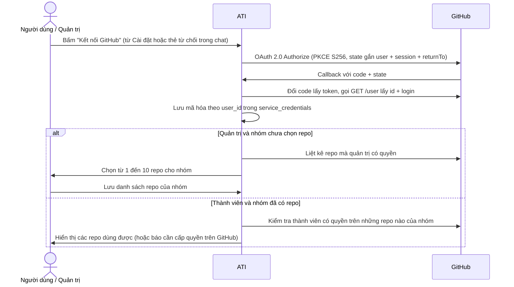

# GitHub OAuth cá nhân, Nâng cấp AI Đa dịch vụ và Lịch chạy có Chế độ chọn — Đặc tả thiết kế

**Ngày:** 01/11/2026 (Asia/Saigon) · **Trạng thái:** chờ chủ dự án duyệt · **Nguồn:** phiên brainstorm & phản biện góc nhìn User/Business ngày 01/11/2026

> Đặc tả này bổ sung cho [đặc tả v3](2026-09-29-ai-workflow-platform-v3-design.md), [đặc tả lịch chạy](2026-10-24-scheduled-workflows-design.md) và nối tiếp mẫu kiến trúc [Trello OAuth cá nhân](2026-11-01-trello-oauth-design.md) (`#224` / `#228`).

---

## 1. Góc nhìn User & Business: Vì sao phải thiết kế lại GitHub trên ATI?

Đặt mình vào vị trí **Tech Lead / PM của một nhóm sản phẩm** dùng GitHub cùng Trello, Slack, Gmail, Google Sheets hằng ngày:

1. **Nỗi đau 1 — Kết nối bằng PAT dùng chung và gõ tay `owner/repo` là rào cản chặn đứng người dùng:**
   - Hiện tại quản trị viên phải vào GitHub Developer Settings tạo Personal Access Token (PAT), dán vào ATI và gõ tay `owner/repo`.
   - Cả nhóm dùng chung một token nên mọi issue hay nhãn tạo ra đều mang tên chủ token, làm mất dấu vết trách nhiệm (ai báo bug, ai gắn nhãn) và không đội ngũ thực tế nào dám bật.
2. **Nỗi đau 2 — Thao tác đơn lẻ hoặc bản tin tĩnh không thắng được công cụ miễn phí có sẵn:**
   - Tạo 1 issue đơn lẻ qua chat mất 30 giây, chậm hơn mở GitHub bấm phím `C` (10 giây).
   - Nếu chỉ làm một "bản tin tĩnh GitHub → Slack", bản thân GitHub + Slack đã có sẵn **Scheduled Reminders** miễn phí.
3. **Giá trị thực sự khiến người dùng cần ATI (AI + Đa dịch vụ + Giải quyết việc lặp lại):**
   - Người dùng cần ATI ở chỗ công cụ rời rạc **không tự nối với nhau được**:
     - **Tình huống A — Triage & Đồng bộ đa dịch vụ lặp lại (GitHub → Trello / Sheets → Slack):** *"Mỗi sáng 8 giờ, kiểm tra các issue mới chưa ai nhận trên repo ATI: cái nào là lỗi thì gắn nhãn `bug`, tạo thẻ tương ứng sang bảng Trello của nhóm và gửi tổng hợp vào Slack #team."*
     - **Tình huống B — Biến Email / Hội thoại thành công việc (Gmail → GitHub → Slack):** *"Đọc email báo lỗi mới nhất trong Gmail, tạo issue trên repo ATI rồi gửi link vào Slack #team"* dưới **chính tên tài khoản GitHub của người đang chat**.
     - **Tình huống C — Báo cáo điểm nghẽn buổi sáng tự chạy (GitHub → AI phân tích → Slack):** với lịch chỉ đọc dữ liệu GitHub (issue mới, PR chờ review quá lâu, issue chưa ai nhận) rồi gửi báo cáo vào 1 kênh Slack, người dùng được **chọn chế độ "Tự chạy không cần duyệt lại"** để không phải bấm duyệt tay mỗi sáng.

---

## 2. Mục tiêu, ngoài phạm vi, phản mục tiêu

### 2.1. Mục tiêu
- **G1 — GitHub OAuth cá nhân là nền tảng số 1 (thay thế hoàn toàn PAT dùng chung):**
  - Mỗi thành viên bấm **"Kết nối GitHub"** (từ trang Kết nối dịch vụ hoặc ngay từ thẻ từ chối trong hội thoại có `returnTo: /c/<uuid>`), đăng nhập GitHub của chính mình.
  - Quản trị viên chọn từ **1 đến 10 repository** cho nhóm từ danh sách repo thực tế trên GitHub (tick chọn, không gõ tay `owner/repo`).
  - Thành viên dùng được những repo trong danh sách nhóm mà tài khoản GitHub của chính họ có quyền truy cập. Khi chat chỉ cần gõ tên ngắn (*"repo ATI"*) là hệ thống tự khớp `owner/repo`.
  - Mọi thao tác ghi (`create_issue`, `add_label`) chạy bằng token của người đang chat, khóa `connections.github` vào `plan_hash`.
- **G2 — Mở rộng năng lực đọc GitHub cho AI mà không phá vỡ bất biến 33 tool / SHA-256 prompt:**
  - Giữ nguyên định nghĩa 5 tool `github.*` trong `ALL_TOOLS` để giữ nguyên từng byte prompt hệ thống.
  - Nâng cấp `GitHubAdapter.searchIssues` để hiểu các bộ lọc an toàn (`is:open`, `no:assignee`, `is:pr`, `review:none`, `draft:false`, `created:>=YYYY-MM-DD`, hoặc `*` / `open` / `unassigned` / `pr`) thay vì bọc cứng toàn bộ chuỗi trong dấu ngoặc kép và chặn Pull Request như hiện tại.
- **G3 — Lịch chạy có "Chế độ chọn" (`approvalMode: 'manual' | 'auto_digest'`):**
  - Trên thẻ đề xuất lịch (`ScheduleMoment`), người dùng chọn một trong hai chế độ trước khi bấm Xác nhận:
    1. **Chờ duyệt mỗi lượt (`manual`, mặc định):** dùng cho mọi lịch đa dịch vụ (kể cả lịch có tạo thẻ Trello, gắn nhãn GitHub, ghi Sheets, gửi Slack). Tới giờ, AI lập sẵn kế hoạch mới từ dữ liệu vừa tra và chờ người dùng duyệt 1 chạm.
    2. **Tự chạy không cần duyệt lại (`auto_digest`):** chỉ mở khi lịch thuộc nhóm đọc GitHub → gửi báo cáo vào đúng 1 kênh Slack đã khóa. Duyệt 1 lần lúc xác nhận thẻ lịch; mỗi lượt tới giờ tự đọc GitHub bằng token OAuth của chủ lịch, kèm đoạn tóm tắt điểm nghẽn của AI và gửi thẳng vào kênh Slack đã khóa.

### 2.2. Ngoài phạm vi
- Tự chạy không duyệt cho các lịch có lệnh ghi vào công cụ quản lý công việc (tạo/sửa issue GitHub, tạo/sửa thẻ Trello, ghi Jira, ghi Google Sheets, gửi Gmail).
- Webhook từ GitHub (tự kích hoạt khi có sự kiện push/issue).
- AI tự viết code, review code hoặc merge Pull Request.
- Tạo dịch vụ thứ 9 (`mygithub`) tách rời khỏi `github`.

### 2.3. Phản mục tiêu (nếu xảy ra thì coi là thất bại dù chạy được)
- Dùng token GitHub của người này để thực thi kế hoạch hoặc lịch chạy của người khác, hoặc rơi về PAT dùng chung (`user_id IS NULL`).
- Gọi GitHub API với `repo` nằm ngoài danh sách repo nhóm đã chọn, hoặc repo mà người đang thực thi không còn quyền truy cập.
- Cho bật chế độ `auto_digest` trên một lịch có bất kỳ hành động ghi nào ngoài việc gửi 1 tin báo cáo vào đúng kênh Slack đã khóa.
- Đổi nội dung `ALL_TOOLS` hoặc prompt hệ thống làm gãy bài kiểm tra SHA-256 (`read-answers.test.ts`, `schedules.test.ts`).

---

## 3. Các phương án kiến trúc đã cân nhắc

| Phương án | Mô tả | Đánh đổi | Quyết định |
|---|---|---|---|
| **1. Nâng cấp trực tiếp dịch vụ `github` sang OAuth cá nhân + mở rộng `GitHubAdapter` + thêm Chế độ chọn trên lịch** | Thay PAT dùng chung bằng OAuth cá nhân trên `github` (như Trello `#224`); giữ nguyên 5 schema trong `ALL_TOOLS` nhưng mở bộ lọc PR/issue trong adapter; thêm `approvalMode` (`manual` / `auto_digest`) trên lịch. | Không sinh ra 2 dịch vụ GitHub; không đổi SHA-256 prompt; vừa chạy được workflow AI đa dịch vụ (GitHub → Trello → Slack), vừa có bản tin tự gửi không cần duyệt. | **Chủ dự án chọn** |
| 2. Tạo dịch vụ thứ 9 (`mygithub`) đứng cạnh `github` cũ | Giữ `github` dán PAT, thêm `mygithub` riêng. | Gây rối cho người dùng và router; trái mục đích bỏ PAT dùng chung (đã bị bác bỏ ở Trello OAuth). | Bỏ |
| 3. Chỉ làm công thức bản tin cố định, đẩy GitHub OAuth xuống Đợt 2 dự phòng | Bản tin chạy trên PAT cũ, không mở rộng AI workflow đa dịch vụ. | Đụng hàng với GitHub Scheduled Reminders miễn phí; không giải quyết nỗi đau phải dán PAT và gõ tay `owner/repo`. | Bỏ sau vòng phản biện User/Business |

---

## 4. Thiết kế Trụ cột 1: GitHub OAuth cá nhân & Phạm vi Repo của nhóm

Thiết kế đồng nhất với [Trello OAuth cá nhân](2026-11-01-trello-oauth-design.md) (`#224` và bản vá audit `#228`):

### 4.1. Luồng kết nối và chọn Repo


### 4.2. Phân quyền giữa Quản trị và Thành viên
- **Mọi người dùng đã đăng nhập ATI:** kết nối và ngắt kết nối tài khoản GitHub của chính mình.
- **Quản trị (`admin`):** sau khi kết nối GitHub của mình, chọn từ **1 đến 10 repository** (`fullName` dạng `owner/repo`, kèm `repoId` và `name`) làm phạm vi cho cả nhóm. Lưu 0 repo thì coi như chưa chọn.
- **Thành viên:** không tự chọn repo ngoài danh sách nhóm. Thành viên có bộ 5 tool `github.*` trong planner khi và chỉ khi:
  1. Có kết nối GitHub cá nhân ở trạng thái `active`;
  2. Quản trị đã chọn ít nhất 1 repo cho nhóm;
  3. Tài khoản GitHub của thành viên đó có quyền truy cập ít nhất 1 repo trong danh sách nhóm.
- **Kiểm tra theo từng repo:** nếu thành viên có quyền trên repo A nhưng không có quyền trên repo B (đều thuộc danh sách nhóm), câu chat nhắm vào repo B bị từ chối riêng cho repo B; repo A vẫn dùng bình thường.
- **Ngắt kết nối hoặc thu hồi quyền:** ngắt kết nối chỉ xóa credential của chính người đó, không ảnh hưởng cấu hình repo của nhóm hay thành viên khác.

### 4.3. Lưu trữ dữ liệu & Migration (PostgreSQL thật)
Migration mới (số kế tiếp trên `main`, idempotent):
1. **Mở rộng `oauth_states`:** thêm mode `'connect_github'` vào cả 3 ràng buộc `oauth_states_mode_check`, `oauth_states_mode_owner_check`, `oauth_states_return_to_check` (giữ nguyên toàn bộ các mode hiện có: `'login'`, `'link'`, `'connect_gmail'`, `'connect_mycalendar'`, `'connect_mysheets'`, `'connect_trello'`).
2. **Xoá credential GitHub dùng chung & cấm `user_id IS NULL`:**
   - `DELETE FROM service_credentials WHERE service = 'github' AND user_id IS NULL;`
   - Thêm ràng buộc `service_credentials_github_owner_check CHECK (service <> 'github' OR user_id IS NOT NULL)`.
3. **Bảng phạm vi repo của nhóm (`github_team_scope` và `github_team_repos`):**
   - `github_team_scope`: `id TEXT PRIMARY KEY DEFAULT 'default'`, `chosen_by UUID NOT NULL REFERENCES users(id)`, `updated_at TIMESTAMPTZ NOT NULL DEFAULT now()`.
   - `github_team_repos`: `id UUID PRIMARY KEY DEFAULT gen_random_uuid()`, `scope_id TEXT NOT NULL DEFAULT 'default' REFERENCES github_team_scope(id) ON DELETE CASCADE`, `repo_id TEXT NOT NULL`, `full_name TEXT NOT NULL` (`owner/repo`), `name TEXT NOT NULL`, `position INTEGER CHECK (position IS NULL OR (position BETWEEN 1 AND 10))`, `UNIQUE (scope_id, full_name)`. Trigger/constraint đảm bảo tối đa 10 repo.
4. **Dịch vụ `GITHUB_SERVICE`:** bỏ `credentialFields` dán token (`credentialFields: []`); `POST /api/services/github/credentials` và `POST /api/services/github/scope` cũ trả `410` (`"GitHub dùng đăng nhập OAuth."`, giống Trello).

### 4.4. Binding vào `plan_hash` và Kiểm tra lúc thực thi (`AdapterFactory`)
- Mở rộng `PlanConnections` trong `packages/tool-schemas/src/types.ts`:
  ```ts
  github?: {
    credentialId: string;
    githubUserId: string;
    login: string;
    repos: string[]; // các repo owner/name mà kế hoạch đụng tới, đã sắp xếp
  };
  ```
- Trước khi băm `plan_hash`, `ChatService.bindConnections` gắn `connections.github` (gồm cả việc phân giải `repo` qua `$ref` nếu bước sau tham chiếu bước `github.search_repos`).
- Lúc thực thi (`phase: 'execution'`), `AdapterFactory.githubAdapter(context)` kiểm tra:
  1. Đúng `userId`, kết nối cá nhân `active`, `record.id === connections.github.credentialId`;
  2. Mọi repo trong `connections.github.repos` vẫn nằm trong `github_team_repos` hiện hành;
  3. Token của người dùng vẫn truy cập được từng repo đó.
  Sai bất kỳ điều kiện nào → ném `StepError` `AUTH_ERROR` tiếng Việt rõ lý do, không gọi lệnh ghi.

---

## 5. Thiết kế Trụ cột 2: Nâng cấp `GitHubAdapter` cho AI Đa dịch vụ

Để giữ nguyên tuyệt đối `ALL_TOOLS` (33 tool) và mã băm SHA-256 của system prompt, schema trong `packages/tool-schemas/src/github.ts` **không thay đổi**. Phần nâng cấp nằm trong `packages/tool-adapters/src/github/github-adapter.ts`:

1. **Khớp tên repo tự nhiên (`github.search_repos`):**
   - Cho phép người dùng gõ `"repo ATI"` hoặc `"repo ATI_Project"`; `searchRepos` đối chiếu không phân biệt hoa thường trên `fullName`, `name` và `description` trong danh sách repo đã cấp quyền cho người đó.
   - Mở rộng `gatherRules` hoặc hỗ trợ tra cứu qua `search_repos` để câu chat tự nhiên không bắt người dùng nhớ tên chủ sở hữu (`owner/`).
2. **Đọc Issue mới, Issue chưa ai nhận và Pull Request chờ review (`github.search_issues`):**
   - Kiểm tra `this.checkedRepo(args.repo)` **trước khi** phát sinh bất kỳ lệnh gọi HTTP nào (như bản vá audit Trello `038aa08c`).
   - Thay vì bọc toàn bộ `args.query` trong dấu ngoặc kép `"..."` và ép cứng `is:issue`, bộ phân tích `buildIssueSearchQuery(repo, rawQuery)` trong `GitHubAdapter`:
     - Luôn khóa cứng tiền tố `repo:${repo}` ở đầu truy vấn gửi tới GitHub;
     - Cho phép các token bộ lọc an toàn trong whitelist: `is:open`, `is:closed`, `is:issue`, `is:pr`, `no:assignee`, `review:none`, `review:required`, `draft:false`, `label:<tên>`, `created:>=<YYYY-MM-DD|ISO>`, `updated:<=<YYYY-MM-DD|ISO>`;
     - Quy đổi từ khóa tự nhiên phổ biến: `query = "*"` hoặc `"open"` → `is:issue is:open`; `"unassigned"` → `is:issue is:open no:assignee`; `"pr"` hoặc `"pull request"` → `is:pr is:open`;
     - Phần từ khóa chữ còn lại (nếu có) vẫn được làm sạch dấu `"` / `\` và bọc trong ngoặc kép.
   - Khi truy vấn có `is:pr`, hàm chuẩn hóa kết quả chấp nhận phần tử có `pull_request` (thay vì ném lỗi như `githubIssue()` cũ); khi không có `is:pr`, giữ nguyên hành vi chỉ trả issue.

Nhờ nâng cấp này, **cả 3 luồng cốt lõi của ATI đều hưởng lợi ngay lập tức**:
- **Hỏi đáp chỉ đọc (`ANS-01`):** *"Repo ATI đang có PR nào mở và issue nào chưa ai nhận?"* → AI gọi `github.search_issues` và trả lời ngay.
- **Workflow AI đa dịch vụ trong chat & lịch chạy chờ duyệt:** *"Tìm các issue chưa ai nhận trên repo ATI, tạo thẻ tương ứng sang bảng Trello Bugs và báo vào Slack #team"* → AI lập kế hoạch 3 bước xuyên `github` → `trello` → `slack`.
- **Lịch chạy tự gửi báo cáo (`auto_digest`):** dùng chung tầng đọc của `GitHubAdapter` với token OAuth của chủ lịch.

---

## 6. Thiết kế Trụ cột 3: Lịch chạy với "Chế độ chọn" (`manual` vs `auto_digest`)

### 6.1. Trải nghiệm người dùng trên thẻ đề xuất lịch (`ScheduleMoment`)
Khi người dùng gõ câu đặt lịch trong chat (khi `SCHEDULES_ENABLED=on`):
1. Planner trả `ScheduleResponse` như hiện tại (prompt không đổi).
2. `ChatService.prepareProposal` kiểm tra xem lịch có đủ điều kiện mở chế độ **"Tự chạy không cần duyệt lại" (`auto_digest`)** hay không. Một đề xuất lịch đủ điều kiện `canAutoDigest = true` khi và chỉ khi:
   - Dịch vụ định tuyến từ `request` chỉ gồm `github` và `slack`;
   - `request` thuộc nhóm báo cáo/tổng hợp/bản tin từ GitHub sang Slack (không chứa yêu cầu tạo/sửa issue, gắn nhãn, tạo thẻ Trello, ghi Sheets...);
   - Tách và xác minh được từ 1–5 repo thuộc phạm vi GitHub của người tạo lịch, và đúng 1 kênh Slack thuộc `allowedScope.channels`.
3. Trên thẻ đề xuất lịch (`ScheduleMoment`), giao diện hiển thị mục **Chế độ khi tới giờ**:
   - **Lựa chọn 1 — Chờ tôi duyệt mỗi lượt *(mặc định)*:** *"Tới giờ, ATI lập kế hoạch mới và chờ bạn duyệt."*
   - **Lựa chọn 2 — Tự gửi bản tin, không cần duyệt lại:**
     - Nếu `canAutoDigest = true`: người dùng chọn được. Khi chọn, thẻ hiện rõ phạm vi sẽ khóa cứng: `Repo: … · Kênh Slack: #… · Nội dung: Issue mới, PR chờ review quá N ngày, Issue chưa ai nhận (+ tóm tắt AI)` và nút đổi thành **Xác nhận và bật tự gửi**.
     - Nếu `canAutoDigest = false` (ví dụ lịch có ghi sang Trello/GitHub hoặc thiếu kênh/repo cụ thể): lựa chọn 2 bị khóa (disabled) kèm dòng giải thích rõ lý do tiếng Việt (ví dụ: *"Chỉ bật được khi lịch chỉ đọc GitHub và gửi báo cáo vào 1 kênh Slack đã chọn"*).

### 6.2. Hợp đồng dữ liệu & Xác nhận đề xuất
Trong `packages/tool-schemas/src/types.ts`:
```ts
export type ScheduleApprovalMode = 'manual' | 'auto_digest';

export interface GithubDigestConfig {
  credentialId: string;         // kết nối GitHub OAuth của người tạo lịch
  githubUserId: string;
  login: string;
  repos: string[];              // 1–5 repo owner/name đã xác minh
  channelId: string;            // Slack channel ID trong allowedScope.channels
  channelName: string;
  staleDays: number;            // 1–14, mặc định 2
}

export interface GithubDigestDelivery {
  channelId: string;
  channelName: string;
  ts: string | null;
  counts: { newIssues: number; stalePrs: number; unassignedIssues: number };
}
```
- `ScheduleProposalMetadata` thêm trường tùy chọn `digestCandidate?: { canAutoDigest: boolean; disabledReason?: string; config?: GithubDigestConfig; configHash?: string }`.
- `POST /api/conversations/:convId/schedule-proposals/:messageId/confirm` nhận body tùy chọn `{ approvalMode?: 'manual' | 'auto_digest' }` (mặc định `'manual'`).
- Nếu gửi `approvalMode: 'auto_digest'` nhưng đề xuất không có `digestCandidate.canAutoDigest === true` → trả `409 Conflict` tiếng Việt.
- Khi xác nhận với `approvalMode: 'auto_digest'` (cả lúc `create` lẫn `update`), `ScheduleService.confirmProposal` lưu `kind = 'github_digest'`, `digest_config`, `digest_config_hash` (SHA-256 của `{ config, recurrence, kind: 'github_digest', userId }`) và `digest_approved_at = now` trong cùng một transaction.

### 6.3. Thực thi lượt chạy `auto_digest` trong `ScheduleRunner`
Với lịch `kind = 'github_digest'`, `ScheduleRunner.planOne` bỏ quy tắc `lastThreeExpired` và chạy theo thứ tự chống race:
1. **Kiểm tra trước khi đọc:** đối chiếu `configHash` từ dòng `schedules`; kiểm tra kết nối GitHub OAuth của người tạo lịch vẫn `active` và đúng `credentialId`; mọi repo vẫn nằm trong `github_team_repos` và người tạo vẫn có quyền; kênh Slack vẫn trong `allowedScope.channels`. Sai bất kỳ điểm nào → lượt `blocked`, lịch `paused` kèm lý do tiếng Việt cụ thể.
2. **Đọc GitHub bằng token OAuth của chủ lịch** (`AbortSignal` 30 s, tối đa 10 mục/nhóm/repo):
   - Issue mới: `repo:R is:issue created:>=SINCE` (`SINCE` = `due_at` của lượt `digest_sent` có `trigger = 'scheduled'` gần nhất, định dạng UTC `YYYY-MM-DDTHH:mm:ssZ`; nếu chưa có lượt `scheduled` nào gửi thành công thì lùi 24h cho lịch hằng ngày/một lần hoặc 7 ngày cho lịch hằng tuần — nhờ vậy bấm **"Chạy lượt này ngay"** `manual` không làm rỗng lượt hẹn tự động sau đó);
   - PR chờ review quá lâu: `repo:R is:pr is:open draft:false review:none created:<=NOW-staleDays`;
   - Issue đang mở chưa ai nhận: `repo:R is:issue is:open no:assignee`.
3. **Tóm tắt điểm nghẽn bằng AI (có ranh giới an toàn):** gọi model với prompt riêng (timeout 10 s qua `AbortSignal`), đầu vào chỉ gồm số hiệu, tiêu đề và số ngày chờ để viết 1–3 câu nhận xét điểm nghẽn ở đầu bản tin (cắt ở 400 ký tự). Lỗi hoặc quá 10 s → bỏ đoạn tóm tắt, vẫn gửi bản tin. Đầu ra của model chỉ là văn bản đã escape, không quyết định gửi gì hay gửi đi đâu.
4. **Ghép tin & Escape:** đầu tin ghi *"Bản tin GitHub tự động của ATI · thiết lập bởi @{login}"*; escape `&`, `<`, `>`, `@channel`, `@here`, `<!…>`; tổng độ dài ≤ 3.500 ký tự; tiêu đề ≤ 120 ký tự; URL dựng cố định `https://github.com/{owner}/{repo}/{issues|pull}/{number}`.
5. **Kiểm tra lại phiên bản ngay trước khi gọi Slack:** đọc lại `schedules.version` và `status`. Nếu người dùng vừa sửa hoặc hủy lịch trong lúc đang đọc GitHub → không gọi Slack, ghi `discarded`.
6. **Gửi Slack & Ghi kết quả:** gọi `slack.send_message` vào đúng `config.channelId`. Một khi đã gọi Slack, kết quả bắt buộc ghi `digest_sent` (kèm `delivery`) hoặc `digest_failed` (không chuyển sang `discarded`). Nếu mọi lỗi/timeout xảy ra trước khi gửi xong (khi máy chủ không đang dừng), ghi `digest_failed`.
7. **Tự tạm dừng khi lỗi lặp:** trong cùng transaction kết thúc lượt `digest_failed`, nếu 3 lượt gần nhất đều là `digest_failed` → chuyển lịch sang `paused` với lý do `"3 lượt liền gửi thất bại"`, ghi `recordState` và phát `schedule_updated`. Thêm `digest_failed` vào `REPLANNABLE` để bấm chạy lại được từ Nhật ký.

---

## 7. Lưu trữ Database (Migration Idempotent)

Có thể gộp trong một file migration kế tiếp trên `main` (ví dụ `0015_github_oauth_and_digest.sql`, lấy số thực tế trên `main` lúc thi công):
- Các thay đổi cho GitHub OAuth ở mục 4.3 (`oauth_states`, `service_credentials_github_owner_check`, `github_team_scope`, `github_team_repos`).
- Trên bảng `schedules`:
  - `kind TEXT NOT NULL DEFAULT 'plan' CHECK (kind IN ('plan', 'github_digest'))`;
  - `digest_config JSONB`, `digest_config_hash TEXT`, `digest_approved_at TIMESTAMPTZ`;
  - Ràng buộc hai chiều chặt:
    `CHECK ((kind = 'plan' AND digest_config IS NULL AND digest_config_hash IS NULL AND digest_approved_at IS NULL) OR (kind = 'github_digest' AND digest_config IS NOT NULL AND digest_config_hash IS NOT NULL AND digest_approved_at IS NOT NULL))`.
- Trên bảng `schedule_runs`:
  - Mở rộng `schedule_runs_status_check` thêm `'digest_sent'`, `'digest_failed'`;
  - Thêm `delivery JSONB` kèm `CHECK ((status = 'digest_sent') = (delivery IS NOT NULL))`;
  - Giữ nguyên `schedule_runs_plan_check` (`(status = 'planned') = (plan_id IS NOT NULL)`).

---

## 8. Kiểm thử & Nghiệm thu (Evidence Standards)

1. **Bất biến hệ thống:**
   - `ALL_TOOLS` giữ nguyên 33 tool; SHA-256 của system prompt trong `read-answers.test.ts` và `schedules.test.ts` giữ nguyên từng byte.
2. **PostgreSQL thật (không mock DB):**
   - Migration chạy lại nhiều lần không lỗi trên dữ liệu `0001`–`0014`;
   - Xoay token / lưu kết nối cá nhân không bao giờ ghi hay đọc `user_id IS NULL`;
   - Giới hạn tối đa 10 repo trong `github_team_repos`;
   - Ràng buộc hai chiều `kind`/`digest_*` và `delivery`;
   - Xác nhận đề xuất `update` cập nhật lại `digest_config_hash`; hash lệch → `blocked` + `paused`; 3 lượt `digest_failed` → `paused`; hai tiến trình `tick` cùng lúc chỉ tạo 1 lượt.
3. **Adapter & Bảo mật phạm vi (`AbortSignal` thật + HTTP giả có state):**
   - `checkedRepo` chặn repo ngoài danh sách nhóm **trước khi** phát lệnh HTTP;
   - `searchIssues` lọc đúng issue mới, issue chưa ai nhận, PR chờ review mà không bị `githubIssue()` chặn;
   - Escape tiêu đề chứa `<!channel>` / `<script>`;
   - Timeout bằng `AbortSignal` thật ở cả đường OAuth, đường đọc GitHub và đường tóm tắt AI (quá 10 s vẫn gửi bản tin).
4. **Browser E2E (`Playwright`):**
   - Quản trị kết nối GitHub OAuth, tick chọn repo cho nhóm; thành viên kết nối GitHub và dùng được trong chat;
   - Đặt lịch trong chat → thẻ lịch hiển thị **Chế độ chọn** → chọn "Tự gửi bản tin" → xác nhận → bấm "Chạy lượt này ngay" → Nhật ký hiện "Đã gửi".

---

## 9. Tóm tắt các quyết định đã chốt

- **Chủ dự án đã quyết:**
  1. Đổi trọng tâm sang **GitHub OAuth cá nhân thật + giá trị AI đa dịch vụ** thay cho công thức bản tin tĩnh đơn lẻ.
  2. Đi theo **Phương án 1**: nâng cấp trực tiếp trên dịch vụ `github` hiện có (như Trello OAuth `#224`), mở rộng ngay trên 5 tool `github.*` mà không tạo dịch vụ thứ 9.
  3. Đặt lịch bằng câu chat và có **Chế độ chọn** (`Chờ duyệt mỗi lượt` vs `Tự gửi không cần duyệt lại`) với ranh giới an toàn: chỉ cho bật tự gửi khi lịch chỉ đọc GitHub và gửi báo cáo vào 1 kênh Slack đã khóa; mọi lịch có ghi dữ liệu công việc phải qua bước duyệt.
- **Quyết định kỹ thuật đã kiểm tra qua Audit mã nguồn:**
  1. Giữ nguyên schema `GITHUB_TOOLS` trong `ALL_TOOLS` để không làm đổi SHA-256 prompt của `read-answers.test.ts` và `schedules.test.ts`; mở bộ lọc PR/issue ngay trong `GitHubAdapter.searchIssues`.
  2. Mốc `SINCE` của lượt tự gửi chỉ tính từ `due_at` của lượt `digest_sent` có `trigger = 'scheduled'` gần nhất để nút "Chạy lượt này ngay" (`manual`) không làm rỗng lượt hẹn tự động trong buổi bảo vệ.
  3. Kiểm tra lại `schedules.version` và `status` ngay trước khi gọi `slack.send_message`; một khi đã gọi Slack thì không chuyển sang `discarded`.
  4. Tuyệt đối không fallback về PAT dùng chung (`user_id IS NULL`); kiểm tra `checkedRepo` trước mọi lời gọi HTTP.
