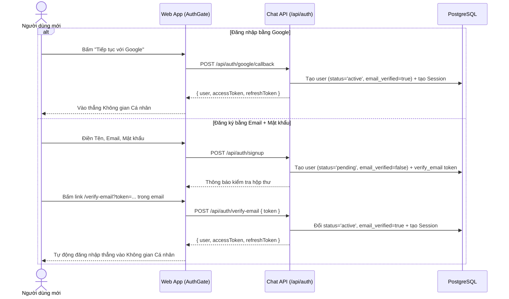

# Đăng ký / Đăng nhập vào thẳng Không gian Cá nhân và Đa Workspace Tổ chức theo Mã mời

**Ngày:** 01/11/2026
**Trạng thái:** Bản thảo chờ duyệt
**Phạm vi:** Luồng đăng ký / đăng nhập (`apps/chat-api/src/routes/auth/`, `apps/chat-web/src/components/AuthGate.tsx`), mô hình Đa Workspace (`db/v3/0015_workspaces.sql`), cô lập ngữ cảnh theo `X-Workspace-Id` và bộ chuyển đổi không gian trên giao diện (`MainNav.tsx`, `UserNavMenu.tsx`, `RequestMoments.tsx`, `SettingsPage.tsx`, `UsersPage.tsx`).

---

## 1. Mục đích và Lý do (Intent & Why)

Hiện tại, bất kỳ người dùng mới nào đăng ký tài khoản (bằng Email + Mật khẩu hoặc bằng Google OAuth) đều bị gán `users.status = 'pending'` và bị chặn hoàn toàn ở màn hình đăng nhập với thông báo *"Tài khoản đang chờ quản trị viên duyệt"* (`403 ACCOUNT_PENDING`). Ngay cả sau khi người dùng đã bấm link xác minh email, họ vẫn không thể vào hệ thống cho tới khi Admin duyệt thủ công.

Từ góc nhìn của người dùng cuối, rào cản này gây trải nghiệm xấu, thiếu thân thiện và làm đứt gãy luồng tiếp cận sản phẩm.

**Thiết kế mới giải quyết triệt để vấn đề này bằng cách tách rời hai khái niệm:**
1. **Quyền truy cập hệ thống (Chế độ Cá nhân — Mặc định):** Mọi người dùng sau khi xác thực danh tính (1 chạm với Google hoặc bấm link xác minh trong email) đều có `users.status = 'active'` và được **tự động đăng nhập thẳng vào Không gian Cá nhân** để sử dụng trợ lý AI cùng các dịch vụ cá nhân của riêng mình ngay lập tức, không cần bất kỳ Admin nào duyệt.
2. **Quyền tham gia Tổ chức (Chế độ Workspace Tổ chức — Đa tổ chức):** Sản phẩm phục vụ nhiều tổ chức độc lập. Khi người dùng muốn làm việc trong một tổ chức, họ có thể **tự tạo Workspace tổ chức mới** (trở thành Admin của tổ chức đó) hoặc **nhập Mã mời (Invite Code)** do Admin của tổ chức cung cấp. Sau khi nhập Mã mời, yêu cầu tham gia mới cần Admin của chính tổ chức đó duyệt. Trong thời gian chờ duyệt vào tổ chức, người dùng vẫn sử dụng Không gian Cá nhân và các tổ chức khác đã được duyệt một cách bình thường.

---

## 2. Các phương án kỹ thuật đã xét (Approaches)

| Phương án | Cách hoạt động | Đánh đổi (Trade-offs) | Quyết định |
|---|---|---|---|
| **Hướng 1: Multi-Workspace chuẩn với ngữ cảnh `X-Workspace-Id` (`null` = Cá nhân)** | Tách bảng `workspaces` và `workspace_members`. Gắn `workspace_id` (nullable) vào hội thoại, lịch chạy, kết nối dịch vụ nhóm và bảng Trello nhóm. Frontend truyền `X-Workspace-Id` khi ở tổ chức hoặc để trống khi ở Cá nhân. | **Ưu:** Cô lập dữ liệu chặt chẽ giữa các tổ chức; chuyển đổi qua lại tức thì không cần cấp lại JWT; giữ tương thích ngược cao.<br>**Nhược:** Cần cập nhật các hàm truy vấn dịch vụ nhóm, hội thoại, lịch chạy theo `workspaceId`. | **Chọn** |
| **Hướng 2: Lưu Workspace đang chọn vào `auth_sessions` / cấp lại JWT mỗi lần chuyển** | Nhúng `active_workspace_id` vào phiên và JWT; mỗi lần đổi không gian phải gọi API xoay lại token. | **Ưu:** Backend đọc thẳng `req.user.workspaceId` từ JWT.<br>**Nhược:** Chuyển đổi không gian bị trễ; mở 2 tab trình duyệt ở 2 workspace khác nhau sẽ ghi đè phiên của nhau. | **Bỏ** |
| **Hướng 3: Chỉ tách bảng Thành viên theo Tổ chức, giữ chung `service_credentials` toàn hệ thống** | Có bảng `workspaces` và Mã mời nhưng vẫn dùng chung `service_credentials` (`user_id IS NULL`) cho mọi tổ chức. | **Ưu:** Sửa ít code adapter nhất.<br>**Nhược:** Lộ và dùng chung cấu hình Jira/Notion/Trello giữa các tổ chức khác nhau, vi phạm tính riêng tư đa tổ chức. | **Bỏ** |

---

## 3. Mục tiêu, Không làm và Những điều không được xảy ra

### 3.1. Mục tiêu (Goals)
1. **Đăng nhập Google vào thẳng hệ thống:** Người dùng mới đăng nhập bằng Google (`email_verified = true`) được tạo với `users.status = 'active'` và vào thẳng `Không gian Cá nhân` ngay lập tức.
2. **Xác minh Email tự động đăng nhập:** Người dùng đăng ký bằng Email + Mật khẩu sau khi bấm link `/verify-email?token=...` sẽ được kích hoạt `users.status = 'active'`, `email_verified = true`, đồng thời backend cấp luôn phiên đăng nhập (`accessToken`, `refreshToken`) để trình duyệt tự động đưa thẳng vào `Không gian Cá nhân` mà không bắt gõ lại mật khẩu.
3. **Thông báo thân thiện khi chưa xác minh Email:** Nếu người dùng đăng ký Email + Mật khẩu nhưng chưa bấm link trong email mà thử đăng nhập, trả mã `403 EMAIL_NOT_VERIFIED` và hiển thị màn nhắc kiểm tra hộp thư kèm nút **"Gửi lại email xác minh"** ngay tại chỗ.
4. **Tạo và Tham gia nhiều Workspace Tổ chức (kèm Link mời 1 chạm & Tùy chọn Vào thẳng):**
   - Mọi người dùng đã đăng nhập đều có thể tạo Workspace tổ chức mới (trở thành `admin` với `status = 'active'` của tổ chức đó và nhận `invite_code` + Link mời `/?invite=ATI-XXXX-XXXX`).
   - Người dùng có thể nhập `invite_code` (trong ứng dụng hoặc ngay ở ô tùy chọn trên màn Đăng ký) hoặc bấm **Link mời trực tiếp (`/?invite=ATI-XXXX-XXXX`)** để tham gia một tổ chức có sẵn. Ngay khi xác thực tài khoản xong, hệ thống tự động xử lý mã mời đã lưu.
   - Tổ chức có tùy chọn `require_approval` (mặc định `true` — cần Admin duyệt; nếu Admin tắt `require_approval = false` cho nhóm nội bộ thì người có đúng Mã mời / Link mời sẽ vào thẳng với `status = 'active'`).
   - Một người dùng có thể tham gia đồng thời nhiều Workspace tổ chức và chuyển đổi qua lại giữa `Không gian Cá nhân` và các `Workspace Tổ chức` qua **Bộ chuyển đổi Workspace đặt cạnh Logo góc trái trên `MainNav.tsx`** (Phương án A).
5. **Quản trị Thành viên & Mã mời theo từng Tổ chức:** Admin của tổ chức xem và sao chép Mã mời / Link mời, bật/tắt chế độ **"Cần Admin duyệt khi nhập mã"**, có thể đổi Mã mời mới (thu hồi mã cũ), và phê duyệt (`Chấp thuận`, `Chấp thuận tất cả`, `Từ chối`) yêu cầu tham gia của tổ chức mình tại trang `/admin/users`.
6. **Không gian Cá nhân đầy đủ năng lực tự động hoá & Cô lập dữ liệu chặt chẽ theo Workspace:**
   - Ở **Không gian Cá nhân (`X-Workspace-Id: personal`)**: người dùng là chủ sở hữu không gian của chính mình (`canConfigure = true`), được tự kết nối và sử dụng các dịch vụ cá nhân (`gmail`, `mycalendar`, `mysheets`, `trello` cá nhân) cũng như tự gắn khoá riêng cho `notion`, `github`, `telegram`, `slack`, `jira` (lưu theo `user_id = req.user.id AND workspace_id IS NULL`), ẩn 2 mục Service Account trùng lặp (`google-calendar`, `google-sheets`).
   - Ở **Workspace Tổ chức (`X-Workspace-Id: <uuid>`)**: hội thoại, lịch chạy và các kết nối dịch vụ dùng chung của tổ chức thuộc về `workspace_id` riêng biệt, không bị lẫn giữa các tổ chức hay không gian cá nhân.

### 3.2. Không làm (Non-goals)
- Không làm trang danh bạ công khai liệt kê tất cả tổ chức trên hệ thống (người dùng chỉ tìm thấy tổ chức khi có Mã mời).
- Không làm hệ thống thanh toán (billing/subscription) theo tổ chức.
- Không thay đổi cơ chế OAuth cá nhân của Gmail, Google Calendar cá nhân, Google Sheets cá nhân (các kết nối này luôn thuộc về cá nhân `user_id` của người đang chat).

### 3.3. Những điều không được xảy ra (Anti-goals)
1. Không bao giờ chặn một người dùng đã xác minh email ở ngoài màn hình đăng nhập chỉ vì họ chưa được Admin tổ chức nào duyệt.
2. Người dùng đang ở trạng thái `pending` hoặc `disabled` tại Tổ chức A tuyệt đối không được đọc/ghi hội thoại, lịch chạy hay dùng dịch vụ chung của Tổ chức A (kể cả khi cố tình gắn header `X-Workspace-Id` của Tổ chức A).
3. Admin của Tổ chức A không được nhìn thấy hay phê duyệt/khóa thành viên của Tổ chức B, và không thể khóa tài khoản toàn cục (`users.status`) làm ảnh hưởng đến Không gian Cá nhân của người dùng đó.
4. Đổi Mã mời mới của tổ chức không làm mất các yêu cầu tham gia (`pending`) đã gửi hợp lệ trước đó.

---

## 4. Thiết kế chi tiết

### 4.1. Luồng Xác thực & Vòng đời Tài khoản (`users`)



- **Tại `POST /api/auth/verify-email` (`signup.ts`):**
  - Khi `authTokens.verifyEmail(token, now)` thành công: trong cùng transaction tại `AuthTokenRepo.consume`, câu lệnh `UPDATE users` cập nhật đồng thời `email_verified = true, status = CASE WHEN status = 'pending' THEN 'active' ELSE status END, updated_at = $3`.
  - Sau khi cập nhật, nếu `user.status === 'active'` và có `SessionRepo`: gọi `sessions.create(user.id, req.get('User-Agent'), now)` và trả về `{ message: 'Email đã xác minh. Đang đưa bạn vào không gian làm việc...', user: toAuthUser(user), ...generateAccessToken(toAuthUser(user), options.jwtSecret, session.sessionId, now), refreshToken: session.refreshToken }`.
  - Bỏ lời gọi `notifyAdmins(options, user)` ở bước xác minh email (vì lúc này user chỉ mới vào Không gian Cá nhân, chưa xin vào tổ chức nào).
- **Tại `POST /api/auth/login` (`session.ts`):**
  - Nếu xác thực mật khẩu đúng nhưng `!found.email_verified`: trả `403` với `{ error: 'Vui lòng xác minh email trước khi đăng nhập.', code: 'EMAIL_NOT_VERIFIED' }`.
  - Nếu `user.status === 'disabled'`: trả `403` với `{ error: 'Tài khoản đã bị vô hiệu hóa.', code: 'ACCOUNT_DISABLED' }`.
- **Tại `POST /api/auth/google/callback` (`google.ts` & `google-auth-repo.ts`):**
  - Trong `GoogleAuthRepo.resolveAccount`: khi tạo user mới qua Google (`INSERT INTO users`), đặt `status = 'active', email_verified = true` (thay vì `'pending'`).
  - Nếu tìm thấy user cũ theo email đang có `email_verified = false` và `status = 'pending'`: khi liên kết Google thành công, nâng `email_verified = true, status = 'active'`.
  - Bỏ việc gửi `pendingApprovalEmail` cho Admin ở bước đăng nhập Google.

### 4.2. Cơ sở dữ liệu Đa Workspace (`db/v3/0015_workspaces.sql`)

1. **Bảng `workspaces`:**
   ```sql
   CREATE TABLE IF NOT EXISTS workspaces (
     id               UUID PRIMARY KEY DEFAULT gen_random_uuid(),
     name             TEXT NOT NULL CHECK (char_length(btrim(name)) BETWEEN 1 AND 100),
     invite_code      TEXT UNIQUE NOT NULL,
     require_approval BOOLEAN NOT NULL DEFAULT true,
     created_by       UUID NOT NULL REFERENCES users(id),
     created_at       TIMESTAMPTZ NOT NULL DEFAULT now(),
     updated_at       TIMESTAMPTZ NOT NULL DEFAULT now()
   );
   ```
   - `invite_code` sinh theo mẫu `ATI-XXXX-XXXX` (dùng bảng chữ cái rõ nghĩa `ABCDEFGHJKLMNPQRSTUVWXYZ23456789`, bỏ `0, O, 1, I` để người dùng dễ đọc và nhập tay).
   - `require_approval`: mặc định `true` (người nhập mã vào trạng thái `pending` chờ Admin duyệt). Nếu Admin tắt (`require_approval = false` cho đội nhóm nội bộ), người nhập đúng mã mời / bấm link mời sẽ vào thẳng với `status = 'active'`.

2. **Bảng `workspace_members`:**
   ```sql
   CREATE TABLE IF NOT EXISTS workspace_members (
     workspace_id UUID NOT NULL REFERENCES workspaces(id) ON DELETE CASCADE,
     user_id      UUID NOT NULL REFERENCES users(id) ON DELETE CASCADE,
     role         TEXT NOT NULL DEFAULT 'member' CHECK (role IN ('admin', 'member')),
     status       TEXT NOT NULL DEFAULT 'pending' CHECK (status IN ('pending', 'active', 'disabled')),
     created_at   TIMESTAMPTZ NOT NULL DEFAULT now(),
     updated_at   TIMESTAMPTZ NOT NULL DEFAULT now(),
     PRIMARY KEY (workspace_id, user_id)
   );
   CREATE INDEX IF NOT EXISTS idx_workspace_members_user_id ON workspace_members(user_id);
   ```

3. **Mở rộng các bảng nghiệp vụ với `workspace_id` và `workspace_mode`:**
   - `conversations`:
     - `ADD COLUMN IF NOT EXISTS workspace_id UUID REFERENCES workspaces(id) ON DELETE CASCADE` (nullable; `NULL` khi ở Cá nhân hoặc Legacy).
     - `ADD COLUMN IF NOT EXISTS workspace_mode TEXT NOT NULL DEFAULT 'legacy' CHECK (workspace_mode IN ('legacy', 'personal', 'organization'))`.
     - Ràng buộc nhất quán: `(workspace_mode = 'organization' AND workspace_id IS NOT NULL) OR (workspace_mode IN ('legacy', 'personal') AND workspace_id IS NULL)`.
     - Truy vấn lọc đồng thời theo người sở hữu và không gian: `WHERE user_id = $1 AND workspace_mode = $2 AND workspace_id IS NOT DISTINCT FROM $3`.
   - `schedules`:
     - `ADD COLUMN IF NOT EXISTS workspace_id UUID REFERENCES workspaces(id) ON DELETE CASCADE` (nullable).
     - `ADD COLUMN IF NOT EXISTS workspace_mode TEXT NOT NULL DEFAULT 'legacy' CHECK (workspace_mode IN ('legacy', 'personal', 'organization'))`.
     - Ràng buộc nhất quán tương tự `conversations`. Khi `ScheduleRunner.planOne` tạo cuộc hội thoại mới cho lượt chạy lịch, phải sao chép cả `s.workspace_id` và `s.workspace_mode` từ lịch sang cuộc hội thoại mới, đồng thời kiểm tra nếu `s.workspace_mode = 'organization'` thì `s.user_id` phải vẫn đang là thành viên `active` của `s.workspace_id` (nếu đã bị khóa trong tổ chức thì lượt chạy báo lỗi quyền và không lập kế hoạch bằng tài nguyên của tổ chức đó).
   - `service_credentials`:
     - `ADD COLUMN IF NOT EXISTS workspace_id UUID REFERENCES workspaces(id) ON DELETE CASCADE` (nullable).
     - **Ba phạm vi lưu trữ rõ ràng, không bao giờ đọc/xoá chồng chéo:**
       1. **Kết nối của riêng người dùng (`workspace_mode = 'personal'` hoặc OAuth cá nhân):** `user_id = req.user.id AND workspace_id IS NULL`. Áp dụng cho cả OAuth cá nhân (`gmail`, `mycalendar`, `mysheets`, `trello`) lẫn các dịch vụ khoá/token cá nhân mà người dùng tự gắn trong Không gian Cá nhân (`notion`, `github`, `telegram`, `slack`, `jira`).
       2. **Kết nối dùng chung của một Workspace Tổ chức (`workspace_mode = 'organization'`):** `user_id IS NULL AND workspace_id = <id tổ chức>`. Áp dụng cho 7 dịch vụ của tổ chức (`slack`, `github`, `notion`, `jira`, `telegram`, `google-calendar`, `google-sheets`) do Admin của tổ chức đó cấu hình.
       3. **Kết nối dùng chung `legacy` (tương thích ngược cho bộ kiểm thử cũ không gửi header `X-Workspace-Id`):** `user_id IS NULL AND workspace_id IS NULL`.
     - Mọi thao tác `saveCredentials`, `updateCredentials`, `deleteCredentials`, `getCredentials` phải khóa `pg_advisory_xact_lock` theo đúng cặp `(service, ownerKey)` và lọc chính xác cả `user_id IS NOT DISTINCT FROM $userId AND workspace_id IS NOT DISTINCT FROM $workspaceId` để thao tác ở Cá nhân, Tổ chức A, Tổ chức B và Legacy hoàn toàn độc lập.
   - `trello_team_scope` và `trello_team_boards`:
     - Gỡ bỏ ràng buộc inline `CHECK (id = 'default')` và `CHECK (scope_id = 'default')` bằng khối `DO $$ ... pg_constraint ... $$` và thay bằng ràng buộc cho phép:
       - `'personal:' || user_id` khi người dùng chọn bảng Trello cá nhân trong Không gian Cá nhân (`workspace_mode = 'personal'`),
       - `workspace_id::text` khi Admin chọn bảng Trello chung cho một Workspace Tổ chức (`workspace_mode = 'organization'`),
       - `'default'` khi request từ bộ kiểm thử cũ không gửi header `X-Workspace-Id` (`workspace_mode = 'legacy'`).

### 4.3. Giao thức Ngữ cảnh `X-Workspace-Id` và API Workspace

1. **Header `X-Workspace-Id`:**
   - Khi người dùng ở **Không gian Cá nhân**: frontend gửi `X-Workspace-Id: personal` (`req.workspaceContext = { mode: 'personal', workspaceId: null, role: 'admin' }`).
   - Khi người dùng chọn một **Workspace Tổ chức**: frontend gửi `X-Workspace-Id: <workspace-uuid>`.
   - Khi không có header `X-Workspace-Id`: `req.workspaceContext = { mode: 'legacy', workspaceId: null, role: req.user.role }` (giữ tương thích ngược cho kiểm thử cũ).
   - Middleware kiểm tra quyền Workspace:
     - Với các route nghiệp vụ (`/api/conversations`, `/api/schedules`, `/api/services`, `/api/connections/trello`, `/api/admin/users`): nếu `X-Workspace-Id` là UUID tổ chức, truy vấn `workspace_members` để xác nhận `(workspace_id, req.user.id)` có `status = 'active'`.
     - Nếu `status = 'pending'`: trả `403 { code: 'WORKSPACE_PENDING', error: 'Yêu cầu tham gia tổ chức của bạn đang chờ quản trị viên duyệt.' }`.
     - Nếu `status = 'disabled'` hoặc không có bản ghi: trả `403 { code: 'WORKSPACE_FORBIDDEN', error: 'Bạn không có quyền truy cập không gian tổ chức này.' }`.
     - Gán `req.workspaceContext = { mode: 'organization', workspaceId: id, workspaceName: name, role }` (`role` là vai trò của user trong chính tổ chức đó).

2. **Các Endpoint `/api/workspaces`:**
   - `GET /api/workspaces`: Trả về `{ workspaces: Array<{ id, name, role, status, inviteCode?, requireApproval?, pendingCount?, createdAt }> }` của người đang đăng nhập. `inviteCode`, `requireApproval` và `pendingCount` chỉ trả về ở những workspace mà người đó có `role === 'admin' && status === 'active'`.
   - `POST /api/workspaces`: Body `{ name, requireApproval?: boolean }`. Tạo workspace mới với `invite_code` duy nhất, `require_approval` (mặc định `true`), và thêm người gọi làm `role = 'admin', status = 'active'`. Trả về `{ workspace }`.
   - `POST /api/workspaces/join`: Body `{ inviteCode }`.
     - Chuẩn hóa mã `inviteCode.trim().toUpperCase()`.
     - Tìm `workspaces` theo `invite_code`. Không thấy trả `404 { code: 'INVALID_INVITE_CODE', error: 'Mã mời không hợp lệ hoặc không tồn tại.' }`.
     - Nếu user đã có bản ghi ở workspace này:
       - `status = 'active'` hoặc `'pending'`: trả lại bản ghi hiện tại (`200 OK`).
       - `status = 'disabled'`: trả `403 { code: 'WORKSPACE_MEMBER_DISABLED', error: 'Bạn đã bị khóa quyền thành viên trong tổ chức này.' }`.
     - Nếu chưa có:
       - Nếu `workspace.require_approval === false`: thêm vào `workspace_members` với `role = 'member', status = 'active'` (vào thẳng tổ chức ngay lập tức!). Trả về `201 { workspace }`.
       - Nếu `workspace.require_approval === true`: thêm vào `workspace_members` với `role = 'member', status = 'pending'`. Gửi email thông báo cho các Admin `active` của workspace đó. Trả về `201 { workspace }`.
   - `POST /api/workspaces/:id/invite-code/regenerate`: Chỉ Admin `active` của workspace `:id` được gọi. Sinh `invite_code` mới và trả về `{ inviteCode }`.
   - `PATCH /api/workspaces/:id/settings`: Body `{ requireApproval: boolean }`. Chỉ Admin `active` của workspace `:id` được gọi. Cập nhật `require_approval` của tổ chức và trả về `{ requireApproval }`.

3. **Quản trị thành viên theo Tổ chức (`/api/admin/users`):**
   - Khi có header `X-Workspace-Id: <uuid>`, `AdminUserRepo` làm việc trên bảng `workspace_members JOIN users` của đúng `workspace_id` đó (thay vì sửa cột `users.status` hay `users.role` toàn cục):
     - `approve`: chuyển `workspace_members.status` từ `'pending'` sang `'active'`.
     - `approve-all` (`POST /api/admin/users/approve-all`): chuyển toàn bộ yêu cầu đang `'pending'` của tổ chức đó sang `'active'` chỉ với 1 thao tác, trả về `{ approvedCount }`.
     - `reject` (`POST /api/admin/users/:id/reject`): xoá dòng `workspace_members` đang `'pending'` để người dùng có thể gửi lại nếu nhập nhầm.
     - `disable` / `enable`: đổi `workspace_members.status` giữa `'active'` và `'disabled'` trong phạm vi tổ chức đó (không khóa Không gian Cá nhân của user).
     - `role`: đổi `workspace_members.role` giữa `'member'` và `'admin'` (chặn hạ quyền/khóa nếu đó là Admin `active` cuối cùng của tổ chức).
   - Khi không có header `X-Workspace-Id` (để tương thích ngược với các bài test cũ gọi thẳng `/api/admin/users` bằng tài khoản global admin): giữ nguyên hành vi cũ trên bảng `users`.

4. **Danh sách Dịch vụ, Lập kế hoạch & Thực thi (`AdapterFactory` & `ExecutionService`) theo Ngữ cảnh:**
   - **Ở Không gian Cá nhân (`X-Workspace-Id: personal`, `workspace_mode = 'personal'`):**
     - Người dùng là chủ sở hữu không gian của chính mình (`canConfigure: true`).
     - Các dịch vụ OAuth cá nhân (`gmail`, `mycalendar`, `mysheets`) hoạt động bình thường.
     - Với `trello`: người dùng sau khi kết nối OAuth Trello cá nhân được tự chọn tối đa 10 bảng Trello cá nhân của mình (lưu tại `trello_team_scope.id = 'personal:' || user_id`) để sử dụng cho mục đích cá nhân.
     - Với 5 dịch vụ `slack`, `github`, `notion`, `jira`, `telegram`: người dùng được phép tự cấu hình và lưu khoá/scope cá nhân của riêng mình (lưu tại `service_credentials` với `user_id = req.user.id AND workspace_id IS NULL`; tuyệt đối không fallback về các bản ghi `user_id IS NULL`).
     - Với 2 dịch vụ Service Account doanh nghiệp (`google-calendar`, `google-sheets`): ẩn khỏi danh sách trả về của `GET /api/services` ở chế độ `'personal'` (vì người dùng cá nhân đã có `mycalendar` và `mysheets` kết nối bằng OAuth 1 chạm, tránh hiển thị trùng 2 bản Google Calendar / 2 bản Google Sheets).
   - **Ở Workspace Tổ chức (`X-Workspace-Id: <uuid>`, `workspace_mode = 'organization'`):**
     - Đọc/ghi `service_credentials` của tổ chức theo `user_id IS NULL AND workspace_id = req.workspaceContext.workspaceId` và `trello_team_scope` theo `id = req.workspaceContext.workspaceId`.
     - Chỉ người có `req.workspaceContext.role === 'admin'` mới được cập nhật key dịch vụ chung hoặc chọn bảng Trello cho tổ chức đó (`canConfigure = (req.workspaceContext.role === 'admin')`).
   - **Khi không có header `X-Workspace-Id` (`workspace_mode = 'legacy'` — Chế độ tương thích ngược cho kiểm thử cũ):**
     - Đọc `service_credentials` có `user_id IS NULL AND workspace_id IS NULL` và `trello_team_scope` có `id = 'default'`.
   - **Cô lập Cache và Kiểm tra Quyền lúc Thực thi (`AdapterFactory` & `ExecutionService`):**
     - `AdapterContext` mang thêm `workspaceMode?: 'legacy' | 'personal' | 'organization'` và `workspaceId?: string | null`.
     - Trong `AdapterFactory`, khóa bộ nhớ đệm (`adapterCache`) bao gồm đầy đủ ngữ cảnh:
       - Khi `workspaceMode === 'personal'`: khóa là `personal:${userId}:${serviceName}` và chỉ đọc credential cá nhân (`user_id = userId AND workspace_id IS NULL`).
       - Khi `workspaceMode === 'organization'`: khóa là `org:${workspaceId}:${serviceName}` và đọc credential của tổ chức (`user_id IS NULL AND workspace_id = workspaceId`).
       - Khi `workspaceMode === 'legacy'`: khóa là `legacy:${serviceName}` và đọc credential `user_id IS NULL AND workspace_id IS NULL`.
       - Với `trelloAdapter`, phạm vi bảng được đọc theo `scopeId` tương ứng (`'personal:' + userId`, `workspaceId`, hoặc `'default'`).
     - Trong `ExecutionService` (`approveAndStart`, `retryStep`, `skipStep`, `continueStep`): lấy `conversation.workspace_mode` và `conversation.workspace_id` trực tiếp từ cuộc hội thoại sở hữu kế hoạch để truyền vào `AdapterContext`. Nếu `conversation.workspace_mode === 'organization'`, bắt buộc kiểm tra người dùng hiện vẫn có `status = 'active'` trong `workspace_members` của `conversation.workspace_id` trước khi cho phép duyệt hoặc chạy tiếp (chặn trường hợp thành viên vừa bị Admin tổ chức khóa nhưng vẫn bấm duyệt kế hoạch cũ).
     - Khi gửi tin nhắn vào một cuộc hội thoại đã có (`POST /api/conversations/:id/messages`), kiểm tra `conversation.workspace_mode` và `conversation.workspace_id` phải khớp với ngữ cảnh `X-Workspace-Id` hiện tại của request để không trộn lẫn tin nhắn giữa các không gian.

---

## 5. Giao diện Người dùng (Frontend UX)

1. **Bộ chuyển đổi Workspace cạnh Logo góc trái trên [`MainNav.tsx`](file:///D:/Môn%20Học/ATI/ATI_Project/apps/chat-web/src/components/layout/MainNav.tsx) (Phương án A) & đồng bộ [`UserNavMenu.tsx`](file:///D:/Môn%20Học/ATI/ATI_Project/apps/chat-web/src/components/layout/UserNavMenu.tsx):**
   - Đặt ngay bên phải Logo `ATI` trên thanh điều hướng chung [`MainNav.tsx`](file:///D:/Môn%20Học/ATI/ATI_Project/apps/chat-web/src/components/layout/MainNav.tsx):
     - Hiển thị `👤 Không gian Cá nhân` (mặc định) hoặc `🏢 <Tên Tổ chức>`.
     - Bấm vào mở menu dropdown gồm:
       - Mục `Không gian Cá nhân` (luôn `Active`).
       - Danh sách các `Workspace Tổ chức`: những tổ chức đã `active` cho phép bấm để chuyển ngay; những tổ chức đang `pending` hiện nhãn `⏳ Chờ Admin duyệt` (disabled click chuyển, có tooltip giải thích).
       - Hai nút ở chân menu: **`+ Nhập mã mời`** và **`+ Tạo tổ chức`**.
   - Tab `Người dùng` (`/admin/users`) trên [`MainNav.tsx`](file:///D:/Môn%20Học/ATI/ATI_Project/apps/chat-web/src/components/layout/MainNav.tsx) và mục `Quản lý người dùng` trong [`UserNavMenu.tsx`](file:///D:/Môn%20Học/ATI/ATI_Project/apps/chat-web/src/components/layout/UserNavMenu.tsx):
     - **Ẩn** khi đang ở `Không gian Cá nhân` hoặc khi ở tổ chức với vai trò `member` (trừ khi ở chế độ legacy global admin).
     - **Hiện** khi đang ở một `Workspace Tổ chức` mà người dùng có vai trò `admin` (kèm badge số lượng thành viên đang chờ duyệt của tổ chức đó).
   - Khi người dùng chuyển đổi Workspace: tự động đưa về màn hình tạo cuộc hội thoại mới (`/`), reset store hội thoại hiện tại và tải lại danh sách dịch vụ + lịch sử hội thoại của không gian mới.
2. **Nhãn Ngữ cảnh Trực quan (Context Pill) & Thẻ Dẫn đường Nhanh trên Cockpit ([`RequestMoments.tsx`](file:///D:/Môn%20Học/ATI/ATI_Project/apps/chat-web/src/pages/Cockpit/RequestMoments.tsx)) và Settings ([`SettingsPage.tsx`](file:///D:/Môn%20Học/ATI/ATI_Project/apps/chat-web/src/pages/Settings/SettingsPage.tsx)):**
   - Phía trên tiêu đề của Cockpit và trang Kết nối dịch vụ hiển thị rõ nhãn không gian hiện tại:
     - Ở Cá nhân: `👤 Không gian Cá nhân · Tự động hoá trên các công cụ của riêng bạn`.
     - Ở Tổ chức: `🏢 <Tên Tổ chức> · Thao tác trên công cụ chung của tổ chức & kết nối cá nhân của bạn`.
   - Nếu người dùng đang ở `Không gian Cá nhân` và chưa tham gia tổ chức nào, hiển thị thẻ gợi ý gọn nhẹ trên Cockpit: *"Làm việc cùng đội nhóm? [Nhập mã mời] hoặc [Tạo Workspace tổ chức]"*.
3. **Link mời 1 chạm (`/?invite=ATI-XXXX-XXXX`), Ô Mã mời lúc Đăng ký & Hộp thoại Nhập Mã mời / Tạo Tổ chức:**
   - Hỗ trợ đường dẫn có tham số `?invite=ATI-XXXX-XXXX` (hoặc `/join?code=ATI-XXXX-XXXX`) và ô tùy chọn *"Mã mời tổ chức (không bắt buộc)"* trên form Đăng ký. Mã mời được lưu tạm vào `sessionStorage`; ngay khi người dùng xác thực Google hoặc bấm link xác minh email xong, ứng dụng tự động gọi `POST /api/workspaces/join` để gia nhập tổ chức (vào thẳng nếu `require_approval = false`, hoặc báo đang chờ Admin duyệt).
   - **Tab Nhập mã mời:** Ô nhập mã (tự động viết hoa, ví dụ `ATI-ALPHA-8F2K`) + nút **"Tham gia tổ chức"**.
   - **Tab Tạo tổ chức mới:** Ô nhập tên tổ chức (tối đa 100 ký tự) + tùy chọn **"Cần Admin duyệt khi thành viên nhập mã"** (mặc định bật) + nút **"Tạo Workspace"**. Tạo xong tự động chuyển sang Workspace vừa tạo.
4. **Trang Quản lý Thành viên của Tổ chức ([`UsersPage.tsx`](file:///D:/Môn%20Học/ATI/ATI_Project/apps/chat-web/src/pages/Users/UsersPage.tsx) tại `/admin/users`):**
   - Đầu trang hiển thị **Thẻ Mã mời của Tổ chức** gồm: mã `inviteCode`, nút **Sao chép mã**, nút **Sao chép Link mời**, nút **Đổi mã mới**, và công tắc bật/tắt **"Cần Admin duyệt khi nhập mã"**.
   - Danh sách **Yêu cầu chờ duyệt** có nút **Chấp thuận tất cả** (khi có từ 1 yêu cầu chờ duyệt trở lên) cùng nút **Chấp thuận** và **Từ chối** trên từng dòng.
5. **Màn hình Xác minh Email (`VerifyEmailView.tsx` & `AuthActionPage.tsx`):**
   - Khi xác minh email thành công và nhận về `accessToken`, tự động lưu phiên vào `authStorage`, xử lý `pendingInviteCode` (nếu có) và chuyển thẳng vào `/`.
   - Khi đăng nhập gặp mã `EMAIL_NOT_VERIFIED`, hiện màn hình nhắc kiểm tra hộp thư kèm nút **"Gửi lại email xác minh"** ngay tại chỗ.

---

## 6. Quyết định của người viết đặc tả & Phần giao cho người thi công

### Quyết định đã chốt trong đặc tả (Spec Author Calls)
- **Không gian Cá nhân đầy đủ quyền kết nối (`canConfigure = true`):** Trong Không gian Cá nhân (`X-Workspace-Id: personal`), người dùng không chỉ dùng được Gmail/MyCalendar/MySheets và tự chọn 10 bảng Trello cá nhân (`trello_team_scope.id = 'personal:' || user_id`), mà còn được tự cấu hình khoá cá nhân cho `notion`, `github`, `telegram`, `slack`, `jira` (lưu với `user_id = req.user.id AND workspace_id IS NULL`). Riêng 2 dịch vụ Service Account doanh nghiệp (`google-calendar`, `google-sheets`) được ẩn ở chế độ Cá nhân để tránh trùng lặp với `mycalendar` và `mysheets`.
- **Quyền sở hữu Hội thoại & Lịch chạy trong Tổ chức:** Mỗi cuộc hội thoại (`conversations`) và lịch chạy (`schedules`) luôn thuộc về cá nhân người tạo trong phạm vi không gian đó (`WHERE user_id = req.user.id AND workspace_mode = $2 AND workspace_id IS NOT DISTINCT FROM $3`), đảm bảo an toàn cho cơ chế duyệt `plan_hash` và token cá nhân.
- **Định dạng Mã mời & Chế độ Gia nhập Linh hoạt:** Dùng mẫu `ATI-XXXX-XXXX` kèm Link mời `/?invite=ATI-XXXX-XXXX`, hỗ trợ cả chế độ cần Admin duyệt (`require_approval = true`, có nút `Chấp thuận tất cả`) lẫn chế độ vào thẳng cho nhóm nội bộ (`require_approval = false`).
- **Tương thích ngược cho bộ kiểm thử hiện có:** Khi request không gửi header `X-Workspace-Id` (các bài test cũ), backend giữ `workspace_mode = 'legacy'`, đọc `user_id IS NULL AND workspace_id IS NULL` và `trello_team_scope.id = 'default'` để không làm gãy hơn 2.500 bài test hiện hữu.
- **Lưu lựa chọn Workspace trên trình duyệt:** Lưu `activeWorkspaceId` (`'personal'` hoặc `<uuid>`) trong `localStorage` gắn theo `user.id`. Khi đăng nhập lại hoặc tải lại trang, nếu tổ chức đó vẫn `active` thì giữ nguyên; nếu không thì tự động quay về `'personal'`.

### Phần giao cho người thi công (Left to the Builder)
- Chi tiết CSS/animation đóng mở dropdown Bộ chuyển đổi Workspace và hộp thoại Tạo/Nhập mã mời (tuân thủ bảng màu và token sẵn có trong `DESIGN.md`).
- Cấu trúc tách file nội bộ giữa `WorkspaceRepo` và `AdminUserRepo` trong `apps/chat-api/src/db/repositories/`.
