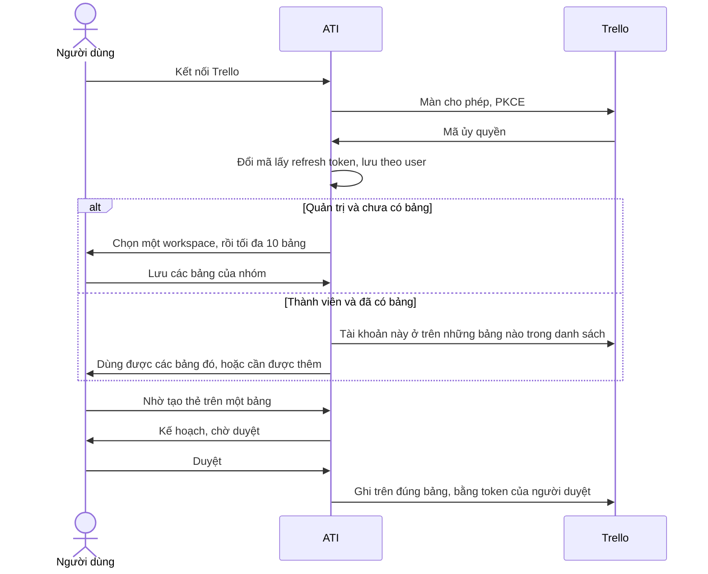

# Trello OAuth: đăng nhập và cấp quyền thay cho dán token

**Ngày:** 01/11/2026
**Trạng thái:** Đã duyệt 01/11/2026.
**Phạm vi:** Thay cách kết nối dịch vụ `trello` đang có. Không thêm dịch vụ thứ hai.
**Cập nhật:** Nhóm trưởng đổi phạm vi từ một bảng sang nhiều bảng trong cùng một workspace, và giữ ATI ở câu nói xuyên dịch vụ, không làm luật tự chạy khi thẻ đổi cột.

## 1. Mục đích

Hôm nay một quản trị viên dán API key và token Trello. Cả nhóm dùng chung token đó. Người dùng phải mở trang developer của Trello, tự tạo token, rồi dán vào ATI.

Việc cần đạt: người dùng bấm kết nối, đăng nhập Trello, bấm cho phép, rồi dùng được. Ô API key và ô token biến mất.

Mỗi người đăng nhập tài khoản Trello của mình. Việc làm trên Trello là của nhóm. Quản trị chọn một workspace, rồi chọn các bảng của workspace đó, tối đa 10 bảng, một lần cho cả nhóm. Thành viên không chọn bảng. Thẻ chỉ tạo được trên bảng đã chọn, và chỉ khi tài khoản Trello của người đang chat đang là thành viên của bảng ấy. Bảng riêng tư và bảng thuộc workspace khác không dùng được. Lệnh ghi vẫn hiện kế hoạch và chờ đúng người đang chat duyệt.

## 2. Phương án

| Cách | Kết quả | Quyết định |
|---|---|---|
| Dịch vụ Trello thứ hai, đứng cạnh bản dán token, cờ tắt | Người dùng vẫn dán token để dùng Trello đang có | Bỏ. Trái với mục đích |
| Cả nhóm dùng một lần đăng nhập chung | Không còn từng người đăng nhập tài khoản của mình | Bỏ |
| Để công tắc tắt đến sau buổi bảo vệ 11/11, bản demo vẫn dán token | OAuth có mã nhưng chưa phải cách dùng | Bỏ. Nhóm trưởng chọn bật ngay khi phần này làm xong |
| Chỉ một bảng cho cả nhóm | Câu “tạo thẻ trên bảng Bugs” bị từ chối khi nhóm có nhiều bảng trong cùng workspace | Bỏ sau khi nhìn từ phía người dùng |
| Luật tự chạy khi thẻ đổi cột, không cần người duyệt | Trùng việc Butler đã làm trên bảng, và bỏ bước duyệt của ATI | Bỏ. Nhóm trưởng giữ ATI ở câu nói xuyên dịch vụ |
| Mỗi người tự chọn bảng, hoặc ATI đụng mọi bảng tài khoản họ mở được | Bảng riêng tư lọt vào, hai người có thể ghi hai nơi khác nhau | Bỏ |
| Làm trên dịch vụ `trello` đang có. Chín tool `trello.*` giữ nguyên. Quản trị chọn tối đa 10 bảng trong một workspace. Khi phần này vào bản đang chạy, ô dán token không còn | Đúng mục đích và đúng cách một nhóm dùng Trello | **Chọn** |

Không có cờ `TRELLO_OAUTH_ENABLED`. Gộp phần này vào bản đang chạy có nghĩa là hành vi Trello đổi ngay. Buổi bảo vệ 11/11, nếu phần này đã nằm trong bản demo, sẽ dùng luồng đăng nhập. Đó là hệ quả đã chấp nhận.

## 3. Mục tiêu

1. Thành viên bấm **Kết nối Trello**, đăng nhập ở Trello, bấm cho phép, rồi quay lại ATI.
2. Quản trị, sau lần cho phép của chính mình, chọn một workspace rồi chọn từ 1 đến 10 bảng thuộc workspace đó. Các bảng này lưu một lần cho cả nhóm.
3. Thành viên đã cho phép và đang ở trên ít nhất một bảng đã chọn thì planner có chín tool `trello.*`. Đọc và ghi chỉ đụng những bảng đã chọn mà chính người đó là thành viên.
4. Thành viên chưa cho phép thì được mời kết nối. Đã cho phép nhưng không ở trên bảng nào đã chọn thì được báo cần được thêm trên Trello, và chưa có tool.
5. Người đã ở trên một vài bảng, nhưng câu chat nhắm vào một bảng đã chọn mà họ chưa được vào, thì từ chối riêng bảng đó. Các bảng họ đã ở vẫn dùng được.
6. Quản trị chưa chọn workspace và chưa chọn bảng thì chưa ai có tool Trello. Người đã kết nối thấy lời nhắc là quản trị chưa chọn bảng.
7. `create_card`, `update_card`, `add_member` và `add_checklist` vẫn cần duyệt đúng `plan_hash`. Không tự chạy.
8. Refresh token nằm trong cơ sở dữ liệu, đã mã hoá. Access token chỉ nằm trong bộ nhớ tiến trình. Hết hạn thì làm mới. Làm mới thất bại thì người đó phải kết nối lại.

## 4. Không làm

- Không thêm tool mới. Không xoá bảng, không xoá thẻ, không mời người chưa có trên bảng vào bảng hoặc vào workspace.
- Không cho mỗi người tự chọn bảng. Không lấy bảng ngoài workspace đã chọn. Không chọn quá 10 bảng.
- Không tự đổi token dán sẵn thành OAuth. Token dán sẵn là của một người mà cả nhóm đang dùng chung. Đổi ngầm sẽ thu hồi token đó và gắn quyền vào một người.
- Không làm OAuth cho Slack, GitHub, Notion, Jira trong phần này.
- Không nhận webhook từ Trello. Không có luật tự chạy khi thẻ đổi cột, hết hạn, hoặc tới giờ. Việc đó Trello đã làm bằng Butler trên chính bảng. ATI chỉ thực hiện khi có người nói và có người duyệt.
- Không giữ ô dán API key và token sau một công tắc tắt.

## 5. Những điều không được xảy ra

1. Không dùng token của người này để thực thi kế hoạch của người khác.
2. Không gọi Trello với `boardId` nằm ngoài các bảng đã chọn, kể cả khi model bịa id hoặc câu chat nêu một bảng khác.
3. Không gọi Trello trên một bảng đã chọn nếu người đang thực thi không còn là thành viên của bảng đó.
4. `add_member` chỉ gán người đã là thành viên của đúng bảng chứa thẻ.
5. Di chuyển thẻ sang một cột của bảng chưa được chọn thì từ chối.
6. Khi chưa cấu hình client OAuth trên máy chủ, nút kết nối không dẫn người dùng sang Trello. ATI báo chưa cấu hình.
7. Access token, refresh token, client secret và authorization code không vào log, không vào ảnh màn hình đã commit, không vào kế hoạch đưa cho model.
8. Sandbox không gọi Trello thật và không gọi Atlassian thật.

## 6. Luồng

Kết nối làm được từ trang kết nối dịch vụ và từ lời từ chối trong hội thoại. Lời từ chối mang `returnTo` của cuộc hội thoại hiện tại, cùng kiểu với Gmail ở OAUTH-01. Sau khi cho phép, người dùng về đúng cuộc hội thoại đó. Đây là quyết định của người viết đặc tả: người dùng đang chat không phải tự tìm trang cài đặt.

## 7. Ai được làm gì

Quản trị là vai trò `admin` đã có trong ATI.

- Mọi người dùng đã đăng nhập ATI kết nối và ngắt kết nối Trello của chính mình.
- Chỉ quản trị chọn workspace, chọn bảng, đổi workspace, hoặc đổi danh sách bảng.
- Danh sách workspace là những workspace mà tài khoản Trello của quản trị đang thuộc về.
- Trong workspace đã chọn, quản trị chỉ thấy bảng mà chính họ là thành viên. Bảng riêng tư và bảng của workspace khác không hiện.
- Chọn từ 1 đến 10 bảng. Lưu không bảng nào thì coi như chưa chọn.
- Đổi workspace thì danh sách bảng cũ bị bỏ. Quản trị chọn lại bảng trong workspace mới.
- Bỏ một bảng khỏi danh sách không sửa kế hoạch đã duyệt. Lúc thực thi, `boardId` trong kế hoạch phải vẫn nằm trong danh sách. Không còn thì từ chối, người dùng lập kế hoạch lại.
- Ngắt kết nối chỉ xoá token của người đó. Không đổi bảng của nhóm và không ngắt người khác.

## 8. Dữ liệu

Một lựa chọn dùng chung cho cả nhóm:

- `workspaceId`, tên workspace, người chọn, thời điểm chọn
- từ 1 đến 10 bảng: `boardId`, tên bảng, cùng `workspaceId`

Một kết nối cho mỗi người, trên dịch vụ `trello`, gắn `user_id`:

- refresh token đã mã hoá
- id và username Trello của người đó
- trạng thái `active` hoặc `reconnect_required`

Access token không ghi vào cơ sở dữ liệu. Refresh token của Trello dùng một lần và sống tối đa 90 ngày. Lần làm mới trả refresh token mới. Lưu token mới và bỏ token cũ trong cùng một transaction. Hai request làm mới cùng lúc không được cùng dùng một refresh token.

Migration khi đưa phần này vào bản đang chạy:

- Xoá bản ghi credential Trello dùng chung (`user_id` rỗng). Không gọi Trello để thu hồi token đó.
- Người vận hành tự thu hồi token cũ trên Trello sau khi triển khai. ATI không còn gửi token ấy.

Kế hoạch, trước khi băm, gắn `connections.trello`: `credentialId`, id thành viên Trello, username, và `boardId` của từng bước Trello. Lúc chạy phải đúng người, đúng kết nối, từng `boardId` còn nằm trong danh sách đã chọn, và người đó vẫn là thành viên của từng bảng được đụng.

## 9. OAuth và lệnh gọi API

Máy chủ cần một OAuth client loại confidential do người vận hành tạo một lần trên Trello:

- `TRELLO_OAUTH_CLIENT_ID`
- `TRELLO_OAUTH_CLIENT_SECRET`
- `TRELLO_OAUTH_REDIRECT_URI`

Người dùng không thấy và không dán ba giá trị này. Thiếu một trong ba thì nút kết nối trả lỗi đã cấu hình chưa xong.

Luồng theo tài liệu Trello OAuth 2.0 cho confidential client, cập nhật 01/10/2026:

- Ủy quyền: `https://auth.atlassian.com/authorize` với `response_type=code`, `prompt=consent`, PKCE S256.
- Đổi mã và làm mới: `https://auth.atlassian.com/oauth/token`.
- Scope gửi đi: `read:board:trello`, `write:board:trello`, `read:member:trello`, `read:organization:trello`, `offline_access`.
- Gọi API bằng `Authorization: Bearer`. Không gửi API key và token trên query như adapter hiện tại.
- Access token hết hạn sau khoảng một giờ.

Trước khi viết mã, người làm đối chiếu tên scope `write:board:trello` với trang cấu hình client của Trello. Nếu tên chính thức khác nhưng cùng phủ việc đọc bảng, đọc thành viên, tạo và sửa thẻ, gán người, thêm checklist, dùng tên chính thức đó. Không thêm scope ngoài bốn việc này.

Adapter `trello` nhận token của người đang thực thi. `search_boards` chỉ trả các bảng đã chọn, mà người đó là thành viên, và tên khớp từ khóa. Mọi `boardId` khác bị từ chối. Cột dùng để tạo hoặc chuyển thẻ phải thuộc một bảng đã chọn mà người đó là thành viên.

## 10. Planner và catalog

Tên và schema chín tool `trello.*` giữ nguyên. Planner thấy chúng khi người đang chat đã kết nối, nhóm đã có ít nhất một bảng, và người đó là thành viên của ít nhất một bảng trong danh sách.

Chưa đủ thì yêu cầu có việc Trello bị từ chối, với một lý do cụ thể: cần kết nối, cần được thêm vào bảng, hoặc quản trị chưa chọn bảng. Câu chat nhắm một bảng đã chọn mà người đó chưa được vào thì từ chối đúng bảng đó. Không rơi về token dùng chung.

Bộ câu golden và test đang giả định mọi người dùng đều có Trello vì token chung phải được sửa cho khớp điều kiện mới. Đó là thay đổi có chủ đích, không phải lệch ngoài phạm vi.

## 11. Màn hình

Trang kết nối Trello:

- Chưa kết nối: nút **Kết nối Trello**. Không còn ô API key, ô token, ô danh sách board id.
- Đã kết nối: username Trello, nút ngắt kết nối.
- Quản trị, đã kết nối, chưa chọn: chọn một workspace, rồi chọn từ 1 đến 10 bảng của workspace đó.
- Quản trị, đã chọn: tên workspace, các bảng đã chọn, nút đổi.
- Thành viên, đã kết nối: mỗi bảng đã chọn hiện một trong hai trạng thái, dùng được hoặc cần được thêm trên Trello.
- Thành viên không ở trên bảng nào đã chọn: chưa có tool, và thấy các bảng họ cần được thêm.

Màn duyệt và biên nhận ghi tên bảng của từng bước Trello và username Trello của người thực hiện.

Trong hội thoại, lời từ chối dùng cùng các câu trên và có nút kết nối khi lý do là chưa kết nối.

## 12. Kiểm thử

- PostgreSQL thật cho lưu token, xoay refresh token, và việc hai lần làm mới không dùng chung một token.
- HTTP giả cho Atlassian và Trello. Sandbox không ra mạng.
- `AbortSignal` thật trên đường làm mới token và đường gọi API.
- Một người không thực thi bằng token của người khác.
- `boardId` ngoài danh sách bị từ chối ở adapter.
- Lưu bảng thứ 11 thì từ chối.
- Bảng ngoài workspace đã chọn không chọn được.
- Người chỉ là thành viên của một trong hai bảng đã chọn thì chỉ dùng được bảng đó.
- Lệnh ghi vẫn dừng ở màn duyệt.
- Browser: quản trị chọn workspace và vài bảng một lần. Thành viên kết nối xong thì dùng được trên những bảng họ đã ở.

## 13. Quyết định của người viết đặc tả

- Có nút kết nối ngay trong lời từ chối của hội thoại, không chỉ ở trang cài đặt.
- Không thêm cờ tắt. Đưa vào bản đang chạy là bật.
- Xoá credential Trello dùng chung lúc migrate, không gọi API thu hồi.
- Kiểm tra thành viên theo từng bảng lúc lập kế hoạch, lúc thực thi, và lúc mở trang kết nối. Không dùng webhook.
- Có tool khi người đó ở trên ít nhất một bảng đã chọn. Câu chat nhắm bảng họ chưa được vào thì từ chối riêng bảng đó.
- Đổi workspace thì bỏ danh sách bảng cũ.
- Bỏ một bảng khỏi danh sách không sửa kế hoạch cũ. Kế hoạch cũ hết hiệu lực lúc thực thi nếu bảng đó không còn được chọn.
