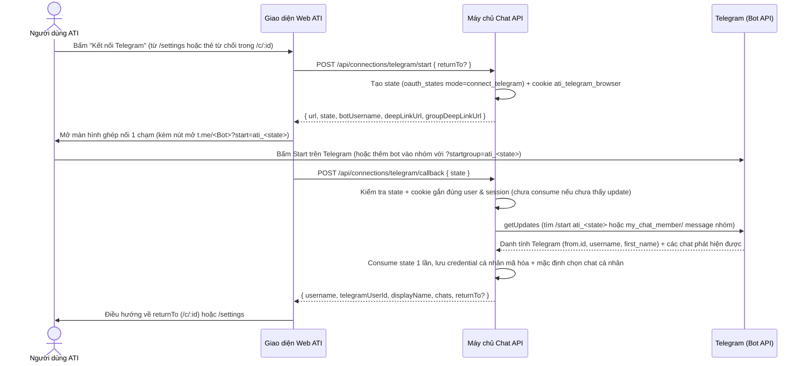

# Kết nối Telegram 1 chạm (OAuth-style Deep-Link Pairing), Nhận diện Chat Tự nhiên và Báo cáo Sáng Tự động Đa dịch vụ — Đặc tả thiết kế

**Ngày:** 02/11/2026 (Asia/Saigon) · **Trạng thái:** Đã chốt sau vòng phản biện User/Business & Kỹ thuật/Bảo mật · **Phạm vi:** Thay thế hoàn toàn cơ chế dán `botToken` và gõ tay `chatId` âm `-100...` trên dịch vụ `telegram` hiện có, giữ nguyên 33 tool trong `ALL_TOOLS` và mã băm SHA-256 của system prompt, đồng thời bổ sung chế độ tự gửi báo cáo sáng đa dịch vụ (`auto_digest`) về đúng 1 chat Telegram đã khóa.

> Đặc tả này bổ sung cho [đặc tả v3](2026-09-29-ai-workflow-platform-v3-design.md), [đặc tả lịch chạy](2026-10-24-scheduled-workflows-design.md) và nối tiếp mẫu kiến trúc [Trello OAuth cá nhân](2026-11-01-trello-oauth-design.md) (`#224` / `#228`).

---

## 1. Góc nhìn User & Business: Vì sao phải thiết kế lại Telegram trên ATI?

Đặt mình vào vị trí **Tech Lead / Product Manager và thành viên một nhóm sản phẩm tại Việt Nam** sử dụng Telegram hằng ngày cùng GitHub, Google Calendar, Google Sheets, Trello và Jira:

1. **Nỗi đau 1 — Bắt người dùng tự tạo BotFather token và tự tìm số âm `-100...` là rào cản kỹ thuật phi thực tế:**
   - Ở thiết kế cũ, quản trị viên phải mở `@BotFather`, tạo bot mới, copy chuỗi `123456:AAH...` dán vào ATI, rồi tìm mã số `Chat ID` âm (`-1001234567890`) vốn bị ẩn hoàn toàn trên ứng dụng Telegram điện thoại và máy tính để gõ tay vào ô cấu hình.
   - Hơn nữa, vì cả nhóm dùng chung một cấu hình tĩnh của admin, từng thành viên không thể tự liên kết tài khoản Telegram cá nhân của mình để nhận báo cáo riêng (*"gửi lịch họp sáng nay vào Telegram của tôi"*), và không có sự kiểm chứng xem người đang ra lệnh có thực sự là thành viên của nhóm Telegram nhận tin hay không.
2. **Nỗi đau 2 — Người dùng nói tên tự nhiên (*"Telegram của tôi"*, *"nhóm Đội Sản Phẩm"*), không ai đọc mã số `-100...`:**
   - Trong `TelegramAdapter.listChats` cũ, bộ lọc chỉ kiểm tra `chat.title.toLocaleLowerCase().includes(query)`. Với chat riêng (`type: 'private'`), Telegram trả về `first_name` / `last_name` của người dùng (ví dụ `"Nguyễn Văn A"`). Khi người dùng nhắn *"Gửi tóm tắt vào Telegram của tôi"* (planner gọi `telegram.list_chats` với `query: "Telegram của tôi"` hoặc `"cá nhân"`), kết quả trả về rỗng `[]`, làm gãy luồng lập kế hoạch.
3. **Nỗi đau 3 — Báo cáo sáng hằng ngày lặp lại cần chế độ "Tự gửi không cần duyệt lại" (`auto_digest`) có ranh giới an toàn:**
   - Giá trị lớn nhất của ATI với Telegram là nối dữ liệu từ nhiều dịch vụ công việc rời rạc về điện thoại của người dùng:
     - **Tình huống A — Báo cáo sáng đa dịch vụ tự chạy (`GitHub / Calendar / Sheets / Trello / Jira → AI tổng hợp → Telegram`):** *"Mỗi sáng 8 giờ, tổng hợp lịch họp Calendar hôm nay, các thẻ Trello đang làm và issue mới trên GitHub rồi gửi báo cáo vào Telegram của tôi."* Nếu mỗi sáng 8 giờ người dùng vẫn phải mở trình duyệt bấm "Duyệt" thì thông báo sáng trên điện thoại mất đi ý nghĩa. Với các lịch **chỉ đọc dữ liệu công việc và chỉ gửi 1 tin báo cáo về đúng 1 chat Telegram đã khóa**, người dùng cần được chọn chế độ **"Tự gửi bản tin, không cần duyệt lại" (`auto_digest`)**.
     - **Tình huống B — Điều phối công việc liên dịch vụ có bước ghi (`Sheets / Gmail → Trello / Jira → Telegram`):** *"Đọc các lỗi khẩn cấp trong bảng tính Sheets, tạo thẻ lên bảng Trello Bugs rồi báo ngay vào nhóm Telegram Kỹ thuật."* Mọi quy trình có ghi vào hệ thống công việc hoặc gửi tin tức thời trong hội thoại vẫn đi qua bước duyệt `plan_hash` (hoặc chế độ `manual` trên lịch chạy).

---

## 2. Mục tiêu, ngoài phạm vi và phản mục tiêu

### 2.1. Mục tiêu
- **G1 — Kết nối Telegram 1 chạm (OAuth-style State + Deep-Link Pairing) thay thế hoàn toàn ô dán `botToken` và gõ số `-100...`:**
  - Người vận hành máy chủ cấu hình một lần Bot chính thức của ATI (`TELEGRAM_BOT_TOKEN`, `TELEGRAM_BOT_USERNAME`, `TELEGRAM_WEB_CALLBACK_URL`). Người dùng cuối không bao giờ thấy hay phải nhập `botToken`.
  - Mỗi người dùng bấm **"Kết nối Telegram"** (từ trang `/settings#telegram` hoặc ngay từ thẻ từ chối `RefusalMoment` trong hội thoại kèm `returnTo: /c/<uuid>`).
  - Hệ thống tạo phiên ghép nối một lần trong bảng `oauth_states` (`mode = 'connect_telegram'`, gắn chặt `user_id`, `session_id`, `browser_binding_hash` và `return_to`), cung cấp Deep-Link 1 chạm `https://t.me/<BotUsername>?start=ati_<state>` (cho chat cá nhân) và `https://t.me/<BotUsername>?startgroup=ati_<state>` (để thêm bot vào nhóm).
  - Khi hoàn tất callback, hệ thống xác thực danh tính Telegram của người dùng (`telegramUserId`, `username`, `displayName`), tự động kích hoạt ngay chat riêng `"Telegram của tôi"` và cho phép tick chọn từ **1 đến 10 chat/group** bằng tên hiển thị rõ ràng.
- **G2 — Khóa `connections.telegram` vào `plan_hash` và khớp tên chat tự nhiên trong `TelegramAdapter`:**
  - Giữ nguyên định nghĩa 2 tool `telegram.list_chats` và `telegram.send_message` trong `ALL_TOOLS` để giữ nguyên tuyệt đối 33 tool và mã băm SHA-256 của system prompt.
  - Nâng cấp `TelegramAdapter.listChats` để hiểu các cách gọi tự nhiên: `"Telegram của tôi"`, `"chat của tôi"`, `"cá nhân"`, `"riêng"`, `"me"`, `@username`, cũng như khớp tên nhóm tiếng Việt không dấu hoặc bỏ tiền tố `"nhóm"`, `"group"`, `"kênh"`.
  - Mọi kế hoạch có bước `telegram.*` đều khóa `connections.telegram` (`credentialId`, `telegramUserId`, `username`, `chatIds`) vào `plan_hash`. Lúc thực thi, `AdapterFactory.telegramAdapter` kiểm tra đúng người, đúng `credentialId`, đúng `chatIds` nằm trong phạm vi đã chọn và người dùng vẫn là thành viên hợp lệ của nhóm.
- **G3 — Lịch chạy có "Chế độ chọn" (`approvalMode: 'manual' | 'auto_digest'`) cho báo cáo sáng về Telegram:**
  - Trên thẻ đề xuất lịch (`ScheduleMoment`), người dùng chọn giữa:
    1. **Chờ tôi duyệt mỗi lượt (`manual`, mặc định):** dùng cho mọi lịch đa dịch vụ (bao gồm lịch có tạo thẻ Trello, tạo issue GitHub/Jira, ghi Sheets...).
    2. **Tự gửi bản tin, không cần duyệt lại (`auto_digest`):** chỉ mở khi lịch chỉ đọc dữ liệu từ các dịch vụ nguồn đã kết nối (`github`, `calendar`, `mycalendar`, `sheets`, `mysheets`, `trello`, `jira`) và gửi báo cáo về **đúng 1 chat Telegram đã khóa**.

### 2.2. Ngoài phạm vi
- Bắt người dùng cuối tạo bot trên `@BotFather` hoặc dán `botToken`.
- Tạo dịch vụ thứ 9 (`mytelegram`) tách rời khỏi `telegram`.
- Tự chạy không duyệt (`auto_digest`) cho bất kỳ lịch nào có bước ghi lên công cụ công việc (tạo/sửa thẻ Trello, tạo/sửa issue GitHub/Jira, thêm dòng Sheets, tạo sự kiện Calendar, gửi Gmail) hoặc gửi vào nhiều chat Telegram cùng lúc.
- Chatbot đàm thoại hai chiều tự do bên trong ứng dụng Telegram (webhook nhận câu lệnh chat tự do từ Telegram). Bot chỉ dùng để xác thực ghép nối `ati_<state>`, kiểm tra quyền thành viên và gửi thông báo/báo cáo từ ATI.

### 2.3. Phản mục tiêu (nếu xảy ra thì coi là thất bại dù chạy được)
- Dùng kết nối Telegram của người A để thực thi kế hoạch hoặc lịch chạy của người B, hoặc rơi về credential dùng chung (`user_id IS NULL`).
- Gửi tin nhắn tới một `chatId` nằm ngoài danh sách 1–10 chat mà người dùng đã chọn, hoặc gửi vào một nhóm Telegram mà `telegramUserId` của người đang thực thi không phải là thành viên (`left` / `kicked`).
- Lộ `TELEGRAM_BOT_TOKEN` trong response API, URL trình duyệt, thông báo lỗi, kế hoạch gửi cho model, hay log.
- Thay đổi `ALL_TOOLS` (33 tool) hoặc làm lệch mã băm SHA-256 của system prompt trong `packages/planner/tests/read-answers.test.ts` và `packages/planner/tests/schedules.test.ts`.
- Cho phép Sandbox hoặc bộ kiểm thử gọi tới `api.telegram.org` hay `t.me` thật.

---

## 3. Các phương án kiến trúc đã cân nhắc

| Phương án | Mô tả | Đánh đổi | Quyết định |
|---|---|---|---|
| **1. Nâng cấp trực tiếp dịch vụ `telegram` sang kết nối cá nhân 1 chạm (`connect_telegram` + Deep-Link) + chọn 1–10 chat theo tên + lịch chạy có `approvalMode` (`manual` / `auto_digest`)** | Máy chủ giữ `TELEGRAM_BOT` dùng chung ở tầng hạ tầng nhưng mỗi người dùng xác thực danh tính Telegram cá nhân qua state एक-lần + Deep-Link `?start=ati_<state>`, chọn 1–10 chat riêng/nhóm có kiểm tra `getChatMember`, khóa `connections.telegram` vào `plan_hash`, và hỗ trợ `auto_digest` đa nguồn về 1 chat Telegram. | Trải nghiệm 1 chạm đúng chuẩn sản phẩm; không sinh dịch vụ thứ 9; giữ nguyên 33 tool và SHA-256 prompt; bảo mật chặt theo từng người dùng. | **Chọn** |
| 2. Giữ ô dán `botToken` và bắt gõ tay số `-100...` | Giữ nguyên thiết kế thời W3-05. | Người dùng phổ thông không thể lấy được số `-100...`; cả nhóm dùng chung không phân biệt được chat cá nhân của ai. | Bỏ |
| 3. Dùng Telegram Login Widget (nhúng script `telegram.org/js/telegram-widget.js`) làm cách duy nhất | Nhúng iframe widget bên thứ ba trên trang `/settings`. | Không tự mở được luồng thêm bot vào nhóm (`?startgroup=`), bị chặn bởi CSP/cookie trình duyệt và khó kiểm thử E2E offline hơn luồng Deep-Link + state trong `oauth_states`. | Bỏ |

---

## 4. Thiết kế Trụ cột 1: Kết nối Telegram 1 chạm & Chọn 1–10 Chat/Group bằng tên hiển thị

### 4.1. Cấu hình Bot cấp máy chủ (`TELEGRAM_BOT` trong `env.ts`)
Người vận hành cấu hình một lần trên máy chủ:
- `TELEGRAM_BOT_TOKEN`: token của Bot ATI (khớp `/^\d{1,20}:[A-Za-z0-9_-]{10,200}$/`).
- `TELEGRAM_BOT_USERNAME`: username của Bot ATI (khớp `/^[A-Za-z][A-Za-z0-9_]{2,31}$/`, bỏ ký tự `@` ở đầu nếu có).
- `TELEGRAM_WEB_CALLBACK_URL`: URL trang callback trên giao diện web, bắt buộc có pathname `/connections/telegram/callback`, không chứa query, fragment hay userinfo (HTTPS ở `live`, hoặc HTTP loopback `127.0.0.1` / `localhost` / `[::1]`).
- Biến ghi đè cho môi trường test/sandbox:
  - `TELEGRAM_API_BASE_URL` (mặc định `https://api.telegram.org`)
  - `TELEGRAM_DEEPLINK_BASE_URL` (mặc định `https://t.me`)
- **Quy tắc an toàn Sandbox:** Trong `RUNTIME_MODE=sandbox`, `validateEnv` chỉ gắn `config.TELEGRAM_BOT` khi `TELEGRAM_API_BASE_URL` được khai báo tường minh (trỏ vào fake server cục bộ). Thiếu một trong các biến bắt buộc thì `config.TELEGRAM_BOT` là `undefined`, máy chủ vẫn khởi động bình thường và `POST /api/connections/telegram/start` trả `503 { error: 'Telegram chưa được cấu hình trên máy chủ.' }`.

### 4.2. Luồng ghép nối 1 chạm (`connect_telegram`)



Chi tiết kỹ thuật bảo mật của luồng ghép nối:
1. **`POST /api/connections/telegram/start`:**
   - Yêu cầu JWT hợp lệ có `sid`.
   - Nếu có `returnTo`, kiểm tra định dạng `/^\/c\/([0-9a-f]{8}-[0-9a-f]{4}-[0-9a-f]{4}-[0-9a-f]{4}-[0-9a-f]{12})$/i` và kiểm tra hội thoại đó thuộc về chính `user.id`. Sai → trả `400 { error: 'Không mở được kết nối từ hội thoại này.', code: 'RETURN_TO_INVALID' }`, không tạo state.
   - Tạo `state = randomBytes(32).toString('base64url')` (43 ký tự), `browser = randomBytes(32).toString('base64url')` (hoặc giữ cookie hợp lệ hiện có), lưu vào `oauth_states` với `mode = 'connect_telegram'`, `user_id = user.id`, `session_id = user.sid`, `return_to = returnTo`.
   - Đặt cookie `ati_telegram_browser` (`HttpOnly`, `SameSite=Lax`, `Path=/api/connections/telegram`, `Max-Age=600`).
   - Trả về JSON:
     - `url`: `${callbackUrl}?state=${encodeURIComponent(state)}`
     - `state`: chuỗi `state`
     - `botUsername`: `oauth.botUsername`
     - `deepLinkUrl`: `${deepLinkBaseUrl}/${oauth.botUsername}?start=ati_${state}`
     - `groupDeepLinkUrl`: `${deepLinkBaseUrl}/${oauth.botUsername}?startgroup=ati_${state}`
2. **`POST /api/connections/telegram/callback`:**
   - Nhận `{ state: string }`.
   - Kiểm tra định dạng `state` và cookie `ati_telegram_browser` (`/^[A-Za-z0-9_-]{43}$/`).
   - **Bước kiểm tra state không phá hủy trước khi hỏi Telegram (`googleAuthRepo.verifyState`):** kiểm tra trong `oauth_states` xem có bản ghi khớp `state_hash`, `browser_binding_hash`, `mode = 'connect_telegram'`, `user_id = user.id`, `session_id = user.sid`, `used_at IS NULL`, `expires_at > now` và phiên đăng nhập vẫn đang `active` hay không. Nếu không khớp → trả `400 { error: 'Yêu cầu kết nối Telegram đã hết hạn hoặc không còn hợp lệ. Hãy bấm "Kết nối Telegram" lại.', code: 'TELEGRAM_STATE_INVALID' }` mà **không gọi HTTP** tới Telegram.
   - **Bước xác minh sự kiện ghép nối trên Telegram (`TelegramBotClient.verifyPairing(state, signal)`):**
     - Gọi `getUpdates` trên Bot API (timeout 10 s qua `AbortSignal`).
     - Tìm update có tin nhắn văn bản khớp `/^\/start(?:@[A-Za-z0-9_]+)?\s+ati_([A-Za-z0-9_-]{43})$/` với mã đúng bằng `state` và bắt buộc `message.from.is_bot !== true` (từ chối mọi tin nhắn phát sinh từ bot khác).
     - Nếu người dùng chưa bấm Start trên Telegram (chưa có update khớp `ati_${state}`) → trả `409 { error: 'Chưa nhận được xác nhận từ Telegram. Hãy bấm "Mở Telegram", nhấn Start rồi thử lại.', code: 'TELEGRAM_PAIRING_PENDING' }` và **giữ nguyên state chưa consume (`used_at IS NULL`)** để người dùng thử lại trong thời hạn 10 phút.
     - Khi tìm thấy update khớp `ati_${state}`:
       - Gọi `consumeState` nguyên tử (`UPDATE oauth_states SET used_at = $3 WHERE ... AND used_at IS NULL`). Nếu một request song song đã consume trước → trả `400 TELEGRAM_STATE_INVALID`.
       - Trích xuất danh tính người dùng từ `message.from`:
         - `telegramUserId = String(from.id)`
         - `displayName = [from.first_name, from.last_name].filter(Boolean).join(' ').trim() || from.username || telegramUserId`
         - `username = from.username?.trim() || displayName`
       - Tập hợp danh sách chat đã biết (`knownChats`) có cô lập quyền truy cập theo từng `telegramUserId`:
         - Luôn có chat riêng cá nhân: `{ chatId: telegramUserId, title: `Telegram của tôi (${displayName})`, type: 'private' }` (chỉ khớp `chatId === telegramUserId`, tuyệt đối không bao giờ lộ chat riêng của người dùng khác từ `getUpdates`);
         - Nếu update `/start ati_<state>` được gửi ngay trong một nhóm (`message.chat.type` là `'group'` hoặc `'supergroup'`), kiểm tra `getChatMember(chatId, telegramUserId)` xác nhận người dùng đang là thành viên (`creator`, `administrator`, `member`, hoặc `restricted` có `is_member !== false`), thêm nhóm đó vào `knownChats` và (nếu người gọi là `admin`) lưu luôn vào danh sách nhóm chung `telegram_team_chats`;
         - Gộp thêm các nhóm trong `telegram_team_chats` (và các nhóm khác xuất hiện trong `getUpdates`) **chỉ khi** `getChatMember(chatId, telegramUserId)` xác nhận `telegramUserId` của chính người gọi đang là thành viên hợp lệ.
       - Mặc định chọn sẵn (`selectedChats`) tối đa 10 chat (ưu tiên chat riêng cá nhân + các nhóm người dùng là thành viên) để kết nối ở trạng thái `connected` ngay sau 1 chạm.
       - Lưu mã hóa vào `service_credentials` (`service = 'telegram'`, `user_id = user.id`, `status = 'active'`).

### 4.3. Quản lý danh sách 1–10 Chat/Group (`candidate-chats` và `scope`)
- **`GET /api/connections/telegram`:**
  - Trả về trạng thái kết nối của người gọi:
    ```ts
    {
      status: 'unconfigured' | 'not_connected' | 'reconnect_required' | 'needs_scope' | 'connected';
      username?: string;
      displayName?: string;
      telegramUserId?: string;
      botUsername?: string;
      groupDeepLinkUrl?: string;
      chats: Array<{
        chatId: string;
        title: string;
        type: 'private' | 'group' | 'supergroup' | 'channel';
        selected: boolean;
        member: boolean;
      }>;
    }
    ```
  - Với mỗi chat nhóm (`group` / `supergroup` / `channel`), máy chủ kiểm tra `getChatMember(chatId, telegramUserId)` (hoặc trạng thái bot trong chat) để điền `member: boolean`. Nếu bot bị thu hồi token (401 từ Telegram) → đánh dấu `markReconnectRequired` và trả `status: 'reconnect_required'`.
- **`GET /api/connections/telegram/candidate-chats`:**
  - Làm mới danh sách chat ứng viên từ `getUpdates` của Bot + `telegram_team_chats` + `knownChats` hiện có của người dùng, lọc những chat mà `telegramUserId` là thành viên (`member: true`), trả về `{ chats: Array<{ chatId: string; title: string; type: string; selected: boolean; member: boolean }> }`.
- **`PUT /api/connections/telegram/scope`:**
  - Nhận `{ chatIds: string[] }` (từ 1 đến 10 `chatId`, tự loại trùng).
  - Mỗi `chatId` bắt buộc phải thuộc tập ứng viên hợp lệ của người gọi (chat riêng `telegramUserId` của chính họ, hoặc nhóm mà `getChatMember(chatId, telegramUserId)` xác nhận họ đang là thành viên). Nếu truyền 0 chat, > 10 chat, hoặc một `chatId` bất kỳ ngoài tập hợp lệ → trả `400` tiếng Việt và giữ nguyên phạm vi cũ.
  - Nếu người gọi là `admin`, các nhóm (`group` / `supergroup` / `channel`) trong danh sách cũng được cập nhật vào `telegram_team_chats` để các thành viên khác trong nhóm thấy tên nhóm và chọn được (nếu họ cũng ở trong nhóm Telegram đó).
- **`DELETE /api/connections/telegram`:**
  - Chỉ xóa credential Telegram cá nhân của chính người gọi, xóa cache trong `AdapterFactory`, không ảnh hưởng tới người dùng khác hay `telegram_team_chats`.
- **Loại bỏ hoàn toàn đường dán token dùng chung:**
  - `TELEGRAM_SERVICE.credentialFields = []`.
  - `POST /api/services/telegram/credentials` và `PUT/POST /api/services/telegram/scope` trả `410 { error: 'Telegram dùng kết nối 1 chạm.' }`.
  - `GET /api/services` không bao giờ đọc credential `telegram` dùng chung (`user_id IS NULL`), mà đính kèm `personalStatus` (`'connected' | 'reconnect_required'`), `username`, `connectedAt` từ bản ghi cá nhân của người gọi (giống Trello `#228`).

---

## 5. Thiết kế Trụ cột 2: Nâng cấp `TelegramAdapter` & Khóa `connections.telegram` vào `plan_hash`

### 5.1. Giữ nguyên bất biến 33 tool và SHA-256 System Prompt
- File `packages/tool-schemas/src/telegram.ts` giữ nguyên từng ký tự định nghĩa của `TELEGRAM_TOOLS` (`telegram.list_chats` và `telegram.send_message`).
- Nhờ vậy, `ALL_TOOLS` giữ nguyên 33 tool và mã băm SHA-256 của system prompt trong `packages/planner/tests/read-answers.test.ts` (`b31234b91e0c22191f5b0c5fb4be73299e673178df36ea3accb2633b42ec64f9`) và `packages/planner/tests/schedules.test.ts` không thay đổi dù chỉ 1 byte.

### 5.2. Nâng cấp `TelegramAdapter` (`packages/tool-adapters/src/telegram/telegram-adapter.ts`)
1. **Hỗ trợ `baseUrl` và `knownChats`:**
   - `TelegramAdapterConfig` thêm:
     - `baseUrl?: string` (mặc định `'https://api.telegram.org'`, bỏ dấu `/` ở cuối) để mọi lệnh `getMe`, `getChat`, `sendMessage` gọi tới `${this.apiBase}/bot${this.token}/${method}`.
     - `knownChats?: ReadonlyArray<{ id: string; title: string; type?: string; username?: string }>` và `telegramUserId?: string`, `username?: string`.
2. **Khớp tên chat tự nhiên trong `telegram.list_chats`:**
   - Khi thực thi `telegram.list_chats({ query, limit })`:
     - Duyệt qua các `id` trong `this.scope()` (đã kiểm tra allowlist).
     - Gọi `getChat` để xác thực chat tồn tại và lấy tiêu đề trực tiếp từ Telegram; nếu chat là `private` (hoặc `id === this.telegramUserId`) và `knownChats` có tiêu đề hiển thị thân thiện (như `"Telegram của tôi (Nguyễn Văn A)"`), kết hợp cả tên thật trên Telegram lẫn nhãn `"Telegram của tôi"`.
     - Hàm `matchesChatQuery(chat, rawQuery, meta)` trả về `true` khi:
       - `rawQuery` rỗng, hoặc là `'*'`, `'all'`, `'tất cả'`, `'telegram'`, `'chat'`;
       - Tiêu đề hoặc username khớp chuỗi con không phân biệt hoa thường hoặc không dấu tiếng Việt (`normalizeVietnamese`);
       - Tiêu đề khớp sau khi bỏ các từ đệm đầu câu như `"nhóm"`, `"group"`, `"kênh"`, `"channel"`, `"chat"`, `"telegram"`, `"tin nhắn"`;
       - Hoặc `chat.type === 'private'` và `rawQuery` thuộc nhóm từ khóa chỉ chat cá nhân của người dùng: `"telegram của tôi"`, `"chat của tôi"`, `"của tôi"`, `"cho tôi"`, `"tôi"`, `"mình"`, `"cá nhân"`, `"riêng"`, `"tin nhắn riêng"`, `"me"`, `"my telegram"`, `"private"`, `"saved"`.
3. **Chặn `chatId` ngoài phạm vi trước mọi lệnh gọi HTTP trong `telegram.send_message`:**
   - Kiểm tra `this.scope().includes(id)` và (nếu có `context?.chatId`) `normalizeTelegramChatId(context.chatId) === id` **trước khi** gọi `getChat` và `sendMessage`. Nếu `chatId` nằm ngoài `allowedScope.chats` → ném `StepError` 403 `AUTH_ERROR` ngay lập tức, `fetchFn` có `0` lời gọi.

### 5.3. Khóa `connections.telegram` vào `plan_hash` và kiểm tra lúc thực thi
- Mở rộng `PlanConnections` trong `packages/tool-schemas/src/types.ts`:
  ```ts
  telegram?: {
    credentialId: string;
    telegramUserId: string;
    username: string;
    chatIds: string[];
  };
  ```
- Mở rộng `PlanStep` thêm `chatId?: string` (tương tự `boardId?: string` của Trello) khi cần ghi nhận chat đích đã phân giải.
- Trong `ChatService.bindConnections`:
  - Khi kế hoạch có bước `telegram.*`:
    - Gọi `this.telegramConnection(userId)`.
    - Nếu `not_connected` hoặc `reconnect_required` → trả `refusal` với `unavailableServices: [{ id: 'telegram', name: 'Telegram' }]`, `reason: 'Tài khoản của bạn chưa Kết nối Telegram hoặc cần kết nối lại.'`.
    - Nếu `needs_scope` → trả `refusal` với `reason: 'Bạn chưa chọn cuộc trò chuyện Telegram nào cho ATI.'`, `suggestion: 'Hãy chọn ít nhất một chat hoặc nhóm Telegram trong trang Kết nối dịch vụ.'`.
    - Phân giải `chatId` của từng bước `telegram.send_message` (kể cả khi `args.chatId` là `{ $ref: 'step_1.output[0].id' }` trỏ vào bước `telegram.list_chats` hoặc nằm trong `WorkingMemory`).
    - Nếu bước `telegram.send_message` nhắm tới một `chatId` không nằm trong `connection.chatIds` của người dùng → trả `refusal` với `reason: 'Bạn không có quyền gửi vào cuộc trò chuyện Telegram này hoặc cuộc trò chuyện chưa được chọn.'`.
    - Gắn `connections.telegram = { credentialId, telegramUserId, username, chatIds }` trước khi tính `plan_hash`.
- Trong `AdapterFactory.telegramAdapter(context)`:
  - Yêu cầu `context?.userId`; đọc `credentialRepo.getPersonalCredentials('telegram', userId)`.
  - Ở `phase: 'execution'`, kiểm tra `record.id === context.connections?.telegram?.credentialId`, kiểm tra các `chatIds` đã khóa trong kế hoạch vẫn còn nằm trong `selectedChats` hiện tại của người dùng, và (với các chat nhóm khi có `telegramBotClient`) kiểm tra `getChatMember` xác nhận `telegramUserId` vẫn là thành viên.
  - Khởi tạo `TelegramAdapter` với `allowedScope: { chats: allowedChatIds }`, `knownChats`, `telegramUserId`, `username`, `baseUrl: this.options.telegramApiBaseUrl`.

---

## 6. Thiết kế Trụ cột 3: Lịch chạy Tự động `auto_digest` Gửi Báo cáo Sáng về 1 Chat Telegram Đã Khóa

### 6.1. Điều kiện mở chế độ `auto_digest` (`TelegramDigestCandidate`)
Khi người dùng đặt lịch trong hội thoại (`SCHEDULES_ENABLED=on`), `ChatService.prepareProposal` đánh giá ứng viên `digestCandidate`:
- Một đề xuất lịch (`action: 'create' | 'update'`) có `canAutoDigest = true` khi và chỉ khi:
  1. Danh sách dịch vụ định tuyến `services` có `'telegram'` và các dịch vụ còn lại chỉ thuộc tập nguồn đọc được hỗ trợ: `github`, `calendar`, `mycalendar`, `sheets`, `mysheets`, `trello`, `jira` (không có `gmail`, `slack`, `notion` hay dịch vụ lạ);
  2. Câu yêu cầu `request` không chứa ý định ghi dữ liệu lên công cụ công việc (không chứa từ khóa tạo/sửa/xóa thẻ, tạo/sửa issue, gắn nhãn, thêm/ghi dòng, tạo lịch họp, gửi email...);
  3. Người tạo lịch đang có kết nối Telegram cá nhân `active` và xác định được **đúng 1 chat Telegram đích** (`chatId`, `chatTitle`, `chatType`) từ danh sách `selectedChats` của họ:
     - Nếu câu yêu cầu nêu rõ `"Telegram của tôi"` / `"cá nhân"` / `"cho tôi"` → khớp chat `private` (`telegramUserId`);
     - Nếu câu yêu cầu nêu tên một nhóm cụ thể → khớp duy nhất 1 nhóm trong `selectedChats`;
     - Nếu câu yêu cầu chỉ nói chung *"gửi qua Telegram"* và người dùng có chat `"Telegram của tôi"` trong `selectedChats` (hoặc chỉ có đúng 1 chat được chọn) → chọn chat đó; nếu có nhiều nhóm được khớp mơ hồ thì `canAutoDigest = false` kèm lý do yêu cầu nêu rõ tên nhóm Telegram nhận báo cáo.
- Cấu trúc dữ liệu trong `packages/tool-schemas/src/types.ts`:
  ```ts
  export type ScheduleApprovalMode = 'manual' | 'auto_digest';

  export type TelegramDigestSource =
    | 'github'
    | 'calendar'
    | 'mycalendar'
    | 'sheets'
    | 'mysheets'
    | 'trello'
    | 'jira';

  export interface TelegramDigestConfig {
    credentialId: string;
    telegramUserId: string;
    username: string;
    chatId: string;
    chatTitle: string;
    chatType: 'private' | 'group' | 'supergroup' | 'channel';
    sources: TelegramDigestSource[];
  }

  export interface TelegramDigestDelivery {
    chatId: string;
    chatTitle: string;
    messageId: number;
    date: number;
    itemCount: number;
    sources: TelegramDigestSource[];
  }
  ```
- Trên `ScheduleProposalMetadata`, thêm trường tùy chọn:
  ```ts
  digestCandidate?: {
    canAutoDigest: boolean;
    disabledReason?: string;
    config?: TelegramDigestConfig;
    configHash?: string;
  };
  ```
- Khi xác nhận đề xuất (`POST /api/conversations/:convId/schedule-proposals/:messageId/confirm`), body nhận `{ approvalMode?: 'manual' | 'auto_digest' }` (mặc định `'manual'`).
  - Nếu gửi `approvalMode: 'auto_digest'` khi `digestCandidate?.canAutoDigest !== true` → trả `409 Conflict` `{ code: 'AUTO_DIGEST_NOT_ALLOWED', message: ... }`.
  - Khi xác nhận với `approvalMode: 'auto_digest'` (cả `create` và `update`), lưu `kind = 'telegram_digest'`, `digest_config`, `digest_config_hash = computeTelegramDigestConfigHash({ config, recurrence, userId })`, `digest_approved_at = now`.

### 6.2. Thực thi lượt chạy `telegram_digest` trong `ScheduleRunner`
Đối với lịch `kind = 'telegram_digest'`, `ScheduleRunner` bỏ qua quy tắc `lastThreeExpired` (vì lượt chạy không tạo plan chờ duyệt) và thực thi theo quy trình 6 bước chống race condition:
1. **Kiểm tra tính toàn vẹn & quyền trước khi đọc:**
   - Tính lại `computeTelegramDigestConfigHash` từ `digest_config`, `recurrence`, `user_id` và đối chiếu với `digest_config_hash` trong DB.
   - Kiểm tra kết nối Telegram cá nhân của `user_id` vẫn `active`, đúng `credentialId`, `config.chatId` vẫn nằm trong `selectedChats`, và nếu là nhóm thì `getChatMember` xác nhận `telegramUserId` vẫn ở trong nhóm.
   - Sai bất kỳ điều kiện nào → ghi lượt chạy `status = 'blocked'`, chuyển lịch sang `paused` kèm lý do tiếng Việt cụ thể, phát `schedule_updated`, không gọi lệnh gửi tin.
2. **Đọc dữ liệu từ các dịch vụ nguồn đã khóa (`config.sources`):**
   - Mốc `SINCE` chỉ tính từ `due_at` của lượt `digest_sent` có `trigger = 'scheduled'` gần nhất (nếu chưa có thì lùi 24 giờ cho lịch `daily`/`once`, hoặc 7 ngày cho lịch `weekly`). Nhờ đó, bấm **"Chạy lượt này ngay"** (`trigger = 'manual'`) không làm rỗng lượt chạy tự động kế tiếp.
   - Chỉ gọi các tool đọc (`sideEffect === 'read'`) qua `AdapterFactory.getAdapterForService(source, { userId, phase: 'planning' })` với `AbortSignal` 30 giây:
     - `calendar` / `mycalendar`: đọc danh sách sự kiện trong ngày của `dueAt` theo `APP_TIME_ZONE`;
     - `github`: đọc các issue mới / đang mở trên repo được cấp quyền;
     - `trello`: đọc các thẻ đang mở trên các bảng Trello của người dùng;
     - `sheets` / `mysheets`: đọc các dòng dữ liệu mới nhất trên bảng tính;
     - `jira`: đọc các issue đang mở trên dự án Jira được cấp quyền.
3. **Tóm tắt điểm nhấn buổi sáng bằng AI (có ranh giới an toàn):**
   - Gọi LLM (timeout 10 giây qua `AbortSignal`) chỉ với tiêu đề/số lượng mục vừa thu thập để viết 1–3 câu nhận xét ngắn gọn (tối đa 400 ký tự) ở đầu bản tin.
   - Nếu LLM lỗi hoặc quá 10 giây → bỏ qua đoạn nhận xét AI, vẫn gửi đầy đủ bản tin dữ liệu.
   - Đầu ra của LLM chỉ là văn bản thuần đã lọc bỏ ký tự điều khiển, không có quyền thay đổi `chatId` hay gọi bất kỳ tool nào.
4. **Định dạng tin nhắn văn bản thuần an toàn:**
   - Dòng mở đầu: `Bản tin tự động của ATI · thiết lập bởi @${config.username}`.
   - Tổng độ dài luôn được cắt an toàn `<= 4000` ký tự (dưới trần 4096 ký tự của Telegram), gửi dưới dạng văn bản thuần (`parse_mode` tắt hoàn toàn, `link_preview_options: { is_disabled: true }`).
5. **Kiểm tra lại `schedules.version` và `status` ngay trước khi gọi `telegram.send_message`:**
   - Đọc lại dòng `schedules` trong DB ngay trước khi phát lệnh gửi Telegram. Nếu `version !== started.toPlan.scheduleVersion` hoặc `status !== 'active'` (trừ lượt `manual`/`replan` trên lịch đang `paused` mà `version` không đổi) hoặc `status === 'cancelled'` → dừng ngay, không gọi Telegram, kết thúc lượt chạy với `status = 'discarded'`.
6. **Gửi tin về đúng `config.chatId` & Tự tạm dừng khi lỗi lặp:**
   - Gọi `telegram.send_message({ chatId: config.chatId, text })`.
   - Một khi lệnh gọi Telegram đã được phát đi, kết quả bắt buộc ghi `digest_sent` (kèm `delivery` và lưu tin nhắn `assistant` `type: 'answer'` vào hội thoại của lượt chạy) hoặc `digest_failed` (không bao giờ chuyển sang `discarded` sau khi đã gửi).
   - Trong cùng transaction kết thúc lượt `digest_failed` (đã khóa `conversations` của lịch cùng lúc với `schedules` theo đúng thứ tự khóa toàn cục `schedule's conversation → schedule → runs → run's conversation`), nếu 3 lượt gần nhất đều là `digest_failed` → tự chuyển lịch sang `paused` với `pause_reason = '3 lượt liền gửi thất bại'`.
   - Thêm `'digest_failed'` vào tập `REPLANNABLE` để người dùng bấm chạy lại được từ trang Nhật ký.

---

## 7. Lưu trữ Cơ sở dữ liệu (Migration `0019_telegram_oauth_and_digest.sql`)

Migration idempotent chạy lại nhiều lần không lỗi trên PostgreSQL 16:
1. **Mở rộng `oauth_states`:**
   - Cập nhật cả 3 ràng buộc `oauth_states_mode_check`, `oauth_states_mode_owner_check`, `oauth_states_return_to_check` để thêm `'connect_telegram'` (giữ nguyên đầy đủ `'login'`, `'link'`, `'connect_gmail'`, `'connect_mycalendar'`, `'connect_mysheets'`, `'connect_trello'`).
2. **Xóa credential Telegram dùng chung & cấm `user_id IS NULL`:**
   - `DELETE FROM service_credentials WHERE service = 'telegram' AND user_id IS NULL;`
   - Thêm ràng buộc `service_credentials_telegram_owner_check CHECK (service <> 'telegram' OR user_id IS NOT NULL)`.
3. **Bảng phạm vi nhóm Telegram (`telegram_team_scope` và `telegram_team_chats`):**
   - `telegram_team_scope`: `id TEXT PRIMARY KEY DEFAULT 'default' CHECK (id = 'default')`, `chosen_by UUID NOT NULL REFERENCES users(id)`, `updated_at TIMESTAMPTZ NOT NULL DEFAULT now()`.
   - `telegram_team_chats`: `id UUID PRIMARY KEY DEFAULT gen_random_uuid()`, `scope_id TEXT NOT NULL DEFAULT 'default' REFERENCES telegram_team_scope(id) ON DELETE CASCADE`, `chat_id TEXT NOT NULL`, `title TEXT NOT NULL`, `chat_type TEXT NOT NULL CHECK (chat_type IN ('private', 'group', 'supergroup', 'channel'))`, `position INTEGER CHECK (position IS NULL OR (position BETWEEN 1 AND 10))`, `UNIQUE (scope_id, chat_id)`, kèm constraint trigger `trg_check_telegram_team_chats_constraints` giới hạn tối đa 10 dòng.
4. **Mở rộng bảng `schedules`:**
   - Thêm cột `kind TEXT NOT NULL DEFAULT 'plan'`, `digest_config JSONB`, `digest_config_hash TEXT`, `digest_approved_at TIMESTAMPTZ`.
   - Ràng buộc hai chiều chặt `schedules_kind_digest_check`:
     `CHECK ((kind = 'plan' AND digest_config IS NULL AND digest_config_hash IS NULL AND digest_approved_at IS NULL) OR (kind = 'telegram_digest' AND digest_config IS NOT NULL AND digest_config_hash IS NOT NULL AND digest_approved_at IS NOT NULL))`.
5. **Mở rộng bảng `schedule_runs`:**
   - Mở rộng `schedule_runs_status_check` thêm `'digest_sent'`, `'digest_failed'`.
   - Thêm cột `delivery JSONB` và ràng buộc `schedule_runs_delivery_check CHECK ((status = 'digest_sent') = (delivery IS NOT NULL))`.
   - Giữ nguyên `schedule_runs_plan_check` (`CHECK ((status = 'planned') = (plan_id IS NOT NULL))`).

---

## 8. Giao diện Người dùng (`apps/chat-web`)

1. **Trang Kết nối dịch vụ (`/settings#telegram` — `TelegramConnection.tsx`):**
   - Nằm trong mục **"Của riêng bạn"** (cùng Gmail, Calendar, Sheets, Trello); ẩn `telegram` khỏi danh sách dịch vụ dùng chung bên dưới.
   - Chưa kết nối: hiện nút `#telegram-connect` (**"Kết nối Telegram"**). Không còn ô nhập `Bot token (BotFather)` hay ô nhập `Chat ID` âm `-100...`.
   - Đã kết nối: hiện tên hiển thị và `@username` Telegram của người dùng, nút `#telegram-disconnect` (**"Ngắt kết nối"**), danh sách các chat/group đang được chọn (tên rõ ràng + nhãn `Chat cá nhân` hoặc `Nhóm Telegram`), nút `#telegram-edit-scope` (**"Chọn chat / nhóm"**) và link mở nhanh thêm bot vào nhóm mới (`+ Thêm bot vào nhóm Telegram`).
   - Khi mở vùng chọn phạm vi (`#telegram-scope`): hiển thị danh sách checkbox từ 1 đến 10 chat/group bằng tên hiển thị rõ ràng, nút `#telegram-refresh-chats` (**"Làm mới danh sách"**) và `#telegram-save-scope` (**"Lưu danh sách chat"**).
2. **Trang Callback Ghép nối (`/connections/telegram/callback` — `TelegramCallbackView.tsx`):**
   - Hiển thị hướng dẫn 1 chạm rõ ràng: nút **Mở Telegram và bấm Start** (trỏ tới `deepLinkUrl` `https://t.me/<Bot>?start=ati_<state>`) và tự động/chủ động gọi `POST /api/connections/telegram/callback` để hoàn tất ghép nối.
   - Nếu `callback` trả `returnTo` hợp lệ (`/c/<uuid>`), điều hướng thẳng về cuộc hội thoại đó; ngược lại điều hướng về `/settings#telegram` kèm thông báo `Đã kết nối @username`.
3. **Thẻ Từ chối trong Hội thoại (`RefusalMoment` trong `ResponseMoment.tsx`):**
   - Khi `unavailableServices` có `telegram`, hiển thị nút `#telegram-connect` (**"Kết nối Telegram"** / **"Kết nối lại Telegram"**) truyền `returnTo: '/c/<convId>'`.
   - Khi người dùng quay lại hội thoại sau khi kết nối xong, tự động làm mới `GET /api/services` và hiện nút **"Gửi lại yêu cầu"**.
4. **Màn Duyệt Kế hoạch (`PlanMoment.tsx`) và Biên nhận (`ReceiptMoment.tsx`):**
   - Hiển thị tên cuộc trò chuyện Telegram (từ `resourceLabels`) và tài khoản `@username` trong `connections.telegram`.
5. **Thẻ Đề xuất Lịch (`ScheduleMoment.tsx`) và Trang Nhật ký (`ScheduleSection.tsx`):**
   - Trên `ScheduleMoment`: hiển thị mục **Chế độ khi tới giờ** với 2 lựa chọn:
     - `#schedule-mode-manual`: **Chờ tôi duyệt mỗi lượt** *(mặc định)*
     - `#schedule-mode-auto-digest`: **Tự gửi bản tin, không cần duyệt lại** (bật khi `digestCandidate?.canAutoDigest === true`, hiện rõ nguồn dữ liệu + tên chat Telegram nhận tin; bị `disabled` kèm `disabledReason` khi `false`).
   - Trên `ScheduleSection` và `ScheduleRunRecovery`: hiển thị nhãn `Tự gửi Telegram`, trạng thái `Đã gửi` (`digest_sent`) và `Gửi thất bại` (`digest_failed`, có nút chạy lại).

---

## 9. Kiểm thử & Nghiệm thu (Evidence Standards)

1. **Bất biến hệ thống:**
   - `ALL_TOOLS` giữ nguyên 33 tool; SHA-256 của system prompt trong `read-answers.test.ts` và `schedules.test.ts` giữ nguyên từng byte.
2. **PostgreSQL 16 thật (không dùng mock DB):**
   - Migration `0019_telegram_oauth_and_digest.sql` chạy 2 lần liên tiếp không lỗi;
   - Kiểm tra đầy đủ các constraint trên `oauth_states` (`connect_telegram`), `service_credentials` (`service_credentials_telegram_owner_check`), `telegram_team_chats` (tối đa 10 chat), `schedules` (`schedules_kind_digest_check`), `schedule_runs` (`schedule_runs_delivery_check`);
   - Xác nhận đề xuất `update` cập nhật lại `digest_config_hash`; lệch hash → `blocked` + `paused`; 3 lượt `digest_failed` liên tiếp → `paused`; khóa dòng đồng nhất không deadlock với `confirmProposal`.
3. **Adapter, Bot Client & Timeout thực tế (`AbortSignal`):**
   - `TelegramBotClient` và `TelegramAdapter` tôn trọng `AbortSignal` thật;
   - Kiểm tra `state` không hợp lệ bị chặn trước khi gọi HTTP; `TELEGRAM_PAIRING_PENDING` giữ nguyên state chưa consume;
   - `TelegramAdapter.listChats` khớp tự nhiên `"Telegram của tôi"`, `"cá nhân"`, tên nhóm không dấu; `send_message` chặn `chatId` ngoài phạm vi trước khi gọi HTTP (`0` lời gọi `fetch`).
4. **Frontend & Browser E2E:**
   - Toàn bộ unit/integration test trong `packages/tool-schemas`, `packages/tool-adapters`, `packages/planner`, `apps/chat-api`, `apps/chat-web` pass 100% với exit code 0.

---

## 10. Nhật ký Phản biện & Thẩm định Đặc tả (Spec Audit Loop)

| Vòng | Góc nhìn | Phát hiện phản biện | Cách xử lý trong Đặc tả | Trạng thái |
|---|---|---|---|---|
| **Vòng 1** | **User / Business** | Nếu sau khi người dùng bấm Start trên Telegram mà vẫn phải vào `/settings` để tick chọn chat rồi mới dùng được thì chưa phải "1 chạm" thực sự, đặc biệt khi bấm kết nối từ thẻ từ chối `RefusalMoment` trong hội thoại `/c/<uuid>`. | Trong `POST /api/connections/telegram/callback`, tự động chọn sẵn (`selectedChats`) chat riêng `"Telegram của tôi (<displayName>)"` cùng tối đa 9 nhóm hợp lệ mà người dùng đang là thành viên, đưa kết nối sang trạng thái `connected` ngay lập tức và điều hướng thẳng về `returnTo: /c/<uuid>`. | **Đã chốt (0 lỗi)** |
| **Vòng 1** | **User / Business** | Người dùng nói *"Gửi vào Telegram của tôi"* hoặc *"báo nhóm Đội Sản Phẩm"* (không dấu / có từ đệm *"nhóm"*), trong khi Telegram API trả `first_name`/`last_name` cho chat riêng và tên nhóm có dấu. | Bổ sung `knownChats` vào `TelegramAdapter` và hàm `matchesChatQuery` hỗ trợ từ khóa cá nhân (`"telegram của tôi"`, `"cá nhân"`, `"riêng"`, `"cho tôi"`), bỏ dấu tiếng Việt và bỏ từ đệm `"nhóm"`, `"group"`, `"kênh"`. | **Đã chốt (0 lỗi)** |
| **Vòng 2** | **Kỹ thuật / Bảo mật** | Nếu `POST /api/connections/telegram/callback` gọi `consumeState` (`SET used_at = now()`) trước khi gọi `getUpdates`, người dùng bấm "Xác nhận" trên web trước khi kịp bấm Start trong app Telegram sẽ làm hỏng `state` và phải làm lại từ đầu. Ngược lại, nếu gọi `getUpdates` trước khi kiểm tra `state` trong DB thì lộ mặt tấn công SSRF/spam Bot API. | Tách thành 2 bước: (1) `googleAuthRepo.verifyState` kiểm tra `state_hash`, `browser_binding_hash`, `user_id`, `session_id`, `used_at IS NULL`, `expires_at > now` trước — nếu sai trả `400 TELEGRAM_STATE_INVALID` với `0` lời gọi HTTP; (2) Gọi `verifyPairing` — nếu chưa có update `/start ati_<state>` từ người dùng thật (`from.is_bot !== true`) thì trả `409 TELEGRAM_PAIRING_PENDING` và giữ `used_at IS NULL`; khi khớp mới gọi `consumeState` nguyên tử. | **Đã chốt (0 lỗi)** |
| **Vòng 2** | **Kỹ thuật / Bảo mật** | `getUpdates` của Bot dùng chung trả về các sự kiện từ nhiều người dùng khác nhau. Nếu không cô lập chặt, người B có thể thấy chat riêng hoặc nhóm riêng của người A. | Ràng buộc cứng: chat `private` chỉ bao giờ khớp `chatId === telegramUserId` của chính người gọi; mọi chat `group`/`supergroup`/`channel` từ `getUpdates` hay `telegram_team_chats` đều phải qua `getChatMember(chatId, telegramUserId)` xác nhận người gọi đang là thành viên (`creator`, `administrator`, `member`, hoặc `restricted` có `is_member !== false`). | **Đã chốt (0 lỗi)** |
| **Vòng 3** | **Kỹ thuật / DB & Concurrency** | Trong `ScheduleRunner`, khi kết thúc lượt chạy `digest_failed` và tự tạm dừng lịch sau 3 lần lỗi liên tiếp, nếu chỉ khóa bảng `schedules` mà không khóa `conversations` của lịch theo đúng thứ tự `schedule's conversation → schedule → runs` sẽ có nguy cơ deadlock với `ScheduleService.confirmProposal`. | Áp dụng đúng thứ tự khóa toàn cục trong `ScheduleRepo.finishDigestRun`: khóa `conversations` của lịch (`FOR UPDATE`) cùng lúc với `schedules` trước khi cập nhật `schedule_runs` và tạm dừng lịch. | **Đã chốt (0 lỗi)** |

